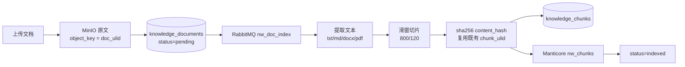

# AI 子系统设计

本文描述 NovelWorkbench 当前的 AI 子系统：模型网关、提示词与上下文装配、技能（Skill）、
无向量检索、流式协议、用量统计与安全边界。

代码位置：

| 模块 | 路径 |
| --- | --- |
| 模型网关 | `backend/internal/ai/client.go`、`usage.go`、`prompt.go`、`skills.go` |
| 对话业务 | `backend/internal/service/chat_service.go`、`chat_context.go` |
| 技能业务 | `backend/internal/service/skill_service.go`、`skill_reference_service.go` |
| 检索业务 | `backend/internal/service/knowledge_service.go`、`knowledge_manticore.go`、`knowledge_worker.go` |
| 供应商与用量 | `backend/internal/service/model_provider_service.go`、`model_usage_service.go` |
| 领域模型 | `backend/internal/domain/chat.go`、`skill.go`、`model_provider.go`、`model_usage.go`、`knowledge.go` |

## 1. 目标与边界

AI 能力围绕"单轮可控生成"设计：用户给出意图，系统装配最小充分上下文，模型流式产出，
作者显式决定是否采纳。

支持范围：

| 维度 | 内容 |
| --- | --- |
| 协议 | OpenAI 兼容（`openai`）、Anthropic 原生（`anthropic`） |
| 调用方式 | 非流式生成、流式生成、连通性探测、候选重排 |
| 业务能力 | 续写、生成大纲、润色、扩写、缩写、生成梗概、审稿、取名、设定问答、自由对话 |
| 检索能力 | Manticore 词法召回 + RRF 融合 + 可选对话模型重排 |

明确不做的事：

| 不做 | 依据 |
| --- | --- |
| 不做多轮 Agent 循环与工具调用 | 无工具注册/调度代码；一次 `ChatService.Send` 只发起一次模型调用 |
| 不做向量化 | 全仓无 embedding/向量服务；检索走 `queryManticoreHits` 词法 MATCH |
| 不自动把 AI 回复写入章节或设定 | AI 产出只落 `chat_messages`；插入正文由前端显式触发（`frontend/src/views/workspace/ChatMessage.vue` 的 `insert-to-chapter` 事件） |

## 2. 模型网关

### 2.1 组成

| 符号 | 文件 | 职责 |
| --- | --- | --- |
| `ai.Client` | `internal/ai/client.go` | 按 `ProviderSpec` 构造/复用 eino 对话组件，统一上报用量 |
| `ai.ProviderSpec` | 同上 | 一次调用所需的供应商能力快照（密钥明文只在内存） |
| `ai.UsageRecorder` | `internal/ai/usage.go` | 用量上报接口，由 `service.ModelUsageService` 实现 |
| `ai.AssembleContext` / `ai.RenderPrompt` / `ai.SystemPrompt` | `internal/ai/prompt.go` | 上下文装配、占位符渲染、系统提示词 |
| `ai.BuiltinSkills` | `internal/ai/skills.go` | 9 个内置技能定义（`BuiltinSkill`，与持久化结构解耦） |

`ProviderSpec` 字段：`ProviderULID`、`ProviderName`、`ProtocolCode`、`BaseURL`、`APIKey`、
`ChatModelName`、`Temperature`、`MaxTokens`、`Timeout`。密钥由 service 解密后传入，`ai` 包不接触存储。

### 2.2 缓存键与密钥失效

`ProviderSpec.cacheKey()`（`internal/ai/client.go`）格式：

```
providerULID | protocolCode | baseURL | chatModelName | sha256(apiKey)[:8] hex | temperature(%.2f) | maxTokens
```

密钥以 SHA-256 摘要前 8 字节入键而非明文：换密钥后摘要改变 → 缓存键改变 → 旧模型实例不再命中，
自动失效重建，避免用旧凭据继续调用或缓存明文密钥。

`Client.chatModelOf` 用 `sync.RWMutex` 保护 `map[string]*providerModels`；缓存项的 `chat` 为 nil 表示构造失败，
下次重新构造。

### 2.3 协议与 eino 组件

| 协议 | 常量 | eino 组件 | 备注 |
| --- | --- | --- | --- |
| OpenAI 兼容 | `ai.ProtocolOpenAI` = `"openai"` | `eino-ext/components/model/openai`（`einoOpenAI.NewChatModel`） | 兼容 `/v1/chat/completions` 的网关可用 |
| Anthropic 原生 | `ai.ProtocolAnthropic` = `"anthropic"` | `eino-ext/components/model/claude`（`einoClaude.NewChatModel`） | Anthropic Messages API；`Save` 时会剥掉 base_url 末尾的 `/v1`（SDK 自拼 `/v1/messages`） |

其他协议编码返回 `unsupported protocol: %s`（`buildChatModel`）。

### 2.4 默认参数

`internal/ai/client.go` 常量：

| 常量 | 值 | 生效位置 |
| --- | --- | --- |
| `defaultMaxTokens` | 2048 | `spec.MaxTokens <= 0` 时兜底 |
| `defaultTemperature` | 0.7 | `spec.Temperature <= 0` 时兜底（`service.temperatureOf` 亦以 0.7 兜底） |
| `defaultTimeout` | 120s | `spec.Timeout <= 0` 时兜底（`callTimeout`） |

配置文件 `backend/configs/config.yaml`：`ai.max_tokens: 2048`、`ai.temperature: 0.7`、`ai.timeout_sec: 120`，
三者经 `service.ModelProviderService.specOf` 写入 `ProviderSpec`。

### 2.5 四种调用

| 方法 | 行为 | 用量上报 |
| --- | --- | --- |
| `Generate(ctx, spec, messages)` | 非流式生成，返回 `*schema.Message` | 调用结束立即上报（成功/失败、token、耗时） |
| `Stream(ctx, spec, messages)` | 流式生成，首个分片到达即返回 `*schema.StreamReader[*schema.Message]` | 首包即记一次成功调用（usage 为空）；结束由调用方 `RecordStreamUsage` 补记真实 token |
| `Probe(ctx, spec)` | 连通性探测：一次极小对话（系统"只回复两个字"/用户"回复：通"），ctx 超时 30s，返回回复前 40 rune | 走 `Generate`，正常计入用量 |
| `Rerank(ctx, spec, query, candidates)` | 用对话模型对候选 ID 重排，严格 JSON `{"ids":[...]}` | 走 `Generate`，计入用量 |

### 2.6 超时的关键差异

| 方法 | 是否施加 `callTimeout` |
| --- | --- |
| `Generate` | **是**。`context.WithTimeout(ctx, callTimeout(spec))` 后调用 `chatModel.Generate(callCtx, …)`（`internal/ai/client.go`） |
| `Stream` | **否**。`chatModel.Stream(ctx, messages)` 直接透传调用方 ctx，ai 层不追加 deadline（`internal/ai/client.go`） |

`Stream` 的超时行为只由 eino 组件自身的 `Timeout`/`RequestTimeout` 配置决定；对话链路传入的是
请求 context（`chat_service.go` 的 `streamChat`），因此流式生成不会因 ai 层默认 120s 被整体掐断，
而是由客户端断开（`ctx.Done()`）终止。

### 2.7 重排解析

`parseRerankIDs`（`internal/ai/client.go`）严格解析：

- 回复以 ` ``` ` 开头 → 视为 markdown 包裹，报错。
- 取首个 `{` 到末个 `}` 之间的文本 `json.Unmarshal` 到 `{"ids": [...]}`。
- ID 必须属于候选集且不重复，否则整体报错。
- 模型未返回的候选 ID 按候选集原顺序补在尾部，保证不丢候选。

任一异常 → `Rerank` 返回候选原顺序并附说明（`rerun unavailable: …` / `rerun fallback: …`）。

## 3. 提示词与上下文装配

### 3.1 系统提示词

`ai.SystemPrompt(styleText)`：固定创作助手人设 + 要求（直接输出创作内容、不解释过程、
不擅自编造设定）+ 项目文风约束（`styleText` 非空时追加）。

### 3.2 上下文块优先级

`internal/ai/prompt.go` 常量：

| 优先级 | 常量 | 块标识（BlockKey） | 内容来源 |
| --- | --- | --- | --- |
| 100 | `PrioritySkill` | `skill` | 命中技能后渲染的提示词模板 |
| 90 | `PriorityCurrentChapter` | `current_chapter` | 当前编辑章节正文（引用章节列表首项） |
| 85 | `PrioritySkillRef` | `skill_reference` | 技能参考资料（关键词命中后注入，单技能上限 4000 字符） |
| 80 | `PriorityExplicitRef` | `ref_chapter` / `ref_doc` | @引用的章节正文 / @引用文档全文拼接 |
| 70 | `PriorityRAG` | `rag` | 知识库召回切片 |
| 60 | `PriorityChapterSummary` | `chapter_summary` | 当前章前后相邻章梗概 |
| 50 | `PriorityCharacter` | `character` / `lore` | 项目角色卡 / 项目设定条目（`note` 排除） |
| 40 | `PriorityHistory` | `history` | 注入的会话历史 |

### 3.3 装配规则

`ai.AssembleContext(blocks, budgetChars)`：

1. 按优先级降序**稳定排序**（`sort.SliceStable`），同优先级保持输入顺序 → 输出确定性。
2. 预算 `ai.ContextBudgetChars = 12000`（约 8k token 输入侧）；`AssembleContext` 按
   `len(ContentText)`（字节长度）累加判定，块间以 `\n\n` 分隔。
3. 超预算时**整块丢弃**（不截半句），从低优先级开始。
4. 空内容块直接跳过，不占预算、不计入丢弃列表。
5. 返回被丢弃的 `BlockKey` 列表；`chat_service.go` 据此打 `上下文块超出预算被丢弃` 告警。
6. 模板占位符 `{{key}}`（`ai.RenderPrompt`）：命中即替换，缺失键替换为**空串**，不留模板残渣。

块内容格式（`buildContextBlocks`，`internal/service/chat_context.go`）：

| 块 | 文本格式 |
| --- | --- |
| `current_chapter` | `【当前章节】{章节名}\n{正文}` |
| `ref_chapter` | `【引用章节】{章节名}\n{正文}` |
| `ref_doc` | `【引用文档】{文档名}\n{全文}` |
| `rag` | `【知识库召回】` + 每条 `\n《{文档名}》{切片文本}` |
| `chapter_summary` | `【章节梗概】\n` + 各梗概换行拼接 |
| `character` | `【角色卡】` + 每条 `\n姓名：{名}｜性格：{性格}｜背景：{背景}` |
| `lore` | `【设定条目】` + 每条 `\n设定名：{名}｜内容：{内容}` |
| `history` | `【对话历史】` + 每条 `\n{用户\|助手}：{正文}` |

### 3.4 单项截断上限

`internal/service/chat_context.go`：

| 常量 | 值 | 作用 |
| --- | --- | --- |
| `characterPersonalityRunes` | 120 | 角色性格 |
| `characterBackgroundRunes` | 200 | 角色背景 |
| `loreContentRunes` | 300 | 设定条目内容 |
| `sessionNameRunes` | 20 | 会话缺省名取首条消息前 20 rune |

`service.truncateRunes` 超长时追加省略号 `…`（角色性格、背景、设定内容、重排候选文本均走该函数）。
`ai.truncateRunes` 不加省略号，仅用于探测回显截断（40 rune）。

### 3.5 技能模板渲染与技能块

`buildContextBlocks` 在 `input.SkillTemplate != ""` 时：

- 先用 `ai.AssembleContext(blocks, ai.ContextBudgetChars)` 装配其余块，得到 `context` 占位符的值。
- `chapter_content` = `joinChapterContent` 拼接的引用章节正文（当前章在前），再按 `ai.ContextBudgetChars` 截断。
- `user_input` = 解析后的用户正文（技能参数）。
- 渲染结果作为 `skill` 块（优先级 100）**置于块列表首位**返回；最终指令文本 = 渲染结果本身。

技能块的保留性：它以 100 的最高优先级参与排序，排在装配队首，是最后一个可能被丢弃的块；
只有当渲染结果单独就超过 12000 字符预算时才会被丢弃并出现在 `dropped_keys` 中。

文本重复说明（可从 `buildContextBlocks` + `chat_service.go` 直接推出）：`{{context}}` 的内容除出现在
技能模板内外，其余块仍以独立块形式参与最终装配，因此上下文文本在最终提示词中出现两次
（一次在 `【上下文】` 消息内，一次在最终指令消息内），并各自占用预算。

### 3.6 历史选取

`selectHistoryMessages(messages, refMessageULIDs, n)`：

- 主干：最近 `n` 条（旧→新）；`n <= 0` 时不注入常规历史。
- 显式引用的消息必注入（不受 `n` 限制），去重后按时间旧→新追加到尾部。
- `n` 的解析顺序（`resolveHistoryLimit`）：请求 `history_count` > 应用配置 `chat_history_count`（默认 5，`setting_service.go` 播种）> 全局配置 `ai.history_count`（默认 5）。

## 4. 消息序列成型

`buildChatMessages(styleText, contextText, instructionText, historyList)`
（`internal/service/chat_context.go`）：

| 顺序 | 角色 | 内容 |
| --- | --- | --- |
| 1 | `schema.System` | `ai.SystemPrompt(styleText)` |
| 2 | `schema.User` | `【上下文】\n{contextText}`；**contextText 为空时整条省略** |
| 3 | 按历史顺序 | 逐条历史消息，角色由 `chatRoleOf` 映射 |
| 4 | `schema.User` | 最终指令（自由对话为用户正文；命中技能为渲染后的模板） |

角色映射（`chatRoleOf`）：`assistant` → `schema.Assistant`；`system` → `schema.System`；
其余（含 `user` 与未知值）→ `schema.User`。

## 5. 技能（Skill）

### 5.1 数据模型

技能 = 作用域 + 提示词模板 + 变量声明 + 参考资料，落在两张表：

| 表 | 关键列 | 说明 |
| --- | --- | --- |
| `skills` | `skill_ulid`（`SKL_`）、`skill_code`、`skill_name`、`scope_code`、`project_ulid`、`category_code`、`description_text`、`prompt_template`、`variable_spec_json`、`enabled_flag`、`builtin_flag`、`sort_order` | 作用域 `global` / `project`；同编码项目技能覆盖全局技能 |
| `skill_references` | `ref_ulid`（`SKR_`）、`skill_ulid`、`ref_name`、`ref_text`、`keyword_list`、`sort_order` | 关键词为空表示总是注入 |

对应 `domain.SkillDO` / `domain.SkillReferenceDO`，VO/DTO 见 `domain/skill.go`。

### 5.2 9 个内置技能

`ai.BuiltinSkills()`（`internal/ai/skills.go`）返回 `[]ai.BuiltinSkill`，播种时由
`service.SkillService.SeedDefaults` 落库为 `scope_code='global'`：

- `internal/ai/skills_craft.go`：进阶方法论类（长篇架构 / 章末钩子 / 对白打磨 / 节奏体检 / 世界观规则卡 / 主线守门 6 个）。
| skill_code | 名称 | category_code | 用途 | 使用占位符 | sort_order |
| --- | --- | --- | --- | --- | --- |
| `continue` | 续写 | `write` | 依据当前章节与上下文续写下一段正文 | `{{user_input}}`、`{{chapter_content}}`、`{{context}}` | 10 |
| `outline` | 生成大纲 | `outline` | 根据需求生成章节大纲或情节梗概 | `{{user_input}}`、`{{context}}` | 20 |
| `polish` | 润色 | `revise` | 润色选中文字：更流畅、更有画面感 | `{{user_input}}`、`{{chapter_content}}` | 30 |
| `expand` | 扩写 | `revise` | 扩写选中文字：补充细节与心理描写 | `{{user_input}}`、`{{chapter_content}}` | 40 |
| `condense` | 缩写 | `revise` | 缩写选中文字：保留关键信息更紧凑 | `{{user_input}}`、`{{chapter_content}}` | 50 |
| `summary` | 生成梗概 | `outline` | 为章节或选中文字生成一句话到一段话的梗概 | `{{user_input}}`、`{{chapter_content}}` | 60 |
| `review` | 审稿 | `revise` | 审阅章节：指出逻辑、节奏、一致性问题 | `{{user_input}}`、`{{chapter_content}}`、`{{context}}` | 70 |
| `name` | 取名 | `setting` | 为角色、地名、功法等生成候选名字 | `{{user_input}}`、`{{context}}` | 80 |
| `setting` | 设定问答 | `setting` | 基于世界观设定与知识库回答设定问题 | `{{user_input}}`、`{{context}}` | 90 |
| `architect` | 长篇架构 | `outline` | 六层搭建（卖点 / 世界观 / 主线 / 人物 / 分卷 / 章纲）并指出结构风险 | `{{context}}`、`{{user_input}}` | 170 |
| `hook` | 章末钩子 | `outline` | 按钩子十型判定章末类型，三项打分并给替换收尾句 | `{{chapter_content}}`、`{{user_input}}` | 180 |
| `dialogue` | 对白打磨 | `revise` | 逐段判信息增量 / 声口区分 / 潜台词 / 权力关系，标出可删对白 | `{{chapter_content}}`、`{{user_input}}` | 190 |
| `pacing` | 节奏体检 | `review` | 标注推进 / 铺垫 / 爆发 / 喘息，定位塌陷与爽点间隔 | `{{chapter_content}}`、`{{user_input}}` | 200 |
| `worldrule` | 世界观规则卡 | `setting` | 把设定改写成「规则 / 边界 / 代价 / 叙事用途」四栏卡，缺项标待补 | `{{context}}`、`{{user_input}}` | 210 |
| `mainline` | 主线守门 | `review` | 判定本章推进 / 原地踏步 / 跑题，引原文为证并给处理建议 | `{{chapter_content}}`、`{{user_input}}` | 220 |

### 5.3 解析与覆盖优先级

`ChatService.resolveSkill`（`internal/service/chat_service.go`）委托 `SkillService.Resolve`：

1. 请求体 `skill_code` 非空 → 直接按编码解析（先项目技能、后全局技能）。
2. `skill_code` 为空 → `parseSlashToken` 解析正文首 token：
   - 正文 trim 后以 `/` 开头 → 取到首个空白符为止的 token 作为编码；
   - 命中启用中的技能 → `remainder_text` = 去掉命令后的正文；
   - 未命中（编码不存在、已停用、或正文不以 `/` 开头）→ 技能编码为空，**正文原样保留**，
     按自由对话处理。
3. `SkillService.resolveByCode`：`project_ulid` 非空时先查
   `(project, code)` 且启用 → 命中即用；否则回退 `(global, code)`；都没命中返回
   "技能不存在或已停用: code"。

命中的技能随 `{{user_input}}`（`remainder_text`）、`{{chapter_content}}`（当前章）、
`{{context}}`（其余上下文装配文本）与自声明变量一起渲染；参考资料作为独立
`skill_reference` 块注入（优先级 85）。

### 5.4 变量声明与校验

- 变量声明存 `variable_spec_json`（`SkillVariableDO` 数组）：
  `variable_name`、`variable_label`、`default_value`、`required_flag`、`description_text`。
- 取值优先级：显式传入 > 声明缺省值 > 空串；`required_flag` 且无值时进 `missing_list`。
- `resolveSkillVariables` 恒注入 `skill_code` 与 `user_input` 两个隐含变量。
- 保存时 `validateSkillTemplate` 用 `ai.TemplatePlaceholders` 校验：模板中出现的占位符
  必须是 `user_input` / `chapter_content` / `context` / `skill_code` 或已声明变量，否则
  `ERR_INVALID_PARAM`。
- 对话链路渲染发现 `missing_list` 非空时直接拒绝（`SkillRenderDTO` 阶段），避免把空值发给模型。

### 5.5 参考资料命中规则

`SkillService.matchReferences`（`internal/service/skill_reference_service.go`）：

1. 按 `sort_order` 顺序遍历该技能的全部参考资料；
2. 关键词列表为空 → 总是命中；否则任一关键词出现在正文（或用户输入）中即命中；
3. 命中后按 `【资料名】\n正文` 拼接，累计字符超过 4000 时停止；
4. 结果作为 `skill_reference` 块进入上下文装配（优先级 85，高于显式引用、低于当前章节）。

### 5.6 播种与生命周期

`SkillService.SeedDefaults`（幂等）：逐个内置技能按 `(global, "", skill_code)` 查缺补插；
已存在则跳过，**不覆盖作者对模板/变量的定制**。插入时 `enabled_flag = true`、`builtin_flag = true`。

- 内置技能不可删除：`SkillService.Delete` 对 `builtin_flag = true` 返回"内置技能不允许删除，可停用"。
- 内置技能可停用、可改模板/变量/参考资料。
- 内置技能的 `skill_code` 与 `scope_code` 不可改（`Save` 显式校验）。
- 删除技能时级联清理其参考资料（`DeleteReferencesBySkill`）。
- 同作用域内编码唯一由服务层保证（先按 `(scope, project, code)` 查重再写）。

## 6. 无向量检索设计

### 6.1 设计前提

系统只接入 OpenAI / Anthropic 对话协议，无 embedding 服务，因此检索链路由词法信号、
结构化权威数据与对话模型重排组成：

| 原则 | 落地 |
| --- | --- |
| 权威原文在 PostgreSQL 与 MinIO，检索索引是可重建投影 | 索引可从 `knowledge_chunks` 全量回灌（`rebuildManticoreIndex`） |
| CJK ngram 解决中文子串与专名匹配 | Manticore 表 `ngram_len='1' ngram_chars='cjk'` |
| 对话模型只在候选有限时参与重排，失败回退 | `maybeRerank` 全链路 fail-open |
| 检索过程可解释 | `domain.KnowledgeSearchTrace` 输出查询词、候选数、选中 ID、通道、重排说明 |

### 6.2 索引链路



关键实现点：

| 环节 | 位置 | 说明 |
| --- | --- | --- |
| 上传 | `KnowledgeService.Upload` | 原文写 MinIO（对象键 = `doc_ulid`），文档行落库 `pending`，投递 `doc_index` 任务；建表失败时回滚 MinIO 对象 |
| 任务投递 | `enqueueIndexJob` | 先写 `jobs` 行（`queued`），再 `mqRepo.PublishIndexJob`；投递失败置 `failed` |
| 文本提取 | `extractDocumentText` | txt/md 直读并剥 UTF-8 BOM；docx 读 `word/document.xml` 去标签还原实体；pdf 用 `ledongthuc/pdf` 取纯文本 |
| 切片 | `chunkText` | 见 6.3 |
| 内容哈希 | `contentHashOf` | `sha256(text)` 十六进制 |
| 增量复用 | `indexDocument` | 与既有切片的 `content_hash` 相同且未被占用 → **复用原 `chunk_ulid`**，否则新建 `CHK_` ULID |
| 落库 | `repo.WithTx` | 同一事务内先删该文档旧切片再插新切片 |
| 索引同步 | `syncManticoreChunks` | 先按 `doc_ulid` 删除该文档全部行，再逐条 INSERT |
| 状态 | `UpdateDocument` | 置 `indexed` 并写 `chunk_count`、`total_token_count` |

失败处理：`handleIndexJob` 内部最多重试 `maxIndexRetryCount = 3` 次（重试间隔 = attempt 秒），
仍失败则文档置 `failed` 并记录原因（截断至 500 rune），消息 ack（毒消息不重投）；
文档已删除的滞留消息直接 ack。

### 6.3 切片算法

`chunkText(text, chunkSize, chunkOverlap)`（`internal/service/knowledge_worker.go`）：

- 默认参数 `chunk_size = 800`、`chunk_overlap = 120`（`backend/configs/config.yaml`，`app` 段）。
- 以 **rune** 为单位切分（`[]rune(trimmed)`）。
- 窗口长度 `chunkSize`；步进 `chunkSize - overlap`。
- 边界优先：窗口内最后一个句末符号（`\n`、`。`、`！`、`？`、`；`、`!`、`?`、`;`）位置 > `chunkSize/2`
  时在该处断开；否则硬切到窗口末尾（`lastBoundary` 返回 0 表示无边界）。
- 重叠回退：若 `end - overlap <= start`（重叠过大），下一窗起点直接取 `end`。
- 空片段丢弃；文本整体为空返回 nil。

### 6.4 表结构与启动迁移

`ensureManticoreSchema`（`internal/service/knowledge_manticore.go`）：

```sql
CREATE TABLE IF NOT EXISTS nw_chunks(
  chunk_ulid string, doc_ulid string, project_ulid string, chunk_text text
) charset_table='non_cjk,0..9,A..Z->a..z,a..z' ngram_len='1' ngram_chars='cjk'
```

表名来自 `manticore.table_chunks`（默认 `nw_chunks`，`manticoreTableName` 为空时回退 `nw_chunks`）。
启动时 `SHOW CREATE TABLE` 检查结果是否含 `ngram_len`：不含则 `DROP TABLE` → 重建 → `rebuildManticoreIndex`
从 `knowledge_chunks` 回灌全部切片（`KnowledgeWorker.Run`）。表初始化或回灌失败只记告警，
检索链路降级，不阻断服务启动。

### 6.5 查询构造与双通道

`extractQueryTerms`：CJK 连续串按 **2-gram** 切分（"主角的名字" → 主角/角的/的名/名字），
拉丁串按字母数字连续段切分并转小写，去标点、去重。抽取结果为空时退化为整串查询。

`queryManticoreHits`（`internal/service/knowledge_manticore.go`）：

| 通道 | MATCH 表达式 | 说明 |
| --- | --- | --- |
| `term` | `"词1" \| "词2" \| …` | 逐词 OR，召回面广 |
| `phrase` | `"完整查询文本"` | 整串匹配，精度高 |

两通道 SQL 均带 `project_ulid = '…'` 过滤；传了 `doc_ulid_list` 时追加 `AND doc_ulid IN (…)`；
`ORDER BY score DESC LIMIT topK`，`score` 取 Manticore `WEIGHT()`（BM25 相关度）。

### 6.6 融合与重排

`KnowledgeService.SearchWithTrace`：

1. 模式归一化：`hybrid` 走双通道，其余按 `keyword` 处理（`normalizeSearchMode`）。
2. `keyword` 模式：只跑 `term` 通道，直接按 Manticore 得分排序，再进可选重排。
3. `hybrid` 模式：跑 `term` + `phrase` 两通道；单通道失败降级到另一条并记告警；
   两通道都失败则返回存储错误。
4. RRF 融合（`fuseSearchResults`，常数 `rrfRankConstant = 60.0`）：

   ```
   score = Σ 1/(60 + rank)      # rank 从 1 开始，每个通道各自计
   ```

   同一切片跨通道命中得分累加，`source_mode` 置 `hybrid`。融合时取 **topK + 8** 条作为候选，
   为重排留出余量。
5. 可选重排（`maybeRerank`）：
   - 候选摘要 = `chunk_ulid` + 截断至 **160 rune** 的切片文本；
   - 超时 **8s**（`context.WithTimeout(ctx, 8*time.Second)`）；
   - 要求模型返回严格 JSON `{"ids":["CHK_x",…]}`；
   - 重排成功后命中项 `source_mode` 置 `hybrid`。
6. 最终取 TopK。默认条数由 `KnowledgeService.resolveRAGTopK` 解析：
   请求 `top_k_count` > 应用配置 `rag_top_k`（默认 6）> 全局配置 `NW_APP_RAG_TOP_K`。

重排 prompt 明确要求"仅输出严格 JSON、按最相关到最不相关排列、只使用给定ID、不要输出其他文字"。

### 6.7 降级路径

重排的三级 fail-open（`maybeRerank` / `Client.Rerank`）：

| 级别 | 触发条件 | 行为 | `trace.rerank_note` |
| --- | --- | --- | --- |
| 1 | 无候选、`aiClient` 或 `providerSvc` 未装配 | 直接按检索得分截断 TopK | "未配置重排模型，按检索得分排序" |
| 2 | `providerSvc.ChatSpec` 取规格失败 | 跳过重排，按检索得分截断 TopK | "重排跳过：{err}" |
| 3 | 模型调用失败 / JSON 解析失败 / ID 非法 | 沿用原候选顺序 | "rerun unavailable: …" / "rerun fallback: …" |

检索整体降级：

| 异常 | 行为 |
| --- | --- |
| Manticore 不可用 | `searchKeywordChannel` 返回 `ERR_STORAGE`；AI 对话链路中 `loadContextInput` 捕获后降级为空上下文（记告警），不阻断生成 |
| 单通道失败 | 降级到另一通道（`hybrid` 模式） |
| 文档未索引完成（`pending`/`indexing`） | 该文档切片未入 Manticore，不参与召回；文档状态前端可见 |
| 查询无命中 | 上下文不含 `rag` 块，模型仍基于章节与设定回答 |
| 引用文档读取失败 | `loadDocFullText` 报错，对话直接失败（显式引用是用户明确要求，不静默忽略） |

## 7. 流式协议

### 7.1 事件结构

`domain.ChatStreamEventDTO`（`backend/internal/domain/chat.go`）：

| 字段 | 类型 | 说明 |
| --- | --- | --- |
| `seq` | int64 | 事件序号，`chatEventWriter.emit` 自增，**从 1 开始** |
| `event_type` | string | `chunk` / `done` / `error` |
| `session_ulid` | string | 会话 ULID |
| `message_ulid` | string | 助手消息 ULID |
| `content_text` | string | 增量文本（`chunk`）或完整回复（`done`） |
| `reference_list` | []KnowledgeChunkVO | RAG 召回依据，仅 `done` 携带 |
| `error_message` | string | 错误说明，仅 `error` 携带 |

事件类型常量（`domain/chat.go`）：`StreamEventChunk = "chunk"`、`StreamEventDone = "done"`、`StreamEventError = "error"`。

### 7.2 事件序列

| 阶段 | 事件 | 说明 |
| --- | --- | --- |
| 流启动失败 | `error` | `streamChat` 中 `aiClient.Stream` 返回错误 → 发 `AI 生成启动失败：{err}` |
| 生成中 | `chunk`（多次） | 每个非空分片一条；空内容分片跳过 |
| 生成中异常 | `error` | 非 EOF 错误 → `AI 生成失败，请稍后重试` |
| 助手消息落库失败 | `error` | `回复保存失败，请重试` |
| 正常结束 | `done` | 携带完整回复文本与 `reference_list`（RAG 召回切片） |

### 7.3 错误前 / 错误后

边界由 API 层 `sseChatWriter.started` 判定（`backend/internal/api/chat_api.go`）：

| 情况 | 表现 |
| --- | --- |
| **流开始前失败**（鉴权、技能解析、会话校验、历史读取、上下文装配、供应商不可用） | 返回 error，响应头尚未提交 → API 层输出 **JSON 错误包络** |
| **流开始后失败**（已写出 chunk / ping / error 事件，HTTP 状态已为 200） | 只能随 SSE 下发 `error` 事件；同时记服务端日志；不再输出 JSON 包络 |

`ChatService.Send` 的约定与之一致：流开始前的失败返回 error，流开始后的失败返回 nil（只发 error 事件）。

### 7.4 心跳与代理配置

| 项 | 值 | 位置 |
| --- | --- | --- |
| 心跳间隔 | 15s（`chatPingInterval`），每个非空 chunk 后重置 | `internal/service/chat_service.go` |
| 心跳格式 | SSE 注释行 `: ping\n\n` | `sseChatWriter.Ping` |
| SSE 响应头 | `Content-Type: text/event-stream; charset=utf-8`、`Cache-Control: no-cache`、`X-Accel-Buffering: no` | `sseChatWriter.begin` |
| 事件格式 | `data: {json}\n\n` | `sseChatWriter.Event` |
| nginx | `/api/` 段 `proxy_buffering off;`、`proxy_read_timeout 3600s;` | `frontend/nginx.conf.template` |
| 服务写超时 | `write_timeout_sec: 0`（不限，SSE 长连接） | `backend/configs/config.yaml` |

客户端断开 → 请求 context 取消 → `streamChat` 返回 `finish(false)` → **不落库助手消息**
（用户消息保留对话痕迹），并通过 `RecordStreamUsage` 补记用量。

### 7.5 token 估算

`estimateTokenCount(inputRunes, outputRunes) = int((inputRunes + outputRunes) * 0.75)`，
即 **rune 数 × 0.75**。用于：

- 用户消息 `token_used_count`：`estimateTokenCount(rune(content), 0)`。
- 助手消息 `token_used_count`：`estimateTokenCount(消息序列总 rune, 回复 rune)`。

流式结束时若有供应商返回的 `ResponseMeta.Usage` 则优先采用真实值，否则用上述估算（`streamChat` 的 `finish`）。

## 8. 用量与可观测性

### 8.1 记录内容

`ai.UsageRecord`（`internal/ai/usage.go`）：`ProviderULID`、`ProviderName`、`ModelName`、
`CallTypeCode`（当前仅 `chat`）、`SuccessFlag`、`PromptTokens`、`CompletionTokens`、`LatencyMs`。

调用类型常量：`ai.CallTypeChat = "chat"`（与 `domain.ModelCallTypeChat` 对齐）。

### 8.2 内存缓冲与落库

`service.ModelUsageService`：

| 环节 | 说明 |
| --- | --- |
| 缓冲键 | `statDate \| providerULID \| modelName \| callTypeCode`（`RecordUsage`） |
| 累加字段 | `call_count`、`success_count`、`fail_count`、`prompt_tokens`、`completion_tokens`、`total_tokens`、`latency_ms_sum` |
| 刷新周期 | `usageFlushInterval = 5s`（`flushLoop`），ctx 取消时做最后一次落库 |
| 落库 | `usageRepo.UpsertIncrement`，按 `uk_mus_dim`（`stat_date`, `provider_ulid`, `model_name`, `call_type_code`）冲突累加计数与 token，并刷新 `provider_name` 快照 |
| 失败处理 | 落库失败仅告警，缓冲丢弃（避免无限增长） |

统计日期取写入时刻 `time.Now().Format("2006-01-02")`。

### 8.3 总览聚合

`ModelUsageService.Overview`：

| 聚合 | 来源 | 说明 |
| --- | --- | --- |
| 按日趋势 | `usageRepo.AggregateDaily` | 升序返回；区间内缺失日期**补零**（`fillUsageDaily`），保证图表连续 |
| 按供应商 | `usageRepo.AggregateByProvider` | `ModelUsageGroupVO`：调用数、失败数、token 合计、平均延迟、成功率 |
| 按模型 | `usageRepo.AggregateByModel` | 同上 |
| 区间总计 | 累加 `daily_list` | `call_count_total`、`fail_count_total`、`total_tokens_total` |
| 平均延迟 | `weightedAvgLatency` | 按每日调用数加权的平均延迟，**整数运算**避免浮点漂移：`Σ(avg_latency_ms × call_count) / Σ(call_count)` |
| 成功率 | `Overview` | `(call_count_total - fail_count_total) / call_count_total`（0-1） |

查询区间：`resolveUsageRange`，缺省近 **14 天**（`to_date - 13` 天）；非法日期回退默认；起止倒置自动纠正。
查询前先 `Flush`，避免刚发生的调用看不到。

## 9. 安全与边界

| 项 | 实现 | 位置 |
| --- | --- | --- |
| 密钥加密存储 | AES-256-GCM 封存（`pkg.SealSecret` / `pkg.OpenSecret`），密钥材料取 JWT 密钥；`api_key_cipher` 列 JSON 序列化标记为 `"-"` 不外泄 | `backend/internal/pkg/secret.go`、`domain/model_provider.go` |
| 密钥掩码 | `maskSecret`：长度 ≤10 → `****`；否则保留前 4 位 + `***` + 后 3 位。解密失败显示 `****（无法解密，请重新填写）`。API 只返回 `api_key_masked` 与 `api_key_configured`，不返回密文或明文 | `model_provider_service.go` |
| 明文生命周期 | 密钥仅在 `specOf` 解封后存在于内存中的 `ProviderSpec.APIKey`；`ai` 包不接触存储 | `model_provider_service.go`、`internal/ai/client.go` |
| 供应商写权限 | 供应商 `save`/`delete`/`test` 需 `system:model:manage`（`domain.PermModelManage`）；`capability`/`chat_options`/`list` 对所有登录用户开放 | `backend/internal/api/router.go` |
| 用量读取权限 | `/model/usage/overview` 需 `system:usage:read`（`domain.PermUsageRead`） | 同上 |
| 项目隔离检索 | Manticore 查询恒带 `project_ulid` 过滤；检索入口先 `mustOwnProject` 校验项目归属 | `knowledge_manticore.go`、`knowledge_service.go` |
| 引用章节归属 | 引用章节必须 `ProjectULID` 等于当前项目，否则"引用章节不存在" | `chat_context.go` |
| 引用文档归属 | 文档须属于当前项目或为全局库（`project_ulid = "0"`），否则"无权引用该文档" | `chat_context.go` |
| 引用消息归属 | 显式引用的消息必须属于当前会话，去重保序，否则"引用消息不存在或不属于该会话" | `chat_service.go` |
| 会话归属 | 会话必须属于当前用户且项目匹配，否则 403 / 参数错误 | `chat_service.go` |
| 私人笔记排除 | `lore_type_code == "note"` 的设定条目不进 AI 上下文（`formatLoreBlock` 跳过，且无可用条目时整块不生成） | `chat_context.go` |
| 显式插入 | AI 产出只写入 `chat_messages`；插入章节由用户在前端显式点击"插入到章节" | `chat_service.go`、`frontend/src/views/workspace/ChatMessage.vue` |
| 供应商默认唯一 | 置默认前先 `ClearDefault`，默认供应商不可删除 | `model_provider_service.go` |

## 12. 当前 AI 工作台行为（2026-11）

- 写作台 AI 面板默认把**当前章节**并入 `ref_chapter_ulid_list`；用户可在「上下文」开关中关闭。显式 @ 引用的章节与当前章会去重。
- 上下文装配顺序不变：当前章节 → 显式引用章节 → 引用文档 → RAG 召回 → 相邻章节摘要 → 角色卡 → 设定条目（`note` 类型不注入）→ 对话历史。
- 快捷指令：续写（`/continue`）、一致性检查、三个情节走向；点击后只填入输入框与技能徽标，不直接消耗调用。
- 知识库重排成功时 `trace.rerank_note` 返回中文「已由对话模型重排」，便于界面直接展示。
- 系统仍不接入向量模型；知识库召回由 Manticore 关键词/短语通道、RRF 融合与对话模型重排组成。
