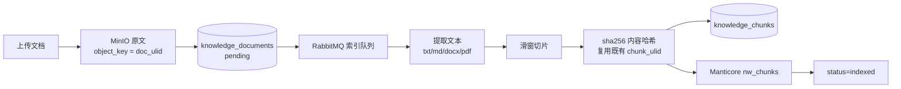

# AI 子系统设计

本文描述 NovelWorkbench 的 AI 能力：模型网关、上下文装配、技能资产、无向量检索、流式协议与用量统计。

## 1. 定位与边界

AI 能力按「单轮可控生成」设计：用户给出意图，服务端装配最小充分上下文，模型流式产出，作者显式决定是否采纳。

| 维度 | 内容 |
| --- | --- |
| 协议 | OpenAI 兼容（`openai`）、Anthropic 原生（`anthropic`） |
| 调用形态 | 非流式生成、流式生成、连通性探测、候选重排 |
| 业务能力 | 续写正文、搭建大纲、润色文字、章节梗概、去 AI 味、章节质检、开篇体检、伏笔台账 |
| 检索 | Manticore CJK ngram 词法召回 + RRF 融合 + 可选对话模型重排 |

明确不做：

| 不做 | 原因 |
| --- | --- |
| 多轮 Agent 循环 / 工具调用 | `ChatService.Send` 每次请求只发起一次模型调用，无工具注册与调度 |
| 向量化检索 | 无 embedding 服务；检索完全基于词法通道与结构化数据 |
| AI 产出自动写入正文 | AI 结果只落 `chat_messages`，插入章节由前端显式触发 |

## 2. 模型网关

### 2.1 组成

| 符号 | 位置 | 职责 |
| --- | --- | --- |
| `ai.Client` | `backend/internal/ai/client.go` | 按 `ProviderSpec` 构造/复用 eino 对话组件，统一上报用量 |
| `ai.ProviderSpec` | 同上 | 单次调用所需供应商快照；`APIKey` 明文只存在于内存 |
| `ai.UsageRecorder` | `backend/internal/ai/usage.go` | 用量上报接口，由 `service.ModelUsageService` 实现 |
| `ai.AssembleContext` / `ai.RenderPrompt` / `ai.SystemPrompt` / `ai.TemplatePlaceholders` | `backend/internal/ai/prompt.go` | 上下文装配、模板渲染与校验、系统提示词 |
| `ai.BuiltinSkills` / `ai.BuiltinPromptProfiles` | `backend/internal/ai/builtin_assets.go` + `domain_<域>.go` | 12 个流程域的档案与 24 个技能定义、下线集合与内容指纹，与持久化结构解耦 |

`ProviderSpec` 字段：`ProviderULID`、`ProviderName`、`ProtocolCode`、`BaseURL`、`APIKey`、`ChatModelName`、`Temperature`、`MaxTokens`、`Timeout`。密钥由 `ModelProviderService.specOf` 解密后传入，`ai` 包不接触存储。

### 2.2 实例缓存与密钥失效

`ProviderSpec.cacheKey()` 拼装：

```
providerULID | protocolCode | baseURL | chatModelName | sha256(apiKey)[:8] | temperature(%.2f) | maxTokens
```

密钥以摘要入键而非明文：更换密钥后键变化，旧实例自然失效，不会用旧凭据继续调用。
`Client.chatModelOf` 用 `sync.RWMutex` 保护 `map[string]*providerModels`；缓存项 `chat == nil` 视为构造失败，下次重建。

### 2.3 协议适配

| 协议 | 常量 | eino 组件 | 备注 |
| --- | --- | --- | --- |
| OpenAI 兼容 | `ai.ProtocolOpenAI` = `openai` | `eino-ext/components/model/openai` | 适配 `/v1/chat/completions` 网关 |
| Anthropic 原生 | `ai.ProtocolAnthropic` = `anthropic` | `eino-ext/components/model/claude` | `base_url` 末尾的 `/v1` 在保存时被剥离，SDK 自行拼接 `/v1/messages` |

其他协议编码在 `buildChatModel` 返回 `unsupported protocol`。

默认参数（`internal/ai/client.go` 常量，`spec` 缺省时兜底）：`defaultMaxTokens = 2048`、`defaultTemperature = 0.7`、`defaultTimeout = 120s`。

### 2.4 五种调用

| 方法 | 行为 | 用量上报 |
| --- | --- | --- |
| `Generate` | 非流式生成，返回 `*schema.Message` | 结束即上报成功/失败、token、耗时 |
| `Stream` | 首片到达即返回 `*schema.StreamReader` | 首包记一次成功调用；流结束由 `RecordStreamUsage` 补记真实 token |
| `Probe` | 连通性探测（系统「只回复两个字」+ 用户「回复：通」，30s 超时），返回前 40 rune | 走 `Generate`，正常计费 |
| `Rerank` | 对话模型按候选 ID 重排，严格 JSON | 走 `Generate`，正常计费 |
| `GenerateBootstrapPlan` | 开书方案：流式累积全文后一次性解析 JSON | 走 `Stream`，流结束补记 token |

`GenerateBootstrapPlan`（`ai/bootstrap.go`）不用 `Generate`：结构化长输出（书名 + 卖点 + 卷章 + 角色 + 设定）在非流式下会长时间不返回响应头，网关 120s 首包超时必然打断。改成流式累积后，首包很快到达，总时长由调用方 `ctx` 控制（`bootstrapPlanTimeout = 300s`），`MaxTokens` 提到 8000 以容纳完整方案。

超时分层（关键：推理模型思考常超过 2 分钟，任何「整体请求超时」都会把长流拦腰切断）：

| 环节 | 约束 | 说明 |
| --- | --- | --- |
| HTTP 客户端 | 不设 `http.Client.Timeout` | 该字段含读 body，会把长流切断 |
| 连接与首包 | `newStreamHTTPClient(timeout)`：拨号 15s、TLS 10s、`ResponseHeaderTimeout` = 供应商超时 | 首包迟迟不来才判失败 |
| `Generate` | 是（`context.WithTimeout`） | 单次非流式调用有硬上限 |
| `Stream` | 否（仅 `ResponseHeaderTimeout`） | 生成时长由客户端 `ctx` 控制 |
| 流空闲看门狗 | `chatStreamIdleTimeout = 6min` | 连续无任何分片才判网关已断，经 `error` 事件告知 |

同一 HTTP 客户端被 Generate / Stream / Probe / Rerank 共用，连接池上限 `MaxIdleConns=32`、`MaxIdleConnsPerHost=8`。

### 2.5 重排解析

`parseRerankIDs` 的规则：

1. 回复以 Markdown 代码围栏开头 → 直接判失败（拒绝包裹输出）。
2. 取首个 `{` 到末个 `}` 之间文本，`json.Unmarshal` 为 `{"ids":[...]}`。
3. ID 必须属于候选集且不重复，否则整体失败。
4. 模型未返回的候选按原顺序补在尾部，保证不丢候选。

失败即 fail-open：`Rerank` 返回原顺序并给出说明（`rerun unavailable: …` / `rerun fallback: …`）。

## 3. 上下文装配

### 3.1 系统提示词与提示词档案

系统提示词由两层组成，`ai.ComposeSystemPrompt(profileText, styleText)` 负责组合：

1. **档案层（身份与底线）**：`PromptProfileService.SystemPromptOf` 解析顺序为「请求显式 `prompt_profile_ulid` → 启用的全局默认档案（排序号最小）→ `ai.SystemPrompt("")` 内置兜底」。显式档案必须启用，且为全局档案或属于当前项目，否则视为未指定。
2. **项目层（文风约束）**：`projects.style_text`，非空时以「本项目文风约束」段落追加在档案之后。

分工约定：档案写「你是谁、什么绝不写」（长篇连载作者 / 责任编辑 / 故事架构师 / 去 AI 味修订 / 设定守门人），技能写「这一次做什么」。二者同时下发，互不覆盖。

内置档案按「流程域 = 1 份档案 + 2 个技能」组织，完整矩阵见 [skills.md](skills.md)。

| 档案编码 | 名称 | 定位 |
| --- | --- | --- |
| `novelist` | 长篇连载作者 | 默认档案：只交稿不解释、具体优先、章末留钩 |
| `architect` | 故事架构师 | 六层结构自上而下、每层给最薄弱处与补齐顺序 |
| `stylist` | 文字打磨师 | 只改怎么说不动说什么、事实锁与声线锁 |
| `deai` | 去 AI 味修订 | 三层痕迹扫描、命中必引原句、区分豁免与边缘 |
| `editor` | 连载责任编辑 | 先判后改、P0/P1/P2 分级、给可直接替换的改法 |
| `continuity` | 设定守门人 | 只依据给定上下文作答、缺失即明说、冲突给三种收敛方案 |
| `final_editor` | 定稿编辑 | 只做归档与对账、不改稿、不把推测写成事实 |
| `serial_editor` | 连载平台主编 | 按第三章/第三十章/第一百章判断留存与商业化 |
| `pitch_analyst` | 选题策划 | 开书前只答值不值得写、判断必带代价 |

档案表 `prompt_profiles` 与技能表结构同构（作用域 + 编码唯一 + 内置不可删 + 可停用），由 `PromptProfileService.SeedDefaults` 幂等播种并做指纹升级，管理端在「提示词档案」页维护。

### 3.2 块优先级

| 优先级 | 常量 | BlockKey | 内容来源 |
| --- | --- | --- | --- |
| 100 | `PrioritySkill` | `skill` | 命中技能渲染后的提示词 |
| 90 | `PriorityCurrentChapter` | `current_chapter` | 当前编辑章节正文 |
| 85 | `PrioritySkillRef` | `skill_reference` | 技能参考资料（关键词命中，单技能上限 4000 字符） |
| 80 | `PriorityExplicitRef` | `ref_chapter` / `ref_doc` / `ref_summary` / `ref_prompt` | @引用章节 / @引用文档全文 / @引用章节摘要 / @引用提示词档案 |
| 70 | `PriorityRAG` | `rag` | 知识库召回切片 |
| 60 | `PriorityChapterSummary` | `chapter_summary` | 相邻章节梗概 |
| 50 | `PriorityCharacter` | `character` / `lore` | 角色卡 / 设定条目（`note` 排除） |
| 40 | `PriorityHistory` | `history` | 注入的会话历史 |

### 3.3 装配规则

`ai.AssembleContext(blocks, budgetChars)`：

1. 按优先级降序稳定排序，同优先级保持输入顺序，输出确定。
2. 预算 `ai.ContextBudgetChars = 12000` 字节；块间以 `\n\n` 分隔。
3. 超预算整块丢弃（不截半句），从低优先级开始；空内容块直接跳过且不计入丢弃列表。
4. 返回被丢弃的 `BlockKey`，`ChatService.Send` 据此打告警日志。
5. `ai.RenderPrompt` 渲染 `{{key}}`：命中即替换，缺失键替换为空串。

块文本格式（`buildContextBlocks`）：

| 块 | 格式 |
| --- | --- |
| `current_chapter` | `【当前章节】{名}\n{正文}` |
| `ref_chapter` | `【引用章节】{名}\n{正文}` |
| `ref_doc` | `【引用文档】{名}\n{全文}` |
| `rag` | `【知识库召回】` + 每条 `\n《{文档名}》{切片}` |
| `chapter_summary` | `【章节梗概】\n` + 梗概换行拼接 |
| `character` | `【角色卡】` + 每条 `\n姓名：{名}｜性格：{性格}｜背景：{背景}` |
| `lore` | `【设定条目】` + 每条 `\n设定名：{名}｜内容：{内容}` |
| `history` | `【对话历史】` + 每条 `\n{用户\|助手}：{正文}` |
| `skill_reference` | `【技能参考资料】\n` + 资料以空行拼接 |

### 3.4 单项截断

| 常量 | 值 | 作用 |
| --- | --- | --- |
| `characterPersonalityRunes` | 120 | 角色性格 |
| `characterBackgroundRunes` | 200 | 角色背景 |
| `loreContentRunes` | 300 | 设定条目内容 |
| `sessionNameRunes` | 20 | 会话缺省名取首条消息字数 |

`service.truncateRunes` 超长时追加省略号；`ai.truncateRunes` 不追加，仅用于探测回显。

### 3.5 技能块渲染

`buildContextBlocks` 在 `SkillTemplate != ""` 时：

1. 先用 `ai.AssembleContext` 装配其余块得到 `context` 占位符值。
2. `chapter_content` = 引用章节正文按「当前章在前」拼接后按预算截断。
3. `user_input` = 去掉斜杠命令后的用户正文。
4. 渲染结果作为 `skill` 块（优先级 100）置于列表首位，同时作为最终指令文本。

因此 `{{context}}` 的内容会同时出现在技能块与独立块中，属于有意设计：技能模板需要就近上下文，独立块保证装配顺序与丢弃统计仍可解释。

### 3.6 历史选取

`selectHistoryMessages(messages, refMessageULIDs, n)`：

- 主干为最近 `n` 条（旧→新），`n <= 0` 不注入常规历史。
- 显式引用的消息不受 `n` 限制，去重后按时间旧→新追加尾部。
- `n` 的解析（`resolveHistoryLimit`）：请求 `history_count` > 应用配置 `chat_history_count`（默认 5）> 全局配置 `ai.history_count`。

## 4. 消息序列

`buildChatMessages(systemPromptText, styleText, contextText, instructionText, historyList)`：

| 顺序 | 角色 | 内容 |
| --- | --- | --- |
| 1 | `system` | `ai.ComposeSystemPrompt(systemPromptText, styleText)`：档案正文 + 项目文风约束 |
| 2 | `user` | `【上下文】\n{contextText}`，`contextText` 为空时整条省略 |
| 3… | 按历史顺序 | 逐条历史，`chatRoleOf` 映射角色 |
| 末 | `user` | 最终指令（自由对话为用户正文，命中技能为渲染结果） |

`chatRoleOf`：`assistant` → `Assistant`；`system` → `System`；其余（含未知值）→ `User`。

## 5. 技能

### 5.1 数据模型

技能 = 作用域 + 提示词模板 + 变量声明 + 参考资料，落两张表：

| 表 | 关键列 | 说明 |
| --- | --- | --- |
| `skills` | `skill_ulid`(`SKL_`)、`skill_code`、`skill_name`、`scope_code`、`project_ulid`、`category_code`、`description_text`、`prompt_template`、`variable_spec_json`、`enabled_flag`、`builtin_flag`、`sort_order` | 作用域 `global` / `project`；同编码项目技能覆盖全局 |
| `skill_references` | `ref_ulid`(`SKR_`)、`skill_ulid`、`ref_name`、`ref_text`、`keyword_list`、`sort_order` | 关键词为空表示总是注入 |

### 5.2 内置技能（24 个 / 12 个流程域）

由 `ai.BuiltinSkills()` 汇总 12 个流程域（`backend/internal/ai/domain_<域>.go`，一个域一个文件），
`SkillService.SeedDefaults` 以 `scope_code='global'`、`builtin_flag=true` 播种并做指纹升级。
完整矩阵见 [skills.md](skills.md)，此处只列编码与用途：

| code | 名称 | 分类 | 所属域 | 用途 |
| --- | --- | --- | --- | --- |
| `continue` | 续写正文 | write | draft | 承接当前章节往下写：衔接、具体、推进、章末留钩 |
| `conflict` | 冲突加码 | write | draft | 目标互斥 + 代价递增 + 不可逆选择的重写 |
| `outline` | 搭建大纲 | outline | architect | 卖点 / 世界观 / 主线 / 人物 / 分卷 / 章纲六层，附结构风险 |
| `worldrule` | 世界观规则卡 | setting | architect | 规则 / 边界 / 代价 / 破例四栏 + 冲突检查 |
| `polish` | 润色文字 | revise | style | 只改「怎么说」：去翻译腔、去重复、把定性换成现场 |
| `dialogue` | 对白打磨 | revise | style | 每句台词争夺信息、权力或关系；去寒暄留潜台词 |
| `deai` | 去 AI 味 | revise | deai | 词面 / 语义 / 统计三层扫描 + 定档 + 改写 |
| `humanness` | 活人感改写 | revise | deai | 材料 / 位置 / 语气三关，写成具体的人在说话 |
| `review` | 章节质检 | review | review | 六道检查出 P0-P2 与可发结论 |
| `hitscan` | 量化门禁 | review | review | 字数 / 句长 / 段落均匀 / ban 词 / 钩子十项给数字 |
| `foreshadow` | 伏笔台账 | setting | continuity | 伏笔表格（类型 / 埋设 / 回收 / 状态 / 风险）与遗忘项 |
| `ledger` | 连续性台账 | setting | continuity | 主线锚点 / 知识状态 / 时间线 / 未收悬念四表核对 |
| `summary` | 章节梗概 | outline | finalize | 一句话总述 + 三句分述，供连续性看板入库 |
| `finalcheck` | 终审对账 | review | finalize | 首读反馈 + 设定台账逐项不符项 + 可发布判断 |
| `golden3` | 开篇体检 | review | operation | 五维打分 + 五项硬指标 + 三个必改问题 |
| `platform` | 平台适配 | outline | operation | 按平台形态给切章、标题简介、标签与发布清单 |
| `pitch` | 立项评估 | outline | pitch | 十二维打分 + 否决项 + 最弱两维补法 |
| `deconstruct` | 拆书 | review | pitch | 一句话核心 / 开篇账 / 节奏 / 钩子链 / 可复用做法 |
| `screenplay` | 剧本拆场 | revise | adapt | 小说场景化改写：动作化对白、场面调度与镜头提示 |
| `voiceover` | 有声旁白 | revise | adapt | 旁白口语化与停顿设计，兼顾听觉信息密度 |
| `title` | 标题封面 | outline | publish | 标题候选打分、封面一句话与关键词标签 |
| `blurb` | 上架文案 | outline | publish | 简介、卖点句与平台外导流文案 |
| `shortdraft` | 短篇起稿 | write | short | 短篇形态路由与开篇工程，按篇幅选结构 |
| `ending` | 结尾余震 | revise | short | 结尾余震设计与代价回收，收束不平淡 |

技能判据均可核对：卖点必须能填满「一个什么人，因为什么事，必须做到什么，否则失去什么」；世界观只认「规则 / 边界 / 代价」三栏；质检每条判定必须引原句，给不出原句的判定删掉；去 AI 味只看可机检指标（句长分布、套话密度、情绪直给次数），不做主观评价。

**指纹升级**：内置技能属于产品资产，但允许作者改。每行存 `asset_hash_text`（出厂内容指纹）与 `customized_flag`。
启动时按「不存在→插入 / 已自改→不动 / 指纹一致→不动 / 其余→覆盖并写新指纹」处理，
所以代码里的提示词改版后上线即生效，作者改过的行不会被冲掉；`internal/ai/ai_chain_test.go` 断言域形状、编码唯一、占位符合法与指纹长度。

### 5.3 解析与覆盖

1. 请求体 `skill_code` 非空 → 直接按编码解析。
2. 否则 `parseSlashToken` 解析正文首 token：trim 后以 `/` 开头，取到首个空白符为止；命中启用技能则剥离命令，未命中（编码不存在、已停用、非首 token）则正文原样保留并按自由对话处理。
3. `resolveByCode`：先查 `(project, code)` 且启用，再回退 `(global, code)`；都未命中返回「技能不存在或已停用」。

### 5.4 变量

- 声明存 `variable_spec_json`（`SkillVariableDO` 数组）：`variable_name`、`variable_label`、`default_value`、`required_flag`、`description_text`。
- 取值优先级：显式传入（非空）> 声明缺省值 > 空串；`required_flag` 且无值进入 `missing_list`（排序后返回）。
- 恒注入 `skill_code` 与 `user_input` 两个隐含变量。
- 保存时 `validateSkillTemplate` 用 `ai.TemplatePlaceholders` 校验：模板占位符必须是 `user_input` / `chapter_content` / `context` / `skill_code` 或已声明变量，否则 `ERR_INVALID_PARAM`。
- `Resolve` 返回的 `missing_list` 由前端在发送前提示补全，避免把空值发给模型。

### 5.5 参考资料

`selectSkillReferences`（纯函数）：

1. 按 `sort_order` 遍历该技能全部参考资料。
2. 关键词列表为空 → 总是命中；否则任一关键词出现在任一 haystack（原始正文、去掉命令后的正文）即命中。
3. 命中后按 `【资料名】\n正文` 拼接，累计字符超过 `skillReferenceBudgetChars = 4000` 即停止。
4. 结果作为 `skill_reference` 块进入装配（优先级 85）。

### 5.6 生命周期

- `SeedDefaults` 幂等 + 指纹升级：按 `(global, "", skill_code)` 查到行后，`customized_flag=true` 或指纹一致则跳过，否则用代码资产覆盖名称/说明/模板/排序号。
- 已下线编码：`dropRetiredBuiltins` 用 `ai.BuiltinSkillCodeSet()` 比对库中 `builtin_flag=true` 的全局技能，把清单外的连同参考资料一并删除。
- 内置技能不可删除（`Delete` 返回「内置技能不允许删除，可停用」），可停用、可改模板/变量/参考资料；`skill_code` 与 `scope_code` 不可改。
- 保存时若提交内容与其出厂指纹不同，`customized_flag` 置 `true`，后续代码升级不再覆盖这一行；改回出厂内容会重新置回 `false`。
- 删除技能级联清理参考资料（`DeleteReferencesBySkill`）。
- 同作用域内编码唯一由服务层查重保证。

## 6. 无向量检索

### 6.1 设计前提

系统只接对话协议、无 embedding 服务，检索由词法信号、结构化权威数据与对话模型重排组成：

| 原则 | 落地 |
| --- | --- |
| 权威原文在 PostgreSQL 与 MinIO | 索引是可重建投影，可全量回灌 |
| CJK ngram 解决中文子串与专名 | Manticore 表 `ngram_len='1' ngram_chars='cjk'` |
| 模型只在候选有限时参与重排 | `maybeRerank` 全链路 fail-open |
| 检索过程可解释 | `domain.KnowledgeSearchTrace` 输出查询词、候选数、选中 ID、通道、重排说明 |

### 6.2 索引链路



| 环节 | 位置 | 要点 |
| --- | --- | --- |
| 上传 | `KnowledgeService.Upload` | 原文写 MinIO（对象键 = `doc_ulid`），文档行 `pending`，投递索引任务；落库失败时回滚对象 |
| 任务投递 | `enqueueIndexJob` | 先写 `jobs` 行（`queued`）再投递；投递失败置 `failed` |
| 文本提取 | `extractDocumentText` | txt/md 直读并剥 BOM；docx 读 `word/document.xml` 去标签还原实体；pdf 用纯 Go 解析 |
| 切片 | `chunkText` | 见 6.3 |
| 增量复用 | `indexDocument` | 与既有切片内容哈希相同且未占用 → 复用原 `chunk_ulid` |
| 落库 | `repo.WithTx` | 同一事务内先删该文档旧切片再插新切片 |
| 索引同步 | `syncManticoreChunks` | 先按 `doc_ulid` 删除该文档全部行，再逐条 INSERT |
| 状态 | `UpdateDocument` | 置 `indexed` 并写 `chunk_count`、`total_token_count` |

失败处理：`handleIndexJob` 最多重试 `maxIndexRetryCount = 3` 次（第 n 次重试前等待 n 秒），仍失败则文档置 `failed` 并记录原因（截断 500 rune），消息 ack，避免毒消息阻塞队列；文档已删除的滞留消息直接 ack。索引成功/失败都会给项目所有者写站内通知。

### 6.3 切片算法

`chunkText(text, chunkSize, overlap)`（`backend/internal/service/knowledge_worker.go`）：

- 默认 `chunk_size = 800`、`chunk_overlap = 120`（`app` 配置段）。
- 以 rune 为单位；窗口 `chunkSize`，步进 `chunkSize - overlap`。
- 边界优先：窗口内最后一个句末符号（`\n`、`。`、`！`、`？`、`；`、`!`、`?`、`;`）位置大于 `chunkSize/2` 时在此断开，否则硬切。
- 重叠过大（`end - overlap <= start`）时下一窗起点取 `end`；空片段丢弃。

### 6.4 表结构与迁移

`ensureManticoreSchema` 执行：

```sql
CREATE TABLE IF NOT EXISTS nw_chunks(
  chunk_ulid string, doc_ulid string, project_ulid string, chunk_text text
) charset_table='non_cjk,0..9,A..Z->a..z,a..z' ngram_len='1' ngram_chars='cjk'
```

表名取 `manticore.table_chunks`，为空回退 `nw_chunks`。启动时 `SHOW CREATE TABLE` 检查是否含 `ngram_len`，不含则 `DROP` → 重建 → `rebuildManticoreIndex` 从 `knowledge_chunks` 回灌。表初始化或回灌失败只记告警，检索降级，不阻断启动。

### 6.5 查询与双通道

`extractQueryTerms`：CJK 连续串按 2-gram 切分，拉丁串按字母数字段切分并转小写，去标点去重；结果为空时退化为整串。

| 通道 | MATCH 表达式 | 特点 |
| --- | --- | --- |
| `term` | `"词1" | "词2" | …` | 逐词 OR，召回面广 |
| `phrase` | `"完整查询"` | 整串匹配，精度高 |

两条 SQL 恒带 `project_ulid` 过滤；传 `doc_ulid_list` 时追加 `AND doc_ulid IN (…)`；`ORDER BY WEIGHT() DESC LIMIT topK`。

### 6.6 融合与重排

`SearchWithTrace`：

1. 模式归一：`hybrid` 走双通道，其余按 `keyword`。
2. `keyword` 只跑 `term` 通道；`hybrid` 跑 `term` + `phrase`，单通道失败降级到另一条，两条都失败返回 `ERR_STORAGE`。
3. RRF 融合（`fuseSearchResults`，常数 `rrfRankConstant = 60`）：

   $$score = \sum_{\text{channel}} \frac{1}{60 + rank}$$

   同切片跨通道命中累加得分并标记 `source_mode = hybrid`；融合取 `topK + 8` 条作为重排候选。
4. 可选重排（`maybeRerank`）：候选摘要为 `chunk_ulid` + 截断 160 rune 的文本；超时 8s；要求严格 JSON；成功后命中项标记 `hybrid`。
5. 最终截断 TopK。默认条数 `resolveRAGTopK`：请求 `top_k_count` > 应用配置 `rag_top_k`（默认 6）> 全局配置。

### 6.7 降级

| 级别 | 触发 | 行为 | `trace.rerank_note` |
| --- | --- | --- | --- |
| 1 | 无候选 / 未装配 AI 客户端 | 按检索得分截断 | 未配置重排模型，按检索得分排序 |
| 2 | 取模型规格失败 | 跳过重排 | 重排跳过：{err} |
| 3 | 调用失败 / JSON 非法 / ID 非法 | 沿用原顺序 | rerun unavailable / rerun fallback |

| 异常 | 行为 |
| --- | --- |
| Manticore 不可用 | 检索返回 `ERR_STORAGE`；对话链路捕获后降级为空 RAG，不阻断生成 |
| 文档未索引完成 | 切片未入 Manticore，不参与召回，状态在文档列表可见 |
| 无命中 | 上下文不含 `rag` 块，模型仍基于章节与设定回答 |
| 显式引用文档读取失败 | 直接报错（用户明确要求，不静默忽略） |

## 7. 流式协议

### 7.1 事件

`domain.ChatStreamEventDTO`：

| 字段 | 类型 | 说明 |
| --- | --- | --- |
| `seq` | int64 | 事件序号，从 1 单调递增 |
| `event_type` | string | `thinking` / `chunk` / `done` / `error` |
| `session_ulid` | string | 会话 ULID |
| `message_ulid` | string | 助手消息 ULID |
| `content_text` | string | 增量思考（thinking）、增量正文（chunk）或完整回复（done） |
| `reasoning_text` | string | 完整思考过程，仅 `done`（模型未返回推理内容时为空串） |
| `reference_list` | []KnowledgeChunkVO | RAG 召回依据，仅 `done` |
| `error_message` | string | 错误说明，仅 `error` |

### 7.2 序列

| 阶段 | 事件 |
| --- | --- |
| 思考中 | `thinking`（推理模型的 `reasoning_content` 每片一条，仅在模型返回时出现） |
| 生成中 | `chunk`（每片一条，空片跳过） |
| 生成启动失败 | `error`：`AI 生成启动失败：{err}` |
| 生成异常 | `error`：`AI 生成失败，请稍后重试` |
| 助手消息落库失败 | `error`：`回复保存失败，请重试` |
| 正常结束 | `done`（完整文本 + `reasoning_text` + `reference_list`） |

### 7.3 错误边界

由 `sseChatWriter.started` 判定：

| 情况 | 表现 |
| --- | --- |
| 流开始前失败（鉴权、技能解析、会话校验、历史读取、上下文装配、供应商不可用） | 响应头未提交 → JSON 错误包络 |
| 流开始后失败 | HTTP 已是 200 → 只能下发 `error` 事件并记服务端日志 |

`ChatService.Send` 约定一致：流前失败返回 error，流后失败返回 nil（只发事件）。

### 7.4 心跳与代理

| 项 | 值 |
| --- | --- |
| 心跳间隔 | 15s（`chatPingInterval`），每个非空 chunk 后重置 |
| 心跳格式 | `: ping\n\n` |
| 响应头 | `Content-Type: text/event-stream; charset=utf-8`、`Cache-Control: no-cache`、`X-Accel-Buffering: no` |
| 事件格式 | `data: {json}\n\n` |
| nginx | `/api/` 段 `proxy_buffering off`、`proxy_read_timeout 3600s` |
| 服务写超时 | `write_timeout_sec: 0`（不限） |

客户端断开 → 请求 context 取消 → `streamChat` 返回 `finish(false)` → 不落助手消息（用户消息保留），仍补记用量。

### 7.5 token 估算

`estimateTokenCount(inputRunes, outputRunes) = int((input + output) × 0.75)`。用于用户消息与助手消息的 `token_used_count`；流结束时若供应商返回 `ResponseMeta.Usage` 则优先采用真实值。

## 8. 用量统计

`ai.UsageRecord`：`ProviderULID`、`ProviderName`、`ModelName`、`CallTypeCode`（当前仅 `chat`）、`SuccessFlag`、`PromptTokens`、`CompletionTokens`、`LatencyMs`。

`ModelUsageService`：

| 环节 | 说明 |
| --- | --- |
| 缓冲键 | `statDate \| providerULID \| modelName \| callTypeCode` |
| 累加 | `call_count`、`success_count`、`fail_count`、prompt/completion/total tokens、`latency_ms_sum` |
| 刷新 | `usageFlushInterval = 5s`；ctx 取消时最后一次落库 |
| 落库 | `usageRepo.UpsertIncrement` 按唯一维度冲突累加 |
| 失败 | 仅告警，缓冲丢弃，避免无限增长 |

`Overview` 聚合：按日趋势（缺失日期补零）、按供应商、按模型、区间总计、按调用数加权的平均延迟（整数运算）、成功率。查询区间缺省近 14 天，非法日期回退默认，起止倒置自动纠正；查询前先 `Flush`。

## 9. 安全边界

| 项 | 实现 |
| --- | --- |
| 密钥存储 | AES-256-GCM 封存（`pkg.SealSecret` / `OpenSecret`），材料取 JWT 密钥；`api_key_cipher` 标记 `json:"-"` 不外泄 |
| 密钥回显 | `maskSecret`：长度 ≤10 → `****`，否则前 4 + `***` + 后 3；解密失败显示「无法解密，请重新填写」；API 只返回 `api_key_masked` 与 `api_key_configured` |
| 明文生命周期 | 仅存在于 `specOf` 解封后的 `ProviderSpec.APIKey` |
| 写权限 | `/model/provider/*` 与 `/model/catalog/*` 需 `system:model:manage`；`capability` 对所有登录用户开放 |
| 项目隔离 | Manticore 查询恒带 `project_ulid`；检索入口先校验项目归属 |
| 引用归属 | 引用章节须属当前项目；引用文档须属当前项目或全局库（`project_ulid = "0"`）；引用消息须属当前会话，去重保序 |
| 会话归属 | 会话须属当前用户且项目匹配 |
| 私人笔记 | `lore_type_code = note` 不进上下文；全部为 note 时整块不生成 |
| 显式插入 | AI 产出只写 `chat_messages`，插入章节由前端显式触发 |
