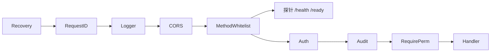
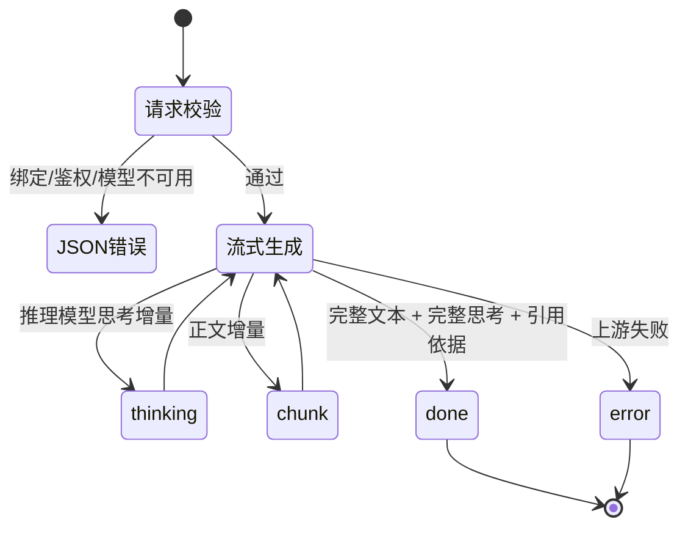

# 接口契约

本文描述 NovelWorkbench 对外暴露的全部 HTTP 接口：通用约定、响应包络、业务码映射、中间件链、权限码、按模块分组的接口总表与特殊端点。

## 1. 通用约定

| 项 | 约定 | 代码位置 |
| --- | --- | --- |
| 业务基础路径 | `/api/v1` | `router.go` 的 `v1 := router.Group("/api/v1")` |
| 探针路径 | `/health`、`/ready`，注册在 `/api/v1` 之外 | `router.go` 的 `NewRouter` |
| 接口总数 | `/api/v1` 下 119 条，另有 2 条探针，共 121 条 | `router.go` |
| 允许方法 | 仅 `GET` / `POST`；`OPTIONS` 只用于 CORS 预检 | `pkg.MethodWhitelistMiddleware` |
| 请求编码 | `POST` 默认 `application/json`（`ShouldBindJSON`）；`/knowledge/upload` 为 `multipart/form-data` | 各 `*_api.go` |
| 查询参数 | `GET` 用 query（`ShouldBindQuery`），路径变量用 `c.Param` | 各 `*_api.go` |
| 鉴权头 | `Authorization: Bearer <access_token>` | `pkg.AuthMiddleware` |
| 链路头 | 请求 `X-Request-ID` 透传；缺省生成 `REQ_` 前缀 ULID，响应头回写同值 | `pkg.RequestIDMiddleware` |
| 业务码 | 字符串 `SUCCESS` 或 `ERR_*` | `domain.RespCode*` |
| ID 形态 | 业务前缀 + ULID（`PRJ_` / `CHP_` / `DOC_` / `MDL_` …） | `domain/common.go` 的 `IDPrefix*` |
| 时间 | 视图对象统一给 RFC3339 字符串（`2026-11-21T03:09:39Z`），零值给空串；日期参数为 `YYYY-MM-DD` | 各 VO |
| 数据归属 | 项目域资源一律经 `mustOwnProject` / `mustOwnDoc` 等校验归属，越权返回 `ERR_FORBIDDEN` | `service/project_service.go` |


CORS 放行 `Origin`、`Content-Type`、`Authorization`、`X-Request-ID`，暴露 `X-Request-ID`，预检缓存 12 小时（`router.go` 的 `cors.Config`）。

## 2. 响应包络

成功（`pkg.Ok`，HTTP 恒为 200）：

```json
{
  "resp_code": "SUCCESS",
  "resp_message": "ok",
  "trace_id": "REQ_01HZX...",
  "data": { "total": 0, "page_num": 1, "page_size": 20, "items": [] }
}
```

失败（`pkg.Fail` / `pkg.FailErr`）：

```json
{
  "resp_code": "ERR_INVALID_PARAM",
  "resp_message": "参数校验失败: Key: 'ProjectCreateREQ.ProjectName' ...",
  "trace_id": "REQ_01HZX...",
  "data": null
}
```

包络结构为 `domain.BaseRESP`（`resp_code` / `resp_message` / `trace_id`）嵌套 `domain.DataRESP[T].data`。
`pkg.FailErr` 对 `pkg.BizError` 保留其业务码与文案，其他 `error` 记日志后统一输出 `ERR_INTERNAL` 与「服务内部错误，请稍后重试」。
绑定失败由各处理器的 `bindErr` 转成 `ERR_INVALID_PARAM`，消息前缀固定为「参数校验失败: 」。
无返回体的写接口 `data` 为 `null`。

## 3. 业务码 → HTTP 状态

映射唯一入口为 `pkg.HTTPStatusForCode`（`backend/internal/pkg/response.go`），未知码归 500。

| 业务码 | HTTP | 语义 | 典型触发 |
| --- | --- | --- | --- |
| `SUCCESS` | 200 | 成功 | 正常返回 |
| `ERR_INVALID_PARAM` | 400 | 参数校验失败 | `binding` 校验失败、非 GET/POST 请求 |
| `ERR_UNAUTHORIZED` | 401 | 未登录或登录失效 | 缺令牌、JWT 解析失败、令牌已吊销、账号禁用 |
| `ERR_FORBIDDEN` | 403 | 无权限 | 缺少权限码、非资源归属人、模型未授权 |
| `ERR_NOT_FOUND` | 404 | 资源不存在 | ULID 查不到 |
| `ERR_CONFLICT` | 409 | 资源冲突 | 重名、邮箱重复、重复提交 |
| `ERR_BIZ_FAILED` | 400 | 通用业务失败 | 删除默认模型、删除含模型的供应商、内置技能删除 |
| `ERR_AI_PROVIDER` | 502 | AI 调用失败 | 无可用模型、供应商停用、上游报错 |
| `ERR_STORAGE` | 503 | 基础设施异常 | MinIO / Manticore / RabbitMQ 失败、`/ready` 依赖未就绪 |
| `ERR_INTERNAL` | 500 | 服务内部错误 | 未归类 error、panic 恢复、权限判定报错 |


`ERR_BIZ_FAILED` 与 `ERR_INVALID_PARAM` 同为 400，客户端须以 `resp_code` 而非 HTTP 状态区分。

## 4. 中间件链与白名单

`pkg.NewRouter` 的装配顺序（`backend/internal/api/router.go` 的 `NewRouter`）：



| 序 | 中间件 | 作用 | 失败输出 |
| --- | --- | --- | --- |
| 1 | `pkg.RecoveryMiddleware` | 捕获 panic，记录堆栈并中止链 | `ERR_INTERNAL` / 500 |
| 2 | `pkg.RequestIDMiddleware` | 分配或透传 `X-Request-ID`，写入上下文键 `request_id` | 无 |
| 3 | `pkg.LoggerMiddleware` | 出口记录 method / path / status / latency_ms | 无 |
| 4 | `cors.New(...)` | 处理预检，预检直接返回 | 无 |
| 5 | `pkg.MethodWhitelistMiddleware` | 仅放行 GET / POST | `ERR_INVALID_PARAM` / 400 |
| 6 | `pkg.AuthMiddleware` | 仅挂 `/api/v1` 组；校验令牌、吊销名单、用户状态，注入上下文键 `user_ulid` | `ERR_UNAUTHORIZED` / 401 |
| 7 | `pkg.AuditMiddleware` | 仅挂 `/api/v1` 组；记录 POST 审计 | 不阻断业务 |
| 8 | `pkg.RequirePermMiddleware` | 分组级权限门禁 | `ERR_FORBIDDEN` / 403，判定报错 `ERR_INTERNAL` / 500 |


`/health`、`/ready` 注册在 `/api/v1` 组之前，只经过 1–5，不鉴权、不审计。

鉴权中间件内部顺序：跳过名单直接放行 → 取 `Authorization`（缺省 401「未登录」）→ `JWTSigner.ParseToken`（失败 401「登录已失效」）→ `TokenStore.IsRevoked` 命中 401「登录已失效」→ `UserStateChecker` 判定用户非禁用（禁用 401「账号不存在或已被禁用」，判定报错 500）。

### 4.1 免鉴权白名单

`backend/cmd/server/main.go` 传入 `pkg.AuthMiddleware` 的 `skipPaths`：

| 路径 | 原因 |
| --- | --- |
| `/api/v1/auth/login` | 登录请求本身无令牌 |


其余 `/api/v1` 路径一律要求登录；系统不开放注册，账号只能由管理员经 `/admin/user/create` 创建。

### 4.2 审计跳过名单

`backend/cmd/server/main.go` 传入 `pkg.AuditMiddleware` 的 `skipPaths`：

| 路径 | 原因 |
| --- | --- |
| `/api/v1/auth/login` | 尚无登录用户可归属 |
| `/api/v1/auth/logout` | 不落审计 |
| `/api/v1/chat/send` | 高频流式调用，不落审计 |


审计规则（`pkg/access_middleware.go`）：只记录 `POST`；`action_code` 取路径去掉 `/api/v1/` 前缀；所有 POST 都会读取 body 提取目标（键白名单覆盖 user / role / menu / project / chapter / document / skill / tool / model / provider / prompt_profile / chat_session / notification），body 采样上限 32KB、`multipart` 不采样且读后还原，凭据字段（`password_text`、`new_password_text`、`old_password_text`、`api_key_text`、`access_token`）脱敏为 `***`；响应体缓冲前 8KB 用于解析包络得到 `resp_code` / `resp_message`，并按 HTTP 状态推导 `log_level_code`（`info` / `warn` / `error`），`trace_id` 取请求链路 ID；落库失败只记 `audit_record_failed` 告警。

## 5. 权限码

权限码定义在 `backend/internal/domain/role.go`，共 15 个常量。`RequirePermMiddleware` 通过 `pkg.PermChecker`（由 `service.RoleService` 实现）判定，命中 `*` 视为全部权限。

| 权限码 | 常量 | 校验路由 |
| --- | --- | --- |
| `*` | `PermAdminAll` | 通配，内置 `admin` 角色持有；不做单点路由绑定 |
| `system:user:manage` | `PermUserManage` | `/admin/user/list`、`/create`、`/update`、`/delete`、`/reset_password` |
| `system:role:manage` | `PermRoleManage` | `/admin/role/list`、`/save`、`/delete` |
| `system:menu:manage` | `PermMenuManage` | `/menu/list`、`/menu/detail/:MenuULID`、`/menu/save`、`/menu/delete` |
| `system:perm:read` | `PermPermissionRead` | `/menu/permission/catalog` |
| `system:audit:read` | `PermAuditRead` | `/admin/audit/list` |
| `system:loginlog:read` | `PermLoginLogRead` | `/admin/login_log/list` |
| `system:model:manage` | `PermModelManage` | `/model/provider/*`、`/model/catalog/*`（共 10 条） |
| `system:usage:read` | `PermUsageRead` | `/model/usage/overview` |
| `system:status:read` | `PermSystemRead` | `/system/status` |
| `system:setting:manage` | `PermSettingManage` | `/setting/update` |
| `system:job:manage` | `PermJobManage` | `/admin/job/list`、`/admin/job/stats`、`/admin/job/retry` |
| `skill:manage` | `PermSkillManage` | `/skill/save`、`/skill/delete`、`/skill/reference/save`、`/skill/reference/delete` |
| `prompt:manage` | `PermPromptManage` | `/prompt/profile/save`、`/prompt/profile/delete` |
| `tool:manage` | `PermToolManage` | `/tool/save`、`/tool/delete` |


未列入上表的其余 `/api/v1` 路由均为「登录用户即可访问」，数据范围由归属校验收窄。

权限目录（`GET /menu/permission/catalog`）由菜单表汇总而来：`service/menu_service.go` 的 `buildPermCatalog` 先登记 `*`，再按菜单行的 `perm_code` 逐条登记（同一码只登记一次），按权限码首段分组（当前实际使用 `system` / `skill` / `tool` / `prompt`，`project` 分组已预留但暂无权限码）并升序返回。因此新增权限码只需在菜单管理里登记一行，无需改代码。

## 6. 探针

| 方法 | 路径 | 鉴权 | 成功 data | 失败 |
| --- | --- | --- | --- | --- |
| GET | `/health` | 免鉴权 | `{"status":"up"}` | 不会失败（`healthCheck` 不检查依赖） |
| GET | `/ready` | 免鉴权 | `{"status":"ready"}` | 依赖 Ping 失败返回 `ERR_STORAGE` / 503「依赖未就绪」 |


两者均由 `pkg.Ok` 输出包络；`/ready` 的检查函数由 `main.go` 注入（`RouterDeps.ReadyCheck`，Postgres Ping）。

## 7. 接口总表

约定：`POST` 请求体为 JSON（`/knowledge/upload` 除外），`GET` 参数为 query 或路径变量；权限门禁见第 5 节——未列入该节权限码表的路由均为「登录用户即可访问」，数据范围由归属校验收窄。

### 7.1 接口总表（119 条）

| 模块 | 方法 | 路径 | 请求 | 响应 data | Handler |
| --- | --- | --- | --- | --- | --- |
| 认证 | POST | `/auth/login` | `UserLoginREQ` | `UserLoginDTO` | `AuthAPI.Login` |
| 认证 | GET | `/auth/profile` | 无 | `UserVO` | `AuthAPI.Profile` |
| 认证 | POST | `/auth/logout` | 无（读 `Authorization` 头） | `null` | `AuthAPI.Logout` |
| 个人中心 | GET | `/profile/detail` | 无 | `UserProfileVO` | `AuthAPI.ProfileDetail` |
| 个人中心 | POST | `/profile/update` | `UserProfileUpdateREQ` | `UserProfileVO` | `AuthAPI.UpdateProfile` |
| 个人中心 | POST | `/profile/password/change` | `UserPasswordChangeREQ` | `null` | `AuthAPI.ChangePassword` |
| 站内通知 | POST | `/notification/list` | `NotificationListREQ` | `PageDTO<NotificationVO>` | `NotificationAPI.List` |
| 站内通知 | GET | `/notification/unread_count` | 无 | `NotificationUnreadCountVO` | `NotificationAPI.UnreadCount` |
| 站内通知 | POST | `/notification/read` | `NotificationReadREQ` | `null` | `NotificationAPI.Read` |
| 站内通知 | POST | `/notification/read_all` | 无 | `null` | `NotificationAPI.ReadAll` |
| 站内通知 | POST | `/notification/delete` | `NotificationDeleteREQ` | `null` | `NotificationAPI.Delete` |
| 项目 | POST | `/project/create` | `ProjectCreateREQ` | `ProjectVO` | `ProjectAPI.Create` |
| 项目 | POST | `/project/update` | `ProjectUpdateREQ` | `ProjectVO` | `ProjectAPI.Update` |
| 项目 | POST | `/project/delete` | `ProjectDeleteREQ` | `null` | `ProjectAPI.Delete` |
| 项目 | POST | `/project/list` | `ProjectListREQ` | `PageDTO<ProjectVO>` | `ProjectAPI.List` |
| 项目 | GET | `/project/detail/:ProjectULID` | 路径变量 | `ProjectVO` | `ProjectAPI.Detail` |
| 项目 | GET | `/project/tree/:ProjectULID` | 路径变量 | `ProjectTreeVO` | `ProjectAPI.Tree` |
| AI 开书 | POST | `/project/bootstrap/plan` | `ProjectBootstrapREQ` | `ProjectBootstrapPlanVO` | `BootstrapAPI.Plan` |
| AI 开书 | POST | `/project/bootstrap/apply` | `ProjectBootstrapApplyREQ` | `ProjectBootstrapResultVO` | `BootstrapAPI.Apply` |
| 卷 | POST | `/volume/create` | `VolumeCreateREQ` | `VolumeVO` | `VolumeAPI.Create` |
| 卷 | POST | `/volume/update` | `VolumeUpdateREQ` | `VolumeVO` | `VolumeAPI.Update` |
| 卷 | POST | `/volume/delete` | `VolumeDeleteREQ` | `null` | `VolumeAPI.Delete` |
| 章节与快照 | POST | `/chapter/create` | `ChapterCreateREQ` | `ChapterDetailVO` | `ChapterAPI.Create` |
| 章节与快照 | POST | `/chapter/update` | `ChapterUpdateREQ` | `ChapterDetailVO` | `ChapterAPI.Update` |
| 章节与快照 | POST | `/chapter/delete` | `ChapterDeleteREQ` | `null` | `ChapterAPI.Delete` |
| 章节与快照 | GET | `/chapter/detail/:ChapterULID` | 路径变量 | `ChapterDetailVO` | `ChapterAPI.Detail` |
| 章节与快照 | GET | `/chapter/snapshot/list/:ChapterULID` | 路径变量 | `[]ChapterSnapshotVO` | `ChapterAPI.SnapshotList` |
| 章节与快照 | POST | `/chapter/snapshot/create` | `ChapterSnapshotCreateREQ` | `ChapterSnapshotVO` | `ChapterAPI.SnapshotCreate` |
| 章节与快照 | POST | `/chapter/snapshot/restore` | `ChapterSnapshotRestoreREQ` | `ChapterDetailVO` | `ChapterAPI.SnapshotRestore` |
| 章节与快照 | POST | `/chapter/check` | `ChapterCheckREQ` | `ChapterCheckVO` | `ChapterAPI.Check` |
| 角色与关系图 | POST | `/character/save` | `CharacterREQ` | `CharacterVO` | `CharacterAPI.Save` |
| 角色与关系图 | POST | `/character/delete` | `CharacterDeleteREQ` | `null` | `CharacterAPI.Delete` |
| 角色与关系图 | POST | `/character/list` | `CharacterListREQ` | `[]CharacterVO` | `CharacterAPI.List` |
| 角色与关系图 | GET | `/character/graph/:ProjectULID` | 路径变量 | `CharacterGraphVO` | `CharacterAPI.Graph` |
| 角色与关系图 | POST | `/character/relation/save` | `CharacterRelationREQ` | `CharacterEdgeVO` | `CharacterAPI.RelationSave` |
| 角色与关系图 | POST | `/character/relation/delete` | `CharacterRelationDeleteREQ` | `null` | `CharacterAPI.RelationDelete` |
| 世界观设定与创作笔记 | POST | `/lore/save` | `LoreREQ` | `LoreVO` | `LoreAPI.Save` |
| 世界观设定与创作笔记 | POST | `/lore/delete` | `LoreDeleteREQ` | `null` | `LoreAPI.Delete` |
| 世界观设定与创作笔记 | POST | `/lore/list` | `LoreListREQ` | `[]LoreVO` | `LoreAPI.List` |
| 知识库 | POST | `/knowledge/upload` | multipart：`project_ulid`、`doc_name`、`file` | `KnowledgeDocumentVO` | `KnowledgeAPI.Upload` |
| 知识库 | POST | `/knowledge/list` | `KnowledgeListREQ` | `PageDTO<KnowledgeDocumentVO>` | `KnowledgeAPI.List` |
| 知识库 | POST | `/knowledge/delete` | `KnowledgeDeleteREQ` | `null` | `KnowledgeAPI.Delete` |
| 知识库 | POST | `/knowledge/search` | `KnowledgeSearchREQ` | `KnowledgeSearchDTO` | `KnowledgeAPI.Search` |
| 知识库 | POST | `/knowledge/reindex` | `KnowledgeReindexREQ` | `null` | `KnowledgeAPI.Reindex` |
| 知识库 | GET | `/knowledge/chunk/list/:DocULID` | query：`page_num`、`page_size` | `PageDTO<KnowledgeChunkVO>` | `KnowledgeAPI.ChunkList` |
| 知识库 | GET | `/knowledge/content/:DocULID` | 路径变量 | 原始字节，非包络（见 §8.2） | `KnowledgeAPI.Content` |
| 知识库 | GET | `/knowledge/stats/:ProjectULID` | 路径变量 | `KnowledgeStatsVO` | `KnowledgeAPI.Stats` |
| 技能与提示词档案 | GET | `/skill/list` | query：`scope_code`、`project_ulid`、`category_code`、`keyword_text`、`enabled_only` | `[]SkillVO` | `SkillAPI.List` |
| 技能与提示词档案 | GET | `/skill/detail/:SkillULID` | 路径变量 | `SkillVO` | `SkillAPI.Detail` |
| 技能与提示词档案 | POST | `/skill/resolve` | `SkillResolveREQ` | `SkillResolveDTO` | `SkillAPI.Resolve` |
| 技能与提示词档案 | GET | `/skill/reference/list` | query：`skill_ulid` | `[]SkillReferenceVO` | `SkillAPI.ReferenceList` |
| 技能与提示词档案 | POST | `/skill/save` | `SkillREQ` | `SkillVO` | `SkillAPI.Save` |
| 技能与提示词档案 | POST | `/skill/delete` | `SkillDeleteREQ` | `null` | `SkillAPI.Delete` |
| 技能与提示词档案 | POST | `/skill/reference/save` | `SkillReferenceREQ` | `SkillReferenceVO` | `SkillAPI.ReferenceSave` |
| 技能与提示词档案 | POST | `/skill/reference/delete` | `SkillReferenceDeleteREQ` | `null` | `SkillAPI.ReferenceDelete` |
| 技能与提示词档案 | POST | `/prompt/profile/list` | `PromptProfileListREQ`（`project_ulid`、`enabled_only`） | `[]PromptProfileVO` | `PromptProfileAPI.List` |
| 技能与提示词档案 | GET | `/prompt/profile/detail/:PromptProfileULID` | 路径变量 | `PromptProfileVO` | `PromptProfileAPI.Detail` |
| 技能与提示词档案 | POST | `/prompt/profile/save` | `PromptProfileREQ` | `PromptProfileVO` | `PromptProfileAPI.Save` |
| 技能与提示词档案 | POST | `/prompt/profile/delete` | `PromptProfileDeleteREQ` | `null` | `PromptProfileAPI.Delete` |
| 工具 | GET | `/tool/list` | query：`keyword_text`、`enabled_only` | `[]ToolVO` | `ToolAPI.List` |
| 工具 | POST | `/tool/invoke` | `ToolInvokeREQ`（`project_ulid`、`tool_code`、`chapter_ulid`、`content_text`、`param_value`） | `ToolInvokeDTO`（`result_text`、`metric_map`、`latency_ms`） | `ToolAPI.Invoke` |
| 工具 | POST | `/tool/save` | `ToolREQ` | `ToolVO` | `ToolAPI.Save` |
| 工具 | POST | `/tool/delete` | `ToolDeleteREQ` | `null` | `ToolAPI.Delete` |
| 菜单与权限目录 | GET | `/menu/nav` | 无 | `MenuNavDTO` | `MenuAPI.Nav` |
| 菜单与权限目录 | GET | `/menu/list` | query：`keyword_text`、`menu_type_code`、`scope_code` | `[]MenuVO` | `MenuAPI.List` |
| 菜单与权限目录 | GET | `/menu/detail/:MenuULID` | 路径变量 | `MenuVO` | `MenuAPI.Detail` |
| 菜单与权限目录 | POST | `/menu/save` | `MenuREQ` | `MenuVO` | `MenuAPI.Save` |
| 菜单与权限目录 | POST | `/menu/delete` | `MenuDeleteREQ` | `null` | `MenuAPI.Delete` |
| 菜单与权限目录 | GET | `/menu/permission/catalog` | 无 | `[]PermGroupVO` | `MenuAPI.PermCatalog` |
| 应用配置 | GET | `/setting/list` | 无 | `[]SettingVO` | `SettingAPI.List` |
| 应用配置 | POST | `/setting/update` | `SettingUpdateREQ` | `SettingVO` | `SettingAPI.Update` |
| 数据总览 | GET | `/stats/overview` | query：`project_ulid`（可空，空为全局） | `StatsOverviewVO` | `StatsAPI.Overview` |
| AI 对话 | POST | `/chat/send` | `ChatSendREQ` | `text/event-stream`（见 §8.1） | `ChatAPI.Send` |
| AI 对话 | POST | `/chat/history` | `ChatHistoryREQ` | `PageDTO<ChatMessageVO>` | `ChatAPI.History` |
| AI 对话 | POST | `/chat/session/create` | `ChatSessionCreateREQ` | `ChatSessionVO` | `ChatAPI.SessionCreate` |
| AI 对话 | POST | `/chat/session/list` | `ChatSessionListREQ` | `[]ChatSessionVO` | `ChatAPI.SessionList` |
| AI 对话 | POST | `/chat/session/delete` | `ChatSessionDeleteREQ` | `null` | `ChatAPI.SessionDelete` |
| 创作规划 | POST | `/outline/node/save` | `OutlineNodeREQ` | `OutlineNodeVO` | `OutlineAPI.SaveNode` |
| 创作规划 | POST | `/outline/node/delete` | `OutlineNodeDeleteREQ` | `null` | `OutlineAPI.DeleteNode` |
| 创作规划 | POST | `/outline/list` | `OutlineTreeREQ` | `[]OutlineNodeVO` | `OutlineAPI.ListTree` |
| 创作规划 | POST | `/outline/scene/save` | `DetailedSceneREQ` | `DetailedSceneVO` | `OutlineAPI.SaveScene` |
| 创作规划 | POST | `/outline/scene/delete` | `DetailedSceneDeleteREQ` | `null` | `OutlineAPI.DeleteScene` |
| 创作规划 | POST | `/outline/scene/list` | `DetailedSceneListREQ` | `[]DetailedSceneVO` | `OutlineAPI.ListScenes` |
| 连续性看板 | POST | `/continuity/fact/save` | `TemporalFactSaveREQ` | `TemporalFactVO` | `ContinuityAPI.SaveFact` |
| 连续性看板 | POST | `/continuity/fact/review` | `TemporalFactReviewREQ` | `TemporalFactVO` | `ContinuityAPI.ReviewFact` |
| 连续性看板 | POST | `/continuity/fact/list` | `TemporalFactListREQ` | `[]TemporalFactVO` | `ContinuityAPI.ListFacts` |
| 连续性看板 | POST | `/continuity/hook/save` | `ForeshadowHookSaveREQ` | `ForeshadowHookVO` | `ContinuityAPI.SaveHook` |
| 连续性看板 | POST | `/continuity/hook/list` | `ForeshadowHookListREQ` | `[]ForeshadowHookVO` | `ContinuityAPI.ListHooks` |
| 连续性看板 | POST | `/continuity/summary/save` | `ChapterSummarySaveREQ` | `ChapterSummaryVO` | `ContinuityAPI.SaveSummary` |
| 连续性看板 | POST | `/continuity/summary/list` | `ChapterSummaryListREQ` | `[]ChapterSummaryVO` | `ContinuityAPI.ListSummaries` |
| 模型生态 | GET | `/model/capability` | 无 | `ModelCapabilityVO` | `ModelProviderAPI.Capability` |
| 模型生态 | POST | `/model/provider/list` | 无 | `[]ModelProviderVO` | `ModelProviderAPI.ProviderList` |
| 模型生态 | POST | `/model/provider/save` | `ModelProviderREQ` | `ModelProviderVO` | `ModelProviderAPI.ProviderSave` |
| 模型生态 | POST | `/model/provider/delete` | `ModelProviderDeleteREQ` | `null` | `ModelProviderAPI.ProviderDelete` |
| 模型生态 | POST | `/model/provider/test` | `ModelProviderTestREQ` | `ModelProviderTestDTO` | `ModelProviderAPI.ProviderTest` |
| 模型生态 | POST | `/model/catalog/list` | `ModelCatalogListREQ` | `[]ModelCatalogVO` | `ModelProviderAPI.ModelList` |
| 模型生态 | POST | `/model/catalog/save` | `ModelCatalogREQ` | `ModelCatalogVO` | `ModelProviderAPI.ModelSave` |
| 模型生态 | POST | `/model/catalog/delete` | `ModelCatalogDeleteREQ` | `null` | `ModelProviderAPI.ModelDelete` |
| 模型生态 | POST | `/model/catalog/test` | `ModelCatalogTestREQ` | `ModelCatalogTestDTO` | `ModelProviderAPI.ModelTest` |
| 模型生态 | POST | `/model/catalog/set_default` | `ModelCatalogTestREQ` | `null` | `ModelProviderAPI.ModelSetDefault` |
| 模型生态 | POST | `/model/catalog/grant` | `ModelGrantREQ` | `null` | `ModelProviderAPI.ModelGrant` |
| 用量分析与运行状态 | GET | `/model/usage/overview` | query：`from_date`、`to_date` | `ModelUsageOverviewVO` | `ModelUsageAPI.Overview` |
| 用量分析与运行状态 | GET | `/system/status` | 无 | `SystemStatusVO` | `SystemStatusAPI.Status` |
| 系统管理 | POST | `/admin/user/list` | `UserAdminListREQ` | `PageDTO<UserAdminVO>` | `UserAdminAPI.List` |
| 系统管理 | POST | `/admin/user/create` | `UserAdminCreateREQ` | `UserAdminVO` | `UserAdminAPI.Create` |
| 系统管理 | POST | `/admin/user/update` | `UserAdminUpdateREQ` | `UserAdminVO` | `UserAdminAPI.Update` |
| 系统管理 | POST | `/admin/user/delete` | `UserAdminDeleteREQ` | `null` | `UserAdminAPI.Delete` |
| 系统管理 | POST | `/admin/user/reset_password` | `UserResetPasswordREQ` | `null` | `UserAdminAPI.ResetPassword` |
| 系统管理 | POST | `/admin/role/list` | `RoleListREQ` | `PageDTO<RoleVO>` | `RoleAPI.List` |
| 系统管理 | POST | `/admin/role/save` | `RoleSaveREQ` | `RoleVO` | `RoleAPI.Save` |
| 系统管理 | POST | `/admin/role/delete` | `RoleDeleteREQ` | `null` | `RoleAPI.Delete` |
| 系统管理 | POST | `/admin/audit/list` | `AuditListREQ` | `PageDTO<AuditVO>` | `AuditAPI.List` |
| 系统管理 | GET | `/admin/audit/detail/:AuditULID` | 路径变量 | `AuditDetailVO` | `AuditAPI.Detail` |
| 系统管理 | POST | `/admin/login_log/list` | `LoginLogListREQ` | `PageDTO<LoginLogVO>` | `LoginLogAPI.List` |
| 系统管理 | POST | `/admin/job/list` | `JobListREQ` | `PageDTO<JobVO>` | `JobAPI.List` |
| 系统管理 | GET | `/admin/job/stats` | 无 | `JobStatsVO` | `JobAPI.Stats` |
| 系统管理 | POST | `/admin/job/retry` | `JobRetryREQ` | `null` | `JobAPI.Retry` |

### 7.2 请求与响应说明

**认证**
`UserLoginREQ`：`account_text`（登录名或邮箱，必填）、`password_text`（必填）；`UserLoginDTO`：`access_token`、`expires_in_sec`、`user_vo`（`UserVO`）；`UserVO`：`user_ulid`、`user_name`、`user_email`、`avatar_url`、`user_status_code`（`active` / `disabled`）、`role_codes`、`created_at`；登出把当前令牌写入吊销名单（Redis），之后同一令牌访问任意接口返回 401。

**个人中心**
`UserProfileUpdateREQ` 只允许改 `user_email`、`avatar_url`、`remark_text`；`user_name` 不可改；`UserPasswordChangeREQ`：`old_password_text`、`new_password_text`（均 6–64 字符）。旧密码不符返回 `ERR_UNAUTHORIZED`，邮箱冲突返回 `ERR_CONFLICT`。

**站内通知**
`NotificationListREQ`：分页字段 + `read_status_code`（`all` / `unread` / `read`）、`notification_type_code`、`keyword_text`；`NotificationReadREQ.notification_ulid_list` 为 1–100 条的批量标记；通知类型：`system` / `task` / `account`。响应项含 `notification_ulid`、`notification_title_text`、`notification_body_text`、`read_flag`、`link_url`、`ref_type_code`、`ref_ulid`、`created_at`；全部接口按 `user_ulid` 隔离，只作用于当前用户的通知。

**项目**
`ProjectCreateREQ`：`project_name`（1–128）、`genre_code`、`style_text`、`synopsis_text`；`ProjectUpdateREQ`：`project_ulid` + 同上字段 + `project_status`（`draft` / `serial` / `completed`）；`ProjectListREQ`：分页字段 + `keyword_text`、`project_status`；`ProjectVO`：`project_ulid`、`project_name`、`genre_code`、`style_text`、`synopsis_text`、`project_status`、`total_word_count`、`volume_count`、`chapter_count`、`created_at`、`updated_at`；`ProjectTreeVO`：`project_vo` + `volume_list`（`VolumeTreeNodeVO`，含 `volume_vo` 与 `chapter_list`（`ChapterBriefVO`））；删除项目在单个事务内级联清理卷、章节、快照、角色、设定、大纲节点与场景卡、连续性数据、会话、知识库文档与统计（`ProjectService.Delete`）；事务提交后由 `cleanupKnowledgeExternal` 清理 MinIO 原文与 Manticore 切片，失败仅告警。

**AI 开书**
`ProjectBootstrapREQ`：`idea_text`（6–2000）、`genre_code`、`target_chapter_count`（3–60，缺省 12）、`model_ulid`（缺省取当前账号默认模型）；`ProjectBootstrapPlanVO`：`project_name`、`genre_code`、`selling_point_text`、`synopsis_text`、`style_text`、`volume_list`（`volume_name` / `summary_text` / `volume_order` / `chapter_list`）、`character_list`、`lore_list`；`plan` 只生成不落库；模型输出经 `normalizeBootstrapPlan` 收敛（卷 ≤3、角色 ≤8、设定 ≤10、枚举值校正、名称截断），作者可改字段后回传；`apply` 在单事务内创建项目、卷、章节、角色、设定与两级大纲节点（卷 → 章），失败整体回滚；生成失败统一返回 `ERR_AI_PROVIDER`，模型未授权返回 `ERR_FORBIDDEN`。

**卷**
`VolumeCreateREQ`：`project_ulid`、`volume_name`（1–128）、`volume_order`（0 表示取项目内最大值 +1）、`summary_text`。 `VolumeUpdateREQ` 只覆盖非空字段，`volume_order` 为 0 表示不调整。`VolumeVO`：`volume_ulid`、`volume_name`、`volume_order`、`summary_text`。

**章节与快照**
`ChapterUpdateREQ` 是整体覆盖：`chapter_name`、`volume_ulid`、`chapter_status`（`draft` / `revised` / `locked`）；`content_text`、`summary_text` 为指针字段，省略表示不改，空串表示清空；字数由服务端统计；`ChapterDetailVO` 内嵌 `ChapterBriefVO`（`chapter_ulid`、`chapter_name`、`chapter_order`、`word_count`、`chapter_status`），并补 `project_ulid`、`volume_ulid`、`content_text`、`summary_text`、`updated_at`；`ChapterSnapshotCreateREQ`：`chapter_ulid`、`change_note`（≤256）。`ChapterSnapshotRestoreREQ`：`snapshot_ulid`；回滚前会为当前正文再留一份快照；`ChapterSnapshotVO`：`snapshot_ulid`、`chapter_ulid`、`snapshot_type`、`change_note`、`word_count`、`created_at`；`ChapterCheckREQ`：`chapter_ulid`（可空）与 `content_text`（待检正文，优先于库内正文）；`ChapterCheckVO`：`word_count`、`paragraph_count`、`verdict_code`、`score_value`、`issue_list`、`banned_word_count`、`hook_present` 等体检结论字段，供写作台「体检」面板与对话期 `#chapter_check` 工具共用同一套门禁。

**角色与关系图**
`CharacterREQ`：`character_ulid`（空为新建）、`project_ulid`、`character_name`（1–64）、`alias_text`、`role_type_code`（`protagonist` / `antagonist` / `supporting` / `minor`）、`personality_text`、`background_text`、`appearance_text`、`goal_text`；`CharacterGraphVO`：`node_list`（`CharacterNodeVO`：`character_ulid`、`character_name`、`role_type_code`）+ `edge_list`（`CharacterEdgeVO`：`relation_ulid`、`from_character_ulid`、`to_character_ulid`、`relation_type_code`、`relation_note`）；`CharacterRelationREQ`：`project_ulid`、`from_character_ulid`、`to_character_ulid`、`relation_type_code`、`relation_note`。删除角色时连带删除其关系边。

**世界观设定与创作笔记**
`lore_type_code` 取 `world` / `rule` / `item` / `place` / `event` / `note`；`note` 即创作笔记，复用同一组接口；`content_mode_code` 标记正文格式：`rich`（富文本 HTML）或 `markdown`，落库默认 `rich`；更新时省略表示保持原值；`LoreListREQ`：`project_ulid`、`lore_type_code`、`keyword_text`（名称/内容模糊）。

**知识库**
`KnowledgeUploadREQ`（表单字段）：`project_ulid`（必填）、`doc_name`（必填，≤128）；文件字段名固定 `file`。仅接受 `txt` / `md` / `docx` / `pdf`，其他后缀返回 `ERR_INVALID_PARAM`；超过 `NW_APP_UPLOAD_MAX_MB` 上限同样返回 `ERR_INVALID_PARAM`。上传成功即写入 MinIO 原文、落库 `pending` 并投递 `doc_index` 任务；`KnowledgeListREQ`：分页字段 + `project_ulid`（必填）+ `doc_status_code`（`pending` / `indexing` / `indexed` / `failed`）；`KnowledgeSearchREQ`：`project_ulid`（必填）、`keyword_text`（≤512，去空白后为空返回 `ERR_INVALID_PARAM`）、`search_mode`（仅 `hybrid` 走双通道，其余值一律按 `keyword`）、`top_k_count`（1–20，缺省取应用配置 `rag_top_k`，再退回全局配置）、`doc_ulid_list`（限定文档范围，空为全部）；`KnowledgeSearchDTO`：`result_list`（`KnowledgeChunkVO`，含 `chunk_ulid`、`doc_ulid`、`doc_name`、`chunk_index`、`chunk_text`、`score_value`、`source_mode`）+ `trace`（`query_terms`、`query_expr`、`candidate_count`、`reranked`、`rerank_note`、`selected_ids`、`source_mode`）。重排失败为 fail-open，保留原顺序并在 `rerank_note` 说明；`KnowledgeReindexREQ.doc_ulid`：仅 `indexed` / `failed` 状态可重投，否则返回 `ERR_BIZ_FAILED`；重投把文档置回 `pending` 并投递 `doc_reindex`；`KnowledgeStatsVO`：`total_count`、`indexed_count`、`pending_count`（含 `indexing`）、`failed_count`、`chunk_count`。

**技能与提示词档案**
作用域：`global` 全局可用，`project` 仅所属项目可用；同编码的项目技能覆盖全局技能（`SkillVO.overridden_flag` 标记被覆盖项）；`SkillVO`：`skill_ulid`、`skill_code`、`skill_name`、`scope_code`、`project_ulid`、`category_code`（`write` / `revise` / `outline` / `setting` / `review` / `other`）、`description_text`、`prompt_template`、`variable_list`、`ref_count`、`enabled_flag`、`builtin_flag`、`customized_flag`（作者改过出厂内容）、`overridden_flag`、`domain_code` / `domain_name`（内置技能的流程域）、`sort_order`、`created_at`、`updated_at`；`SkillResolveREQ`：`project_ulid`、`content_text`（≤20000）、`skill_code`（显式指定优先）、`variable_value`。`SkillResolveDTO`：`skill_ulid`、`skill_code`、`skill_name`、`remainder_text`、`variable_map`、`missing_list`、`ref_text_list`；`missing_list` 非空表示必填变量缺失；变量取值优先级：显式传值 > 声明缺省值 > 必填缺失记入 `missing_list`（`resolveSkillVariables`）；模板占位符只允许内置占位符（`user_input` / `chapter_content` / `context` / `skill_code`）与已声明变量，出现未声明占位符时保存返回 `ERR_INVALID_PARAM`（`validateSkillTemplate`）；内置技能 `builtin_flag=true`：不可删除（返回 `ERR_BIZ_FAILED`），可停用或改提示词；`scope_code` 与 `skill_code` 不可改。保存内容与出厂指纹不同时 `customized_flag` 置 `true`，此后代码升级不再覆盖该行；改回出厂内容会置回 `false`；`PromptProfileVO`：`prompt_profile_ulid`、`prompt_profile_code`、`prompt_profile_name`、`scope_code`、`project_ulid`、`description_text`、`system_prompt_text`、`builtin_flag`、`enabled_flag`、`customized_flag`、`domain_code` / `domain_name`、`sort_order`、`updated_at`。作用域规则与技能一致；项目档案的归属校验比技能更严（`mustOwnProject`，校验创建者）。内置档案不可删、编码不可改，可改正文与名称。

**工具**
内置 6 个工具：`chapter_check`（章节体检）、`deai_scan`（去 AI 味扫描）、`chapter_digest`（章节摘要）、`character_scan`（角色出场统计）、`foreshadow_scan`（伏笔回收检查）、`lore_lookup`（设定检索）。内置工具不可删、不可改编码；`customized_flag` 由名称/说明/关键词/参数的改动推导，改过后代码升级不再覆盖；`/tool/invoke` 按登录用户执行归属校验（`project_ulid` 必须属于本人），结果只读、不写项目数据；`content_text` 为空时回落到 `chapter_ulid` 的库内正文；对话期自动触发不看权限码，只看工具 `enabled_flag` 与正文是否命中 `trigger_keywords`，显式点名上限 3 个、单轮总数上限 3 个。

**菜单与权限目录**
菜单表同时是权限码登记处：`page` 行承载页面权限码，`action` 行只登记动作权限码、不进导航；`MenuNavDTO`：`menu_tree_list`（`MenuTreeNodeVO` 递归 `child_list`）+ `perm_code_list`。只返回启用、非 `action` 且当前用户有权限（或持有 `*`）的节点；节点带 `visible_flag`，为 `false` 的页面不进侧边栏但仍注册路由（供入口合并后的旧链接与深链继续访问）；`MenuREQ`：`menu_ulid`、`parent_ulid`、`menu_code`（2–64，唯一）、`menu_name`、`menu_type_code`（`group` / `page` / `action`）、`scope_code`（`global` / `project`）、`route_path`、`icon_code`、`perm_code`、`visible_flag`、`enabled_flag`、`sort_order`、`remark_text`；约束：`group` 不可配路由（`ERR_INVALID_PARAM`）；菜单编码唯一（重复 `ERR_CONFLICT`）；权限码全局唯一，同码只能被一行登记（重复 `ERR_CONFLICT`）；上级必须存在且不能是自己或自己的下级（`ERR_INVALID_PARAM`）；存在下级时不可删除（`ERR_CONFLICT`，提示先删下级）；`PermGroupVO`：`group_code`、`group_name`、`perm_list`（`PermItemVO`：`perm_code`、`perm_name`、`perm_desc`、`menu_code`、`menu_name`、`builtin_flag`）。

**应用配置**
白名单与取值范围（`service/setting_service.go` 的 `settingDefaultList` 与 `settingRangeMap`）： | 键 | 默认值 | 取值范围 | 生效位置 | `SettingUpdateREQ`：`setting_key`（须在白名单内）、`setting_value`（须为正整数且落在区间），越界或键不在白名单返回 `ERR_INVALID_PARAM`。

**数据总览**
`StatsOverviewVO`：`project_count`、`total_word_count`、`today_word_delta`、`ai_word_total`、`trend_list`（近 30 天 `WordStatVO`：`stat_date`、`word_delta`、`ai_word_delta`）。

**AI 对话**
`ChatSendREQ`： | 字段 | 类型 | 说明 | `ChatHistoryREQ`：`session_ulid`（必填）+ 分页字段；结果按 `created_at` 升序；`ChatSessionCreateREQ`：`project_ulid`、`session_name`（空则取首条消息前 20 字）。`ChatSessionVO`：`session_ulid`、`project_ulid`、`session_name`、`message_count`、`updated_at`；`ChatMessageVO`：`message_ulid`、`session_ulid`、`role_code`（`user` / `assistant` / `system`）、`content_text`、`reasoning_text`、`skill_code`、`tool_code_list`（本轮执行的工具编码）、`ref_doc_ulid_list`、`ref_chapter_ulid_list`、`ref_summary_ulid_list`、`ref_prompt_ulid_list`、`ref_message_ulid_list`、`token_used_count`、`created_at`；所选模型未授权给当前账号返回 `ERR_FORBIDDEN`；账号无任何可用模型返回 `ERR_AI_PROVIDER`。

**创作规划**
`OutlineNodeREQ`：`outline_ulid`（空为新建）、`project_ulid`、`parent_outline_ulid`（根节点留空）、`node_type_code`（`volume` / `arc` / `storyBlock` / `chapter`）、`title_text`、`summary_text`、`node_status_code`（`draft` / `planning` / `ready` / `done`）、`sort_order`（0 表示追加到末尾）；`OutlineNodeVO.children` 递归承载子树，按 `sort_order` 升序；`DetailedSceneREQ`：`scene_ulid`、`project_ulid`、`outline_ulid`（必填）、`character_ulid_list`、`location_text`、`conflict_text`、`pace_code`（`slow` / `medium` / `fast` / `climax`）、`estimated_words`、`entry_state_text`、`goal_text`、`key_choice_text`、`outcome_text`、`exit_state_text`、`sort_order`；`DetailedSceneListREQ.outline_ulid` 留空表示项目下全部场景。

**连续性看板**
事实 `TemporalFactSaveREQ`：`fact_ulid`（空为新建）、`project_ulid`、`subject_text`、`predicate_code`、`object_text`、`fact_status_code`（`candidate` / `confirmed` / `superseded` / `stale`）、`valid_from_chapter_ulid`、`valid_until_chapter_ulid`、`source_chapter_ulid`（必填）、`source_quote_text`、`note_text`；复核 `TemporalFactReviewREQ`：`fact_ulid`、`project_ulid`、`fact_status_code`（只接受 `confirmed` / `superseded` / `stale`）、`note_text`；伏笔 `ForeshadowHookSaveREQ`：`hook_status_code`（`planned` / `planted` / `echoed` / `resolved` / `abandoned`）、`description_text`、`expected_payoff_text`、`setup_chapter_ulid`、`payoff_chapter_ulid`、`importance_code`（`high` / `medium` / `low`）；摘要 `ChapterSummarySaveREQ`：`summary_ulid`（空时按章节覆盖）、`chapter_ulid`、`summary_text`（1–20000）、`source_hash_text`、`summary_status_code`（`pending` / `verified` / `stale`）。

**模型生态**
供应商承载「网关 + 凭据」，模型是使用与授权的最小单位：`model_providers` → `model_catalogs` → `model_role_grants`。 `ModelProviderREQ`：`provider_ulid`（空为创建）、`provider_name`、`protocol_code`（仅 `openai` / `anthropic`）、`base_url`（合法 URL）、`api_key_text`（空表示保持原值）、`enabled_flag`、`sort_order`、`remark_text`。密钥以 AES-256-GCM 加密保存，`ModelProviderVO` 只回 `api_key_masked` 与 `api_key_configured`；`ModelCatalogREQ`：`model_ulid`、`provider_ulid`、`model_name`、`model_label`、`temperature`（0–2）、`max_tokens`、`context_window_count`、`enabled_flag`、`default_flag`、`sort_order`、`remark_text`、`role_ulid_list`（保存时整体覆盖授权）；`ModelCapabilityVO`：`chat_ready`、`default_model_ulid`、`default_model_label`、`default_model_name`、`default_provider_name`、`option_list`（`ModelOptionVO`）、`hint_text`；管理员（含 `*`）可见全部启用模型，其余账号按角色授权并集过滤，供应商或模型停用即从 `option_list` 剔除；`ModelProviderTestDTO` / `ModelCatalogTestDTO`：`status_code`（`success` / `failed`）、`message_text`、`latency_ms`、`reply_text`（供应商测试另含 `probe_model_id`）。 服务层约束： | 约束 | 行为 | 启动期：`ModelProviderService.SeedDefault` 在供应商表为空且配置了 `NW_AI_BASE_URL` / `NW_AI_CHAT_MODEL` 时播种「一条供应商 + 一个默认模型」并授权给内置角色；`ModelProviderService.MigrateLegacyModels` 在模型目录为空时把供应商自带的 `chat_model_name` 补成模型目录行，属启动期兼容逻辑，失败只告警不阻断启动。

**用量分析与运行状态**
日期格式 `YYYY-MM-DD`；缺省近 14 天，非法输入回退默认，起止倒置自动纠正（`resolveUsageRange`）；`ModelUsageOverviewVO`：`call_count_total`、`fail_count_total`、`total_tokens_total`、`avg_latency_ms`、`success_rate_value`（0–1）、`daily_list`、`provider_list`、`model_list`；`SystemStatusVO`：`server_started_at`、`server_uptime_sec`、`go_version_text`、`build_version_text`、`dependency_list`、`chat_ready`、`hint_text`。`dependency_code` 取 `postgres` / `redis` / `rabbitmq` / `minio` / `manticore` / `model`，`status_code` 取 `up` / `down` / `degraded`。

**系统管理**
- 用户：`UserAdminCreateREQ`（`user_name` 3–64、`user_email`、`password_text` 6–64、`role_codes`、`remark_text`），用户名或邮箱重复返回 `ERR_CONFLICT`，`role_codes` 为空时默认挂 `user` 角色；`UserAdminUpdateREQ.role_codes` 为整体覆盖语义；`UserResetPasswordREQ` 只收 `user_ulid` 与 `new_password_text`；不能删除自己（`ERR_BIZ_FAILED`）。 - 角色：`RoleListREQ` 仅含分页字段；`RoleSaveREQ`：`role_ulid`、`role_code`、`role_name`、`remark_text`、`perm_codes`（≤32）。内置角色（`admin` / `user`）不可删除（`ERR_BIZ_FAILED`）、不可改编码；仍有用户挂载的角色不可删除（`ERR_CONFLICT`）；角色编码重复返回 `ERR_CONFLICT`。 - 审计：`AuditListREQ`：分页字段 + `log_level_code`（`info`/`warn`/`error`）+ `trace_id`（精确）+ `target_type` + `action_code`（模糊）+ `keyword_text`（路径/用户/响应说明模糊）+ `user_ulid` + `date_from`/`date_to`（`YYYY-MM-DD`）。`AuditVO` 含 `audit_ulid`、`log_level_code`、`trace_id`、`user_ulid`、`user_name`、`action_code`、`request_path`、`request_method`、`target_type`、`target_ulid`、`resp_code`、`resp_message`、`http_status`、`latency_ms`、`ip_addr`、`user_agent_text`、`created_at`；`AuditDetailVO` 额外含 `request_body`（凭据字段脱敏；上传请求与超过 32KB 的请求体不采样）。 - 登录日志：`LoginLogListREQ`：分页字段 + `keyword_text`（账号/IP）+ `login_result_code`（`success` / `failed` / `disabled`）+ `date_from` / `date_to`。 - 任务：`JobListREQ`：分页字段 + `job_type_code`、`job_status_code`、`keyword_text`。状态 `queued` / `running` / `success` / `failed`，类型 `doc_index` / `doc_reindex`；重试仅接受 `failed`，成功后任务回到 `queued`、文档回到 `pending`。`JobStatsVO` 给四态计数。

## 8. 特殊端点

### 8.1 `POST /chat/send`（SSE）

流开始前的失败（绑定校验、鉴权、模型不可用）仍返回普通 JSON 包络；流开始后（响应头已提交）的失败只能经 SSE `error` 事件下发，服务端仅记日志。

响应头在首条事件写出时提交：

| 头 | 值 |
| --- | --- |
| `Content-Type` | `text/event-stream; charset=utf-8` |
| `Cache-Control` | `no-cache` |
| `X-Accel-Buffering` | `no` |


事件行格式 `data: {json}\n\n`，心跳为注释行 `: ping\n\n`；每条数据是 `domain.ChatStreamEventDTO`。

| 字段 | 类型 | 说明 |
| --- | --- | --- |
| `seq` | int64 | 单调递增事件序号 |
| `event_type` | string | `thinking` / `chunk` / `done` / `error` |
| `session_ulid` | string | 会话 ULID |
| `message_ulid` | string | 助手消息 ULID |
| `content_text` | string | 增量思考（`thinking`）、增量文本（`chunk`）或完整文本（`done`） |
| `reasoning_text` | string | 完整思考过程（`done` 时给出，模型未返回推理内容时为空串） |
| `reference_list` | `[]KnowledgeChunkVO` | RAG 召回依据（`done` 时给出） |
| `error_message` | string | 错误信息（`error` 时给出） |




客户端断开连接会取消上游模型调用；生成失败不落库助手消息，只保留用户消息。

`thinking` 事件只在模型返回推理内容（OpenAI 兼容协议的 `reasoning_content` / Anthropic 的 thinking block）时出现；非推理模型只会收到 `chunk` 与 `done`，前端据此在「等待首字节」与「思考中」之间自动切换。`ChatMessageVO.reasoning_text` 在拉取历史时一并返回，重开会话仍能看到上次的思考过程。

### 8.2 `GET /knowledge/content/:DocULID`（原始字节）

该端点成功时不返回业务包络，直接输出文件原始字节（`c.Data`）；失败路径仍由 `respondErr` 输出 JSON 包络。

| 项 | 行为 |
| --- | --- |
| `Content-Type` | `txt` → `text/plain; charset=utf-8`；`md` → `text/markdown; charset=utf-8`；`docx` → `application/vnd.openxmlformats-officedocument.wordprocessingml.document`；`pdf` → `application/pdf`；其他 → `application/octet-stream` |
| `Content-Disposition` | `inline; filename*=UTF-8''<url-escaped doc_name>` |


前端以 `fetch` 取 blob（`fetchKnowledgeContent`），交给 `docx-preview` / `vue-pdf-embed` 预览，`txt` / `md` 直接渲染。

## 9. 分页约定

| 项 | 规则 |
| --- | --- |
| 请求字段 | `page_num`、`page_size`（`domain.PageREQ`，JSON body 与 query 同名） |
| `page_num` | 从 1 开始；`<= 0` 归一为 1 |
| `page_size` | 缺省 20；`<= 0` 或 `> 100` 归一为 20（上限 100） |
| 归一入口 | `PageREQ.Normalize()`，由各 service 在查询前调用 |
| 响应结构 | `PageDTO<T>`：`total`、`page_num`、`page_size`、`items` |


返回 `PageDTO` 的端点（10 条）：

| 端点 | 分页字段来源 |
| --- | --- |
| `POST /project/list` | JSON body |
| `POST /knowledge/list` | JSON body |
| `GET /knowledge/chunk/list/:DocULID` | query |
| `POST /chat/history` | JSON body |
| `POST /notification/list` | JSON body |
| `POST /admin/user/list` | JSON body |
| `POST /admin/role/list` | JSON body |
| `POST /admin/audit/list` | JSON body |
| `POST /admin/login_log/list` | JSON body |
| `POST /admin/job/list` | JSON body |


返回普通数组、全量不翻页的端点：`/chapter/snapshot/list/:ChapterULID`、`/character/list`、`/lore/list`、`/skill/list`、`/skill/reference/list`、`/outline/list`、`/outline/scene/list`、`/continuity/fact/list`、`/continuity/hook/list`、`/continuity/summary/list`、`/chat/session/list`、`/model/provider/list`、`/model/catalog/list`、`/prompt/profile/list`、`/menu/list`、`/setting/list`、`/menu/permission/catalog`。

## 10. 前端消费规则

实现位于 `frontend/src/api/http.ts` 与 `frontend/src/composables/useSSE.ts`。

| 规则 | 实现 |
| --- | --- |
| 基础路径 | Axios 实例 `baseURL: '/api/v1'`，`timeout: 30000` |
| 令牌注入 | 请求拦截器从本地存储读 token，写入 `Authorization: Bearer <token>` |
| 包络解包 | 响应拦截器校验 `resp_code === 'SUCCESS'`，成功时把 `envelope.data` 直接作为调用方返回值；`get<T>` / `post<T>` 的 `T` 即 `data` 类型 |
| 失败归一 | 非成功包络或无响应体统一构造 `ApiError`（`resp_code`、`resp_message`、`trace_id`、`http_status`）并 reject；无响应体时归为 `ERR_INTERNAL` + `http_status = 0` |
| 未授权 | `resp_code === 'ERR_UNAUTHORIZED'` 时清除令牌与用户信息，提示后跳转 `/login`（登录接口自身的 401 不触发，避免凭据错误被误判为会话过期） |
| 静默失败 | 业务层用 `silent_error: true`（`http.ts` 的参数名）标记静默，落到请求层即 `silent: true`，跳过统一 `ElMessage` 提示（知识库列表 / 切片等自行处理错误时使用） |
| 不存在判定 | `isApiNotReadyError` 对 `ERR_NOT_FOUND` 或 HTTP 404 返回 true |
| 二进制端点 | `/knowledge/content` 不走 Axios 拦截器，用 `fetch` 手动带 `Authorization` 头并返回 `Blob`，`!response.ok` 直接抛错 |
| SSE 不走 Axios | `/chat/send` 用 `fetch` + `ReadableStream`（`streamSsePost`）发起；`parseSseBuffer` 只消费以 `\n` 结尾的完整行，末尾半行留作缓冲，跨 chunk 断行与多事件粘包都能正确解析，非法 JSON 行跳过 |
| 流取消 | `useSSE.startStream` 会先中止上一条流；`stopStream` 触发 `AbortController.abort`，`AbortError` 静默结束、不触发 `onError` |

