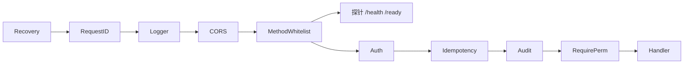
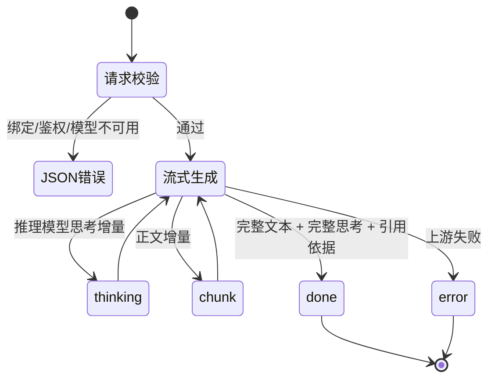

# 接口契约

本文描述 NovelWorkbench 对外接口的通用约定：响应包络、业务码映射、中间件链、权限码、特殊端点、分页与前端消费规则。
按模块分组的完整接口清单见 [endpoints.md](endpoints.md)。

## 1. 通用约定

| 项 | 约定 | 代码位置 |
| --- | --- | --- |
| 业务基础路径 | `/api/v1` | `router.go` 的 `v1 := router.Group("/api/v1")` |
| 探针路径 | `/health`、`/ready`，注册在 `/api/v1` 之外 | `router.go` 的 `NewRouter` |
| 接口总数 | `/api/v1` 下 132 条，另有 2 条探针，共 134 条 | `router.go` |
| 允许方法 | 仅 `GET` / `POST`；`OPTIONS` 只用于 CORS 预检 | `pkg.MethodWhitelistMiddleware` |
| 请求编码 | `POST` 默认 `application/json`（`ShouldBindJSON`）；`/knowledge/upload` 为 `multipart/form-data` | 各 `*_api.go` |
| 查询参数 | `GET` 用 query（`ShouldBindQuery`），路径变量用 `c.Param` | 各 `*_api.go` |
| 鉴权头 | `Authorization: Bearer <access_token>` | `pkg.AuthMiddleware` |
| 链路头 | 请求 `X-Request-ID` 透传；缺省生成 `REQ_` 前缀 ULID，响应头回写同值 | `pkg.RequestIDMiddleware` |
| 业务码 | 字符串 `SUCCESS` 或 `ERR_*` | `domain.RespCode*` |
| ID 形态 | 业务前缀 + ULID（`PRJ_` / `CHP_` / `DOC_` / `MDL_` …） | `domain/common.go` 的 `IDPrefix*` |
| 时间 | 视图对象统一给 RFC3339 字符串（`2026-11-21T03:09:39Z`），零值给空串；日期参数为 `YYYY-MM-DD` | 各 VO |
| 数据归属 | 项目域资源一律经 `mustOwnProject` / `mustOwnDoc` 等校验归属，越权返回 `ERR_FORBIDDEN` | `service/project_service.go` |

CORS 放行 `Origin`、`Content-Type`、`Authorization`、`X-Request-ID`，暴露 `X-Request-ID`，预检缓存 12 小时（`router.go` 的 `cors.Config`）。

## 2. 响应包络

成功（`pkg.Ok`，HTTP 恒为 200）：

```json
{
  "resp_code": "SUCCESS",
  "resp_message": "ok",
  "trace_id": "REQ_01HZX...",
  "data": { "total": 0, "page_num": 1, "page_size": 20, "items": [] }
}
```

失败（`pkg.Fail` / `pkg.FailErr`）：

```json
{
  "resp_code": "ERR_INVALID_PARAM",
  "resp_message": "参数校验失败: Key: 'ProjectCreateREQ.ProjectName' ...",
  "trace_id": "REQ_01HZX...",
  "data": null
}
```

包络结构为 `domain.BaseRESP`（`resp_code` / `resp_message` / `trace_id`）嵌套 `domain.DataRESP[T].data`。
`pkg.FailErr` 对 `pkg.BizError` 保留其业务码与文案，其他 `error` 记日志后统一输出 `ERR_INTERNAL` 与「服务内部错误，请稍后重试」。
绑定失败由各处理器的 `bindErr` 转成 `ERR_INVALID_PARAM`，消息前缀固定为「参数校验失败: 」。
无返回体的写接口 `data` 为 `null`。

## 3. 业务码 → HTTP 状态

映射唯一入口为 `pkg.HTTPStatusForCode`（`backend/internal/pkg/response.go`），未知码归 500。

| 业务码 | HTTP | 语义 | 典型触发 |
| --- | --- | --- | --- |
| `SUCCESS` | 200 | 成功 | 正常返回 |
| `ERR_INVALID_PARAM` | 400 | 参数校验失败 | `binding` 校验失败、非 GET/POST 请求 |
| `ERR_UNAUTHORIZED` | 401 | 未登录或登录失效 | 缺令牌、JWT 解析失败、令牌已吊销、账号禁用 |
| `ERR_FORBIDDEN` | 403 | 无权限 | 缺少权限码、非资源归属人、模型未授权 |
| `ERR_NOT_FOUND` | 404 | 资源不存在 | ULID 查不到 |
| `ERR_CONFLICT` | 409 | 资源冲突 | 重名、邮箱重复、重复提交；模型供应商名称重复（`uk_model_provider_name`）、同一供应商下模型重名（`uk_model_catalog_provider_name`）——唯一索引冲突时服务层捕获 `repo.IsDuplicateKey` 转成该码 |
| `ERR_BIZ_FAILED` | 400 | 通用业务失败 | 删除默认模型、删除含模型的供应商、内置提示词删除 |
| `ERR_AI_PROVIDER` | 502 | AI 调用失败 | 无可用模型、供应商停用、上游报错 |
| `ERR_STORAGE` | 503 | 基础设施异常 | MinIO / Manticore / RabbitMQ 失败、`/ready` 依赖未就绪 |
| `ERR_INTERNAL` | 500 | 服务内部错误 | 未归类 error、panic 恢复、权限判定报错 |

`ERR_BIZ_FAILED` 与 `ERR_INVALID_PARAM` 同为 400，客户端须以 `resp_code` 而非 HTTP 状态区分。

## 4. 中间件链与白名单

`api.NewRouter` 的装配顺序：



| 序 | 中间件 | 作用 | 失败输出 |
| --- | --- | --- | --- |
| 1 | `pkg.RecoveryMiddleware` | 捕获 panic，记录堆栈并中止链 | `ERR_INTERNAL` / 500 |
| 2 | `pkg.RequestIDMiddleware` | 分配或透传 `X-Request-ID`，写入上下文键 `request_id` | 无 |
| 3 | `pkg.LoggerMiddleware` | 出口记录 method / path / status / latency_ms | 无 |
| 4 | `cors.New(...)` | 处理预检，预检直接返回 | 无 |
| 5 | `pkg.MethodWhitelistMiddleware` | 仅放行 GET / POST | `ERR_INVALID_PARAM` / 400 |
| 6 | `pkg.AuthMiddleware` | 仅挂 `/api/v1` 组；校验令牌、吊销名单、密码版本、用户状态，注入上下文键 `user_ulid` | `ERR_UNAUTHORIZED` / 401 |
| 7 | `pkg.IdempotencyMiddleware` | 仅挂 `/api/v1` 组；按 `Idempotency-Key` 保证写动作只执行一次 | `ERR_INVALID_PARAM` / `ERR_CONFLICT` |
| 8 | `pkg.AuditMiddleware` | 仅挂 `/api/v1` 组；记录 POST 审计（请求体 + 响应体） | 不阻断业务 |
| 9 | `pkg.RequirePermMiddleware` | 分组级权限门禁 | `ERR_FORBIDDEN` / 403，判定报错 `ERR_INTERNAL` / 500 |

`/health`、`/ready` 注册在 `/api/v1` 组之前，只经过 1–5，不鉴权、不审计。

鉴权中间件内部顺序：跳过名单直接放行 → 取 `Authorization`（缺省 401「未登录」）→ `JWTSigner.ParseClaims`（失败 401「登录已失效」）→ `TokenStore.IsRevoked` 命中 401「登录已失效」→ `UserStateChecker` 返回账号状态与当前密码版本（禁用 401「账号不存在或已被禁用」，判定报错 500）→ 令牌内 `pwd_epoch` 落后于库内版本时 401「密码已变更，请重新登录」。

### 4.1 免鉴权白名单

`backend/cmd/server/main.go` 传入 `pkg.AuthMiddleware` 的 `skipPaths`：

| 路径 | 原因 |
| --- | --- |
| `/api/v1/auth/login` | 登录请求本身无令牌 |

其余 `/api/v1` 路径一律要求登录；系统不开放注册，账号只能由管理员经 `/admin/user/create` 创建。

### 4.2 审计跳过名单

`backend/cmd/server/main.go` 传入 `pkg.AuditMiddleware` 的 `skipPaths`：

| 路径 | 原因 |
| --- | --- |
| `/api/v1/auth/login` | 尚无登录用户可归属 |
| `/api/v1/auth/logout` | 不落审计 |
| `/api/v1/chat/send` | 高频流式调用，不落审计 |

审计规则（`pkg/access_middleware.go`）：只记录 `POST`；`action_code` 取路径去掉 `/api/v1/` 前缀；所有 POST 都会读取 body 提取目标（键白名单覆盖 user / role / menu / project / chapter / document / prompt / tool / model / provider / chat_session / notification），body 采样上限 32KB、`multipart` 不采样且读后还原，凭据字段（`password_text`、`new_password_text`、`old_password_text`、`api_key_text`、`access_token`）脱敏为 `***`；响应体同样采样落库（上限 32KB，超限追加「已截断」标记，非 JSON 流式响应记占位说明），并从响应包络解析 `resp_code` / `resp_message`，按 HTTP 状态推导 `log_level_code`（`info` / `warn` / `error`），`trace_id` 取请求链路 ID；落库失败只记 `audit_record_failed` 告警。审计详情接口返回 `request_body` 与 `resp_body`，前端详情抽屉同时展示两者。

### 4.3 审计 span 模型与动作名

一条审计行是链路里的一个 **span**，`span_type_code` 取值固定五种：

| span_type_code | 写入点 | 说明 |
| --- | --- | --- |
| `http` | `pkg.AuditMiddleware` | 入口 POST 请求，链路的根 span，`parent_span_code` 为空 |
| `workflow_step` | `service/workflow_steps.go` | 工作流每一步执行，`parent_span_code=workflow/run/create` |
| `ai_call` | `service/audit_ai.go`（对话 / 工作流 / 开书共用） | 一次模型调用，带 `model_name` / `token_count`，不落 prompt 全文 |
| `job` | 预留，当前无写入点 | 异步任务（索引 worker 目前不写审计，列表里不会出现该类型） |
| `system` | `service/audit_service.go` | 系统维护动作（如 `system/audit.purge`） |

`action_name` 的中文名由 `pkg/audit_names.go` 的 `auditActionNameMap` 提供：键是动作码（路径去掉 `/api/v1/`），未登记时回落为动作码本身；`AuditActionLabel` 供中间件与查询补全共用，`AuditActionNameOf` 额外按前缀归类后台与 AI 动作（如 `ai/workflow/<步骤类型>` 映射为「AI 出稿 / 修订 / 复审 / 摘要」）。服务层 `AuditService.Record` 在 `ActionName` 为空时自动补齐，历史行缺列也能在列表里显示中文名。

**列名转义与保留字**：`model_name` 是 Manticore 25.0 的保留字，裸写会让 `CREATE TABLE` / `ALTER TABLE ADD COLUMN` / `INSERT` 报 `P03: syntax error, unexpected MODEL_NAME`。因此 `repo/audit_schema_repo.go` 里所有列名都经 `quoteIdent` 加反引号（DDL 列定义、补列、INSERT 列清单、SELECT 列、`WHERE` 过滤列、`GROUP BY`、`ORDER BY` 一视同仁），列定义收敛到 `auditColumnSpecList` 并由 `audit_chain_test.go` 断言与 INSERT 列清单一致。读取侧不变：Manticore 返回的行 map 仍用不带反引号的列名。

**结构退化自愈**：若建表失败后降级写入，Manticore 会自动把全部列建成 `text`（stored field），此时按 `span_type_code` / `log_level_code` 过滤会报 `filters are supported only on attributes`。`EnsureSchema` 末尾的 `rebuildIfDegraded` 会用 `DESC` 检查过滤核心列（`log_level_code` / `span_type_code` / `trace_id` / `action_code` / `created_at_ts`），一旦发现被建成 `text`，就 `DROP` + 重建审计表并记 `Errorw("检测到审计表结构退化，已重建")`；**该动作会丢弃全部历史审计**，只在退化（表已不可筛选）时触发。

### 4.4 写请求幂等

`pkg.IdempotencyMiddleware`（`backend/internal/pkg/idempotency.go`）对**写动作**提供「同一次点击只执行一次」语义：

- 键来自请求头 `Idempotency-Key`，缓存键为 `nw:idempotency:<sha256(用户 + 路径 + 键)>`，按用户隔离；
- 仅路径末段命中写动作白名单（`create/save/update/delete/restore/upload/reindex/review/invoke/set_default/grant/test/read/read_all/apply/retry/change/reset_password`）才生效；列表、详情等查询类 POST 一律不缓存，否则会读到写前快照；
- 首请求以 `SET NX` 抢占并写 `processing`，成功后以 `SET XX` 覆盖为 `done` 并保留 24 小时；重放直接返回首响应，并带 `Idempotent-Replay: true`；
- 同键不同请求体返回 `ERR_INVALID_PARAM`「同一 Idempotency-Key 不能用于不同的请求内容」，同键仍在处理中返回 `ERR_CONFLICT`「相同请求正在处理中，请稍候」；
- 只有 2xx 才缓存：业务校验失败或 5xx 会释放键，允许客户端改正后重试；
- 登录、登出在跳过名单内（重放登录会把旧令牌再发一次）；Redis 不可用时降级为普通请求，不阻断业务。

前端在 `frontend/src/request/index.ts` 为每个 POST 生成 `Idempotency-Key`（26 位 ULID，见 `utils/idempotency.ts`），并对「写动作 + 相同 URL + 相同请求体」的在途请求做单飞合并，双击不会产生两条并发写入。

### 4.5 删除幂等

所有删除接口遵循「目标已不存在 = 删除成功」：`project`、`volume`、`chapter`、`character`、`character relation`、`lore`、`outline node`、`outline scene`、`knowledge doc`、`chat session`、`prompt`、`tool`、`role`、`menu`、`model provider`、`model catalog`、`user` 在查不到目标时直接返回 `SUCCESS`。越权（目标存在但不归属当前用户）仍返回 `ERR_FORBIDDEN`，不会因幂等被吞掉。

## 5. 权限码

权限码定义在 `backend/internal/domain/role.go`，共 14 个常量。`RequirePermMiddleware` 通过 `pkg.PermChecker`（由 `service.RoleService` 实现）判定，命中 `*` 视为全部权限。

| 权限码 | 常量 | 校验路由 |
| --- | --- | --- |
| `*` | `PermAdminAll` | 通配，内置 `admin` 角色持有；不做单点路由绑定 |
| `system:user:manage` | `PermUserManage` | `/admin/user/*`（5 条） |
| `system:role:manage` | `PermRoleManage` | `/admin/role/*`（3 条） |
| `system:menu:manage` | `PermMenuManage` | `/menu/list`、`/menu/detail/:MenuULID`、`/menu/save`、`/menu/delete` |
| `system:perm:read` | `PermPermissionRead` | `/menu/permission/catalog` |
| `system:audit:read` | `PermAuditRead` | `/admin/audit/*`（6 条：list / detail / trace / action_options / retention / purge） |
| `system:loginlog:read` | `PermLoginLogRead` | `/admin/login_log/list` |
| `system:model:manage` | `PermModelManage` | `/model/provider/*`、`/model/catalog/*`（10 条） |
| `system:usage:read` | `PermUsageRead` | `/model/usage/overview` |
| `system:status:read` | `PermSystemRead` | `/system/status` |
| `system:setting:manage` | `PermSettingManage` | `/setting/update` |
| `system:job:manage` | `PermJobManage` | `/admin/job/list`、`/admin/job/stats`、`/admin/job/retry` |
| `prompt:manage` | `PermPromptManage` | `/prompt/save`、`/prompt/delete` |
| `tool:manage` | `PermToolManage` | `/tool/save`、`/tool/delete` |

未列入上表的其余 `/api/v1` 路由均为「登录用户即可访问」，数据范围由归属校验收窄。

权限目录（`GET /menu/permission/catalog`）由菜单表汇总而来：`service/menu_service.go` 的 `buildPermCatalog` 先登记 `*`，再按菜单行的 `perm_code` 逐条登记（同一码只登记一次），按权限码首段分组（当前实际使用 `system` / `prompt` / `tool`）并升序返回。因此新增权限码只需在菜单管理里登记一行，无需改代码。

角色授权规则（`service/role_service.go`）：

- 提交的 `perm_codes` 必须先通过校验：去重保序、剔除空白，**未在权限目录登记的编码直接返回 `ERR_INVALID_PARAM`**，`*` 只允许 `admin` 角色持有；
- `perm_codes` 缺省（`null`）表示「不修改权限」，只改名称/备注的请求不会把权限清空；传 `[]` 才表示清空；
- 管理员角色的 `*` 是系统不变量：任何保存都会强制保留，避免改坏后无人能进入管理端；
- 内置角色权限在启动时自动修复：`admin` 固定为 `*`，其他内置角色剔除 `*` 与未登记编码（普通角色带 `*` 会让前端把权限面板锁成只读，该状态不可手工修复，只能由启动期自愈纠正）；
- 菜单被删除、权限码被改写或菜单被停用后，`RoleService.PrunePermCode` 会从所有角色中剔除该悬挂权限码，`*` 永不被剔除。

### 5.1 密码版本与令牌失效

`users.pwd_epoch` 记录密码版本，签发 JWT 时写入 `pwd_epoch` 声明；鉴权中间件每次比对令牌版本与库内版本，落后即返回 `ERR_UNAUTHORIZED`「密码已变更，请重新登录」。本人改密与管理员重置密码都会 `pwd_epoch + 1`，因此改密后所有旧令牌立刻失效。本人改密接口返回新令牌（`UserPasswordChangeDTO`），前端收到后立即替换本地令牌，避免「改完密码把自己踢下线」。

### 5.2 密码强度规则

设置新密码的三条入口共用同一判定（`service/password_rule.go` 的 `validatePasswordStrength`）：`/admin/user/create` 的 `password_text`、`/admin/user/reset_password` 的 `new_password_text`、`/auth/password/change` 的 `new_password_text`。规则为「长度 ≥ 8 且同时包含字母与数字」，不满足返回 `ERR_INVALID_PARAM`；改密时新密码与当前密码相同也会被拒绝。登录比对不经过该校验，历史短密码仍可登录，仅在下次改密时被要求升级。前端 `views/Admin/components/passwordStrength.ts` 是同一规则的镜像，三处表单复用。

### 5.3 管理端视图字段的派生规则

| 字段 | 端点 | 派生规则 |
| --- | --- | --- |
| `user_count` | `/admin/role/list` | 实时统计 `user_roles` 中挂载该角色的用户数，用于删除前判断影响面；统计失败按 0 返回，不阻断列表 |
| `role_name_list` | `/auth/profile`、`/menu/permission/catalog` | 角色名称（非编码），用于个人中心标签云与权限目录的「引用角色」；未授权为空数组而非 null |
| `perm_codes` 含 `*` | `/auth/profile` | 表示拥有全部权限，前端不再逐项展示 |
| `setting_value_type` / `setting_value_min` / `setting_value_max` / `setting_default_text` | `/setting/list`、`/setting/update` | 由后端白名单派生：未登记的键按 `text` 下发且不带默认值与区间；`setting_value_max` 为 0 表示未声明区间 |
| `role_code`（`/admin/user/list` 入参） | 用户列表 | 非空时改走 `user_roles` 关联查询；未知编码返回空页而不是报错 |
| `component_path` | `/menu/*` | 前端组件路径；分组类型必须为空，否则 `/menu/save` 返回 `ERR_INVALID_PARAM` |
| `unknown_usage_count` | `/model/usage/overview`（总览、`daily_list` 每日点） | 网关未返回 usage 的调用次数。记账时 `ai.UsageRecord.UsageKnownFlag=false` 就 `+1`，同时 `prompt_tokens` / `completion_tokens` / `total_tokens` 都按 0 累加，因此「有调用次数但 token 全 0」可被解释而非当成漏记 |
| `total_tokens` / `total_tokens_total` | `/model/usage/overview` | 逐条累加 `prompt_tokens + completion_tokens`（`RecordUsage` 内相加，不是查询期计算），按日 `SUM(total_tokens)`；`completion_tokens` 单独 `SUM` 供双轴图 |
| `avg_latency_ms` | `/model/usage/overview` | 单日 = `SUM(latency_ms_sum) / MAX(SUM(call_count), 1)`；区间 = 各日 `avg_latency_ms × call_count` 之和再除以区间调用总数（加权，0 调用返回 0） |
| `success_rate_value` | `/model/usage/overview` | 区间 = `(call_count_total - fail_count_total) / call_count_total`，取 0–1；调用总数为 0 时不计算，保持 0 |
| `daily_list` 缺失日期 | `/model/usage/overview` | 区间内无调用的日期补零值点（`stat_date` 有值、其余为 0），前端不必自己补齐 x 轴 |

## 6. 探针

| 方法 | 路径 | 鉴权 | 成功 data | 失败 |
| --- | --- | --- | --- | --- |
| GET | `/health` | 免鉴权 | `{"status":"up"}` | 不会失败（`healthCheck` 不检查依赖） |
| GET | `/ready` | 免鉴权 | `{"status":"ready"}` | 依赖 Ping 失败返回 `ERR_STORAGE` / 503「依赖未就绪」 |

两者均由 `pkg.Ok` 输出包络；`/ready` 的检查函数由 `main.go` 注入（`RouterDeps.ReadyCheck`，Postgres Ping）。

## 7. 特殊端点

### 7.1 `POST /chat/send`（SSE）

流开始前的失败（绑定校验、鉴权、模型不可用）仍返回普通 JSON 包络；流开始后（响应头已提交）的失败只能经 SSE `error` 事件下发，服务端仅记日志。

响应头在首条事件写出时提交：

| 头 | 值 |
| --- | --- |
| `Content-Type` | `text/event-stream; charset=utf-8` |
| `Cache-Control` | `no-cache` |
| `X-Accel-Buffering` | `no` |

事件行格式 `data: {json}\n\n`，心跳为注释行 `: ping\n\n`；每条数据是 `domain.ChatStreamEventDTO`。

| 字段 | 类型 | 说明 |
| --- | --- | --- |
| `seq` | int64 | 单调递增事件序号 |
| `event_type` | string | `thinking` / `chunk` / `done` / `error` |
| `session_ulid` | string | 会话 ULID |
| `message_ulid` | string | 助手消息 ULID |
| `content_text` | string | 增量思考（`thinking`）、增量文本（`chunk`）或完整文本（`done`） |
| `reasoning_text` | string | 完整思考过程（`done` 时给出，模型未返回推理内容时为空串） |
| `reference_list` | `[]KnowledgeChunkVO` | RAG 召回依据（`done` 时给出） |
| `tool_code_list` | `[]string` | 本轮模型实际调用的工具编码（`done` 时给出） |
| `error_message` | string | 错误信息（`error` 时给出） |



客户端断开连接会取消上游模型调用；生成失败不落库助手消息，只保留用户消息。

`thinking` 事件只在模型返回推理内容（OpenAI 兼容协议的 `reasoning_content` / Anthropic 的 thinking block）时出现；非推理模型只会收到 `chunk` 与 `done`，前端据此在「等待首字节」与「思考中」之间自动切换。`ChatMessageVO.reasoning_text` 在拉取历史时一并返回，重开会话仍能看到上次的思考过程。

### 7.2 `GET /knowledge/content/:DocULID`（原始字节）

该端点成功时不返回业务包络，直接输出文件原始字节（`c.Data`）；失败路径仍由 `respondErr` 输出 JSON 包络。

| 项 | 行为 |
| --- | --- |
| `Content-Type` | `txt` → `text/plain; charset=utf-8`；`md` → `text/markdown; charset=utf-8`；`docx` → `application/vnd.openxmlformats-officedocument.wordprocessingml.document`；`pdf` → `application/pdf`；其他 → `application/octet-stream` |
| `Content-Disposition` | `inline; filename*=UTF-8''<url-escaped doc_name>` |

前端以 `fetch` 取 blob（`fetchKnowledgeContent`），交给 `docx-preview` / `vue-pdf-embed` 预览，`txt` / `md` 直接渲染。

## 8. 分页约定

| 项 | 规则 |
| --- | --- |
| 请求字段 | `page_num`、`page_size`（`domain.PageREQ`，JSON body 与 query 同名） |
| `page_num` | 从 1 开始；`<= 0` 归一为 1 |
| `page_size` | 缺省 20；`<= 0` 或 `> 100` 归一为 20（上限 100） |
| 归一入口 | `PageREQ.Normalize()`，由各 service 在查询前调用 |
| 响应结构 | `PageDTO<T>`：`total`、`page_num`、`page_size`、`items` |

返回 `PageDTO` 的端点（11 条）：

| 端点 | 分页字段来源 |
| --- | --- |
| `POST /project/list` | JSON body |
| `POST /knowledge/list` | JSON body |
| `GET /knowledge/chunk/list/:DocULID` | query |
| `POST /chat/history` | JSON body |
| `POST /notification/list` | JSON body |
| `POST /workflow/run/list` | JSON body |
| `POST /admin/user/list` | JSON body |
| `POST /admin/role/list` | JSON body |
| `POST /admin/audit/list` | JSON body |
| `POST /admin/login_log/list` | JSON body |
| `POST /admin/job/list` | JSON body |

返回普通数组、全量不翻页的端点：`/chapter/snapshot/list/:ChapterULID`、`/character/list`、`/lore/list`、`/prompt/list`、`/outline/list`、`/outline/scene/list`、`/continuity/fact/list`、`/continuity/hook/list`、`/continuity/summary/list`、`/chat/session/list`、`/model/provider/list`、`/model/catalog/list`、`/menu/list`、`/setting/list`、`/menu/permission/catalog`。

## 9. 前端消费规则

实现位于 `frontend/src/api/http.ts` 与 `frontend/src/composables/useSSE.ts`。

| 规则 | 实现 |
| --- | --- |
| 基础路径 | Axios 实例 `baseURL: '/api/v1'`，`timeout: 30000` |
| 令牌注入 | 请求拦截器从本地存储读 token，写入 `Authorization: Bearer <token>` |
| 包络解包 | 响应拦截器校验 `resp_code === 'SUCCESS'`，成功时把 `envelope.data` 直接作为调用方返回值；`get<T>` / `post<T>` 的 `T` 即 `data` 类型 |
| 失败归一 | 非成功包络或无响应体统一构造 `ApiError`（`resp_code`、`resp_message`、`trace_id`、`http_status`）并 reject；无响应体时归为 `ERR_INTERNAL` + `http_status = 0` |
| 未授权 | `resp_code === 'ERR_UNAUTHORIZED'` 时清除令牌与用户信息，提示后跳转 `/login`（登录接口自身的 401 不触发，避免凭据错误被误判为会话过期） |
| 静默失败 | 业务层用 `silent_error: true`（`http.ts` 的参数名）标记静默，落到请求层即 `silent: true`，跳过统一 `ElMessage` 提示（知识库列表 / 切片等自行处理错误时使用） |
| 不存在判定 | `isApiNotReadyError` 对 `ERR_NOT_FOUND` 或 HTTP 404 返回 true |
| 二进制端点 | `/knowledge/content` 不走 Axios 拦截器，用 `fetch` 手动带 `Authorization` 头并返回 `Blob`，`!response.ok` 直接抛错 |
| SSE 不走 Axios | `/chat/send` 用 `fetch` + `ReadableStream`（`streamSsePost`）发起；`parseSseBuffer` 只消费以 `\n` 结尾的完整行，末尾半行留作缓冲，跨 chunk 断行与多事件粘包都能正确解析，非法 JSON 行跳过 |
| 流取消 | `useSSE.startStream` 会先中止上一条流；`stopStream` 触发 `AbortController.abort`，`AbortError` 静默结束、不触发 `onError` |
