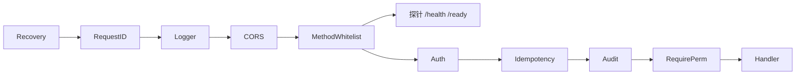
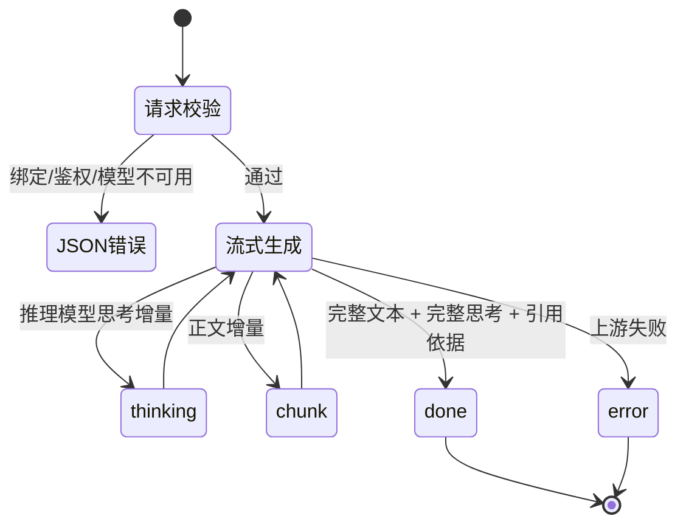

# 接口契约

本文描述 NovelWorkbench 对外暴露的全部 HTTP 接口：通用约定、响应包络、业务码映射、中间件链、权限码、按模块分组的接口总表与特殊端点。

## 1. 通用约定

| 项 | 约定 | 代码位置 |
| --- | --- | --- |
| 业务基础路径 | `/api/v1` | `router.go` 的 `v1 := router.Group("/api/v1")` |
| 探针路径 | `/health`、`/ready`，注册在 `/api/v1` 之外 | `router.go` 的 `NewRouter` |
| 接口总数 | `/api/v1` 下 110 条，另有 2 条探针，共 112 条 | `router.go` |
| 允许方法 | 仅 `GET` / `POST`；`OPTIONS` 只用于 CORS 预检 | `pkg.MethodWhitelistMiddleware` |
| 请求编码 | `POST` 默认 `application/json`（`ShouldBindJSON`）；`/knowledge/upload` 为 `multipart/form-data` | 各 `*_api.go` |
| 查询参数 | `GET` 用 query（`ShouldBindQuery`），路径变量用 `c.Param` | 各 `*_api.go` |
| 鉴权头 | `Authorization: Bearer <access_token>` | `pkg.AuthMiddleware` |
| 链路头 | 请求 `X-Request-ID` 透传；缺省生成 `REQ_` 前缀 ULID，响应头回写同值 | `pkg.RequestIDMiddleware` |
| 业务码 | 字符串 `SUCCESS` 或 `ERR_*` | `domain.RespCode*` |
| ID 形态 | 业务前缀 + ULID（`PRJ_` / `CHP_` / `DOC_` / `MDL_` …） | `domain/common.go` 的 `IDPrefix*` |
| 时间 | 视图对象统一给 RFC3339 字符串（`2026-11-21T03:09:39Z`），零值给空串；日期参数为 `YYYY-MM-DD` | 各 VO |
| 数据归属 | 项目域资源一律经 `mustOwnProject` / `mustOwnDoc` 等校验归属，越权返回 `ERR_FORBIDDEN` | `service/project_service.go` |

CORS 放行 `Origin`、`Content-Type`、`Authorization`、`X-Request-ID`，暴露 `X-Request-ID`，预检缓存 12 小时（`router.go` 的 `cors.Config`）。

## 2. 响应包络

成功（`pkg.Ok`，HTTP 恒为 200）：

```json
{
  "resp_code": "SUCCESS",
  "resp_message": "ok",
  "trace_id": "REQ_01HZX...",
  "data": { "total": 0, "page_num": 1, "page_size": 20, "items": [] }
}
```

失败（`pkg.Fail` / `pkg.FailErr`）：

```json
{
  "resp_code": "ERR_INVALID_PARAM",
  "resp_message": "参数校验失败: Key: 'ProjectCreateREQ.ProjectName' ...",
  "trace_id": "REQ_01HZX...",
  "data": null
}
```

包络结构为 `domain.BaseRESP`（`resp_code` / `resp_message` / `trace_id`）嵌套 `domain.DataRESP[T].data`。
`pkg.FailErr` 对 `pkg.BizError` 保留其业务码与文案，其他 `error` 记日志后统一输出 `ERR_INTERNAL` 与「服务内部错误，请稍后重试」。
绑定失败由各处理器的 `bindErr` 转成 `ERR_INVALID_PARAM`，消息前缀固定为「参数校验失败: 」。
无返回体的写接口 `data` 为 `null`。

## 3. 业务码 → HTTP 状态

映射唯一入口为 `pkg.HTTPStatusForCode`（`backend/internal/pkg/response.go`），未知码归 500。

| 业务码 | HTTP | 语义 | 典型触发 |
| --- | --- | --- | --- |
| `SUCCESS` | 200 | 成功 | 正常返回 |
| `ERR_INVALID_PARAM` | 400 | 参数校验失败 | `binding` 校验失败、非 GET/POST 请求 |
| `ERR_UNAUTHORIZED` | 401 | 未登录或登录失效 | 缺令牌、JWT 解析失败、令牌已吊销、账号禁用 |
| `ERR_FORBIDDEN` | 403 | 无权限 | 缺少权限码、非资源归属人、模型未授权 |
| `ERR_NOT_FOUND` | 404 | 资源不存在 | ULID 查不到 |
| `ERR_CONFLICT` | 409 | 资源冲突 | 重名、邮箱重复、重复提交 |
| `ERR_BIZ_FAILED` | 400 | 通用业务失败 | 删除默认模型、删除含模型的供应商、内置提示词删除 |
| `ERR_AI_PROVIDER` | 502 | AI 调用失败 | 无可用模型、供应商停用、上游报错 |
| `ERR_STORAGE` | 503 | 基础设施异常 | MinIO / Manticore / RabbitMQ 失败、`/ready` 依赖未就绪 |
| `ERR_INTERNAL` | 500 | 服务内部错误 | 未归类 error、panic 恢复、权限判定报错 |

`ERR_BIZ_FAILED` 与 `ERR_INVALID_PARAM` 同为 400，客户端须以 `resp_code` 而非 HTTP 状态区分。

## 4. 中间件链与白名单

`api.NewRouter` 的装配顺序：



| 序 | 中间件 | 作用 | 失败输出 |
| --- | --- | --- | --- |
| 1 | `pkg.RecoveryMiddleware` | 捕获 panic，记录堆栈并中止链 | `ERR_INTERNAL` / 500 |
| 2 | `pkg.RequestIDMiddleware` | 分配或透传 `X-Request-ID`，写入上下文键 `request_id` | 无 |
| 3 | `pkg.LoggerMiddleware` | 出口记录 method / path / status / latency_ms | 无 |
| 4 | `cors.New(...)` | 处理预检，预检直接返回 | 无 |
| 5 | `pkg.MethodWhitelistMiddleware` | 仅放行 GET / POST | `ERR_INVALID_PARAM` / 400 |
| 6 | `pkg.AuthMiddleware` | 仅挂 `/api/v1` 组；校验令牌、吊销名单、密码版本、用户状态，注入上下文键 `user_ulid` | `ERR_UNAUTHORIZED` / 401 |
| 7 | `pkg.IdempotencyMiddleware` | 仅挂 `/api/v1` 组；按 `Idempotency-Key` 保证写动作只执行一次 | `ERR_INVALID_PARAM` / `ERR_CONFLICT` |
| 8 | `pkg.AuditMiddleware` | 仅挂 `/api/v1` 组；记录 POST 审计（请求体 + 响应体） | 不阻断业务 |
| 9 | `pkg.RequirePermMiddleware` | 分组级权限门禁 | `ERR_FORBIDDEN` / 403，判定报错 `ERR_INTERNAL` / 500 |

`/health`、`/ready` 注册在 `/api/v1` 组之前，只经过 1–5，不鉴权、不审计。

鉴权中间件内部顺序：跳过名单直接放行 → 取 `Authorization`（缺省 401「未登录」）→ `JWTSigner.ParseClaims`（失败 401「登录已失效」）→ `TokenStore.IsRevoked` 命中 401「登录已失效」→ `UserStateChecker` 返回账号状态与当前密码版本（禁用 401「账号不存在或已被禁用」，判定报错 500）→ 令牌内 `pwd_epoch` 落后于库内版本时 401「密码已变更，请重新登录」。

### 4.1 免鉴权白名单

`backend/cmd/server/main.go` 传入 `pkg.AuthMiddleware` 的 `skipPaths`：

| 路径 | 原因 |
| --- | --- |
| `/api/v1/auth/login` | 登录请求本身无令牌 |

其余 `/api/v1` 路径一律要求登录；系统不开放注册，账号只能由管理员经 `/admin/user/create` 创建。

### 4.2 审计跳过名单

`backend/cmd/server/main.go` 传入 `pkg.AuditMiddleware` 的 `skipPaths`：

| 路径 | 原因 |
| --- | --- |
| `/api/v1/auth/login` | 尚无登录用户可归属 |
| `/api/v1/auth/logout` | 不落审计 |
| `/api/v1/chat/send` | 高频流式调用，不落审计 |

审计规则（`pkg/access_middleware.go`）：只记录 `POST`；`action_code` 取路径去掉 `/api/v1/` 前缀；所有 POST 都会读取 body 提取目标（键白名单覆盖 user / role / menu / project / chapter / document / prompt / tool / model / provider / chat_session / notification），body 采样上限 32KB、`multipart` 不采样且读后还原，凭据字段（`password_text`、`new_password_text`、`old_password_text`、`api_key_text`、`access_token`）脱敏为 `***`；响应体同样采样落库（上限 32KB，超限追加「已截断」标记，非 JSON 流式响应记占位说明），并从响应包络解析 `resp_code` / `resp_message`，按 HTTP 状态推导 `log_level_code`（`info` / `warn` / `error`），`trace_id` 取请求链路 ID；落库失败只记 `audit_record_failed` 告警。审计详情接口返回 `request_body` 与 `resp_body`，前端详情抽屉同时展示两者。

### 4.3 写请求幂等

`pkg.IdempotencyMiddleware`（`backend/internal/pkg/idempotency.go`）对**写动作**提供「同一次点击只执行一次」语义：

- 键来自请求头 `Idempotency-Key`，缓存键为 `nw:idempotency:<sha256(用户 + 路径 + 键)>`，按用户隔离；
- 仅路径末段命中写动作白名单（`create/save/update/delete/restore/upload/reindex/review/invoke/set_default/grant/test/read/read_all/apply/retry/change/reset_password`）才生效；列表、详情等查询类 POST 一律不缓存，否则会读到写前快照；
- 首请求以 `SET NX` 抢占并写 `processing`，成功后以 `SET XX` 覆盖为 `done` 并保留 24 小时；重放直接返回首响应，并带 `Idempotent-Replay: true`；
- 同键不同请求体返回 `ERR_INVALID_PARAM`「同一 Idempotency-Key 不能用于不同的请求内容」，同键仍在处理中返回 `ERR_CONFLICT`「相同请求正在处理中，请稍候」；
- 只有 2xx 才缓存：业务校验失败或 5xx 会释放键，允许客户端改正后重试；
- 登录、登出在跳过名单内（重放登录会把旧令牌再发一次）；Redis 不可用时降级为普通请求，不阻断业务。

前端在 `frontend/src/request/index.ts` 为每个 POST 生成 `Idempotency-Key`（26 位 ULID，见 `utils/idempotency.ts`），并对「写动作 + 相同 URL + 相同请求体」的在途请求做单飞合并，双击不会产生两条并发写入。

### 4.4 删除幂等

所有删除接口遵循「目标已不存在 = 删除成功」：`project`、`volume`、`chapter`、`character`、`character relation`、`lore`、`outline node`、`outline scene`、`knowledge doc`、`chat session`、`prompt`、`tool`、`role`、`menu`、`model provider`、`model catalog`、`user` 在查不到目标时直接返回 `SUCCESS`。越权（目标存在但不归属当前用户）仍返回 `ERR_FORBIDDEN`，不会因幂等被吞掉。

## 5. 权限码

权限码定义在 `backend/internal/domain/role.go`，共 14 个常量。`RequirePermMiddleware` 通过 `pkg.PermChecker`（由 `service.RoleService` 实现）判定，命中 `*` 视为全部权限。

| 权限码 | 常量 | 校验路由 |
| --- | --- | --- |
| `*` | `PermAdminAll` | 通配，内置 `admin` 角色持有；不做单点路由绑定 |
| `system:user:manage` | `PermUserManage` | `/admin/user/*`（5 条） |
| `system:role:manage` | `PermRoleManage` | `/admin/role/*`（3 条） |
| `system:menu:manage` | `PermMenuManage` | `/menu/list`、`/menu/detail/:MenuULID`、`/menu/save`、`/menu/delete` |
| `system:perm:read` | `PermPermissionRead` | `/menu/permission/catalog` |
| `system:audit:read` | `PermAuditRead` | `/admin/audit/list`、`/admin/audit/detail/:AuditULID` |
| `system:loginlog:read` | `PermLoginLogRead` | `/admin/login_log/list` |
| `system:model:manage` | `PermModelManage` | `/model/provider/*`、`/model/catalog/*`（10 条） |
| `system:usage:read` | `PermUsageRead` | `/model/usage/overview` |
| `system:status:read` | `PermSystemRead` | `/system/status` |
| `system:setting:manage` | `PermSettingManage` | `/setting/update` |
| `system:job:manage` | `PermJobManage` | `/admin/job/list`、`/admin/job/stats`、`/admin/job/retry` |
| `prompt:manage` | `PermPromptManage` | `/prompt/save`、`/prompt/delete` |
| `tool:manage` | `PermToolManage` | `/tool/save`、`/tool/delete` |

未列入上表的其余 `/api/v1` 路由均为「登录用户即可访问」，数据范围由归属校验收窄。

权限目录（`GET /menu/permission/catalog`）由菜单表汇总而来：`service/menu_service.go` 的 `buildPermCatalog` 先登记 `*`，再按菜单行的 `perm_code` 逐条登记（同一码只登记一次），按权限码首段分组（当前实际使用 `system` / `prompt` / `tool`）并升序返回。因此新增权限码只需在菜单管理里登记一行，无需改代码。

角色授权规则（`service/role_service.go`）：

- 提交的 `perm_codes` 必须先通过校验：去重保序、剔除空白，**未在权限目录登记的编码直接返回 `ERR_INVALID_PARAM`**，`*` 只允许 `admin` 角色持有；
- `perm_codes` 缺省（`null`）表示「不修改权限」，只改名称/备注的请求不会把权限清空；传 `[]` 才表示清空；
- 管理员角色的 `*` 是系统不变量：任何保存都会强制保留，避免改坏后无人能进入管理端；
- 内置角色权限在启动时自动修复：`admin` 固定为 `*`，其他内置角色剔除 `*` 与未登记编码（普通角色带 `*` 会让前端把权限面板锁成只读，该状态不可手工修复，只能由启动期自愈纠正）；
- 菜单被删除、权限码被改写或菜单被停用后，`RoleService.PrunePermCode` 会从所有角色中剔除该悬挂权限码，`*` 永不被剔除。

### 5.1 密码版本与令牌失效

`users.pwd_epoch` 记录密码版本，签发 JWT 时写入 `pwd_epoch` 声明；鉴权中间件每次比对令牌版本与库内版本，落后即返回 `ERR_UNAUTHORIZED`「密码已变更，请重新登录」。本人改密与管理员重置密码都会 `pwd_epoch + 1`，因此改密后所有旧令牌立刻失效。本人改密接口返回新令牌（`UserPasswordChangeDTO`），前端收到后立即替换本地令牌，避免「改完密码把自己踢下线」。

## 6. 探针

| 方法 | 路径 | 鉴权 | 成功 data | 失败 |
| --- | --- | --- | --- | --- |
| GET | `/health` | 免鉴权 | `{"status":"up"}` | 不会失败（`healthCheck` 不检查依赖） |
| GET | `/ready` | 免鉴权 | `{"status":"ready"}` | 依赖 Ping 失败返回 `ERR_STORAGE` / 503「依赖未就绪」 |

两者均由 `pkg.Ok` 输出包络；`/ready` 的检查函数由 `main.go` 注入（`RouterDeps.ReadyCheck`，Postgres Ping）。

## 7. 接口总表

约定：`POST` 请求体为 JSON（`/knowledge/upload` 除外），`GET` 参数为 query 或路径变量；权限门禁见第 5 节——未列入该节权限码表的路由均为「登录用户即可访问」，数据范围由归属校验收窄。

### 7.1 认证与个人中心（6 条）

| 方法 | 路径 | 请求 | 响应 data |
| --- | --- | --- | --- |
| POST | `/auth/login` | `UserLoginREQ` | `UserLoginDTO` |
| GET | `/auth/profile` | 无 | `UserVO` |
| POST | `/auth/logout` | 无（读 `Authorization` 头） | `null` |
| GET | `/profile/detail` | 无 | `UserProfileVO` |
| POST | `/profile/update` | `UserProfileUpdateREQ` | `UserProfileVO` |
| POST | `/profile/password/change` | `UserPasswordChangeREQ` | `UserPasswordChangeDTO`（新令牌） |

### 7.2 站内通知（5 条）

| 方法 | 路径 | 请求 | 响应 data |
| --- | --- | --- | --- |
| POST | `/notification/list` | `NotificationListREQ` | `PageDTO<NotificationVO>` |
| GET | `/notification/unread_count` | 无 | `NotificationUnreadCountVO` |
| POST | `/notification/read` | `NotificationReadREQ` | `null` |
| POST | `/notification/read_all` | 无 | `null` |
| POST | `/notification/delete` | `NotificationDeleteREQ` | `null` |

### 7.3 项目、卷、章节与快照（19 条）

| 方法 | 路径 | 请求 | 响应 data |
| --- | --- | --- | --- |
| POST | `/project/create` | `ProjectCreateREQ` | `ProjectVO` |
| POST | `/project/update` | `ProjectUpdateREQ` | `ProjectVO` |
| POST | `/project/delete` | `ProjectDeleteREQ` | `null` |
| POST | `/project/list` | `ProjectListREQ` | `PageDTO<ProjectVO>` |
| GET | `/project/detail/:ProjectULID` | 路径变量 | `ProjectVO` |
| GET | `/project/tree/:ProjectULID` | 路径变量 | `ProjectTreeVO` |
| POST | `/project/bootstrap/plan` | `ProjectBootstrapREQ` | `ProjectBootstrapPlanVO` |
| POST | `/project/bootstrap/apply` | `ProjectBootstrapApplyREQ` | `ProjectBootstrapResultVO` |
| POST | `/volume/create` | `VolumeCreateREQ` | `VolumeVO` |
| POST | `/volume/update` | `VolumeUpdateREQ` | `VolumeVO` |
| POST | `/volume/delete` | `VolumeDeleteREQ` | `null` |
| POST | `/chapter/create` | `ChapterCreateREQ` | `ChapterDetailVO` |
| POST | `/chapter/update` | `ChapterUpdateREQ` | `ChapterDetailVO` |
| POST | `/chapter/delete` | `ChapterDeleteREQ` | `null` |
| GET | `/chapter/detail/:ChapterULID` | 路径变量 | `ChapterDetailVO` |
| GET | `/chapter/snapshot/list/:ChapterULID` | 路径变量 | `[]ChapterSnapshotVO` |
| POST | `/chapter/snapshot/create` | `ChapterSnapshotCreateREQ` | `ChapterSnapshotVO` |
| POST | `/chapter/snapshot/restore` | `ChapterSnapshotRestoreREQ` | `ChapterDetailVO` |
| POST | `/chapter/check` | `ChapterCheckREQ` | `ChapterCheckVO` |

### 7.4 角色、设定与关系图（9 条）

| 方法 | 路径 | 请求 | 响应 data |
| --- | --- | --- | --- |
| POST | `/character/save` | `CharacterREQ` | `CharacterVO` |
| POST | `/character/delete` | `CharacterDeleteREQ` | `null` |
| POST | `/character/list` | `CharacterListREQ` | `[]CharacterVO` |
| GET | `/character/graph/:ProjectULID` | 路径变量 | `CharacterGraphVO` |
| POST | `/character/relation/save` | `CharacterRelationREQ` | `CharacterEdgeVO` |
| POST | `/character/relation/delete` | `CharacterRelationDeleteREQ` | `null` |
| POST | `/lore/save` | `LoreREQ` | `LoreVO` |
| POST | `/lore/delete` | `LoreDeleteREQ` | `null` |
| POST | `/lore/list` | `LoreListREQ` | `[]LoreVO` |

### 7.5 知识库（8 条）

| 方法 | 路径 | 请求 | 响应 data |
| --- | --- | --- | --- |
| POST | `/knowledge/upload` | multipart：`project_ulid`、`doc_name`、`file` | `KnowledgeDocumentVO` |
| POST | `/knowledge/list` | `KnowledgeListREQ` | `PageDTO<KnowledgeDocumentVO>` |
| POST | `/knowledge/delete` | `KnowledgeDeleteREQ` | `null` |
| POST | `/knowledge/search` | `KnowledgeSearchREQ` | `KnowledgeSearchDTO` |
| POST | `/knowledge/reindex` | `KnowledgeReindexREQ` | `null` |
| GET | `/knowledge/chunk/list/:DocULID` | query：`page_num`、`page_size` | `PageDTO<KnowledgeChunkVO>` |
| GET | `/knowledge/content/:DocULID` | 路径变量 | 原始字节，非包络（见 §8.2） |
| GET | `/knowledge/stats/:ProjectULID` | 路径变量 | `KnowledgeStatsVO` |

### 7.6 提示词与工具（9 条）

| 方法 | 路径 | 权限门禁 | 请求 | 响应 data |
| --- | --- | --- | --- | --- |
| GET | `/prompt/list` | — | query：`scope_code`、`project_ulid`、`prompt_kind_code`、`category_code`、`keyword_text`、`enabled_only` | `[]PromptVO` |
| GET | `/prompt/detail/:PromptULID` | — | 路径变量 | `PromptVO` |
| POST | `/prompt/resolve` | — | `PromptResolveREQ` | `PromptResolveDTO` |
| POST | `/prompt/save` | `prompt:manage` | `PromptREQ` | `PromptVO` |
| POST | `/prompt/delete` | `prompt:manage` | `PromptDeleteREQ` | `null` |
| GET | `/tool/list` | — | query：`keyword_text`、`enabled_only` | `[]ToolVO` |
| POST | `/tool/invoke` | — | `ToolInvokeREQ` | `ToolInvokeDTO` |
| POST | `/tool/save` | `tool:manage` | `ToolREQ` | `ToolVO` |
| POST | `/tool/delete` | `tool:manage` | `ToolDeleteREQ` | `null` |

### 7.7 菜单、配置与总览（9 条）

| 方法 | 路径 | 权限门禁 | 请求 | 响应 data |
| --- | --- | --- | --- | --- |
| GET | `/menu/nav` | — | 无 | `MenuNavDTO` |
| GET | `/menu/list` | `system:menu:manage` | query：`keyword_text`、`menu_type_code`、`scope_code` | `[]MenuVO` |
| GET | `/menu/detail/:MenuULID` | `system:menu:manage` | 路径变量 | `MenuVO` |
| POST | `/menu/save` | `system:menu:manage` | `MenuREQ` | `MenuVO` |
| POST | `/menu/delete` | `system:menu:manage` | `MenuDeleteREQ` | `null` |
| GET | `/menu/permission/catalog` | `system:perm:read` | 无 | `[]PermGroupVO` |
| GET | `/setting/list` | — | 无 | `[]SettingVO` |
| POST | `/setting/update` | `system:setting:manage` | `SettingUpdateREQ` | `SettingVO` |
| GET | `/stats/overview` | — | query：`project_ulid`（可空，空为全局） | `StatsOverviewVO` |

### 7.8 AI 对话（5 条）

| 方法 | 路径 | 请求 | 响应 data |
| --- | --- | --- | --- |
| POST | `/chat/send` | `ChatSendREQ` | `text/event-stream`（见 §8.1） |
| POST | `/chat/history` | `ChatHistoryREQ` | `PageDTO<ChatMessageVO>` |
| POST | `/chat/session/create` | `ChatSessionCreateREQ` | `ChatSessionVO` |
| POST | `/chat/session/list` | `ChatSessionListREQ` | `[]ChatSessionVO` |
| POST | `/chat/session/delete` | `ChatSessionDeleteREQ` | `null` |

### 7.9 创作规划与连续性（13 条）

| 方法 | 路径 | 请求 | 响应 data |
| --- | --- | --- | --- |
| POST | `/outline/node/save` | `OutlineNodeREQ` | `OutlineNodeVO` |
| POST | `/outline/node/delete` | `OutlineNodeDeleteREQ` | `null` |
| POST | `/outline/list` | `OutlineTreeREQ` | `[]OutlineNodeVO` |
| POST | `/outline/scene/save` | `DetailedSceneREQ` | `DetailedSceneVO` |
| POST | `/outline/scene/delete` | `DetailedSceneDeleteREQ` | `null` |
| POST | `/outline/scene/list` | `DetailedSceneListREQ` | `[]DetailedSceneVO` |
| POST | `/continuity/fact/save` | `TemporalFactSaveREQ` | `TemporalFactVO` |
| POST | `/continuity/fact/review` | `TemporalFactReviewREQ` | `TemporalFactVO` |
| POST | `/continuity/fact/list` | `TemporalFactListREQ` | `[]TemporalFactVO` |
| POST | `/continuity/hook/save` | `ForeshadowHookSaveREQ` | `ForeshadowHookVO` |
| POST | `/continuity/hook/list` | `ForeshadowHookListREQ` | `[]ForeshadowHookVO` |
| POST | `/continuity/summary/save` | `ChapterSummarySaveREQ` | `ChapterSummaryVO` |
| POST | `/continuity/summary/list` | `ChapterSummaryListREQ` | `[]ChapterSummaryVO` |

### 7.10 模型生态与运行状态（13 条）

| 方法 | 路径 | 权限门禁 | 请求 | 响应 data |
| --- | --- | --- | --- | --- |
| GET | `/model/capability` | — | 无 | `ModelCapabilityVO` |
| POST | `/model/provider/list` | `system:model:manage` | 无 | `[]ModelProviderVO` |
| POST | `/model/provider/save` | `system:model:manage` | `ModelProviderREQ` | `ModelProviderVO` |
| POST | `/model/provider/delete` | `system:model:manage` | `ModelProviderDeleteREQ` | `null` |
| POST | `/model/provider/test` | `system:model:manage` | `ModelProviderTestREQ` | `ModelProviderTestDTO` |
| POST | `/model/catalog/list` | `system:model:manage` | `ModelCatalogListREQ` | `[]ModelCatalogVO` |
| POST | `/model/catalog/save` | `system:model:manage` | `ModelCatalogREQ` | `ModelCatalogVO` |
| POST | `/model/catalog/delete` | `system:model:manage` | `ModelCatalogDeleteREQ` | `null` |
| POST | `/model/catalog/test` | `system:model:manage` | `ModelCatalogTestREQ` | `ModelCatalogTestDTO` |
| POST | `/model/catalog/set_default` | `system:model:manage` | `ModelCatalogTestREQ` | `null` |
| POST | `/model/catalog/grant` | `system:model:manage` | `ModelGrantREQ` | `null` |
| GET | `/model/usage/overview` | `system:usage:read` | query：`from_date`、`to_date` | `ModelUsageOverviewVO` |
| GET | `/system/status` | `system:status:read` | 无 | `SystemStatusVO` |

### 7.11 系统管理（14 条）

| 方法 | 路径 | 权限门禁 | 请求 | 响应 data |
| --- | --- | --- | --- | --- |
| POST | `/admin/user/list` | `system:user:manage` | `UserAdminListREQ` | `PageDTO<UserAdminVO>` |
| POST | `/admin/user/create` | `system:user:manage` | `UserAdminCreateREQ` | `UserAdminVO` |
| POST | `/admin/user/update` | `system:user:manage` | `UserAdminUpdateREQ` | `UserAdminVO` |
| POST | `/admin/user/delete` | `system:user:manage` | `UserAdminDeleteREQ` | `null` |
| POST | `/admin/user/reset_password` | `system:user:manage` | `UserResetPasswordREQ` | `null` |
| POST | `/admin/role/list` | `system:role:manage` | `RoleListREQ` | `PageDTO<RoleVO>` |
| POST | `/admin/role/save` | `system:role:manage` | `RoleSaveREQ` | `RoleVO` |
| POST | `/admin/role/delete` | `system:role:manage` | `RoleDeleteREQ` | `null` |
| POST | `/admin/audit/list` | `system:audit:read` | `AuditListREQ` | `PageDTO<AuditVO>` |
| GET | `/admin/audit/detail/:AuditULID` | `system:audit:read` | 路径变量 | `AuditDetailVO` |
| POST | `/admin/login_log/list` | `system:loginlog:read` | `LoginLogListREQ` | `PageDTO<LoginLogVO>` |
| POST | `/admin/job/list` | `system:job:manage` | `JobListREQ` | `PageDTO<JobVO>` |
| GET | `/admin/job/stats` | `system:job:manage` | 无 | `JobStatsVO` |
| POST | `/admin/job/retry` | `system:job:manage` | `JobRetryREQ` | `null` |

### 7.12 非通用业务规则

字段级定义以 `backend/internal/domain/*.go` 为唯一事实源（每个 REQ/VO 字段都带注释与 `binding` 校验），此处只记录**从字段名看不出来**的规则。

| 模块 | 规则 |
| --- | --- |
| 认证 | 登录名或邮箱均可登录（`UserRepo.GetByAccount` 同时匹配两列）；账号不存在与密码错误返回同一文案与同一业务码，不泄露账号是否存在。登出把当前令牌写入吊销名单（Redis），之后同一令牌访问任意接口返回 401 |
| 个人中心 | `UserProfileUpdateREQ` 只允许改 `user_email`、`avatar_url`、`remark_text`，`user_name` 不可改。旧密码不符返回 `ERR_UNAUTHORIZED`，邮箱冲突返回 `ERR_CONFLICT` |
| 站内通知 | `NotificationReadREQ.notification_ulid_list` 为 1–100 条的批量标记。全部接口按 `user_ulid` 隔离，只作用于当前用户的通知 |
| 项目 | `project_status` 取 `draft` / `serial` / `completed`，创建时固定 `draft`。删除项目在单个事务内级联清理卷、章节、快照、角色、设定、大纲节点与场景卡、连续性数据、会话、知识库文档与统计；事务提交后由 `cleanupKnowledgeExternal` 清理 MinIO 原文与 Manticore 切片，失败仅告警 |
| AI 开书 | `target_chapter_count` 缺省 12。`plan` 只生成不落库，模型输出经 `normalizeBootstrapPlan` 收敛（卷 ≤3、角色 ≤8、设定 ≤10、枚举值校正、名称截断），作者可改字段后回传；`apply` 在单事务内创建项目、卷、章节、角色、设定与两级大纲节点（卷 → 章），失败整体回滚。生成失败返回 `ERR_AI_PROVIDER`，模型未授权返回 `ERR_FORBIDDEN` |
| 卷与章节 | 卷与章节的 `volume_order` / `chapter_order` 传 0 表示取同级最大值 +1。`ChapterUpdateREQ` 是整体覆盖；`content_text`、`summary_text` 为指针字段，省略表示不改、空串表示清空。`ChapterSnapshotRestoreREQ` 回滚前会为当前正文再留一份快照。`ChapterCheckREQ.content_text` 优先于库内正文 |
| 角色与关系图 | `CharacterREQ.character_ulid` 为空即新建。`CharacterRelationREQ` 拒绝自环，两端角色必须存在且同属本项目。删除角色时连带删除其关系边 |
| 设定与笔记 | `lore_type_code` 的 `note` 即创作笔记，与其他设定共用同一组接口。`content_mode_code` 缺省 `rich` |
| 知识库 | 上传仅接受 `txt` / `md` / `docx` / `pdf`，文件字段名固定 `file`；超过 `NW_APP_UPLOAD_MAX_MB` 返回 `ERR_INVALID_PARAM`。上传成功即写入 MinIO 原文、落库 `pending` 并投递 `doc_index` 任务。`KnowledgeSearchREQ.keyword_text` 去空白后为空返回 `ERR_INVALID_PARAM`；`search_mode` 仅 `hybrid` 走双通道，其余值一律按 `keyword`；`top_k_count` 缺省取应用配置 `rag_top_k`，再退回全局配置 |
| 提示词 | 作用域 `global` / `project`；同编码的项目提示词覆盖全局提示词，被覆盖项在列表里带 `overridden_flag`。编码解析：请求体 `prompt_code` 优先，否则只解析正文**首个 token** 的 `/code`，命中启用提示词则剥离命令，未命中按自由对话处理。模板占位符只允许 `user_input` / `chapter_content` / `context` / `prompt_code`，保存期校验，未登记占位符直接 `ERR_INVALID_PARAM`。指令类提示词若用了写作台保留动作编码（`/help` 等），保存被拒绝 |
| 工具 | 内置 6 个工具不可删、不可改编码；`customized_flag` 由名称/说明/参数的改动推导，改过后代码升级不再覆盖。`/tool/invoke` 按登录用户执行归属校验，结果只读、不写项目数据；`content_text` 为空时回落到 `chapter_ulid` 的库内正文。工具不由命令注入：服务端随请求下发启用工具声明，模型自行决定调用与否 |
| 菜单与权限目录 | `page` 行承载页面权限码，`action` 行只登记动作权限码、不进导航。约束：`group` 不可配路由；菜单编码唯一；权限码全局唯一，同码只能被一行登记；上级必须存在且不能是自己或自己的下级；存在下级时不可删除（须先删下级）。隐藏页（`visible_flag=false`）仍下发，前端据此注册路由——这样「把多个页面合并成一个入口」时直接访问旧链接与深链不会失效 |
| 应用配置 | 键为白名单，值为正整数且须落在区间内，越界或键不在白名单返回 `ERR_INVALID_PARAM` |
| AI 对话 | `ref_*_ulid_list` 只对应 `@` 的两类来源（素材库与历史会话），装配方式见下表。工具**不在**请求体里点名：`tool_code_list` 字段已移除，服务端随请求下发启用工具声明，由模型自行决定调用；响应 `done` 事件的 `tool_code_list` 是模型本轮**实际调用**的编码，仅供展示与回看。引用文档必须是本项目或全局库，跨项目返回 `ERR_FORBIDDEN` |
| 创作规划 | 大纲节点 `node_type_code` 取 `volume` / `arc` / `storyBlock` / `chapter`，`node_status_code` 取 `draft` / `planning` / `ready` / `done`。父子关系与成环由 service 校验，含子节点不可直接删除 |
| 连续性看板 | 事实复核只接受 `confirmed` / `superseded` / `stale`，不允许退回 `candidate`。伏笔状态取 `planned` / `planted` / `echoed` / `resolved` / `abandoned`。`ChapterSummarySaveREQ` 不带 `summary_ulid` 时按 `(project_ulid, chapter_ulid)` 覆盖，保证「一章一条摘要」 |
| 模型生态 | 供应商承载「网关 + 凭据」，模型是使用与授权的最小单位：`model_providers` → `model_catalogs` → `model_role_grants` / `model_user_grants`。密钥以 AES-256-GCM 加密保存，VO 只回 `api_key_masked` 与 `api_key_configured`。`api_key_text` 传空表示保持原值。`role_ulid_list` 保存时整体覆盖授权。管理员（含 `*`）可见全部启用模型，其余账号按角色授权与用户直授的并集过滤 |
| 用量与运行状态 | 日期格式 `YYYY-MM-DD`；缺省近 14 天，非法输入回退默认，起止倒置自动纠正。`success_rate_value` 取 0–1。`dependency_code` 取 `postgres` / `redis` / `rabbitmq` / `minio` / `manticore` / `model`，`status_code` 取 `up` / `down` / `degraded` |
| 系统管理 | 用户与邮箱唯一，重复返回 `ERR_CONFLICT`；`role_codes` 为空时默认挂 `user` 角色，`UserAdminUpdateREQ.role_codes` 为整体覆盖语义；不能删除自己（`ERR_BIZ_FAILED`）。内置角色 `admin` / `user` 不可删除、不可改编码；仍有用户挂载的角色不可删除（`ERR_CONFLICT`）。审计列表的 `trace_id` 为精确匹配，`action_code` 与 `keyword_text` 为模糊匹配 |

`@` 引用的装配方式（优先级数值越大越靠前）：

| 字段 | 来源 | 装配方式 |
| --- | --- | --- |
| `ref_character_ulid_list` | 素材库 · 角色 | 显式引用块（优先级 90） |
| `ref_lore_ulid_list` | 素材库 · 设定 | 显式引用块；`note`（创作笔记）被拒 |
| `ref_chapter_ulid_list` | 素材库 · 章节 | 首项为当前章（100），其余 90 |
| `ref_summary_ulid_list` | 素材库 · 章节摘要 | 显式引用块 |
| `ref_doc_ulid_list` | 素材库 · 文档 | 全文按切片拼接后进块 |
| `ref_session_ulid_list` | 历史会话 | 逐条编号归档后进块，一条不删；当前会话自身被拒 |


## 8. 特殊端点

### 8.1 `POST /chat/send`（SSE）

流开始前的失败（绑定校验、鉴权、模型不可用）仍返回普通 JSON 包络；流开始后（响应头已提交）的失败只能经 SSE `error` 事件下发，服务端仅记日志。

响应头在首条事件写出时提交：

| 头 | 值 |
| --- | --- |
| `Content-Type` | `text/event-stream; charset=utf-8` |
| `Cache-Control` | `no-cache` |
| `X-Accel-Buffering` | `no` |

事件行格式 `data: {json}\n\n`，心跳为注释行 `: ping\n\n`；每条数据是 `domain.ChatStreamEventDTO`。

| 字段 | 类型 | 说明 |
| --- | --- | --- |
| `seq` | int64 | 单调递增事件序号 |
| `event_type` | string | `thinking` / `chunk` / `done` / `error` |
| `session_ulid` | string | 会话 ULID |
| `message_ulid` | string | 助手消息 ULID |
| `content_text` | string | 增量思考（`thinking`）、增量文本（`chunk`）或完整文本（`done`） |
| `reasoning_text` | string | 完整思考过程（`done` 时给出，模型未返回推理内容时为空串） |
| `reference_list` | `[]KnowledgeChunkVO` | RAG 召回依据（`done` 时给出） |
| `tool_code_list` | `[]string` | 本轮模型实际调用的工具编码（`done` 时给出） |
| `error_message` | string | 错误信息（`error` 时给出） |



客户端断开连接会取消上游模型调用；生成失败不落库助手消息，只保留用户消息。

`thinking` 事件只在模型返回推理内容（OpenAI 兼容协议的 `reasoning_content` / Anthropic 的 thinking block）时出现；非推理模型只会收到 `chunk` 与 `done`，前端据此在「等待首字节」与「思考中」之间自动切换。`ChatMessageVO.reasoning_text` 在拉取历史时一并返回，重开会话仍能看到上次的思考过程。

### 8.2 `GET /knowledge/content/:DocULID`（原始字节）

该端点成功时不返回业务包络，直接输出文件原始字节（`c.Data`）；失败路径仍由 `respondErr` 输出 JSON 包络。

| 项 | 行为 |
| --- | --- |
| `Content-Type` | `txt` → `text/plain; charset=utf-8`；`md` → `text/markdown; charset=utf-8`；`docx` → `application/vnd.openxmlformats-officedocument.wordprocessingml.document`；`pdf` → `application/pdf`；其他 → `application/octet-stream` |
| `Content-Disposition` | `inline; filename*=UTF-8''<url-escaped doc_name>` |

前端以 `fetch` 取 blob（`fetchKnowledgeContent`），交给 `docx-preview` / `vue-pdf-embed` 预览，`txt` / `md` 直接渲染。

## 9. 分页约定

| 项 | 规则 |
| --- | --- |
| 请求字段 | `page_num`、`page_size`（`domain.PageREQ`，JSON body 与 query 同名） |
| `page_num` | 从 1 开始；`<= 0` 归一为 1 |
| `page_size` | 缺省 20；`<= 0` 或 `> 100` 归一为 20（上限 100） |
| 归一入口 | `PageREQ.Normalize()`，由各 service 在查询前调用 |
| 响应结构 | `PageDTO<T>`：`total`、`page_num`、`page_size`、`items` |

返回 `PageDTO` 的端点（10 条）：

| 端点 | 分页字段来源 |
| --- | --- |
| `POST /project/list` | JSON body |
| `POST /knowledge/list` | JSON body |
| `GET /knowledge/chunk/list/:DocULID` | query |
| `POST /chat/history` | JSON body |
| `POST /notification/list` | JSON body |
| `POST /admin/user/list` | JSON body |
| `POST /admin/role/list` | JSON body |
| `POST /admin/audit/list` | JSON body |
| `POST /admin/login_log/list` | JSON body |
| `POST /admin/job/list` | JSON body |

返回普通数组、全量不翻页的端点：`/chapter/snapshot/list/:ChapterULID`、`/character/list`、`/lore/list`、`/prompt/list`、`/outline/list`、`/outline/scene/list`、`/continuity/fact/list`、`/continuity/hook/list`、`/continuity/summary/list`、`/chat/session/list`、`/model/provider/list`、`/model/catalog/list`、`/menu/list`、`/setting/list`、`/menu/permission/catalog`。

## 10. 前端消费规则

实现位于 `frontend/src/api/http.ts` 与 `frontend/src/composables/useSSE.ts`。

| 规则 | 实现 |
| --- | --- |
| 基础路径 | Axios 实例 `baseURL: '/api/v1'`，`timeout: 30000` |
| 令牌注入 | 请求拦截器从本地存储读 token，写入 `Authorization: Bearer <token>` |
| 包络解包 | 响应拦截器校验 `resp_code === 'SUCCESS'`，成功时把 `envelope.data` 直接作为调用方返回值；`get<T>` / `post<T>` 的 `T` 即 `data` 类型 |
| 失败归一 | 非成功包络或无响应体统一构造 `ApiError`（`resp_code`、`resp_message`、`trace_id`、`http_status`）并 reject；无响应体时归为 `ERR_INTERNAL` + `http_status = 0` |
| 未授权 | `resp_code === 'ERR_UNAUTHORIZED'` 时清除令牌与用户信息，提示后跳转 `/login`（登录接口自身的 401 不触发，避免凭据错误被误判为会话过期） |
| 静默失败 | 业务层用 `silent_error: true`（`http.ts` 的参数名）标记静默，落到请求层即 `silent: true`，跳过统一 `ElMessage` 提示（知识库列表 / 切片等自行处理错误时使用） |
| 不存在判定 | `isApiNotReadyError` 对 `ERR_NOT_FOUND` 或 HTTP 404 返回 true |
| 二进制端点 | `/knowledge/content` 不走 Axios 拦截器，用 `fetch` 手动带 `Authorization` 头并返回 `Blob`，`!response.ok` 直接抛错 |
| SSE 不走 Axios | `/chat/send` 用 `fetch` + `ReadableStream`（`streamSsePost`）发起；`parseSseBuffer` 只消费以 `\n` 结尾的完整行，末尾半行留作缓冲，跨 chunk 断行与多事件粘包都能正确解析，非法 JSON 行跳过 |
| 流取消 | `useSSE.startStream` 会先中止上一条流；`stopStream` 触发 `AbortController.abort`，`AbortError` 静默结束、不触发 `onError` |
