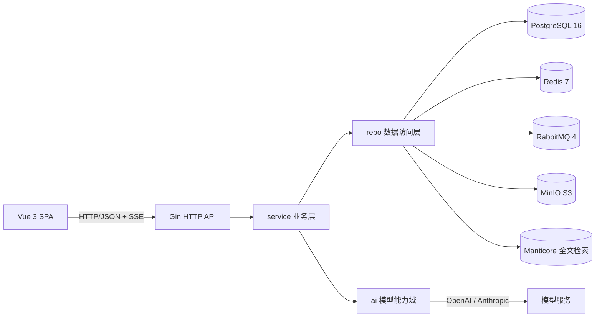
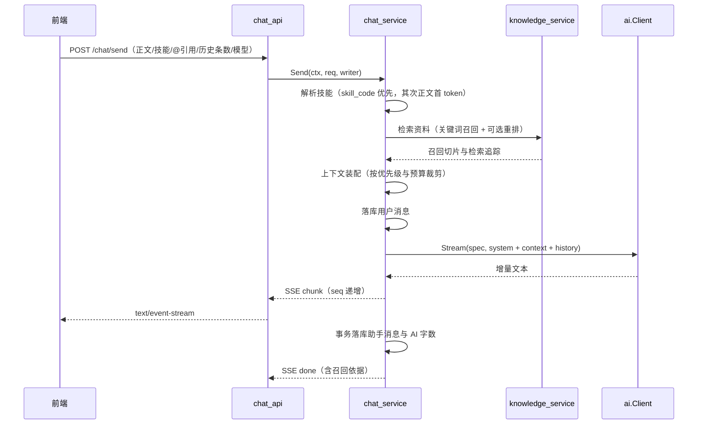

# NovelWorkbench 架构设计

本文描述 NovelWorkbench 当前的系统定位、技术选型、分层约束与核心链路实现。
只讲"现在是怎么设计的、为什么这样设计"，不记录演进过程。

## 1. 系统定位

NovelWorkbench 是前后端分离的 AI 小说创作工作台。系统以"项目 → 卷 → 章节"为写作主线，
把大纲、正文、角色、世界观、知识资料、AI 对话与技能统一在一个工作台中。

系统同时承担两类职责：

1. **SaaS 管理**：用户、角色权限、审计、模型供应商、用量分析、运行状态。
2. **创作业务**：项目导航、卷章目录、正文编辑、快照、角色关系、世界观设定、
   创作规划、连续性看板、知识库检索、AI 流式生成。

设计优先级：稳定性 > 体验 > 性能。项目当前无正式用户，系统收敛到清晰可维护的设计，
不做多余抽象层；所有写入动作由作者显式触发，AI 产出不自动落库到权威数据。

## 2. 总体结构



部署形态：前端 nginx 容器 + 后端 Go 容器。中间件可使用云服务器既有实例，
也可通过 `--profile infra` 在本地拉起同版本实例。后端 `CGO_ENABLED=0` 静态编译，不引入 cgo。

## 3. 技术选型

| 层 | 选型 | 承担的职责 |
| --- | --- | --- |
| 后端语言 | Go 1.24 | 静态编译，无 cgo，单二进制部署 |
| Web 框架 | Gin 1.11 | 路由、参数绑定、中间件链 |
| ORM | GORM 1.31 + pgx | 关系数据读写与自动迁移 |
| 配置 | Viper 1.21 | YAML 模板 + `NW_` 环境变量覆盖 |
| 日志 | Zap 1.28 | 结构化 JSON 日志 |
| AI 编排 | eino 0.9 + eino-ext | OpenAI 兼容与 Anthropic 消息协议对话组件 |
| 关系存储 | PostgreSQL 16 | 业务主数据、权限、统计、任务状态 |
| 全文检索 | Manticore（HTTP SQL API） | CJK ngram 全文召回，索引可整体重建 |
| 缓存 | Redis 7 | 登出令牌黑名单 |
| 队列 | RabbitMQ 4 | 知识库异步索引任务 |
| 对象存储 | MinIO | 知识库文档原文 |
| 前端 | Vue 3.4 + TypeScript 5.4 + Vite 5.2 | SPA |
| UI | Element Plus 2.9 + UnoCSS 0.58 | 组件库与品牌色工具类 |
| 状态 | Pinia 2.1 | 认证、应用配置、当前项目上下文 |
| 路由 | Vue Router 4.3 | 登录守卫、页面懒加载 |
| HTTP | Axios 1.6 | 包络解包、Bearer 注入、错误归一 |
| 可视化 | ECharts 5.5 / AntV X6 2.18 | 趋势图 / 角色关系图 |
| 编辑 | CodeMirror 6 / WangEditor 5 | 正文 / 富文本笔记 |

## 4. 后端分层

依赖方向严格单向：`api → service → repo → domain`。
`ai`、`infra`、`pkg` 是能力层与叶子层，不反向依赖 `api` 或 `service`。

```
backend/
├── cmd/server                装配启动、优雅关闭
├── configs/                  配置模板（凭据留空，靠环境变量注入）
├── internal/
│   ├── api                   HTTP 处理：绑定、鉴权挂载、响应输出
│   ├── service               业务规则、事务边界、上下文装配
│   ├── repo                  SQL 与中间件访问的唯一出口；含 WithTx 事务封装
│   ├── domain                DO/REQ/RESP/DTO/VO 唯一定义处
│   ├── ai                    模型网关、提示词模板、技能、用量契约
│   ├── infra                 配置加载、连接构造、启动期校验
│   └── pkg                   ULID、响应包络、错误、JWT、中间件、密钥封存、文本统计
```

分层约束：

| 规则 | 原因 |
| --- | --- |
| 请求/响应结构只在 domain 定义 | 前后端契约单一事实源 |
| SQL 只写在 repo | service 只调 repo 方法，不拼 gorm 条件 |
| service 持有 `*gorm.DB` 仅作事务入口 | 跨表写入需要同一事务；事务边界由 service 决定，`repo.WithTx` 提供唯一封装 |
| Manticore 客户端只在知识库相关 service 使用 | 检索是业务语义的一部分（融合、重排、追踪），不是通用数据访问 |
| service 不写 HTTP 状态码 | 响应码到 HTTP 状态的映射集中在 `pkg.HTTPStatusForCode` |
| api 不写业务判断 | 避免同规则散落多个处理器 |
| 文件名与业务名一致 | 一个业务域一个文件，便于检索 |
| 单文件不超过 500 行 | 控制认知负载；超限按同域子文件拆分 |
| 导出符号必须有注释 | 可读性与静态检查 |
| ID 用带业务前缀的 ULID | 例如 `PRJ_01H...`，日志可定位业务类型 |
| 字段使用显式后缀 | `project_name`、`genre_code`、`created_at_ms` |
| 业务码用字符串 | `SUCCESS`、`ERR_*`；HTTP 状态仍是 int |
| 路由只开放 GET/POST | 删除通过 `POST /xxx/delete`，方法白名单强制 |

## 5. 请求生命周期

中间件顺序：`Recovery → RequestID → Logger → CORS → MethodWhitelist → Auth → Audit → Permission`。

1. **Recovery** 捕获 panic，记日志并输出 500 包络。
2. **RequestID** 读取或生成 `REQ_` 前缀 ULID，贯穿日志与响应 `trace_id`。
3. **Logger** 在出口层记录路径、耗时、请求 ID、响应码。
4. **CORS** 允许前端开发态与部署态访问；预检请求不进入业务。
5. **MethodWhitelist** 只放行 GET/POST/OPTIONS。
6. **Auth** 解析 Bearer Token，注入 `user_ulid`；登出令牌在 Redis 黑名单；
   每次请求检查用户状态，禁用账号的旧令牌立即失效。
7. **Audit** 对写请求记录审计日志，失败只告警不阻断业务。
8. **Permission** 按权限码控制管理端路由。

统一响应包络：

```json
{
  "resp_code": "SUCCESS",
  "resp_message": "ok",
  "trace_id": "REQ_01HZX...",
  "data": {}
}
```

错误码族与 HTTP 状态映射只在 `pkg.codeHTTPStatus` 一处维护：

| 业务码 | HTTP 状态 | 语义 |
| --- | --- | --- |
| `SUCCESS` | 200 | 成功 |
| `ERR_INVALID_PARAM` | 400 | 参数校验失败 |
| `ERR_UNAUTHORIZED` | 401 | 未登录或登录失效 |
| `ERR_FORBIDDEN` | 403 | 无权限 |
| `ERR_NOT_FOUND` | 404 | 资源不存在 |
| `ERR_CONFLICT` | 409 | 资源冲突（重名/重复提交） |
| `ERR_BIZ_FAILED` | 400 | 通用业务失败 |
| `ERR_AI_PROVIDER` | 502 | AI 模型调用失败 |
| `ERR_STORAGE` | 503 | 对象存储/检索/队列等基础设施异常 |
| `ERR_INTERNAL` | 500 | 服务内部错误 |

## 6. 核心业务链路

### 6.1 登录与权限

- 注册创建用户并分配默认角色；密码用 bcrypt 哈希，API 永不返回哈希。
- 登录签发 JWT（HS256，默认 7 天），返回用户信息与权限码集合。
- 登出把令牌写入 Redis 黑名单，TTL 与令牌剩余有效期一致。
- 管理接口按权限码收口：`system:user:manage`、`system:role:manage`、`system:audit:read`、
  `system:model:manage`、`system:usage:read`、`system:status:read`。
- 权限逐请求查库，改角色立即生效；管理接口流量极低，这一跳查询可接受。

### 6.2 项目导航与写作台

- 项目是全部创作资源的隔离边界，所有创作表都带 `project_ulid`。
- 章节表同时冗余 `project_ulid`，鉴权不必多表 join。
- 快照用于留档与回滚；写入正文时服务端计算字数并按差值维护项目累计字数与当日统计。
- 前端侧边栏有项目切换器，URL 中的 `project_ulid` 优先级最高；路由变化反写 Pinia store，
  切换项目不丢失当前功能页面。

### 6.3 AI 对话



关键设计：

| 机制 | 实现 | 收益 |
| --- | --- | --- |
| 单链路 | 续写、润色、大纲、审稿都走 `/chat/send` + 技能码 | 上下文、容错、审计一处实现 |
| 双协议 | OpenAI 兼容与 Anthropic 消息协议 | 厂商不限，密钥加密存储 |
| 上下文预算 | 固定 12000 字符预算，按优先级裁剪整块 | 长篇输入可控且可解释 |
| 历史可配置 | 默认 5 条，请求可覆盖，显式引用不受限 | 用户能感知上下文长度 |
| SSE | `seq` 递增、15s 心跳、断连取消 | 流式体验稳定 |
| 召回透明 | `done` 事件返回引用依据 | AI 产出可追溯 |
| 失败不落库 | 客户端断开或生成失败不写助手消息 | 避免半成品污染历史 |

### 6.4 知识库检索

系统不接入向量模型，也不保留伪造向量。检索使用 Manticore CJK ngram 作为权威文本的可重建投影：

1. **上传**：原文写 MinIO，文档行落库 `pending`，投递 RabbitMQ 索引任务。
2. **索引**：拉取原文，按标题/段落/字符上限切片，计算内容哈希；写 Manticore，
   状态更新为 `indexed`。表结构与旧版不符时自动重建并回灌。
3. **检索**：从用户输入抽取查询词，Manticore 双通道召回候选；
   多通道时按 RRF 融合（`score = Σ 1/(60+rank)`），单通道按同式排序；
   可选 chat 模型按候选 ID 做重排，失败时回退原排序。
4. **追踪**：返回查询词、候选数、选中 ID、来源通道、耗时，前端展示"AI 依据"。

权威源是 PostgreSQL/MinIO 中的原文，Manticore 索引可随时重建。这一约束使删除、改名、
重新切片都可控，且不依赖外部向量服务。

### 6.5 创作规划与连续性

- 大纲树以项目为根，节点类型覆盖卷、幕、故事块与章节；父子关系与排序由 service 校验，
  含子节点的节点不可直接删除，父节点不能挂到自身或后代上。
- 场景卡挂在大纲节点上，记录出场角色、地点、冲突、节奏、入场状态、目标、关键选择、
  结果与出场状态，是章节正文生成前的可执行任务单。
- 连续性看板由时序事实、伏笔钩子与章节摘要三张账本组成；事实必须经过显式审核
  （确认/取代/过期）才成为正式依据，AI 产出默认只生成候选。
- 章节摘要带内容哈希与状态；正文变化后摘要可标记 stale，避免过期证据进入 AI 上下文。

### 6.6 设定与关系

- 角色卡：基础信息、性格、目标、秘密、声音特征、当前状态。
- 角色关系：起点角色、终点角色、关系描述；AntV X6 展示节点与边。
- 世界观设定：分类（世界背景/规则/地点/物品/事件）与关键词检索。
- 创作笔记复用设定表，`lore_type_code='note'`；私人笔记不注入 AI 上下文，避免污染创作证据。

### 6.7 运维与可观测性

- 用量：按供应商、模型、调用类型聚合调用次数、token、延迟、成功率；内存缓冲 5 秒批量落库。
- 运行状态：探测 PG/Redis/RabbitMQ/MinIO/Manticore 与模型健康，展示耗时与结论。
- 审计：记录写操作的操作者、动作码、资源、结果、客户端 IP。
- 系统配置：运行时可配置项（历史条数等）走 `app_settings` 表，改后立即生效。

## 7. 前端架构

```
frontend/src/
├── api        HTTP 客户端与模块 API
├── components 无业务组件（按钮/卡片/空态/加载/页头）
├── composables SSE 流式解析与请求
├── layout     主框架与项目上下文导航
├── router     路由表与守卫
├── stores     auth/app/project
├── styles     变量、全局样式、按钮五态
├── i18n       zh-CN/en-US
└── views      登录、仪表盘、工作台、角色、设定、笔记、创作规划、连续性、知识库、模型、管理
```

交互约定：

- 所有按钮走全局五态体系：默认、悬停放大、按下缩小、禁用、加载。
- 成功/失败必有反馈，错误页必有重试入口。
- 路由切换有过渡；卡片有悬停微抬起；列表有加载与空态。
- AI 流式输出逐字展示，停止按钮可取消请求。
- 项目上下文导航让任意项目页面都能直接切换到其他项目的同类页面。

## 8. 部署架构

- 后端镜像：多阶段构建，最终镜像只含二进制与 CA 证书，`CGO_ENABLED=0`。
- 前端镜像：Node 构建静态资源，nginx 提供 SPA、反代 `/api`、关闭 SSE 缓冲。
- Docker Compose：应用容器 + 可选本地中间件 profile。
- Podman Compose：云主机使用既有中间件网络；脚本完成构建、替换镜像、健康检查。
- CI：push/PR 触发 vet/build/test 与前端构建；tag 触发镜像发布。

## 9. 设计取舍

| 决策 | 收益 | 代价 |
| --- | --- | --- |
| 单 AI 链路 | 行为一致、排错路径唯一 | 一键生成需前端两步：发问 + 插入 |
| 不使用向量模型 | 部署轻、成本可控、结果可解释 | 同义改写召回弱于语义向量；用查询改写与 chat 重排补偿 |
| 关键词索引可重建 | 数据一致性与删除可控 | 索引构建需异步任务与状态机 |
| 项目切换器常驻 | 导航死角少 | 侧栏信息密度较高 |
| 审计同步落库 | 顺序一致、不丢记录 | 高写入量下表是热点；当前规模可接受 |
| 权限逐请求查库 | 改角色立即生效 | 管理接口多一跳查询；流量极低可接受 |
| 笔记复用设定表 | 少一张表、少一套 CRUD | 设定与笔记共用分类字段，笔记固定为 `note` 类型 |

## 10. 质量约束

- 所有 Go 源文件 ≤500 行；导出符号有注释；文件头有一句话职责说明。
- 前端页面样式超阈值抽到同目录 CSS，单文件保持可维护。
- 新增业务优先复用已有 DO/REQ/RESP/DTO/VO 命名与字段后缀约定。
- 不引入 cgo；不引入向量模型；不为几行不可复用代码抽函数。
- 文档只描述当前设计与实现，不写调研来源与对比。
