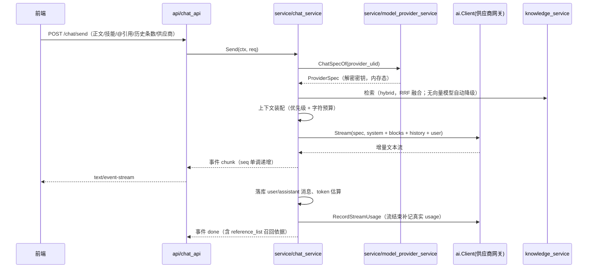

# NovelWorkbench 架构设计

## 1. 项目定位

NovelWorkbench 是前后端分离的 AI 小说创作工作台：以"项目—卷—章节"为创作主线，把 AI 生成、知识库检索、角色设定、斜杠技能统一到一条对话链路上，目标是让长篇创作的设定一致性与写作效率同时可控。

核心能力：

| 能力 | 说明 |
| --- | --- |
| 写作工作台 | 项目/卷/章节三级目录，章节编辑器（CodeMirror）、自动字数统计、快照留档与回滚 |
| AI 助手 | SSE 流式对话；斜杠命令（/续写 /润色 /大纲 等内置技能 + 自定义技能）；@引用文档与章节；引用最近 N 条历史（N 可配置）；按供应商/模型可选 |
| 模型生态 | 多供应商管理（OpenAI 兼容 / Anthropic 双协议）、密钥 AES-GCM 加密、连通性测试、默认切换；用量按日聚合（调用/token/延迟/成功率） |
| 知识库 | 文档上传（MinIO 存原文）、切片 + 向量化（pgvector）+ 全文索引（Manticore）、混合检索（向量 + 关键词 RRF 融合）回灌 AI 上下文；无向量模型时降级为关键词检索 |
| 设定管理 | 角色卡、角色关系图（AntV X6）、世界观设定（分类/检索）、创作笔记 |
| 异步任务 | 文档索引经 RabbitMQ 队列异步执行，失败可重试，状态落库可观测 |
| 数据总览 | ECharts 展示字数趋势（人工/AI 双来源）、项目统计 |
| 运维可见性 | 运行状态页（PG/Redis/RabbitMQ/MinIO/Manticore/模型健康 + 探测耗时）、审计日志、用量分析 |

## 2. 技术栈

| 层 | 选型 | 说明 |
| --- | --- | --- |
| 后端语言 | Go 1.24 | `CGO_ENABLED=0` 静态编译，部署无 cgo 依赖 |
| Web 框架 | gin | 路由分组、绑定校验、统一响应 |
| ORM | gorm + pgx | PostgreSQL 驱动为纯 Go（jackc/pgx） |
| 配置 | viper | YAML + `NW_` 前缀环境变量覆盖（`postgres.host` → `NW_POSTGRES_HOST`），启动期 fail fast |
| 日志 | zap | 生产 JSON 结构化日志，全局唯一日志出口（pkg.Logger） |
| AI 编排 | eino + eino-ext（OpenAI 兼容 + Anthropic 原生组件） | 对话 Generate/Stream、向量 EmbedStrings；按供应商解析，可对接任意 OpenAI 兼容网关与 Anthropic |
| 缓存/黑名单 | Redis（go-redis/v9） | 令牌吊销黑名单，TTL 自然过期 |
| 消息队列 | RabbitMQ（amqp091-go） | 文档索引任务队列 |
| 对象存储 | MinIO（minio-go/v7） | 知识库文档原文 |
| 全文检索 | Manticore（HTTP JSON API） | 切片关键词检索通道 |
| 向量检索 | PostgreSQL pgvector | 切片语义检索通道 |
| 前端 | Vue 3.4 + TS 5.4 + Vite 5.2 | SPA，Axios 统一包络解包 |
| UI/样式 | Element Plus 2.9 + UnoCSS | 五色主题 + 按钮五态动效体系 |
| 状态/路由 | Pinia 2.1 + Vue Router 4.3 | token/用户/应用态；登录守卫 |
| 可视化 | ECharts 5.5、AntV X6 2.18 | 字数趋势；角色关系图 |
| 编辑器 | CodeMirror 6、WangEditor 5 | 章节正文；创作笔记 |
| 国际化 | Vue I18n 9.10 | zh-CN / en-US |

## 3. 后端分层

依赖方向严格单向：`api → service → repo → domain`，`ai` 为能力域（被 service 使用），`pkg` 与 `domain` 为叶子。

```
cmd/server        装配启动：配置加载、中间件连接、依赖注入、优雅关闭
internal/api      HTTP 处理器：参数绑定、响应输出；不含业务逻辑
internal/service  业务逻辑：事务边界、归属校验、VO 组装
internal/repo     数据访问：gorm/redis/manticore/minio/rabbitmq，唯一允许出现存储类型的地方
internal/domain   领域结构体：XxxDO/XxxREQ/XxxRESP/XxxDTO/XxxVO 的唯一定义处
internal/ai       能力域：供应商网关（双协议）、提示词装配、内置技能资产、用量契约
internal/infra    基础设施：配置结构、各中间件连接构造
internal/pkg      叶子工具：ULID、响应包络、业务错误、JWT、中间件、字数统计、密钥封存
```

关键约束（自检依据）：

| 约束 | 原因 |
| --- | --- |
| domain 之外禁止声明入参/出参结构体 | 请求/响应契约单一事实源，前后端联调不漂移 |
| ID 一律带业务前缀 ULID（如 `PRJ_01H…`） | 日志与数据排查可肉眼定位归属；ULID 时间有序，索引局部性好 |
| 业务响应码为字符串（`SUCCESS`/`ERR_*`） | HTTP 状态已是 int，字符串避免嵌套混淆；映射集中在 `pkg.HTTPStatusForCode` |
| 业务路由仅 GET/POST | 语义简单、网关缓存与审计友好；删除用 `POST .../delete` |
| 字段命名带后缀（`user_name`/`genre_code`） | 消除 `name`/`code` 类歧义，跨层对齐成本低 |
| 每文件 ≤500 行、连续注释 ≤3 行 | 控制单文件认知负载 |
| repo 之外不暴露 gorm 类型 | 存储可替换、service 可独立测试 |

## 4. 统一响应与错误

所有接口输出同一包络：

```json
{ "resp_code": "SUCCESS", "resp_message": "ok", "trace_id": "REQ_01H…", "data": {} }
```

- 业务码字符串族：`SUCCESS`、`ERR_INVALID_PARAM`、`ERR_UNAUTHORIZED`、`ERR_FORBIDDEN`、`ERR_NOT_FOUND`、`ERR_CONFLICT`、`ERR_BIZ_FAILED`、`ERR_AI_PROVIDER`、`ERR_STORAGE`、`ERR_INTERNAL`。
- 业务码 → HTTP 状态映射单点维护（`pkg.HTTPStatusForCode`），出参永远带 `resp_code` + `trace_id`。
- 错误在产生处只包装（`pkg.WrapBizError`），在 api 出口统一转换响应；判定用 `errors.As`，不比字符串。

## 5. 中间件链路

顺序：`Recovery → RequestID → Logger → MethodWhitelist(GET/POST) → CORS → JWT 鉴权 → 审计 → 权限（admin 组）`。

- RequestID：透传/生成 `X-Request-ID`（`REQ_` 前缀 ULID），贯穿日志与响应 `trace_id`。
- 鉴权：`Authorization: Bearer` 解析 JWT 得 `user_ulid` 注入上下文；登出令牌写 Redis 黑名单（`nw:token:blacklist:<sha256>`），TTL 与令牌寿命一致；每请求按主键校验 `user_status_code`，禁用/删除账号的旧令牌立即失效（不止登录时拒绝）。
- 审计：出口层记录全部 `POST /api/v1/*` 变更请求（登录/登出/chat/send 除外），失败仅告警不阻断业务。
- 权限：`RequirePermMiddleware` 按权限码收口（`system:user:manage` / `system:role:manage` / `system:audit:read` / `system:model:manage` / `system:usage:read` / `system:status:read`），判定走角色权限码并集，`*` 通配。模型供应商列表与 `/model/capability` 对所有登录用户开放（AI 面板需要读取），写操作与用量/状态收口到管理权限。
- 免鉴权白名单：`/api/v1/auth/register`、`/api/v1/auth/login`；`/health`（存活）与 `/ready`（DB Ping 就绪）不在鉴权组内。

## 6. 关键链路设计

### 6.1 AI 对话（SSE 流式）



设计要点：

| 要点 | 实现 | 原因 |
| --- | --- | --- |
| 单一 AI 链路 | 续写/润色/大纲等全部走 `/chat/send` + 技能码 | 一套上下文装配与容错，行为一致、排错路径唯一 |
| 供应商解析 | `ai.Client` 只吃 `ProviderSpec`，模型实例按密钥摘要缓存 | 多供应商可切换；密钥换掉自动重建，不吃陈旧连接 |
| 上下文预算 | `ai.AssembleContext` 按优先级裁剪（技能>当前章>@引用>RAG>梗概>角色>历史） | 输入超窗是长篇创作常态，宁可丢低价值块也不截半句 |
| 历史可配置 | `ai.history_count`（默认 5）请求级可覆盖 | 用户对上下文长度有明确体感，配置即体验 |
| 流式稳定 | eino StreamReader 逐块转发，心跳与 `seq` 便于前端对账断线 | 流式是长回答唯一可用体验 |
| 召回透明 | `done` 事件带 `reference_list` | 让作者知道 AI 依据了哪些资料，可追溯 |
| 用量可观测 | 调用即上报（内存缓冲 5s 落库），流式结束补记真实 token | 管理端能回答"钱花在哪、慢在哪、失败在哪" |

### 6.2 知识库索引（异步）

1. `POST /knowledge/upload`：原文写 MinIO（`doc_ulid` 为对象键），文档行落库 `pending`。
2. 投递 RabbitMQ `nw_doc_index` 队列（消息体 `KnowledgeIndexJobDTO`），同时 `jobs` 表留痕。
3. 消费者拉取原文 → 按 `chunk_size/chunk_overlap` 切片 → 批量向量化（eino Embed）→ pgvector 落库 + Manticore 建索引 → 文档状态 `indexed`；失败置 `failed` 并记录 `error_message`，支持 `POST /knowledge/reindex` 重投。

异步化原因：向量化是分钟级慢操作，同步等待会拖垮上传体验；队列 + 状态机让"卡住"可观测、可重试。

### 6.3 混合检索（RRF）

向量通道（pgvector 余弦）与关键词通道（Manticore）各取 TopK，用 RRF（`score = Σ 1/(60+rank)`）融合排序取交集并集头部。Manticore 表使用 CJK ngram（`ngram_len=1` + `ngram_chars=cjk`）解决中文子串匹配；`hybrid` 只给 `query_text` 时关键词通道回退用同一文本建 MATCH。原因：纯向量对专有名词（人名/功法名）不敏感，纯关键词对同义改写不敏感；RRF 无参数调权，稳定压过精细调参。

## 7. 前端架构

```
src/api        axios 实例 + 包络解包 + Bearer 注入 + 401 统一跳登录
src/stores     auth（token/user）、app（locale/布局）、project（当前项目上下文）
src/router     登录守卫 + 懒加载分包（element-plus/echarts/x6 独立 chunk）
src/styles     variables.css（五色体系）+ button-states.css（按钮五态）
src/components NWButton/NWCard/NWEmpty/NWLoading 等无业务组件
src/views      login / dashboard / workspace / character / lore / knowledge / notes /
               models / settings / slash-admin / admin（users/roles/audit/usage/status）
src/i18n       zh-CN / en-US 文案表
```

设计要点：

| 要点 | 实现 | 原因 |
| --- | --- | --- |
| 项目上下文导航 | 侧边栏项目切换器 + 五个项目内入口；URL 的 project_ulid 最高优先级 | 登录后直达任意项目的全部功能，消灭"进不去功能"的导航死角 |
| 按钮五态 | 全局样式统一定义 DEFAULT/HOVER(放大)/PRESSED(缩小)/DISABLED/LOADING | 点击感一致；一处定义避免各页漂移 |
| 交互提示 | ElMessage 成功/失败提示、路由过渡动画、加载骨架、空态 | 无反馈的交互等于"没响应" |
| 能力可见 | 供应商页/运行状态页/AI 面板均展示"对话与向量是否就绪"及可操作指引 | 配置缺失时用户知道点哪里，而不是遇到"生成失败" |
| 包络解包 | axios 响应拦截统一拆 `data`、非 SUCCESS reject | 页面代码只关心业务数据与错误文案 |
| 主题 | 五色 CSS 变量 + 派生语义变量 | 换肤与暗色扩展只动变量层 |

## 8. 部署架构

- 后端/前端各一个镜像（多阶段构建；后端 `CGO_ENABLED=0` + alpine + CA 证书）。
- **Docker 形态**：根目录 `docker-compose.yml` 编排应用容器；中间件默认指向云服务器（Postgres/Redis/RabbitMQ/MinIO/Manticore），本地全栈开发可 `--profile infra` 拉起同版本中间件（pgvector:pg16、redis:8.4、minio、rabbitmq:4、manticore）。
- **Podman 形态**（`deploy/podman/`）：云主机运行时为 Podman + podman-compose；应用容器以 guest 加入既有中间件网络（服务名直连 postgres/redis/...），镜像基于预构建产物构建（不在小内存主机上跑语言工具链），`deploy.sh` 负责组装上下文 → 构建 → 重建容器 → `/health` + `/ready` 健康自检。
- 前端容器内置 nginx：SPA 回退 + `/healthz` 探针 + `/api` 反代后端 + SSE 关闭缓冲。
- CI：GitHub Actions 做 `go vet/build/test` 与 `npm build` 与镜像构建；打 `v*` tag 触发 Release 构建并推送镜像到 GHCR。

## 9. 取舍与已知限制

| 决策 | 收益 | 代价 |
| --- | --- | --- |
| 单一 AI 链路（聊天 + 技能）而非多个生成接口 | 上下文装配/容错/审计一处实现 | 部分"一键生成"需前端两步（发问 + 插入） |
| 审计日志请求出口同步落库 | 实现简单、顺序一致、不丢记录 | 高并发写入下审计表是写热点（当前规模可接受） |
| 权限判定逐请求查库（未加缓存） | 无缓存失效问题，改角色立即生效 | 管理接口每次多一跳查询（管理面流量极低） |
| 检索 RRF 固定参数 | 稳定、无需调参 | 极端数据分布下不如加权调优 |
| 向量维度固定 1024 | 与主流 embedding 模型对齐 | 换模型需重建索引（已有 reindex 入口） |
| 会话历史按条数裁剪（非 token 预算） | 体感直观、实现简单 | 超长单条消息仍依赖总预算兜底 |
