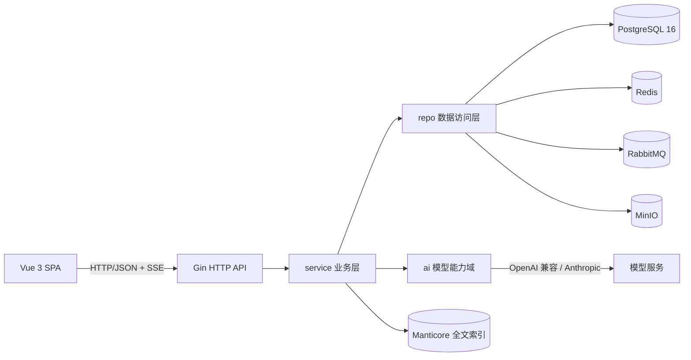
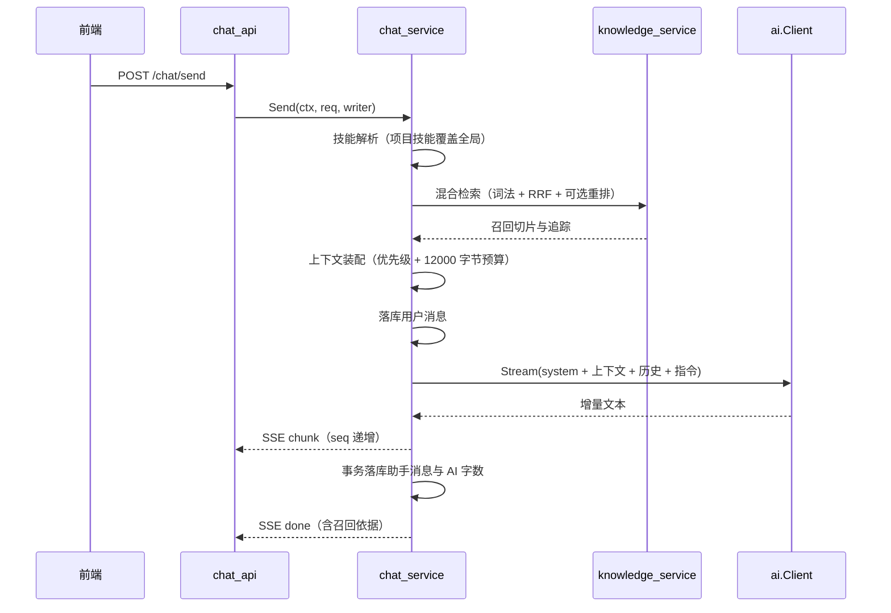

# 系统架构

本文描述 NovelWorkbench 的整体定位、技术选型、分层约束、请求生命周期与核心链路。

## 1. 系统定位

NovelWorkbench 是前后端分离的 AI 小说创作工作台，以「项目 → 卷 → 章节」为写作主线，把大纲、正文、角色、世界观、知识资料、AI 对话与技能资产统一在一个工作台中，同时提供完整的 SaaS 管理能力。

| 职责 | 内容 |
| --- | --- |
| 创作业务 | 项目导航、卷章目录、正文编辑、快照回滚、角色关系、世界观设定、创作规划、连续性看板、知识库检索、技能资产、AI 流式生成 |
| SaaS 管理 | 用户、角色权限、菜单与权限目录、审计、登录日志、模型供应商与模型目录、用量分析、运行状态、任务中心、站内通知 |

系统不开放注册，账号只能由管理员在「用户管理」中创建并分配角色。

设计优先级：**稳定性 > 体验 > 性能**。写入动作全部由作者显式触发，AI 产出不自动落库为权威数据；中间件故障降级而非阻断写作。

## 2. 总体结构



部署形态：前端 nginx 容器 + 后端 Go 容器；中间件可复用宿主机既有实例，也可通过 `--profile infra` 本地拉起。后端 `CGO_ENABLED=0` 静态编译，不引入 cgo。

## 3. 技术选型

| 层 | 选型 | 职责 |
| --- | --- | --- |
| 后端语言 | Go 1.24 | 静态编译、单二进制部署 |
| Web 框架 | Gin 1.11 | 路由、参数绑定、中间件链 |
| ORM | GORM 1.31 + pgx | 关系数据读写与启动期自动迁移 |
| 配置 | Viper 1.21 | YAML 模板 + `NW_` 环境变量覆盖 |
| 日志 | Zap 1.28 | 结构化 JSON 日志 |
| AI 编排 | eino 0.9 + eino-ext | OpenAI 兼容与 Anthropic 对话组件 |
| 关系存储 | PostgreSQL 16 | 业务主数据、权限、统计、任务状态 |
| 全文检索 | Manticore HTTP SQL API | CJK ngram 召回，索引可整体重建 |
| 缓存 | Redis | 登出令牌黑名单 |
| 队列 | RabbitMQ | 知识库异步索引任务 |
| 对象存储 | MinIO | 知识库文档原文 |
| 前端 | Vue 3 + TypeScript + Vite | SPA |
| UI | Element Plus + UnoCSS | 组件库与品牌令牌 |
| 状态 / 路由 / HTTP | Pinia、Vue Router、Axios | 认证、项目上下文、包络解包 |
| 可视化 / 编辑器 | ECharts、AntV X6、CodeMirror 6、WangEditor、MavonEditor | 趋势图、关系图、正文、富文本与 Markdown 笔记 |
| 测试 | Go testing + Vitest | 链路级单元测试 |
| 部署 | Docker Compose / Podman Compose + GitHub Actions | 镜像构建与发布 |

## 4. 后端分层

依赖方向严格单向：`api → service → repo → domain`；`ai`、`infra`、`pkg` 为叶子能力层，不反向依赖 `api` 或 `service`。

```
backend/
├── cmd/server        装配启动、迁移播种、路由、优雅关闭
├── configs/          配置模板（凭据留空，环境变量注入）
└── internal/
    ├── api           HTTP 处理器与路由注册
    ├── service       业务规则、事务边界、上下文装配
    ├── repo          SQL 与中间件访问的唯一出口（含 WithTx）
    ├── domain        DO / REQ / RESP / DTO / VO 唯一定义处
    ├── ai            模型网关、提示词装配、内置技能、用量契约
    ├── infra         配置加载、连接构造、启动校验
    └── pkg           ULID、包络、错误、JWT、中间件、密钥封存、文本工具
```

| 约束 | 原因 |
| --- | --- |
| 请求/响应结构只在 `domain` 定义 | 前后端契约单一事实源 |
| SQL 只写在 `repo` | service 只调仓储方法，不拼查询条件 |
| service 持有 `*gorm.DB` 仅作事务入口 | 跨表写入需同一事务，`repo.WithTx` 是唯一封装 |
| 判定与装配规则下沉为纯函数 | 可见性过滤、作用域优先级、变量取值、关键词命中、预算裁剪可独立单测，不依赖数据库 |
| Manticore 客户端只在知识库相关 service 使用 | 融合、重排、追踪属于业务语义，不是通用数据访问 |
| service 不写 HTTP 状态码 | 业务码到状态码的映射集中在 `pkg.HTTPStatusForCode` |
| api 不写业务判断 | 避免同一规则散落多个处理器 |
| 业务路由只开放 GET/POST | 删除走 `POST /xxx/delete`，方法白名单强制 |
| 路径参数放末尾 | `/menu/detail/{MenuULID}`、`/knowledge/content/{DocULID}` |
| ID 为带业务前缀的 ULID | `PRJ_` / `CHP_` / `SKL_` …，日志可定位业务类型 |
| 字段使用显式后缀 | `project_name`、`genre_code`、`created_at_ms` |
| 权限码由菜单表登记 | 新增权限只需在「菜单管理」登记一行，角色页自动可见 |
| 单文件 ≤500 行 | 控制认知负载，超限按同域拆分 |

## 5. 请求生命周期

中间件顺序（`api.NewRouter`）：

`Recovery → RequestID → Logger → CORS → MethodWhitelist → Auth → Audit → RequirePerm`

| 中间件 | 行为 |
| --- | --- |
| Recovery | 捕获 panic，记日志并输出 `ERR_INTERNAL` |
| RequestID | 读取或生成 `REQ_` 前缀 ULID，写入日志与响应头 `X-Request-ID` |
| Logger | 出口层记录方法、路径、状态码、耗时、请求 ID |
| CORS | 放行前端访问；`OPTIONS` 预检不进入业务 |
| MethodWhitelist | 仅放行 GET / POST |
| Auth | 解析 Bearer 令牌 → 查黑名单 → 校验用户状态 → 注入 `user_ulid` |
| Audit | POST 且不在跳过名单时落审计（失败只告警） |
| RequirePerm | 按权限码收口管理接口，缺失返回 `ERR_FORBIDDEN` |

白名单：免鉴权仅 `/api/v1/auth/login`；免审计为登录、登出与 `/api/v1/chat/send`（会话正文不入审计）。`/health`、`/ready` 挂在根引擎，不经过鉴权与审计。

统一响应包络（`pkg.Ok` / `pkg.Fail`）：

```json
{
  "resp_code": "SUCCESS",
  "resp_message": "ok",
  "trace_id": "REQ_01HZX...",
  "data": {}
}
```

业务码到 HTTP 状态的映射只维护在 `pkg` 一处：

| 业务码 | HTTP | 语义 |
| --- | --- | --- |
| `SUCCESS` | 200 | 成功 |
| `ERR_INVALID_PARAM` | 400 | 参数校验失败 |
| `ERR_UNAUTHORIZED` | 401 | 未登录或登录失效 |
| `ERR_FORBIDDEN` | 403 | 无权限 |
| `ERR_NOT_FOUND` | 404 | 资源不存在 |
| `ERR_CONFLICT` | 409 | 资源冲突 |
| `ERR_BIZ_FAILED` | 400 | 通用业务失败 |
| `ERR_AI_PROVIDER` | 502 | 模型调用失败 |
| `ERR_STORAGE` | 503 | 存储 / 检索 / 队列异常 |
| `ERR_INTERNAL` | 500 | 服务内部错误 |

两个端点不使用该包络：`/chat/send` 返回 SSE 事件流，`/knowledge/content` 返回文件字节流。

## 6. 启动装配

`backend/cmd/server/main.go` 的顺序：

1. 初始化 Zap 与配置（`infra.LoadConfig`，启动期校验关键项）。
2. 连接 PostgreSQL（失败即退出）→ `AutoMigrate` 声明 33 张表（失败即退出）。
3. 连接 Redis / RabbitMQ / MinIO / Manticore；失败只告警并降级。
4. 构造仓储 → 服务 → 中间件 → 路由。
5. 播种：内置技能（8 个，并按代码清单下线旧内置技能）、5 份提示词档案、默认配置、内置角色、内置菜单（失败即退出）；用户表为空时创建引导管理员。
6. 可选播种出厂模型供应商（配置了网关地址与模型名且供应商表为空时）。
7. 启动知识库索引 worker（RabbitMQ 消费）。
8. 监听端口；收到 SIGINT/SIGTERM 后优雅关闭 HTTP、worker、连接池。

## 7. 核心链路

### 7.1 登录与权限

- 账号由管理员创建，密码 bcrypt 存储，API 永不返回哈希。
- 登录签发 HS256 JWT（默认 7 天），返回用户信息与角色编码；权限码由 `GET /menu/nav` 下发。
- 登出把令牌写入 Redis 黑名单，TTL 取令牌 `expires_at - issued_at`（签发时长）。
- **权限码单一事实源是菜单表**：`menus.perm_code` 即权限登记，权限目录由菜单汇总，角色勾选后立即生效，无需权限码表或角色-菜单关联表。
- 权限逐请求查库（`RoleService.HasPerm`），管理接口流量低，这一跳可接受。

### 7.2 项目与写作台

- 项目是创作资源隔离边界，所有创作表带 `project_ulid`；章节表冗余该列，鉴权不必多表 join。
- 正文更新时服务端计算字数，按差值维护项目累计字数与当日统计。
- 快照用于留档与回滚；快照恢复重新计算字数。
- 前端侧边栏有项目切换器，URL 中的 `project_ulid` 优先级最高，路由变化反写 Pinia store。

### 7.3 AI 对话



关键机制见 `doc/ai.md`。设计取舍：单链路（所有生成走 `/chat/send` + 技能码）保证上下文、容错与审计只有一处实现。

### 7.4 知识库

上传 → MinIO 原文 + `pending` 文档行 → RabbitMQ 任务 → worker 提取/切片/哈希去重 → 写 PostgreSQL 切片与 Manticore 索引 → `indexed`。检索为双词法通道 + RRF 融合 + 可选对话模型重排，全程可追踪。权威数据始终在 PostgreSQL 与 MinIO，索引可随时重建。

### 7.5 创作规划与连续性

- 大纲树以项目为根，节点覆盖卷 / 幕 / 故事块 / 章节；父子关系与成环由 service 校验，含子节点不可直接删除。
- 场景卡挂在大纲节点上，记录出场角色、地点、冲突、节奏、入场/出场状态、目标与关键选择。
- 连续性由时序事实、伏笔钩子、章节摘要三本账组成；事实需显式复核（确认/取代/过期）才成为依据，AI 产出默认只是候选。
- 章节摘要带内容哈希与状态，正文变化后可标记 stale，避免过期证据进入上下文。

### 7.6 设定与关系

角色卡记录基础信息、性格、目标、秘密、声音特征与当前状态；角色关系由起点、终点与描述构成，前端用 AntV X6 渲染。世界观设定按分类（世界背景 / 规则 / 地点 / 物品 / 事件）管理。创作笔记复用设定表，`lore_type_code = note`，私人笔记永不进入 AI 上下文。

### 7.7 可观测性

- 用量：按供应商、模型、调用类型聚合调用数、token、延迟、成功率；内存缓冲 5 秒批量落库。
- 运行状态：探测 PostgreSQL / Redis / RabbitMQ / MinIO / Manticore 与模型健康，展示耗时与结论。
- 审计：写操作记录操作者、动作码、目标、结果、IP；仅 `/api/v1/admin/` 路径读取 body 提取目标。
- 任务中心：`jobs` 表状态机 `queued → running → success|failed`，失败可重试。

## 8. 前端架构

```
frontend/src/
├── api           Axios 封装与各业务模块 API（含 contracts.ts 契约类型）
├── components    无业务组件：NWButton / NWCard / NWEmpty / NWIcon / NWLoading / NWPageHeader / NWStatTile / ProjectPageHeader
├── composables   useSSE：流式解析与请求
├── layout        AdminLayout、CommandPalette、NotificationBell
├── router        路由表与守卫（含 meta.perm_code 校验）
├── stores        auth / app / menu / project / notification
├── styles        variables / element-theme / button-states / page / global
├── i18n          zh-CN / en-US 分片：common / workspace / assets / admin / extensions
└── views         登录、仪表盘、工作台、知识库、角色、设定、笔记、创作规划、连续性、
                  模型、技能、个人中心、通知、管理端各页
```

交互约定：按钮五态（默认/悬停/按下/禁用/加载）、异步动作必有反馈、列表具备加载与空态、危险操作二次确认、路由切换有过渡、AI 流式输出可中止。侧边栏完全由 `GET /menu/nav` 下发，改菜单即改导航。

## 9. 部署架构

- 后端镜像：多阶段构建，最终只含二进制与 CA 证书，`CGO_ENABLED=0`。
- 前端镜像：Node 构建静态资源，nginx 托管 SPA、反代 `/api/`、关闭 SSE 缓冲。
- 本地：`docker-compose.yml` 提供应用容器与可选 `infra` profile。
- 云主机：`deploy/podman/` 用 Podman Compose 加入既有中间件网络，`deploy.sh` 完成构建、重建与健康自检。
- CI：push / PR 触发 vet、build、test 与前端构建；tag 触发镜像发布到 GHCR。

## 10. 设计取舍

| 决策 | 收益 | 代价 |
| --- | --- | --- |
| 单 AI 链路 | 行为一致、排错路径唯一 | 一键生成需前端两步：发问 + 插入 |
| 不使用向量模型 | 部署轻、成本可控、结果可解释 | 同义改写召回弱于语义向量，靠查询词扩展与 chat 重排补偿 |
| 关键词索引可重建 | 数据一致、删除可控 | 需要异步任务与状态机 |
| 审计同步落库 | 顺序一致、不丢记录 | 高写入量时表是热点；当前规模可接受 |
| 权限逐请求查库 | 改角色立即生效 | 管理接口多一跳查询；流量极低可接受 |
| 笔记复用设定表 | 少一张表与一套 CRUD | 设定与笔记共用分类字段，笔记固定为 `note` |
| 无数据库外键 | 迁移与批量写入不受约束校验拖累 | 引用完整性只能由 service 保证 |
| 菜单即权限登记 | 新增权限零代码改动 | 菜单表承担两重语义，改动需谨慎 |

## 11. 质量约束

- Go 与前端源文件控制在 500 行内；导出符号有注释；文件头一句话说明职责。
- 业务规则优先写成纯函数，测试直接驱动，不引入数据库与 mock 框架。
- 不引入 cgo、不引入向量模型、不为几行不可复用代码抽函数。
- 文档只描述当前设计与实现。
