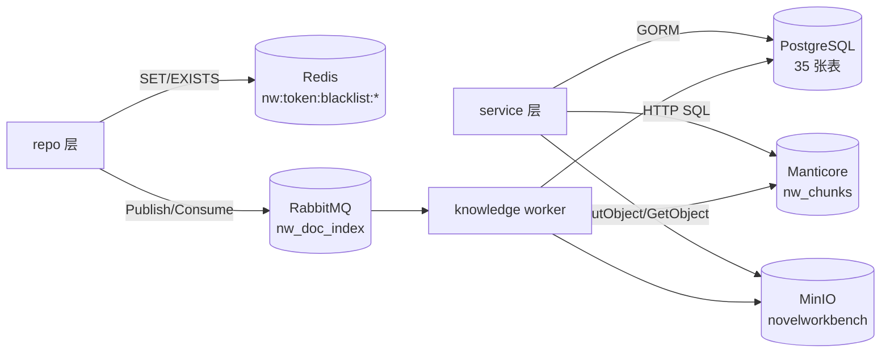
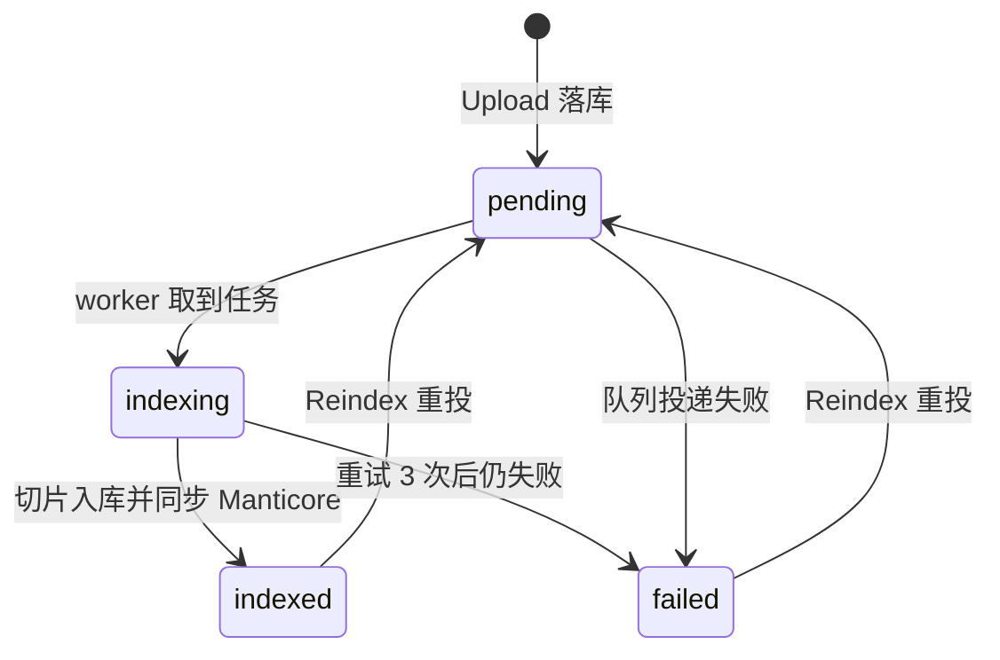
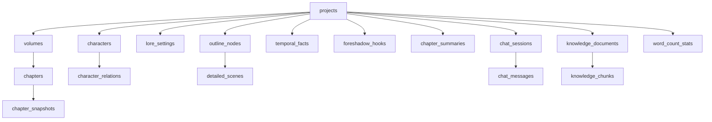

# 数据存储设计

本文描述 NovelWorkbench 的存储分工与降级行为、命名约定、35 张表的列结构、枚举取值、非关系存储、启动播种、事务与一致性边界、索引约束、迁移策略与备份恢复要点。

## 1. 存储分工与降级

| 存储 | 承载内容 | 权威级别 | 缺失或故障时的行为 |
| --- | --- | --- | --- |
| PostgreSQL | 业务主数据、权限、审计、统计、任务留痕 | 权威源 | 启动即退出（`cmd/server/main.go` 中 `infra.NewPostgres` 失败 `os.Exit(1)`） |
| MinIO | 知识库文档原文二进制 | 文件内容权威源 | 上传/读取返回 `ERR_STORAGE`；服务启动继续 |
| Manticore | 知识库切片全文索引 | 可重建投影（非权威） | keyword 模式检索直接报错；hybrid 模式单通道失败降级到另一通道，两通道都失败才报错；服务启动继续 |
| Redis | 登出令牌黑名单 | 易失缓存 | 吊销校验视为未吊销（`TokenRepo.IsRevoked` 返回 false），服务启动继续 |
| RabbitMQ | 知识库索引任务投递 | 传输通道（非权威） | 索引任务投递失败，文档置 `failed`；服务启动继续 |



`cmd/server/main.go` 的初始化顺序为：配置 → Postgres → `AutoMigrate` → Redis → RabbitMQ → MinIO（含桶检查）→ Manticore → JWT 签名器 → 仓储与服务装配 → 启动播种 → HTTP 监听。

- Postgres 连接或迁移失败：`os.Exit(1)`。
- Redis 配置非法（`NewRedis` 返回 nil 客户端）：`os.Exit(1)`；连接探活失败仅告警。
- RabbitMQ、MinIO、Manticore 连接失败：仅 `Warnw` 告警，对应能力降级。
- 播种失败（技能、配置、角色、菜单、引导管理员）：`os.Exit(1)`；默认供应商播种失败仅告警。

运行状态页的依赖探测（`backend/internal/service/system_status_service.go` 的 `SystemStatusService.Status`）对 postgres 标记为必需，其余四项为可选：必需依赖失败记为 `down`，可选依赖失败记为 `degraded`。

## 2. 命名约定

### 2.1 表名与列名

| 对象 | 约定 | 示例 |
| --- | --- | --- |
| 表名 | snake_case 复数，由各 DO 的 `TableName()` 显式指定 | `projects`、`knowledge_chunks`、`lore_settings` |
| 主键 | `<业务>_ulid`，值 = 前缀 + 26 位大写 ULID（`pkg.NewULID`） | `PRJ_01J...`、`CHP_01J...` |
| 引用列 | `_ulid` 结尾 | `project_ulid`、`chapter_ulid`、`source_chapter_ulid` |
| 状态/枚举列 | 多数以 `_code` 结尾；`projects.project_status`、`chapters.chapter_status`、`chapter_snapshots.snapshot_type` 三个列不带该后缀 | `fact_status_code`、`call_type_code`、`chapter_status` |
| 计数列 | `_count` 结尾 | `word_count`、`chunk_count`、`call_count` |
| 正文/长文本列 | `_text` 结尾且 `type:text` | `content_text`、`chunk_text`、`note_text` |
| 布尔列 | `_flag` 结尾 | `enabled_flag`、`default_flag`、`builtin_flag`、`read_flag` |
| 毫秒时间戳列 | `_ms` 结尾，`bigint` | `model_providers.last_test_at`、`model_catalogs.last_test_at` |
| 视图对象中的时间戳 | `_ms` 结尾（毫秒），由 `time.Time` 转换而来，不落库 | `created_at`、`updated_at` |

GORM 默认把 `XxxULID` 推导为 `xxx_ul_id`。`infra.ULIDNamingStrategy.ColumnName`（`backend/internal/infra/postgres.go`）把以 `_ul_id` 结尾的推导名改写为 `_ulid`；因此索引名仍保留 GORM 原推导结果（如 `idx_projects_user_ul_id`），列名统一为 `user_ulid`。

### 2.2 ULID 业务前缀（全表）

前缀常量定义在 `domain/common.go`、`domain/continuity.go`、`domain/outline.go`。

| 前缀 | 常量 | 对应表 / 用途 |
| --- | --- | --- |
| `USR_` | `IDPrefixUser` | `users` |
| `REQ_` | `IDPrefixRequest` | 请求链路 ID（不落库） |
| `PRJ_` | `IDPrefixProject` | `projects` |
| `VOL_` | `IDPrefixVolume` | `volumes` |
| `CHP_` | `IDPrefixChapter` | `chapters` |
| `SNP_` | `IDPrefixChapterSnapshot` | `chapter_snapshots` |
| `CHR_` | `IDPrefixCharacter` | `characters` |
| `RLT_` | `IDPrefixRelation` | `character_relations` |
| `LOR_` | `IDPrefixLore` | `lore_settings` |
| `OUT_` | `IDPrefixOutline` | `outline_nodes` |
| `SCN_` | `IDPrefixScene` | `detailed_scenes` |
| `FCT_` | `IDPrefixTemporalFact` | `temporal_facts` |
| `HOK_` | `IDPrefixForeshadowHook` | `foreshadow_hooks` |
| `CSM_` | `IDPrefixChapterSummary` | `chapter_summaries` |
| `DOC_` | `IDPrefixDocument` | `knowledge_documents`（同时作为 MinIO 对象键） |
| `CHK_` | `IDPrefixChunk` | `knowledge_chunks` |
| `SES_` | `IDPrefixSession` | `chat_sessions` |
| `MSG_` | `IDPrefixMessage` | `chat_messages` |
| `SKL_` | `IDPrefixSkill` | `skills` |
| `SKR_` | `IDPrefixSkillReference` | `skill_references` |
| `MNU_` | `IDPrefixMenu` | `menus` |
| `ROL_` | `IDPrefixRole` | `roles` |
| `URO_` | `IDPrefixUserRole` | `user_roles` |
| `AUD_` | `IDPrefixAudit` | `audit_logs` |
| `LGL_` | `IDPrefixLoginLog` | `login_logs` |
| `PMP_` | `IDPrefixPromptProfile` | `prompt_profiles` |
| `NTF_` | `IDPrefixNotification` | `notifications` |
| `MPR_` | `IDPrefixModelProvider` | `model_providers` |
| `MDL_` | `IDPrefixModelCatalog` | `model_catalogs` |
| `MGR_` | `IDPrefixModelGrant` | `model_role_grants` |
| `MUS_` | `IDPrefixModelUsage` | `model_usage_stats` |
| `JOB_` | `IDPrefixJob` | `jobs` |
| `SET_` | `IDPrefixSetting` | `app_settings` |
| `WCS_` | `IDPrefixWordStat` | `word_count_stats` |

### 2.3 列类型映射

| Go 类型 / 标签 | PostgreSQL 类型 |
| --- | --- |
| `string` + `size:N` | `varchar(N)` |
| `string` + `type:text` | `text` |
| `int`、`int64` | `bigint` |
| `bool` | `boolean` |
| `float64` | `decimal` |
| `time.Time`（`BaseDO`） | `timestamptz` |

GORM 仅在字段带 `not null` 标签时生成 `NOT NULL`。当前所有 DO 都没有该标签，因此 DDL 中只有主键列隐含非空（`PRIMARY KEY` 约束），其余列均可空；带 `default:` 的列只在建表时写入 `DEFAULT` 值，不改变可空性。非空语义由请求校验与写入路径保证。

## 3. 表结构

`AutoMigrate` 一次性声明 35 张表（`cmd/server/main.go`）。所有表统一含 `created_at timestamptz`（`autoCreateTime`）、`updated_at timestamptz`（`autoUpdateTime`）、`created_by varchar(40)` 与 `updated_by varchar(40)`，来自 `domain.BaseDO`，下表不再重复列出。

`created_by` / `updated_by` 由 GORM 回调自动填充（`pkg.RegisterActorCallbacks`）：`AuthMiddleware` 把当前登录用户 ULID 注入请求 context，回调在 `gorm:create` / `gorm:update` 之前写入对应列。显式赋值优先，不会被覆盖；系统任务（无登录态）留空串。不使用软删除——业务删除是硬删除，且 `user_name`、`role_code`、`menu_code` 带唯一索引，软删除会让已删行长期占位、无法重建同名资源。

### 3.1 用户、权限与审计（7 张）

#### users

| 列 | 类型 | 约束 | 用途 |
| --- | --- | --- | --- |
| `user_ulid` | `varchar(40)` | PK | 用户 ULID（`USR_`） |
| `user_name` | `varchar(64)` | UNIQUE `idx_users_user_name` | 登录名 |
| `user_email` | `varchar(128)` | UNIQUE `idx_users_user_email` | 邮箱 |
| `password_hash` | `varchar(128)` | | bcrypt 哈希，`json:"-"` 不出参 |
| `avatar_url` | `varchar(256)` | | 头像地址 |
| `remark_text` | `varchar(256)` | | 备注 |
| `user_status_code` | `varchar(16)` | `DEFAULT 'active'`，`idx_users_user_status_code` | `active` / `disabled` |

#### roles

| 列 | 类型 | 约束 | 用途 |
| --- | --- | --- | --- |
| `role_ulid` | `varchar(40)` | PK | 角色 ULID（`ROL_`） |
| `role_code` | `varchar(64)` | UNIQUE `idx_roles_role_code` | 角色编码 |
| `role_name` | `varchar(64)` | | 角色名称 |
| `remark_text` | `varchar(256)` | | 备注 |
| `perm_codes_json` | `text` | | 权限码 JSON 数组，`["*"]` 表示全部 |
| `builtin_flag` | `boolean` | `DEFAULT false` | 内置角色不可删除 |

#### user_roles

| 列 | 类型 | 约束 | 用途 |
| --- | --- | --- | --- |
| `user_role_ulid` | `varchar(40)` | PK | 关联 ULID（`URO_`） |
| `user_ulid` | `varchar(40)` | `idx_user_roles_user_ul_id` | 用户 |
| `role_ulid` | `varchar(40)` | `idx_user_roles_role_ul_id` | 角色 |

`(user_ulid, role_ulid)` 无唯一约束；写入统一走 `RoleRepo.ReplaceUserRoles`（事务内先删后插），因此不会产生重复行。

#### menus

菜单与权限码登记表：`page` 行承载页面权限，`action` 行只登记动作权限码、不进导航。

| 列 | 类型 | 约束 | 用途 |
| --- | --- | --- | --- |
| `menu_ulid` | `varchar(40)` | PK | 菜单 ULID（`MNU_`） |
| `parent_ulid` | `varchar(40)` | `idx_menus_parent_ul_id` | 上级菜单，空为根 |
| `menu_code` | `varchar(64)` | UNIQUE `idx_menus_menu_code` | 菜单编码 |
| `menu_name` | `varchar(64)` | | 菜单名称 |
| `menu_type_code` | `varchar(16)` | | `group` / `page` / `action` |
| `scope_code` | `varchar(16)` | `idx_menus_scope_code` | `global` / `project` |
| `route_path` | `varchar(128)` | | 前端路由，项目内以 `:project_ulid` 结尾 |
| `icon_code` | `varchar(32)` | | 图标键 |
| `perm_code` | `varchar(64)` | `idx_menus_perm_code` | 权限码，空表示登录可见 |
| `visible_flag` | `boolean` | `DEFAULT true` | 是否进导航 |
| `enabled_flag` | `boolean` | `DEFAULT true` | 是否启用 |
| `sort_order` | `bigint` | | 同级升序 |
| `remark_text` | `varchar(256)` | | 备注 |

`perm_code` 的全局唯一性由 `MenuService.Save` 调用 `MenuRepo.CountByPermCode` 校验（冲突返回 `ERR_CONFLICT`），数据库不建唯一索引以允许多行空值。

#### audit_logs

| 列 | 类型 | 约束 | 用途 |
| --- | --- | --- | --- |
| `audit_ulid` | `varchar(40)` | PK | 审计 ULID（`AUD_`） |
| `log_level_code` | `varchar(16)` | `idx_audit_logs_log_level_code` | 级别：`info`（2xx/3xx）/ `warn`（4xx）/ `error`（5xx），由 HTTP 状态推导 |
| `trace_id` | `varchar(40)` | `idx_audit_logs_trace_id` | 链路 ID，与响应包络 `trace_id` 同值 |
| `user_ulid` | `varchar(40)` | `idx_audit_logs_user_ul_id` | 操作者，未登录为空串 |
| `user_name` | `varchar(64)` | `idx_audit_logs_user_name` | 操作者登录名快照 |
| `action_code` | `varchar(128)` | `idx_audit_logs_action_code` | 接口路径去 `/api/v1/` 前缀 |
| `request_path` | `varchar(256)` | | 完整请求路径 |
| `request_method` | `varchar(8)` | | `GET` / `POST` |
| `request_body` | `text` | | 请求体（凭据字段脱敏为 `***`；上传与超 32KB 不采样） |
| `target_type` | `varchar(32)` | `idx_audit_logs_target_type` | 目标类型：user/role/menu/project/chapter/document/skill/tool/model/provider/prompt_profile/chat_session/notification |
| `target_ulid` | `varchar(40)` | `idx_audit_logs_target_ul_id` | 目标 ULID |
| `resp_code` | `varchar(32)` | `idx_audit_logs_resp_code` | 业务响应码（如 `SUCCESS`、`ERR_CONFLICT`） |
| `resp_message` | `varchar(512)` | | 业务响应说明，失败时为原因 |
| `http_status` | `int` | | HTTP 状态码 |
| `latency_ms` | `bigint` | | 处理耗时（毫秒） |
| `ip_addr` | `varchar(64)` | | 客户端 IP |
| `user_agent_text` | `varchar(512)` | | 客户端 UA |

写入方为 `pkg.AuditMiddleware`：仅记录 `POST` 请求，跳过 `/api/v1/auth/login`、`/api/v1/auth/logout`、`/api/v1/chat/send`；
中间件缓冲响应体前 8KB 解析包络（业务码与说明）后透传，普通响应不受影响。
落库失败只告警，不阻断业务。`AuditRepo` 有 `Create`、`GetByULID`、`ListPage`，无删除路径；
`ListPage` 支持级别 / 链路 ID / 目标类型 / 动作码 / 关键字 / 用户 / 日期区间过滤，历史行缺级别时按 HTTP 状态补全。

#### login_logs

| 列 | 类型 | 约束 | 用途 |
| --- | --- | --- | --- |
| `login_log_ulid` | `varchar(40)` | PK | 日志 ULID（`LGL_`） |
| `user_ulid` | `varchar(40)` | `idx_login_logs_user_ul_id` | 命中的用户，失败时为空 |
| `login_account_text` | `varchar(128)` | `idx_login_logs_login_account_text` | 登录名或邮箱 |
| `login_result_code` | `varchar(16)` | `idx_login_logs_login_result_code` | `success` / `failed` / `disabled` |
| `fail_reason_text` | `varchar(256)` | | 失败原因 |
| `ip_addr` | `varchar(64)` | | 客户端 IP |
| `user_agent_text` | `varchar(512)` | | 客户端 UA |

#### notifications

| 列 | 类型 | 约束 | 用途 |
| --- | --- | --- | --- |
| `notification_ulid` | `varchar(40)` | PK | 通知 ULID（`NTF_`） |
| `user_ulid` | `varchar(40)` | `idx_notifications_user_ul_id` | 接收人 |
| `notification_type_code` | `varchar(16)` | `idx_notifications_notification_type_code` | `system` / `task` / `account` |
| `notification_title_text` | `varchar(128)` | | 标题 |
| `notification_body_text` | `varchar(512)` | | 正文 |
| `read_flag` | `boolean` | `DEFAULT false`，`idx_notifications_read_flag` | 是否已读 |
| `link_url` | `varchar(256)` | | 前端跳转路由 |
| `ref_type_code` | `varchar(32)` | | 关联业务类型 |
| `ref_ulid` | `varchar(40)` | | 关联业务 ULID |

所有查询都带 `user_ulid`；用户删除时由 `UserAdminService.Delete` 调用 `NotificationRepo.DeleteByUser` 清理。

### 3.2 创作主数据（7 张）

#### projects

| 列 | 类型 | 约束 | 用途 |
| --- | --- | --- | --- |
| `project_ulid` | `varchar(40)` | PK | 项目 ULID（`PRJ_`） |
| `user_ulid` | `varchar(40)` | `idx_projects_user_ul_id` | 归属用户 |
| `project_name` | `varchar(128)` | | 书名 |
| `genre_code` | `varchar(32)` | | 题材编码，无白名单 |
| `style_text` | `varchar(1024)` | | 文风提示词 |
| `synopsis_text` | `varchar(4096)` | | 简介 |
| `project_status` | `varchar(16)` | `idx_projects_project_status` | `draft` / `serial` / `completed` |
| `total_word_count` | `bigint` | | 累计字数，由章节字数差增减 |

#### volumes

| 列 | 类型 | 约束 | 用途 |
| --- | --- | --- | --- |
| `volume_ulid` | `varchar(40)` | PK | 卷 ULID（`VOL_`） |
| `project_ulid` | `varchar(40)` | `idx_volumes_project_ul_id` | 所属项目 |
| `volume_name` | `varchar(128)` | | 卷名 |
| `volume_order` | `bigint` | | 排序号 |
| `summary_text` | `varchar(2048)` | | 卷概要 |

#### chapters

| 列 | 类型 | 约束 | 用途 |
| --- | --- | --- | --- |
| `chapter_ulid` | `varchar(40)` | PK | 章节 ULID（`CHP_`） |
| `project_ulid` | `varchar(40)` | `idx_chapters_project_ul_id` | 所属项目 |
| `volume_ulid` | `varchar(40)` | `idx_chapters_volume_ul_id` | 所属卷 |
| `chapter_name` | `varchar(128)` | | 章节名 |
| `chapter_order` | `bigint` | `idx_chapters_chapter_order` | 项目内排序号，创建时取最大值 +1 |
| `content_text` | `text` | | 正文 |
| `summary_text` | `varchar(2048)` | | 章节梗概 |
| `word_count` | `bigint` | | 正文字数（`pkg.CountWords`） |
| `chapter_status` | `varchar(16)` | | `draft` / `revised` / `locked` |

#### chapter_snapshots

| 列 | 类型 | 约束 | 用途 |
| --- | --- | --- | --- |
| `snapshot_ulid` | `varchar(40)` | PK | 快照 ULID（`SNP_`） |
| `chapter_ulid` | `varchar(40)` | `idx_chapter_snapshots_chapter_ul_id` | 所属章节 |
| `content_text` | `text` | | 快照正文 |
| `snapshot_type` | `varchar(16)` | | 当前只写入 `manual` |
| `change_note` | `varchar(256)` | | 变更说明 |

写入路径只有 `ChapterService.SnapshotCreate` 与 `ChapterService.SnapshotRestore`（回滚前自动留档，`change_note = "restore 自动留档"`），两者都写 `manual`。

#### characters

| 列 | 类型 | 约束 | 用途 |
| --- | --- | --- | --- |
| `character_ulid` | `varchar(40)` | PK | 角色 ULID（`CHR_`） |
| `project_ulid` | `varchar(40)` | `idx_characters_project_ul_id` | 所属项目 |
| `character_name` | `varchar(64)` | | 姓名 |
| `alias_text` | `varchar(128)` | | 别名 |
| `role_type_code` | `varchar(16)` | | `protagonist` / `antagonist` / `supporting` / `minor` |
| `personality_text` | `varchar(2048)` | | 性格 |
| `background_text` | `varchar(4096)` | | 背景经历 |
| `appearance_text` | `varchar(2048)` | | 外貌 |
| `goal_text` | `varchar(2048)` | | 目标动机 |

#### character_relations

| 列 | 类型 | 约束 | 用途 |
| --- | --- | --- | --- |
| `relation_ulid` | `varchar(40)` | PK | 关系 ULID（`RLT_`） |
| `project_ulid` | `varchar(40)` | `idx_character_relations_project_ul_id` | 所属项目 |
| `from_character_ulid` | `varchar(40)` | `idx_character_relations_from_character_ul_id` | 起点角色 |
| `to_character_ulid` | `varchar(40)` | `idx_character_relations_to_character_ul_id` | 终点角色 |
| `relation_type_code` | `varchar(32)` | | 自由文本（注释示例 `friend`/`enemy`/`lover`/`kin`/`teacher`） |
| `relation_note` | `varchar(256)` | | 关系说明 |

#### lore_settings

世界观设定与创作笔记共用一张表，`lore_type_code = 'note'` 表示创作笔记。

| 列 | 类型 | 约束 | 用途 |
| --- | --- | --- | --- |
| `lore_ulid` | `varchar(40)` | PK | 设定 ULID（`LOR_`） |
| `project_ulid` | `varchar(40)` | `idx_lore_settings_project_ul_id` | 所属项目 |
| `lore_name` | `varchar(128)` | | 设定名 |
| `lore_type_code` | `varchar(16)` | `idx_lore_settings_lore_type_code` | `world` / `rule` / `item` / `place` / `event` / `note` |
| `content_text` | `text` | | 设定内容 |
| `content_mode_code` | `varchar(16)` | `DEFAULT 'rich'` | `rich`（富文本 HTML）/ `markdown` |
| `sort_order` | `bigint` | | 排序号 |

### 3.3 规划与连续性（5 张）

#### outline_nodes

| 列 | 类型 | 约束 | 用途 |
| --- | --- | --- | --- |
| `outline_ulid` | `varchar(40)` | PK | 节点 ULID（`OUT_`） |
| `project_ulid` | `varchar(40)` | `idx_outline_nodes_project_ul_id` | 所属项目 |
| `parent_outline_ulid` | `varchar(40)` | `DEFAULT ''`，`idx_outline_nodes_parent_outline_ul_id` | 父节点，根为空串 |
| `node_type_code` | `varchar(32)` | `idx_outline_nodes_node_type_code` | `volume` / `arc` / `storyBlock` / `chapter` |
| `title_text` | `varchar(128)` | | 节点标题 |
| `summary_text` | `varchar(4096)` | | 节点概要 |
| `node_status_code` | `varchar(16)` | `idx_outline_nodes_node_status_code` | `draft` / `planning` / `ready` / `done` |
| `sort_order` | `bigint` | `idx_outline_nodes_sort_order` | 同级升序 |

`OutlineService.SaveNode` 在 `node_status_code` 为空时写 `draft`，`sort_order` 为 0 时取同级最大值 +1；`OutlineService.DeleteNode` 在子节点数 > 0 时返回 `ERR_CONFLICT`，不级联删子节点，也不删挂在其下的场景卡片。

#### detailed_scenes

| 列 | 类型 | 约束 | 用途 |
| --- | --- | --- | --- |
| `scene_ulid` | `varchar(40)` | PK | 场景 ULID（`SCN_`） |
| `project_ulid` | `varchar(40)` | `idx_detailed_scenes_project_ul_id` | 所属项目 |
| `outline_ulid` | `varchar(40)` | `idx_detailed_scenes_outline_ul_id` | 所属大纲节点 |
| `character_ulid_list` | `text` | | 出场角色 ULID JSON 数组 |
| `location_text` | `varchar(256)` | | 场景地点 |
| `conflict_text` | `text` | | 核心冲突 |
| `pace_code` | `varchar(16)` | `idx_detailed_scenes_pace_code` | `slow` / `medium` / `fast` / `climax` |
| `estimated_words` | `bigint` | | 预计字数 |
| `entry_state_text` | `text` | | 入场状态 |
| `goal_text` | `text` | | 角色目标 |
| `key_choice_text` | `text` | | 关键选择 |
| `outcome_text` | `text` | | 场景结果 |
| `exit_state_text` | `text` | | 出场状态 |
| `sort_order` | `bigint` | `idx_detailed_scenes_sort_order` | 节点内升序 |

`OutlineService.SaveScene` 在 `sort_order` 为 0 时取同一大纲节点下的最大值 +1；`pace_code` 直接取自请求，无缺省值；`character_ulid_list` 由 `encodeCharacterULIDs` 序列化为 JSON 数组字符串。删除场景只删该行（`OutlineRepo.DeleteScene`），不校验是否被其他数据引用。

#### temporal_facts

| 列 | 类型 | 约束 | 用途 |
| --- | --- | --- | --- |
| `fact_ulid` | `varchar(40)` | PK | 事实 ULID（`FCT_`） |
| `project_ulid` | `varchar(40)` | `idx_temporal_facts_project_ul_id` | 所属项目 |
| `subject_text` | `varchar(128)` | | 主体 |
| `predicate_code` | `varchar(64)` | `idx_temporal_facts_predicate_code` | 谓词编码 |
| `object_text` | `varchar(256)` | | 客体 |
| `fact_status_code` | `varchar(16)` | `idx_temporal_facts_fact_status_code` | 事实状态 |
| `valid_from_chapter_ulid` | `varchar(40)` | | 生效起始章节 |
| `valid_until_chapter_ulid` | `varchar(40)` | | 生效截止章节 |
| `source_chapter_ulid` | `varchar(40)` | `idx_temporal_facts_source_chapter_ul_id` | 证据来源章节 |
| `source_quote_text` | `text` | | 原文证据 |
| `note_text` | `text` | | 备注 |

#### foreshadow_hooks

| 列 | 类型 | 约束 | 用途 |
| --- | --- | --- | --- |
| `hook_ulid` | `varchar(40)` | PK | 钩子 ULID（`HOK_`） |
| `project_ulid` | `varchar(40)` | `idx_foreshadow_hooks_project_ul_id` | 所属项目 |
| `hook_status_code` | `varchar(16)` | `idx_foreshadow_hooks_hook_status_code` | 钩子状态 |
| `description_text` | `text` | | 伏笔描述 |
| `expected_payoff_text` | `text` | | 预期回收方式 |
| `setup_chapter_ulid` | `varchar(40)` | `idx_foreshadow_hooks_setup_chapter_ul_id` | 埋设章节 |
| `payoff_chapter_ulid` | `varchar(40)` | `idx_foreshadow_hooks_payoff_chapter_ul_id` | 回收章节 |
| `importance_code` | `varchar(16)` | `idx_foreshadow_hooks_importance_code` | 重要程度 |
| `note_text` | `text` | | 备注 |

#### chapter_summaries

| 列 | 类型 | 约束 | 用途 |
| --- | --- | --- | --- |
| `summary_ulid` | `varchar(40)` | PK | 摘要 ULID（`CSM_`） |
| `project_ulid` | `varchar(40)` | `idx_chapter_summaries_project_ul_id` | 所属项目 |
| `chapter_ulid` | `varchar(40)` | `idx_chapter_summaries_chapter_ul_id` | 所属章节 |
| `summary_text` | `text` | | 摘要正文 |
| `source_hash_text` | `varchar(128)` | | 生成时的正文指纹 |
| `summary_status_code` | `varchar(16)` | `idx_chapter_summaries_summary_status_code` | 摘要状态 |

`(project_ulid, chapter_ulid)` 无唯一约束；`ContinuityService.SaveSummary` 先按章节查询，存在则更新、否则插入。

### 3.4 知识库（2 张）

#### knowledge_documents

| 列 | 类型 | 约束 | 用途 |
| --- | --- | --- | --- |
| `doc_ulid` | `varchar(40)` | PK | 文档 ULID（`DOC_`） |
| `project_ulid` | `varchar(40)` | `idx_knowledge_documents_project_ul_id` | 所属项目；域注释约定 `0` 表示全局库 |
| `doc_name` | `varchar(128)` | | 文档名 |
| `doc_type_code` | `varchar(16)` | | `txt` / `md` / `docx` / `pdf`（由扩展名白名单推导） |
| `object_key` | `varchar(256)` | | MinIO 对象键，等于 `doc_ulid` |
| `doc_status_code` | `varchar(16)` | `idx_knowledge_documents_doc_status_code` | `pending` / `indexing` / `indexed` / `failed` |
| `chunk_count` | `bigint` | | 切片数量（索引完成后回写） |
| `total_token_count` | `bigint` | | 切片 token 合计 |
| `error_message` | `varchar(512)` | | 失败原因，截断到 500 字符 |

`KnowledgeService.mustOwnDoc` 在 `project_ulid` 为空或 `"0"` 时跳过归属校验；当前上传路径（`KnowledgeService.Upload`）始终写入请求中的 `project_ulid`。

#### knowledge_chunks

| 列 | 类型 | 约束 | 用途 |
| --- | --- | --- | --- |
| `chunk_ulid` | `varchar(40)` | PK | 切片 ULID（`CHK_`） |
| `doc_ulid` | `varchar(40)` | `idx_knowledge_chunks_doc_ul_id` | 所属文档 |
| `project_ulid` | `varchar(40)` | `idx_knowledge_chunks_project_ul_id` | 所属项目（冗余，供按项目检索与删除） |
| `chunk_index` | `bigint` | | 文档内升序序号 |
| `chunk_text` | `text` | | 切片文本 |
| `token_count` | `bigint` | | 切片 token 估算 |
| `content_hash` | `varchar(64)` | `idx_knowledge_chunks_content_hash` | 切片文本 SHA-256 十六进制 |

切片由 `KnowledgeWorker.indexDocument` 生成：按 `app.chunk_size` / `app.chunk_overlap` 滑窗切分，命中既有同哈希切片时复用其 `chunk_ulid`，否则新建；同一文档的切片在同一事务内先删后插。

### 3.5 对话、技能、档案与工具（6 张）

#### chat_sessions

| 列 | 类型 | 约束 | 用途 |
| --- | --- | --- | --- |
| `session_ulid` | `varchar(40)` | PK | 会话 ULID（`SES_`） |
| `project_ulid` | `varchar(40)` | `idx_chat_sessions_project_ul_id` | 所属项目 |
| `user_ulid` | `varchar(40)` | `idx_chat_sessions_user_ul_id` | 所属用户 |
| `session_name` | `varchar(128)` | | 会话名，首条消息发送时以正文前若干字符回填 |

#### chat_messages

| 列 | 类型 | 约束 | 用途 |
| --- | --- | --- | --- |
| `message_ulid` | `varchar(40)` | PK | 消息 ULID（`MSG_`） |
| `session_ulid` | `varchar(40)` | `idx_chat_messages_session_ul_id` | 所属会话 |
| `role_code` | `varchar(16)` | | `user` / `assistant` / `system` |
| `content_text` | `text` | | 消息正文 |
| `reasoning_text` | `text` | | 思考过程（推理模型返回，非推理模型为空串） |
| `skill_code` | `varchar(32)` | | 命中的斜杠命令编码，空为自由对话 |
| `tool_code_json` | `text` | | 本轮执行的工具编码 JSON 数组（显式 `#code` 与关键词触发） |
| `ref_doc_json` | `text` | | `@` 引用文档 ULID JSON 数组 |
| `ref_chapter_json` | `text` | | `@` 引用章节 ULID JSON 数组 |
| `ref_summary_json` | `text` | | `@` 引用章节摘要 ULID JSON 数组 |
| `ref_prompt_json` | `text` | | `@` 引用提示词档案 ULID JSON 数组 |
| `ref_message_json` | `text` | | 显式引用历史消息 ULID JSON 数组 |
| `token_used_count` | `bigint` | | 本条估算 token |

#### skills

| 列 | 类型 | 约束 | 用途 |
| --- | --- | --- | --- |
| `skill_ulid` | `varchar(40)` | PK | 技能 ULID（`SKL_`） |
| `skill_code` | `varchar(32)` | `idx_skills_skill_code` | 技能编码，对话中以 `/code` 触发 |
| `skill_name` | `varchar(64)` | | 技能名称 |
| `scope_code` | `varchar(16)` | `DEFAULT 'global'`，`idx_skills_scope_code` | `global` / `project` |
| `project_ulid` | `varchar(40)` | `idx_skills_project_ul_id` | 所属项目，全局技能为空串 |
| `category_code` | `varchar(16)` | | `write` / `revise` / `outline` / `setting` / `review` / `other` |
| `description_text` | `varchar(256)` | | 一句话说明 |
| `prompt_template` | `text` | | 提示词模板，含 `{{变量}}` |
| `variable_spec_json` | `text` | | 变量声明 JSON 数组，无变量为 `[]` |
| `enabled_flag` | `boolean` | `DEFAULT true` | 是否启用 |
| `builtin_flag` | `boolean` | `DEFAULT false` | 内置技能不可删除 |
| `asset_hash_text` | `varchar(64)` | | 出厂内容指纹（sha256），用于判断代码资产是否有新版本 |
| `customized_flag` | `boolean` | `DEFAULT false` | 作者是否改过出厂内容；`true` 时启动升级不覆盖该行 |
| `sort_order` | `bigint` | | 排序号 |

作用域内编码唯一（`scope_code` + `project_ulid` + `skill_code`）由 `SkillRepo.GetByCode` 查重后写入保证，无数据库唯一索引；同编码时由 `backend/internal/service/skill_service.go` 的 `pickSkillByScope` 决定命中项——启用中的项目技能优先，其次启用中的全局技能（`SkillRepo.List` 按 `scope_code DESC, sort_order ASC, created_at ASC` 排序，仅影响列表展示顺序）。

#### skill_references

| 列 | 类型 | 约束 | 用途 |
| --- | --- | --- | --- |
| `ref_ulid` | `varchar(40)` | PK | 资料 ULID（`SKR_`） |
| `skill_ulid` | `varchar(40)` | `idx_skill_references_skill_ul_id` | 所属技能 |
| `ref_name` | `varchar(64)` | | 资料名 |
| `ref_text` | `text` | | 资料正文 |
| `keyword_list` | `varchar(256)` | | 触发关键词（逗号分隔），空表示总是注入 |
| `sort_order` | `bigint` | | 注入顺序 |

技能删除时 `SkillService.Delete` 先调 `SkillRepo.DeleteReferencesBySkill` 再删技能行（非同一事务）。

#### prompt_profiles

| 列 | 类型 | 约束 | 用途 |
| --- | --- | --- | --- |
| `prompt_profile_ulid` | `varchar(40)` | PK | 档案 ULID（`PMP_`） |
| `prompt_profile_code` | `varchar(32)` | `idx_prompt_profiles_prompt_profile_code` | 档案编码 |
| `prompt_profile_name` | `varchar(64)` | | 档案名 |
| `scope_code` | `varchar(16)` | `DEFAULT 'global'`，`idx_prompt_profiles_scope_code` | `global` / `project` |
| `project_ulid` | `varchar(40)` | `idx_prompt_profiles_project_ul_id` | 所属项目，全局档案为空串 |
| `description_text` | `varchar(256)` | | 一句话说明 |
| `system_prompt_text` | `text` | | 系统提示词正文（身份与底线） |
| `builtin_flag` | `boolean` | `DEFAULT false` | 内置档案不可删除，可停用 |
| `enabled_flag` | `boolean` | `DEFAULT true` | 是否启用 |
| `asset_hash_text` | `varchar(64)` | | 出厂内容指纹（sha256），用于判断代码资产是否有新版本 |
| `customized_flag` | `boolean` | `DEFAULT false` | 作者是否改过出厂内容；`true` 时启动升级不覆盖该行 |
| `sort_order` | `bigint` | | 排序号；全局默认档案取启用的最小排序号 |

与技能同构：作用域内编码唯一由 `PromptProfileRepo.CountByCode` 查重保证（无唯一索引），内置档案由 `PromptProfileService.SeedDefaults` 播种并按 `asset_hash_text` 做版本升级，写入走 `prompt:manage` 权限。

#### tools

| 列 | 类型 | 约束 | 用途 |
| --- | --- | --- | --- |
| `tool_ulid` | `varchar(40)` | PK | 工具 ULID（`TOL_`） |
| `tool_code` | `varchar(32)` | UNIQUE `idx_tools_tool_code` | 工具编码（`#编码` 触发） |
| `tool_name` | `varchar(64)` | | 工具名称 |
| `tool_type_code` | `varchar(16)` | `idx_tools_tool_type_code` | `builtin`（当前仅内置，服务端函数实现） |
| `description_text` | `varchar(256)` | | 一句话说明（模型与用户可见） |
| `trigger_keywords` | `varchar(256)` | | 自动触发关键词（逗号分隔） |
| `param_schema_json` | `text` | | 参数声明 JSON 数组（`ToolParamDO`） |
| `enabled_flag` | `boolean` | `DEFAULT true` | 是否启用 |
| `builtin_flag` | `boolean` | `DEFAULT false` | 内置工具不可删除，可停用 |
| `asset_hash_text` | `varchar(64)` | | 出厂指纹（sha256） |
| `customized_flag` | `boolean` | `DEFAULT false` | 改过则代码升级不覆盖 |
| `sort_order` | `bigint` | | 排序号 |

工具与技能的分工：技能让模型「按格式写」，工具让服务端「先算出事实」。内置 6 个工具全部是确定性逻辑
（`ai/check.Analyze` + 仓储读），不额外消耗模型调用；结果以「工具结果」上下文块注入（优先级等同技能参考资料）。
播种与执行在 `service/tool_service.go`，出厂定义在 `ai/builtin_tools.go`，写入走 `tool:manage` 权限。

### 3.6 模型与用量（5 张）

#### model_providers

| 列 | 类型 | 约束 | 用途 |
| --- | --- | --- | --- |
| `provider_ulid` | `varchar(40)` | PK | 供应商 ULID（`MPR_`） |
| `provider_name` | `varchar(64)` | | 供应商名称 |
| `protocol_code` | `varchar(16)` | `idx_model_providers_protocol_code` | `openai` / `anthropic` |
| `base_url` | `varchar(256)` | | 网关地址（OpenAI 需含 `/v1`） |
| `api_key_cipher` | `varchar(512)` | | AES-256-GCM 密文，`json:"-"` 不出参 |
| `enabled_flag` | `boolean` | `DEFAULT true` | 停用则其下模型不可用 |
| `sort_order` | `bigint` | | 排序号 |
| `remark_text` | `varchar(256)` | | 备注 |
| `last_test_status_code` | `varchar(16)` | | `untested` / `success` / `failed` |
| `last_test_message` | `varchar(512)` | | 最近测试结论 |
| `last_test_at` | `timestamptz` | | 最近测试时间 |

供应商下仍有模型时 `ModelProviderService.DeleteProvider` 返回 `ERR_BIZ_FAILED`，不级联删模型。

#### model_catalogs

| 列 | 类型 | 约束 | 用途 |
| --- | --- | --- | --- |
| `model_ulid` | `varchar(40)` | PK | 模型 ULID（`MDL_`） |
| `provider_ulid` | `varchar(40)` | `idx_model_catalogs_provider_ul_id` | 所属供应商 |
| `model_name` | `varchar(128)` | | 请求体 `model` 字段 |
| `model_label` | `varchar(64)` | | 展示名，空则回填 `model_name` |
| `temperature` | `decimal` | | 采样温度 |
| `max_tokens` | `bigint` | | 单次输出上限 |
| `context_window_count` | `bigint` | | 上下文窗口，0 表示未知 |
| `enabled_flag` | `boolean` | `DEFAULT true` | 是否启用 |
| `default_flag` | `boolean` | `DEFAULT false`，`idx_model_catalogs_default_flag` | 系统默认模型 |
| `sort_order` | `bigint` | | 排序号 |
| `remark_text` | `varchar(256)` | | 备注 |
| `last_test_status_code` | `varchar(16)` | | `untested` / `success` / `failed` |
| `last_test_message` | `varchar(512)` | | 最近测试结论 |
| `last_test_at` | `timestamptz` | | 最近测试时间 |

`default_flag` 的全局唯一由服务层保证：`ModelProviderService.SaveModel` / `SetDefaultModel` 先调 `ModelProviderRepo.ClearDefaultModel` 清零再置位。默认模型不可删除（`DeleteModel` 返回 `ERR_BIZ_FAILED`）。

#### model_role_grants

| 列 | 类型 | 约束 | 用途 |
| --- | --- | --- | --- |
| `grant_ulid` | `varchar(40)` | PK | 授权 ULID（`MGR_`） |
| `model_ulid` | `varchar(40)` | `idx_model_role_grants_model_ul_id` | 模型 |
| `role_ulid` | `varchar(40)` | `idx_model_role_grants_role_ul_id` | 角色 |

授权整体覆盖：`ModelProviderRepo.ReplaceGrants` 在同一事务内先删后插。删除模型前先 `DeleteGrantsByModel`。无授权行时仅管理员可用。

#### model_user_grants

| 列 | 类型 | 约束 | 用途 |
| --- | --- | --- | --- |
| `grant_ulid` | `varchar(40)` | PK | 授权 ULID（`MUG_`） |
| `model_ulid` | `varchar(40)` | `idx_model_user_grants_model_ul_id` | 模型 |
| `user_ulid` | `varchar(40)` | `idx_model_user_grants_user_ul_id` | 用户 |

用户直授与角色授权取并集：`ReplaceUserGrants` 整体覆盖；`DeleteUserGrantsByUser` 在删用户时级联清理；
`DeleteRoleGrantsByRole` 在删角色时清理该角色的模型授权。因此删除用户/角色不会留下悬空授权，
模型列表对已删除用户显示「已删除用户」占位，便于管理员发现历史遗留。

可用模型 = 模型启用 ∧ 供应商启用 ∧（管理员 ∨ 命中角色授权 ∨ 命中用户直授）。

#### model_usage_stats

| 列 | 类型 | 约束 | 用途 |
| --- | --- | --- | --- |
| `usage_stat_ulid` | `varchar(40)` | PK | 统计 ULID（`MUS_`） |
| `stat_date` | `varchar(10)` | UNIQUE `uk_mus_dim` | 统计日期 `YYYY-MM-DD` |
| `provider_ulid` | `varchar(40)` | UNIQUE `uk_mus_dim` | 供应商 |
| `provider_name` | `varchar(64)` | | 供应商名称快照 |
| `model_name` | `varchar(128)` | UNIQUE `uk_mus_dim` | 模型名 |
| `call_type_code` | `varchar(16)` | UNIQUE `uk_mus_dim` | 调用类型，当前只有 `chat` |
| `call_count` | `bigint` | | 调用次数 |
| `success_count` | `bigint` | | 成功次数 |
| `fail_count` | `bigint` | | 失败次数 |
| `prompt_tokens` | `bigint` | | 输入 token 合计 |
| `completion_tokens` | `bigint` | | 输出 token 合计 |
| `total_tokens` | `bigint` | | 总 token 合计 |
| `latency_ms_sum` | `bigint` | | 耗时合计（毫秒），均值 = 合计 / `call_count` |

唯一维度 `(stat_date, provider_ulid, model_name, call_type_code)`；写入用 `ModelUsageRepo.UpsertIncrement` 的 `ON CONFLICT ... DO UPDATE` 累加计数与 token，并刷新 `provider_name`。

### 3.7 运维（3 张）

#### jobs

| 列 | 类型 | 约束 | 用途 |
| --- | --- | --- | --- |
| `job_ulid` | `varchar(40)` | PK | 任务 ULID（`JOB_`） |
| `job_type_code` | `varchar(32)` | `idx_jobs_job_type_code` | `doc_index` / `doc_reindex` |
| `payload_json` | `text` | | `KnowledgeIndexJobDTO` 序列化（`{"doc_ulid":"DOC_..."}`） |
| `job_status_code` | `varchar(16)` | `idx_jobs_job_status_code` | `queued` / `running` / `success` / `failed` |
| `retry_count` | `bigint` | | 已重试次数 |
| `error_message` | `varchar(512)` | | 失败原因 |

写入路径只产生 `queued`、`success`、`failed`；`running` 不出现在任何写入中，只用于 `JobRepo.GetPendingByDoc` 的「未完成任务」查询条件（`job_status_code IN ('queued','running')`）与 `JobService.Stats` 的状态计数。

状态流转：`KnowledgeService.enqueueIndexJob` 插入 `queued` → worker 消费后写 `success` 或 `failed`；`JobService.Retry` 仅接受 `failed` 行，把它重置为 `queued`（`retry_count=0`、清空 `error_message`），同时把文档置回 `pending`，再重新投递队列；投递失败则写回 `failed`。

#### app_settings

| 列 | 类型 | 约束 | 用途 |
| --- | --- | --- | --- |
| `setting_ulid` | `varchar(40)` | PK | 配置 ULID（`SET_`） |
| `setting_key` | `varchar(64)` | UNIQUE `idx_app_settings_setting_key` | 配置键（白名单） |
| `setting_value` | `varchar(512)` | | 配置值（正整数字符串） |
| `setting_desc` | `varchar(256)` | | 说明，启动时与内置说明同步 |

#### word_count_stats

| 列 | 类型 | 约束 | 用途 |
| --- | --- | --- | --- |
| `word_stat_ulid` | `varchar(40)` | PK | 统计 ULID（`WCS_`） |
| `project_ulid` | `varchar(40)` | `idx_word_count_stats_project_ul_id` | 所属项目 |
| `stat_date` | `varchar(10)` | `idx_word_count_stats_stat_date` | 统计日期 `YYYY-MM-DD` |
| `word_delta` | `bigint` | | 当日人工净增字数 |
| `ai_word_delta` | `bigint` | | 当日 AI 生成字数 |

`(project_ulid, stat_date)` 无唯一约束；`ProjectRepo.UpsertWordDelta` 与 `ChatRepo.UpsertAIWordDelta` 采用「先查后写」的累加方式，并发下可能插入同日重复行，统计查询以 `SUM` 聚合（重复行会被重复累加）。

## 4. 枚举与状态码

### 4.1 用户与权限

| 字段 | 取值 | 常量 |
| --- | --- | --- |
| `users.user_status_code` | `active` / `disabled` | `UserStatusActive` / `UserStatusDisabled` |
| `roles.role_code`（内置） | `admin` / `user` | `RoleCodeAdmin` / `RoleCodeUser` |
| `menus.menu_type_code` | `group` / `page` / `action` | `MenuTypeGroup` / `MenuTypePage` / `MenuTypeAction` |
| `menus.scope_code` | `global` / `project` | `MenuScopeGlobal` / `MenuScopeProject` |
| `login_logs.login_result_code` | `success` / `failed` / `disabled` | `LoginResultSuccess` / `LoginResultFailed` / `LoginResultDisabled` |
| `notifications.notification_type_code` | `system` / `task` / `account` | `NotificationTypeSystem` / `NotificationTypeTask` / `NotificationTypeAccount` |

权限码常量共 14 个，全部定义在 `domain/role.go`，以 JSON 数组存于 `roles.perm_codes_json`，并由 `menus.perm_code` 登记到权限目录。其中 `*` 是通配符，不由菜单登记；其余 13 个中，`system:model:manage` 只登记在动作节点上，其余 12 个各对应一条页面或分组菜单行。

| 权限码 | 常量 | 含义 |
| --- | --- | --- |
| `*` | `PermAdminAll` | 全部权限 |
| `system:user:manage` | `PermUserManage` | 用户管理 |
| `system:role:manage` | `PermRoleManage` | 角色管理 |
| `system:menu:manage` | `PermMenuManage` | 菜单管理（含权限码登记） |
| `system:perm:read` | `PermPermissionRead` | 权限目录查看 |
| `system:audit:read` | `PermAuditRead` | 审计日志查看 |
| `system:model:manage` | `PermModelManage` | 模型供应商管理 |
| `system:usage:read` | `PermUsageRead` | 用量分析查看 |
| `system:status:read` | `PermSystemRead` | 运行状态查看 |
| `system:setting:manage` | `PermSettingManage` | 运行时配置维护 |
| `system:loginlog:read` | `PermLoginLogRead` | 登录日志查看 |
| `system:job:manage` | `PermJobManage` | 异步任务查看与重试 |
| `skill:manage` | `PermSkillManage` | 技能资产管理 |
| `prompt:manage` | `PermPromptManage` | 提示词档案管理 |

### 4.2 创作

| 字段 | 取值 | 缺省 |
| --- | --- | --- |
| `projects.project_status` | `draft` / `serial` / `completed` | 创建时固定 `draft` |
| `chapters.chapter_status` | `draft` / `revised` / `locked` | 创建时固定 `draft` |
| `chapter_snapshots.snapshot_type` | `manual` | 两条写入路径都写 `manual` |
| `characters.role_type_code` | `protagonist` / `antagonist` / `supporting` / `minor` | 无 |
| `character_relations.relation_type_code` | 自由文本 | 无 |
| `lore_settings.lore_type_code` | `world` / `rule` / `item` / `place` / `event` / `note` | 无 |
| `lore_settings.content_mode_code` | `rich` / `markdown` | 列默认 `rich` |
| `outline_nodes.node_type_code` | `volume` / `arc` / `storyBlock` / `chapter` | 无 |
| `outline_nodes.node_status_code` | `draft` / `planning` / `ready` / `done` | 空值写 `draft` |
| `detailed_scenes.pace_code` | `slow` / `medium` / `fast` / `climax` | 无 |

### 4.3 连续性

| 字段 | 取值 | 常量 | 缺省 |
| --- | --- | --- | --- |
| `temporal_facts.fact_status_code` | `candidate` / `confirmed` / `superseded` / `stale` | `FactStatusCodeCandidate` 等 | 空值写 `candidate` |
| `foreshadow_hooks.hook_status_code` | `planned` / `planted` / `echoed` / `resolved` / `abandoned` | `HookStatusCodePlanned` 等 | 由请求决定 |
| `foreshadow_hooks.importance_code` | `high` / `medium` / `low` | `ImportanceCodeHigh` 等 | 空值写 `medium` |
| `chapter_summaries.summary_status_code` | `pending` / `verified` / `stale` | `SummaryStatusCodePending` 等 | 空值写 `pending` |

### 4.4 知识库、对话与技能

| 字段 | 取值 | 常量 |
| --- | --- | --- |
| `knowledge_documents.doc_type_code` | `txt` / `md` / `docx` / `pdf` | 由 `docTypeOfFileName` 白名单推导，其他扩展名拒绝上传 |
| `knowledge_documents.doc_status_code` | `pending` / `indexing` / `indexed` / `failed` | 字面量写入（`KnowledgeService` / `KnowledgeWorker`） |
| `chat_messages.role_code` | `user` / `assistant` / `system` | `ChatRoleUser` / `ChatRoleAssistant` / `ChatRoleSystem` |
| `skills.scope_code` | `global` / `project` | `SkillScopeGlobal` / `SkillScopeProject` |
| `skills.category_code` | `write` / `revise` / `outline` / `setting` / `review` / `other` | `SkillCategoryWrite` 等 |

文档索引状态机（`KnowledgeService` 与 `KnowledgeWorker`）：



### 4.5 模型与运维

| 字段 | 取值 | 常量 |
| --- | --- | --- |
| `model_providers.protocol_code` | `openai` / `anthropic` | `ProtocolCodeOpenAI` / `ProtocolCodeAnthropic` |
| `model_providers.last_test_status_code`、`model_catalogs.last_test_status_code` | `untested` / `success` / `failed` | `ProviderTestStatusUntested` / `ProviderTestStatusSuccess` / `ProviderTestStatusFailed` |
| `model_usage_stats.call_type_code` | `chat` | `ModelCallTypeChat` |
| `jobs.job_type_code` | `doc_index` / `doc_reindex` | `JobTypeDocIndex` / `JobTypeDocReindex` |
| `jobs.job_status_code` | `queued` / `running` / `success` / `failed` | `JobStatusQueued` 等 |
| 检索模式（请求参数，非列） | `keyword` / `hybrid` | `SearchModeKeyword` / `SearchModeHybrid`（默认 hybrid） |

## 5. 非关系存储

### 5.1 MinIO

| 项 | 值 | 位置 |
| --- | --- | --- |
| 桶名 | `novelworkbench`（`minio.bucket`） | `configs/config.yaml` |
| 桶初始化 | `infra.NewMinIO` 检查桶，不存在则创建；启动后再做一次健康检查，失败只告警 | `backend/internal/infra/minio.go`、`cmd/server/main.go` |
| 对象键 | 文档 ULID（`DOC_...`），即 `knowledge_documents.object_key` | `KnowledgeService.Upload` |
| 上传 Content-Type | `application/octet-stream` | `KnowledgeService.Upload` |

上传顺序（`KnowledgeService.Upload`）：

1. 校验项目归属、扩展名白名单、`upload_max_mb` 大小上限；
2. `ObjectRepo.PutObject` 写原文，失败抛 `ERR_STORAGE`；
3. 插入 `knowledge_documents` 行（`doc_status_code = 'pending'`）；失败则 `RemoveObject` 回滚已上传对象（回滚失败只告警）；
4. `enqueueIndexJob`：先插 `jobs` 行（`queued`），再投递 RabbitMQ；投递失败把任务行置 `failed` 并返回 `ERR_STORAGE`，同时把文档置 `failed`。

删除顺序（`KnowledgeService.Delete`）：先 `RemoveObject`（失败即中断，抛 `ERR_STORAGE`）→ 删 Manticore 行（失败只告警）→ 事务内删 `knowledge_chunks` 与 `knowledge_documents`。

### 5.2 Manticore

| 项 | 值 |
| --- | --- |
| 表名 | `nw_chunks`（`manticore.table_chunks`）；`manticoreTableName` 在配置为空时回落到同名默认值 |
| 客户端 | `infra.ManticoreClient`，`POST {base_url}/sql?mode=raw`，HTTP 超时 5s |
| 表结构 | `chunk_ulid string, doc_ulid string, project_ulid string, chunk_text text` |

建表语句（`ensureManticoreSchema`）：

```sql
CREATE TABLE IF NOT EXISTS nw_chunks(
  chunk_ulid string,
  doc_ulid string,
  project_ulid string,
  chunk_text text
) charset_table='non_cjk,0..9,A..Z->a..z,a..z' ngram_len='1' ngram_chars='cjk'
```

- `ngram_len='1'` + `ngram_chars='cjk'`：中文按单字切分；
- `charset_table`：非 CJK 字符小写映射。

worker 启动时的结构校验（`KnowledgeWorker.Run`）：执行 `CREATE TABLE IF NOT EXISTS`，再 `SHOW CREATE TABLE nw_chunks`；若结果不含 `ngram_len` 则 `DROP TABLE` 重建，并从 PG 全量回灌（`rebuildManticoreIndex` 读 `ListAllChunksForIndex`，按文档分组调用 `syncManticoreChunks`）。

单文档同步 `syncManticoreChunks` 为「先删后插」：`DELETE FROM nw_chunks WHERE doc_ulid = '...'` 后逐条 `INSERT`。字符串转义由 `escapeManticoreString` 处理（`\`、`'`、`"`）。

检索（`queryManticoreHits`）：

```sql
SELECT chunk_ulid, WEIGHT() AS score FROM nw_chunks
WHERE MATCH('@chunk_text <expr>') AND project_ulid = '<PRJ_...>'
  [AND doc_ulid IN (...)]
ORDER BY score DESC LIMIT <topK>
```

- `expr`：term 通道为逐词引号后用 ` | ` 连接的 OR 表达式，phrase 通道为整串引号包裹；
- 命中结果按 `chunk_ulid` 回表 `knowledge_chunks`（`KnowledgeRepo.GetChunksByULIDs` 联 `knowledge_documents` 取文档名）；
- hybrid 模式对 term / phrase 两路命中做 RRF 融合（`score = Σ 1/(60+rank)`），再交默认模型重排（重排失败 fail-open 保留原顺序）。

### 5.3 Redis

| 项 | 值 |
| --- | --- |
| 键格式 | `nw:token:blacklist:<sha256hex(token)>` |
| 值 | `"1"` |
| TTL | 令牌签发有效期（`expires_at - issued_at`），到期键自动清除 |
| 读语义 | `TokenRepo.IsRevoked` 在 Redis 异常时返回 false（视为未吊销） |
| 写入点 | `AuthService.Logout` → `TokenRepo.Revoke` |

### 5.4 RabbitMQ

| 项 | 值 |
| --- | --- |
| 队列名 | `nw_doc_index`（`rabbitmq.queue_doc_index`） |
| 声明 | `QueueDeclare(name, durable=true, autoDelete=false, exclusive=false, noWait=false)`，投递与消费前各声明一次（幂等） |
| 投递 | `PublishWithContext`，`DeliveryMode=Persistent`，`ContentType=application/json` |
| 消息体 | `{"doc_ulid":"DOC_..."}` |

消费确认语义（`MQRepo.ConsumeIndexJobs`）：

| 情况 | 动作 |
| --- | --- |
| 载荷 JSON 非法 | `Nack(requeue=false)`，丢弃 |
| handler 返回 nil（成功，或已在内部落库为失败） | `Ack` |
| handler 返回 error（查询异常、关停中断） | `Nack(requeue=true)`，重投 |
| 通道关闭或 ctx 取消 | 消费循环退出 |

消费循环中断后按 5s 间隔重连（`consumeReconnectInterval`）。`KnowledgeWorker.handleIndexJob` 对单文档最多重试 3 次（`maxIndexRetryCount`），退避 `attempt` 秒；最终失败写入 `jobs` 与 `knowledge_documents` 的失败信息，并向项目主人发 `task` 类型通知后返回 nil（不重投）。

## 6. 启动播种

全部播种在 `AutoMigrate` 之后、HTTP 监听之前执行（`cmd/server/main.go`）。所有播种都按业务键查缺补插，重复启动不产生重复行。

| 顺序 | 动作 | 触发条件 | 失败处理 |
| --- | --- | --- | --- |
| 1 | `ModelProviderService.SeedDefault` 播种默认供应商与默认模型 | 配置了 `ai.base_url` 与 `ai.chat_model` 且 `model_providers` 为空 | 告警，继续启动 |
| 2 | `ModelProviderService.MigrateLegacyModels` 把 `model_providers.chat_model_name` 非空的行转成 `model_catalogs` 行 | `model_catalogs` 为空 | 告警，继续启动 |
| 3 | `SkillService.SeedDefaults` 播种 18 个内置全局技能并按指纹升级、下线旧内置技能 | 按 `(global, "", skill_code)` 查行：不存在则插入；`customized_flag` 或指纹一致则跳过；否则覆盖正文并写新指纹。不在 `BuiltinSkillCodeSet` 内的内置技能连带参考资料删除 | `os.Exit(1)` |
| 3.1 | `PromptProfileService.SeedDefaults` 播种 12 份内置全局提示词档案并按指纹升级 | 同上；已下线编码的内置档案直接删除 | `os.Exit(1)` |
| 4 | `SettingService.SeedDefaults` 播种默认配置 | 按 `setting_key` 查缺补插；已存在时仅同步 `setting_desc` | `os.Exit(1)` |
| 5 | `RoleService.SeedDefaults` 播种内置角色 | 按 `role_code` 查缺补插 | `os.Exit(1)` |
| 6 | `MenuService.SeedDefaults` 播种内置菜单 | 按 `menu_code` 查缺补插，父级编码先解析 | `os.Exit(1)` |
| 7 | `UserAdminService.BootstrapAdmin` 引导管理员 | `users` 为空 | `os.Exit(1)` |

播种内容：

| 对象 | 内容 |
| --- | --- |
| 供应商 | 名称「默认模型网关」，`enabled_flag=true`，`last_test_status_code='untested'`，API Key 用 JWT 密钥派生材料做 AES-256-GCM 封存（`pkg.SealSecret`） |
| 默认模型 | 取 `ai.chat_model`，`default_flag=true`，`model_label` 回填模型名；播种后 `grantToBuiltinRoles` 授权给全部内置角色 |
| 内置技能 | 来源 `ai.BuiltinSkills()`，共 18 个（9 个流程域 × 2）：`continue`、`conflict`、`outline`、`worldrule`、`polish`、`dialogue`、`deai`、`humanness`、`review`、`hitscan`、`foreshadow`、`ledger`、`summary`、`finalcheck`、`golden3`、`platform`、`pitch`、`deconstruct`；`scope_code='global'`、`builtin_flag=true`、`enabled_flag=true`、`variable_spec_json='[]'`，`asset_hash_text` 为出厂指纹。启动时按指纹升级：已自改或指纹一致不覆盖，其余覆盖正文；清单之外的旧内置技能由 `dropRetiredBuiltins` 连同参考资料一并删除 |
| 提示词档案 | 来源 `ai.BuiltinPromptProfiles()`，共 9 份：`novelist`（默认）、`architect`、`stylist`、`deai`、`editor`、`continuity`、`final_editor`、`serial_editor`、`pitch_analyst`；`scope_code='global'`、`builtin_flag=true`、`enabled_flag=true`，`asset_hash_text` 为出厂指纹；启动时按指纹升级，已自改或指纹一致不覆盖 |
| 应用配置 | `chat_history_count=5`、`rag_top_k=6`、`daily_word_goal=2000`；键为白名单，值须为整数并落在 `settingRangeMap` 区间 |
| 内置角色 | `admin`（`perm_codes_json=["*"]`）、`user`（`perm_codes_json="[]"`），`builtin_flag=true`，已存在不覆盖 |
| 内置菜单 | 来源 `menuSeedList`，共 26 行：3 个分组（创作 / 平台 / 系统）、22 个页面、1 个动作权限（`action_model_write`） |
| 管理员 | 登录名 `admin`，邮箱 `admin@novelworkbench.local`，密码取 `app.admin_password`（缺省 `Admin@123456`），挂载 `admin` 角色 |

内置菜单承载的权限码登记：`skills`（`skill:manage`）、`admin_users`（`system:user:manage`）、`admin_roles`（`system:role:manage`）、`admin_menus`（`system:menu:manage`）、`admin_perms`（`system:perm:read`）、`admin_audit`（`system:audit:read`）、`admin_login_log`（`system:loginlog:read`）、`admin_usage`（`system:usage:read`）、`admin_jobs`（`system:job:manage`）、`admin_status`（`system:status:read`）、`settings`（`system:setting:manage`）、`action_model_write`（`system:model:manage`）。

## 7. 事务与一致性

事务封装统一为 `repo.WithTx(db, fn)`（`backend/internal/repo/tx.go`，即 `db.Transaction`）。仓储层内另有三处自建事务：`ChatRepo.DeleteSessionWithMessages`、`RoleRepo.ReplaceUserRoles`、`ModelProviderRepo.ReplaceGrants`。

### 7.1 有事务边界的操作

| 操作 | 事务内覆盖范围 | 位置 |
| --- | --- | --- |
| 项目删除 | 章节快照 → 章节 → 卷 → 角色关系与角色 → 世界观设定 → 会话消息与会话 → 知识切片 → 知识文档 → 字数统计 → 项目行 | `ProjectService.Delete` |
| 卷删除 | 汇总卷内字数 → 章节快照 → 章节 → 卷 → 项目字数回补 | `VolumeService.Delete` |
| 章节更新 | 章节字段更新 + 项目累计字数增减 + 当日字数统计 | `ChapterService.Update` |
| 章节删除 | 章节快照 → 章节 → 项目字数回补 | `ChapterService.Delete` |
| 快照回滚 | 自动留档 → 章节正文与字数更新 → 项目字数增减 | `ChapterService.SnapshotRestore` |
| 角色删除 | 关系边 → 角色卡 | `CharacterService.Delete` |
| 知识文档删除 | 切片行 → 文档行 | `KnowledgeService.Delete` |
| 切片重建 | 删该文档既有切片 → 逐条插入新切片 | `KnowledgeWorker.indexDocument` |
| AI 回复落库 | assistant 消息 → 当日 AI 字数统计 | `ChatService.Send` |
| 用户角色覆盖 | 清空用户全部关联 → 逐条插入 | `RoleRepo.ReplaceUserRoles` |
| 模型授权覆盖 | 清空模型全部授权 → 逐条插入 | `ModelProviderRepo.ReplaceGrants` |
| 会话删除 | 消息 → 会话 | `ChatRepo.DeleteSessionWithMessages` |

字数账目维护 `applyWordDelta`（`chapter_service.go`）在事务内做两件事：

- `ProjectRepo.AdjustTotalWordCount`：`total_word_count = total_word_count + delta`（表达式增减，避免读改写覆盖）；
- `ProjectRepo.UpsertWordDelta`：当日 `word_count_stats` 累加 `word_delta`。

### 7.2 项目删除的级联覆盖面



图中箭头表示归属关系；删除顺序与箭头相反（先删子行）。`ProjectService.Delete` 在单个事务内按下列顺序显式删除（无数据库级联）：

`chapter_snapshots` → `chapters` → `volumes` → `character_relations` + `characters` → `lore_settings` → `detailed_scenes` → `outline_nodes` → `temporal_facts` + `foreshadow_hooks` + `chapter_summaries` → `chat_messages` + `chat_sessions` → `knowledge_chunks` → `knowledge_documents` → `word_count_stats` → `projects`。

事务提交后执行 `cleanupKnowledgeExternal`：逐文档删 MinIO 对象与 Manticore 行，失败只告警，不回滚数据库。

以下表没有按项目删除的路径，项目删除后其行保留：

| 表 | 原因 |
| --- | --- |
| `jobs` | `JobRepo` 只有 Create / Update / Get / List，任务留痕永久保留 |
| `audit_logs`、`login_logs` | 只有 Create / ListPage，日志只增不删 |

其余表为全局数据，与项目无归属关系：`users`、`roles`、`user_roles`、`menus`、`app_settings`、`skills`（全局行）、`model_providers`、`model_catalogs`、`model_role_grants`、`model_usage_stats`、`notifications`（按用户而非项目清理）。

### 7.3 跨存储写操作

这些操作无法纳入同一个数据库事务，只能靠应用层编排与告警降级：

| 操作 | 顺序 | 失败后果 |
| --- | --- | --- |
| 知识库上传 | MinIO 写 → PG 文档行 → PG 任务行 → RabbitMQ 投递 | PG 行失败回滚删 MinIO 对象；投递失败把文档与任务置 `failed` |
| 知识库删除 | MinIO 删原文 → Manticore 删行 → PG 事务 | MinIO 失败即中断；Manticore 失败只告警，索引残留 |
| 索引同步 | PG 切片事务 → Manticore 先删后插 → 回写文档状态 | Manticore 失败只告警，keyword 通道降级 |
| 项目删除的外部清理 | PG 事务提交后 → MinIO 删对象 → Manticore 删行 | 失败只告警，PG 一致性已保证 |
| 技能删除 | 删参考资料 → 删技能行 | 两步非同一事务，中途失败会残留参考资料 |
| 用户删除 | 删角色关联 → 删通知（失败只告警）→ 删用户行 | 通知清理失败会残留通知 |
| 模型用量统计 | 内存缓冲累加 → 每 5s `Flush` 批量 upsert | 落库失败丢弃该批缓冲（只告警），统计可能少计 |

`ModelUsageService` 的缓冲是唯一的最终一致路径：`RecordUsage` 只写内存，`flushLoop` 每 5s（`usageFlushInterval`）批量写库，进程退出时再 flush 一次。

## 8. 索引与查询约束

| 约束 | 说明 |
| --- | --- |
| 无外键 | 所有 DO 没有 `foreignKey` 标签，`AutoMigrate` 不生成 `FOREIGN KEY` |
| 无软删除 | 没有 `gorm.DeletedAt` 字段，删除均为物理 `DELETE` |
| 无数据库级联 | 不存在 `ON DELETE CASCADE`，级联全部由服务层编排 |
| 数据库唯一约束 6 处 | `users.user_name`、`users.user_email`、`roles.role_code`、`menus.menu_code`、`app_settings.setting_key`、`model_usage_stats.uk_mus_dim`（`stat_date` + `provider_ulid` + `model_name` + `call_type_code` 四列组合） |
| 服务层唯一语义 | `menus.perm_code`（`MenuRepo.CountByPermCode`）、`model_catalogs.default_flag`（`ClearDefaultModel` 后置位）、`skills` 的 `(scope_code, project_ulid, skill_code)`（`GetByCode` 查重）、`chapter_summaries` 的 `(project_ulid, chapter_ulid)`（先查后写）、`word_count_stats` 的 `(project_ulid, stat_date)`（先查后写） |
| 归属校验在服务层 | `mustOwnProject` / `mustOwnChapter` / `mustOwnDoc` 比对 `projects.user_ulid`，不是数据库约束 |
| 跨表关联用 JOIN | 如 `RoleRepo.ListRolesByUserULID`（`JOIN user_roles`）、`KnowledgeRepo.GetChunksByULIDs`（`JOIN knowledge_documents`）、`StatsRepo`（`word_count_stats w` 联 `projects`） |
| 分页 | `PageREQ.Normalize`：`page_num < 1` 归一为 1；`page_size` 缺省 20、超过 100 归一为 20 |
| 排序约定 | 时间倒序（`created_at DESC`）用于日志/任务/通知/项目；`sort_order ASC, created_at ASC` 用于菜单/设定/技能/参考资料；`chapter_order ASC`、`chunk_index ASC`、`sort_order ASC, outline_ulid ASC` 用于章节/切片/大纲 |
| 聚合在 SQL 内 | `model_usage_stats` 的按日/按供应商/按模型聚合由 `ModelUsageRepo` 的 `GROUP BY` 完成，缺日由服务层补零；`word_count_stats` 的区间汇总由 `StatsRepo` 完成 |
| 大文本不建索引 | `content_text`、`chunk_text`、`prompt_template`、`ref_text` 等 `text` 列不建索引，正文检索依赖 Manticore |
| 排序号来源 | 章节取项目内 `MAX(chapter_order)+1`；卷在请求值 ≤ 0 时取项目内最大值 +1；大纲节点与场景在请求值为 0 时取同级最大值 +1 |

## 9. 迁移策略

- 唯一迁移入口是 `cmd/server/main.go` 的 `db.AutoMigrate(...)`，声明 33 个 DO：`UserDO`、`ProjectDO`、`VolumeDO`、`ChapterDO`、`ChapterSnapshotDO`、`WordCountStatDO`、`CharacterDO`、`CharacterRelationDO`、`LoreDO`、`KnowledgeDocumentDO`、`OutlineNodeDO`、`DetailedSceneDO`、`TemporalFactDO`、`ForeshadowHookDO`、`ChapterSummaryDO`、`KnowledgeChunkDO`、`SkillDO`、`SkillReferenceDO`、`MenuDO`、`JobDO`、`AppSettingDO`、`ChatSessionDO`、`ChatMessageDO`、`RoleDO`、`UserRoleDO`、`AuditLogDO`、`ModelProviderDO`、`ModelCatalogDO`、`ModelRoleGrantDO`、`ModelUsageStatDO`、`NotificationDO`、`LoginLogDO`、`PromptProfileDO`。
- 仓库内没有 `.sql` 文件，也没有 migrations 目录。
- AutoMigrate 语义：表不存在则建表；表已存在则补缺失的列与索引。它不做破坏性变更——不删列、不改列类型、不删索引；删除字段或调整列宽必须手工执行 DDL。
- AutoMigrate 失败（连接失败或 DDL 出错）时 `os.Exit(1)`，服务不会带半迁移状态启动。
- 数据层幂等补丁在启动期以业务键判空执行：`SeedDefault`（供应商表为空）、`MigrateLegacyModels`（模型表为空）、四个 `SeedDefaults`（按编码/键查缺补插）、`BootstrapAdmin`（用户表为空）。
- Manticore 侧的结构管理由 `ensureManticoreSchema` 自实现：表不存在则按 CJK ngram 结构建表；已存在但 `SHOW CREATE TABLE` 结果缺少 `ngram_len` 时 drop 重建，并从 PG 回灌全部切片。这是唯一支持的结构变更路径。
- Redis 与 RabbitMQ 无结构迁移：键按 TTL 自然过期，队列在每次投递/消费前 `QueueDeclare` 幂等声明。

## 10. 备份与恢复

| 数据 | 备份对象 | 恢复要点 |
| --- | --- | --- |
| PostgreSQL | 整库逻辑备份（如 `pg_dump`） | 恢复后启动服务，`AutoMigrate` 幂等补齐缺失的表、列与索引；播种逻辑补回内置角色、菜单、配置、技能与管理员 |
| MinIO | 桶 `novelworkbench` | 对象键即文档 ULID，与 `knowledge_documents.object_key` 一一对应；缺对象时 `KnowledgeService.GetContent` 返回 `ERR_STORAGE`，索引任务在 `KnowledgeWorker.indexDocument` 读取原文失败后把文档置 `failed` |
| Manticore | 无需备份 | 索引是投影；恢复 PG 后重启服务即可建表，`SHOW CREATE TABLE` 通过时不会自动回灌，需重建时可先 drop `nw_chunks` 再启动，或对每个文档调 `KnowledgeService.Reindex` 重投任务 |
| Redis | 无需备份 | 只存令牌黑名单，丢失后已签发令牌在 JWT 有效期内仍可用（默认 168 小时） |
| RabbitMQ | 无需备份 | 仅传输通道；队列 durable、消息 persistent，未消费消息在重启后重投；丢失的任务可用 `Reindex` 重新投递 |

恢复顺序：PostgreSQL → MinIO → 重启服务（触发 AutoMigrate、播种与 Manticore 建表）→ 按需重投知识库索引。

一致性注意：

- PG 与 MinIO 之间无分布式事务。上传是「MinIO 先写、PG 后写、PG 失败删 MinIO」，删除是「MinIO 先删、PG 后删」，两者之间存在短暂不一致窗口。
- PG 与 Manticore 之间同理：切片先落 PG 再同步 Manticore，同步失败只降级，不回滚 PG。
- `word_count_stats` 的 `(project_ulid, stat_date)` 无唯一约束，并发写入可能产生重复行，统计以 `SUM` 聚合时会被重复累加。
- `model_usage_stats` 有 5s 内存缓冲，进程异常退出会丢失最近一个刷新周期的用量。
