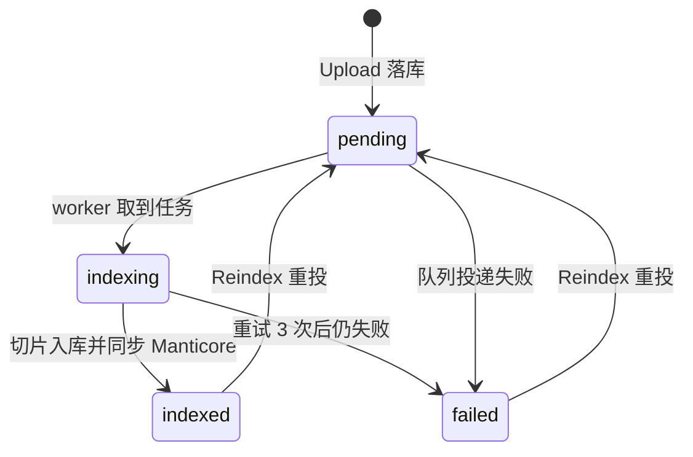

# 数据存储设计

本文描述 NovelWorkbench 的存储分工与降级行为、命名约定、表结构、枚举取值、非关系存储、启动播种、事务边界、索引约束与迁移策略。

## 1. 存储分工与降级

| 存储 | 承载内容 | 权威级别 | 缺失或故障时的行为 |
| --- | --- | --- | --- |
| PostgreSQL | 业务主数据、权限、审计、统计、任务留痕 | 权威源 | 启动即退出（`cmd/server/main.go` 中 `infra.NewPostgres` 失败 `os.Exit(1)`） |
| MinIO | 知识库文档原文二进制 | 文件内容权威源 | 上传/读取返回 `ERR_STORAGE`；服务启动继续 |
| Manticore | 知识库切片全文索引 | 可重建投影（非权威） | keyword 模式检索直接报错；hybrid 模式单通道失败降级到另一通道；服务启动继续 |
| Redis | 登出令牌黑名单 | 易失缓存 | 吊销校验视为未吊销（`TokenRepo.IsRevoked` 返回 false），服务启动继续 |
| RabbitMQ | 知识库索引任务投递 | 传输通道（非权威） | 索引任务投递失败，文档置 `failed`；服务启动继续 |


`cmd/server/main.go` 的初始化顺序：配置 → Postgres → `AutoMigrate` → Redis → RabbitMQ → MinIO（含桶检查）→ Manticore → JWT 签名器 → 仓储与服务装配 → 启动播种 → HTTP 监听。

- Postgres 连接或迁移失败：`os.Exit(1)`。
- Redis 配置非法（`NewRedis` 返回 nil 客户端）：`os.Exit(1)`；连接探活失败仅告警。
- RabbitMQ、MinIO、Manticore 连接失败：仅告警，对应能力降级。
- 播种失败（提示词、工具、配置、角色、菜单、引导管理员）：`os.Exit(1)`；默认供应商播种失败仅告警。

运行状态页的依赖探测（`service/system_status_service.go` 的 `SystemStatusService.Status`）把 postgres 标为必需，其余四项为可选：必需依赖失败记 `down`，可选依赖失败记 `degraded`。

## 2. 命名约定

| 对象 | 约定 | 示例 |
| --- | --- | --- |
| 表名 | snake_case 复数，由各 DO 的 `TableName()` 显式指定 | `projects`、`knowledge_chunks`、`lore_settings` |
| 主键 | `<业务>_ulid`，值 = 前缀 + 26 位大写 ULID（`pkg.NewULID`） | `PRJ_01J...`、`CHP_01J...` |
| 引用列 | `_ulid` 结尾 | `project_ulid`、`chapter_ulid` |
| 状态/枚举列 | 多数以 `_code` 结尾；`projects.project_status`、`chapters.chapter_status`、`chapter_snapshots.snapshot_type` 三个列不带该后缀 | `fact_status_code`、`chapter_status` |
| 计数列 | `_count` 结尾 | `word_count`、`chunk_count` |
| 正文/长文本列 | `_text` 结尾且 `type:text` | `content_text`、`chunk_text` |
| 布尔列 | `_flag` 结尾 | `enabled_flag`、`builtin_flag`、`read_flag` |
| 视图对象中的时间戳 | 一律 RFC3339 字符串，由 `pkg.FormatTime` 转换，不落库 | `created_at`、`updated_at` |

GORM 默认把 `XxxULID` 推导为 `xxx_ul_id`。`infra.ULIDNamingStrategy.ColumnName`（`backend/internal/infra/postgres.go`）把以 `_ul_id` 结尾的推导名改写为 `_ulid`；索引名仍保留 GORM 原推导结果（如 `idx_projects_user_ul_id`），列名统一为 `user_ulid`。

### 2.1 ULID 业务前缀

前缀常量定义在 `domain/common.go`、`domain/continuity.go`、`domain/outline.go`。

| 前缀 | 对应表 / 用途 | 前缀 | 对应表 / 用途 |
| --- | --- | --- | --- |
| `USR_` | `users` | `PRM_` | `prompts` |
| `REQ_` | 请求链路 ID（不落库） | `MNU_` | `menus` |
| `PRJ_` | `projects` | `ROL_` | `roles` |
| `VOL_` | `volumes` | `URO_` | `user_roles` |
| `CHP_` | `chapters` | `AUD_` | `audit_logs` |
| `SNP_` | `chapter_snapshots` | `LGL_` | `login_logs` |
| `CHR_` | `characters` | `NTF_` | `notifications` |
| `RLT_` | `character_relations` | `MPR_` | `model_providers` |
| `LOR_` | `lore_settings` | `MDL_` | `model_catalogs` |
| `OUT_` | `outline_nodes` | `MGR_` | `model_role_grants` |
| `SCN_` | `detailed_scenes` | `MUG_` | `model_user_grants` |
| `FCT_` | `temporal_facts` | `MUS_` | `model_usage_stats` |
| `HOK_` | `foreshadow_hooks` | `JOB_` | `jobs` |
| `CSM_` | `chapter_summaries` | `SET_` | `app_settings` |
| `DOC_` | `knowledge_documents`（同时作为 MinIO 对象键） | `WCS_` | `word_count_stats` |
| `CHK_` | `knowledge_chunks` | | |
| `SES_` | `chat_sessions` | | |
| `MSG_` | `chat_messages` | `TOL_` | `tools` |

### 2.2 列类型映射

| Go 类型 / 标签 | PostgreSQL 类型 |
| --- | --- |
| `string` + `size:N` | `varchar(N)` |
| `string` + `type:text` | `text` |
| `int`、`int64` | `bigint` |
| `bool` | `boolean` |
| `float64` | `decimal` |
| `time.Time`（`BaseDO`） | `timestamptz` |

GORM 仅在字段带 `not null` 标签时生成 `NOT NULL`。当前所有 DO 都没有该标签，因此 DDL 中只有主键列隐含非空，其余列均可空；带 `default:` 的列只在建表时写入 `DEFAULT` 值，不改变可空性。非空语义由请求校验与写入路径保证。

## 3. 表结构

`AutoMigrate` 一次性声明 33 张表（`cmd/server/main.go`）。所有表统一含 `created_at timestamptz`（`autoCreateTime`）、`updated_at timestamptz`（`autoUpdateTime`）、`created_by varchar(40)` 与 `updated_by varchar(40)`，来自 `domain.BaseDO`，下表不再重复列出。

`created_by` / `updated_by` 由 GORM 回调自动填充（`pkg.RegisterActorCallbacks`）：`AuthMiddleware` 把当前登录用户 ULID 注入请求 context，回调在 `gorm:create` / `gorm:update` 之前写入对应列。显式赋值优先，不会被覆盖；系统任务（无登录态）留空串。

不使用软删除——业务删除是硬删除，且 `user_name`、`role_code`、`menu_code` 带唯一索引，软删除会让已删行长期占位、无法重建同名资源。

下面按域列出各表的列与关键约束。「PK」为主键，「UQ」为唯一索引，「IDX」为普通索引，未标注者无特殊约束。

### 3.1 用户、权限与审计（7 张）

**users** — `user_ulid`(PK) · `user_name`(UQ,v64) · `user_email`(UQ,v128) · `password_hash`(v128，bcrypt，`json:"-"` 不出参) · `avatar_url`(v256) · `remark_text`(v256) · `user_status_code`(IDX,v16，缺省 `active`，取值 `active`/`disabled`)

**roles** — `role_ulid`(PK) · `role_code`(UQ,v64) · `role_name`(v64) · `remark_text`(v256) · `perm_codes_json`(text，权限码 JSON 数组，`["*"]` 表示全部) · `builtin_flag`(bool，缺省 false，内置角色不可删除)

**user_roles** — `user_role_ulid`(PK) · `user_ulid`(IDX) · `role_ulid`(IDX)

无唯一约束；写入统一走 `RoleRepo.ReplaceUserRoles`（事务内先删后插），不会产生重复行。

**menus** — `menu_ulid`(PK) · `parent_ulid`(IDX，空为根) · `menu_code`(UQ,v64) · `menu_name`(v64) · `menu_type_code`(v16，`group`/`page`/`action`) · `scope_code`(IDX,v16，`global`/`project`) · `route_path`(v128，项目内以 `:project_ulid` 结尾) · `component_path`(v128) · `icon_code`(v32) · `perm_code`(IDX,v64，空表示登录即可见) · `visible_flag`(bool，缺省 true，是否进导航) · `enabled_flag`(bool，缺省 true) · `sort_order`(bigint) · `remark_text`(v256)

`perm_code` 的全局唯一性由 `MenuService.Save` 调用 `MenuRepo.CountByPermCode` 校验（冲突返回 `ERR_CONFLICT`），数据库不建唯一索引以允许多行空值。

**audit_logs** — `audit_ulid`(PK) · `log_level_code`(IDX,v16，级别 `info`(2xx/3xx)/`warn`(4xx)/`error`(5xx)，由 HTTP 状态推导) · `trace_id`(IDX,v40，链路 ID，与响应包络 `trace_id` 同值) · `user_ulid`(IDX，操作者，未登录为空串) · `user_name`(IDX,v64，操作者登录名快照) · `action_code`(IDX,v128，接口路径去 `/api/v1/` 前缀) · `request_path`(v256) · `request_method`(v8) · `request_body`(text，凭据字段脱敏为 `***`，上传与超限不采样) · `target_type`(IDX,v32，目标类型 user/role/menu/project/chapter/document/prompt/tool/model/provider/chat_session/notification) · `target_ulid`(IDX) · `resp_code`(IDX,v32) · `resp_message`(v512) · `http_status`(int) · `latency_ms`(bigint) · `ip_addr`(v64) · `user_agent_text`(v512)

写入方为 `pkg.AuditMiddleware`：仅记录 `POST` 请求，跳过 `/api/v1/auth/login`、`/api/v1/auth/logout`、`/api/v1/chat/send`。中间件缓冲响应体前 8KB 解析包络（业务码与说明）后透传，普通响应不受影响。落库失败只告警，不阻断业务。`AuditRepo` 有 `Create`、`GetByULID`、`ListPage`，无删除路径；`ListPage` 支持级别 / 链路 ID / 目标类型 / 动作码 / 关键字 / 用户 / 日期区间过滤，历史行缺级别时按 HTTP 状态补全。

**login_logs** — `login_log_ulid`(PK) · `user_ulid`(IDX，命中用户，失败为空) · `login_account_text`(IDX,v128，登录名或邮箱) · `login_result_code`(IDX,v16，`success`/`failed`/`disabled`) · `fail_reason_text`(v256) · `ip_addr`(v64) · `user_agent_text`(v512)

**notifications** — `notification_ulid`(PK) · `user_ulid`(IDX，接收人) · `notification_type_code`(IDX,v16，`system`/`task`/`account`) · `notification_title_text`(v128) · `notification_body_text`(v512) · `read_flag`(IDX,bool，缺省 false) · `link_url`(v256) · `ref_type_code`(v32) · `ref_ulid`(v40)

所有查询都带 `user_ulid`；用户删除时由 `UserAdminService.Delete` 调用 `NotificationRepo.DeleteByUser` 清理。

### 3.2 创作主数据（7 张）

**projects** — `project_ulid`(PK) · `user_ulid`(IDX，归属用户) · `project_name`(v128) · `genre_code`(v32，无白名单) · `style_text`(v1024，文风提示词) · `synopsis_text`(v4096) · `project_status`(IDX,v16，`draft`/`serial`/`completed`，创建时固定 `draft`) · `total_word_count`(bigint，累计字数，由章节字数差增减)

**volumes** — `volume_ulid`(PK) · `project_ulid`(IDX) · `volume_name`(v128) · `volume_order`(bigint) · `summary_text`(v2048)

**chapters** — `chapter_ulid`(PK) · `project_ulid`(IDX) · `volume_ulid`(IDX) · `chapter_name`(v128) · `chapter_order`(IDX，项目内排序号，创建时取最大值 +1) · `content_text`(text) · `summary_text`(v2048) · `word_count`(bigint，`pkg.CountWords`) · `chapter_status`(v16，`draft`/`revised`/`locked`，创建时固定 `draft`)

**chapter_snapshots** — `snapshot_ulid`(PK) · `chapter_ulid`(IDX) · `content_text`(text) · `snapshot_type`(v16，当前只写 `manual`) · `change_note`(v256)

写入路径只有 `ChapterService.SnapshotCreate` 与 `SnapshotRestore`（回滚前自动留档，`change_note = "restore 自动留档"`）。

**characters** — `character_ulid`(PK) · `project_ulid`(IDX) · `character_name`(v64) · `alias_text`(v128) · `role_type_code`(v16，`protagonist`/`antagonist`/`supporting`/`minor`) · `personality_text`(v2048) · `background_text`(v4096) · `appearance_text`(v2048) · `goal_text`(v2048)

**character_relations** — `relation_ulid`(PK) · `project_ulid`(IDX) · `from_character_ulid`(IDX，起点角色) · `to_character_ulid`(IDX，终点角色) · `relation_type_code`(v32，自由文本) · `relation_note`(v256)

**lore_settings** — `lore_ulid`(PK) · `project_ulid`(IDX) · `lore_name`(v128) · `lore_type_code`(IDX,v16，`world`/`rule`/`item`/`place`/`event`/`note`) · `content_text`(text) · `content_mode_code`(v16，缺省 `rich`，`rich`=富文本 HTML / `markdown`) · `sort_order`(bigint)

世界观设定与创作笔记共用一张表，`lore_type_code = 'note'` 表示创作笔记；该类型禁止注入 AI 上下文。

### 3.3 规划与连续性（5 张）

**outline_nodes** — `outline_ulid`(PK) · `project_ulid`(IDX) · `parent_outline_ulid`(IDX，缺省空串) · `node_type_code`(IDX,v32，`volume`/`arc`/`storyBlock`/`chapter`) · `title_text`(v128) · `summary_text`(v4096) · `node_status_code`(IDX,v16，`draft`/`planning`/`ready`/`done`，空值写 `draft`) · `sort_order`(IDX，同级升序)

`OutlineService.SaveNode` 在 `sort_order` 为 0 时取同级最大值 +1；`DeleteNode` 在子节点数 > 0 时返回 `ERR_CONFLICT`，不级联删子节点，也不删挂在其下的场景卡片。

**detailed_scenes** — `scene_ulid`(PK) · `project_ulid`(IDX) · `outline_ulid`(IDX) · `character_ulid_list`(text，出场角色 ULID JSON 数组) · `location_text`(v256) · `conflict_text`(text) · `pace_code`(IDX,v16，`slow`/`medium`/`fast`/`climax`) · `estimated_words`(bigint) · `entry_state_text`(text，入场状态) · `goal_text`(text，角色目标) · `key_choice_text`(text，关键选择) · `outcome_text`(text，场景结果) · `exit_state_text`(text，出场状态) · `sort_order`(IDX)

`SaveScene` 在 `sort_order` 为 0 时取同一大纲节点下最大值 +1；`pace_code` 直接取自请求，无缺省值。

**temporal_facts** — `fact_ulid`(PK) · `project_ulid`(IDX) · `subject_text`(v128，主体) · `predicate_code`(IDX,v64，谓词) · `object_text`(v256，客体) · `fact_status_code`(IDX,v16，`candidate`/`confirmed`/`superseded`/`stale`，空值写 `candidate`) · `valid_from_chapter_ulid`(生效起始章) · `valid_until_chapter_ulid`(生效截止章) · `source_chapter_ulid`(IDX，证据来源章) · `source_quote_text`(text，原文证据) · `note_text`(text)

**foreshadow_hooks** — `hook_ulid`(PK) · `project_ulid`(IDX) · `hook_status_code`(IDX,v16，`planned`/`planted`/`echoed`/`resolved`/`abandoned`) · `description_text`(text，伏笔描述) · `expected_payoff_text`(text，预期回收方式) · `setup_chapter_ulid`(IDX，埋设章) · `payoff_chapter_ulid`(IDX，回收章) · `importance_code`(v16，`high`/`medium`/`low`，空值写 `medium`) · `note_text`(text)

**chapter_summaries** — `summary_ulid`(PK) · `project_ulid`(IDX) · `chapter_ulid`(IDX) · `summary_text`(text) · `source_hash_text`(v128，生成时的正文指纹) · `summary_status_code`(IDX,v16，`pending`/`verified`/`stale`，空值写 `pending`)

`(project_ulid, chapter_ulid)` 无唯一约束；`ContinuityService.SaveSummary` 先按章节查询，存在则更新、否则插入。

### 3.4 知识库（2 张）

**knowledge_documents** — `doc_ulid`(PK) · `project_ulid`(IDX) · `doc_name`(v256) · `doc_type_code`(v16，`txt`/`md`/`docx`/`pdf`，由扩展名白名单推导) · `object_key`(v128，MinIO 对象键，同 `doc_ulid`) · `doc_status_code`(v16，`pending`/`indexing`/`indexed`/`failed`) · `chunk_count`(int) · `total_token_count`(bigint) · `error_message`(v512，失败原因)

**knowledge_chunks** — `chunk_ulid`(PK) · `doc_ulid`(IDX) · `project_ulid`(IDX) · `chunk_index`(int，片内序号) · `chunk_text`(text) · `token_count`(int) · `content_hash`(v64，切片内容指纹，用于增量重建时复用 ULID)

### 3.5 对话与 AI 资产（6 张）

**chat_sessions** — `session_ulid`(PK) · `project_ulid`(IDX) · `user_ulid`(IDX) · `session_name`(v128，缺省取首条消息前 20 字)

**chat_messages** — `message_ulid`(PK) · `session_ulid`(IDX) · `role_code`(v16，`user`/`assistant`/`system`) · `content_text`(text) · `reasoning_text`(text，完整思考过程) · `prompt_code`(v32，命中的指令提示词编码) · `tool_code_json`(text，本轮执行的工具编码 JSON 数组) · `ref_doc_json` / `ref_chapter_json` / `ref_message_json` / `ref_summary_json` / `ref_prompt_json`(text，各自的引用 ULID 数组) · `token_used_count`(int)

**prompts** — `prompt_ulid`(PK) · `prompt_code`(IDX,v32，对话中以 `/code` 触发) · `prompt_name`(v64) · `prompt_kind_code`(IDX,v16，`system` 身份 / `command` 指令) · `scope_code`(IDX,v16，`global`/`project`) · `project_ulid`(IDX，全局为空) · `domain_code`(IDX,v32，内置提示词的流程域) · `category_code`(v16，`write`/`revise`/`outline`/`setting`/`review`/`other`) · `description_text`(v256) · `prompt_text`(text，可含 `{{占位符}}`) · `enabled_flag`(bool) · `builtin_flag`(bool，内置不可删) · `asset_hash_text`(v64，出厂指纹) · `customized_flag`(bool，作者是否改过，改过则代码升级不覆盖) · `sort_order`(int)

**tools** — `tool_ulid`(PK) · `tool_code`(UQ,v32，对话中以 `#code` 触发) · `tool_name`(v64) · `tool_type_code`(IDX,v16，固定 `builtin`) · `description_text`(v256，模型可见的一句话说明) · `trigger_keywords`(v256，关键词自动触发，逗号分隔) · `param_schema_json`(text，参数声明 JSON 数组) · `enabled_flag`(bool) · `builtin_flag`(bool) · `asset_hash_text`(v64，出厂指纹) · `customized_flag`(bool) · `sort_order`(int)

### 3.6 模型生态（5 张）

**model_providers** — `provider_ulid`(PK) · `provider_name`(v64) · `protocol_code`(v16，`openai`/`anthropic`) · `base_url`(v256) · `api_key_cipher`(text，AES-256-GCM 封存) · `enabled_flag`(bool) · `sort_order`(int) · `remark_text`(v256) · `last_test_status_code`(v16，`untested`/`success`/`failed`) · `last_test_message`(v512，探测结果说明) · `last_test_at`(timestamptz，最近测试时间)

**model_catalogs** — `model_ulid`(PK) · `provider_ulid`(IDX) · `model_name`(v128) · `model_label`(v64) · `temperature`(float64) · `max_tokens`(int) · `context_window_count`(int) · `enabled_flag`(bool) · `default_flag`(bool，全局唯一默认模型) · `sort_order`(int) · `remark_text`(v256) · `last_test_status_code`(v16) · `last_test_message`(v512) · `last_test_at`(timestamptz)

**model_role_grants** — `grant_ulid`(PK，`MGR_`) · `model_ulid`(IDX) · `role_ulid`(IDX)

**model_user_grants** — `grant_ulid`(PK，`MUG_`) · `model_ulid`(IDX) · `user_ulid`(IDX)

角色授权与用户授权是两条并列的授权路径：`ModelAccessService` 判定时取「用户显式授权 ∪ 用户所属角色授权」，任一命中即放行。用户被删除时 `UserAdminService.Delete` 连带清理其 `model_user_grants` 行；角色授权则由 `ModelProviderRepo.ReplaceGrants` 整体覆盖。

**model_usage_stats** — `usage_stat_ulid`(PK) · `stat_date`(IDX,v10，`YYYY-MM-DD`) · `provider_ulid`(IDX) · `provider_name`(v64，供应商名快照) · `model_name`(IDX) · `call_type_code`(v16，`chat`) · `call_count`(bigint) · `success_count`(bigint) · `fail_count`(bigint) · `prompt_tokens`(bigint) · `completion_tokens`(bigint) · `total_tokens`(bigint) · `latency_ms_sum`(bigint)

唯一索引 `uk_mus_dim` = `stat_date` + `provider_ulid` + `model_name` + `call_type_code` 四列组合。

### 3.7 运维（3 张）

**jobs** — `job_ulid`(PK) · `job_type_code`(v16，`doc_index`/`doc_reindex`) · `job_status_code`(v16，`queued`/`running`/`success`/`failed`) · `payload_json`(text，任务载荷 `{"doc_ulid":"DOC_…"}`) · `retry_count`(int) · `error_message`(v512)

**app_settings** — `setting_ulid`(PK) · `setting_key`(UQ,v64，白名单) · `setting_value`(v512，正整数字符串) · `setting_desc`(v256，启动时与内置说明同步)

**word_count_stats** — `word_stat_ulid`(PK) · `project_ulid`(IDX) · `stat_date`(IDX,v10，`YYYY-MM-DD`) · `word_delta`(bigint，当日人工净增) · `ai_word_delta`(bigint，当日 AI 生成)

`(project_ulid, stat_date)` 无唯一约束；`ProjectRepo.UpsertWordDelta` 与 `ChatRepo.UpsertAIWordDelta` 采用「先查后写」累加，并发下可能插入同日重复行，统计查询以 `SUM` 聚合。

## 4. 枚举与状态码

### 4.1 用户与权限

| 字段 | 取值 |
| --- | --- |
| `users.user_status_code` | `active` / `disabled` |
| `roles.role_code`（内置） | `admin` / `user` |
| `menus.menu_type_code` | `group` / `page` / `action` |
| `menus.scope_code` | `global` / `project` |
| `login_logs.login_result_code` | `success` / `failed` / `disabled` |
| `notifications.notification_type_code` | `system` / `task` / `account` |

权限码常量共 15 个，定义在 `domain/role.go`，以 JSON 数组存于 `roles.perm_codes_json`，并由 `menus.perm_code` 登记到权限目录。

| 权限码 | 常量 | 含义 | 权限码 | 常量 | 含义 |
| --- | --- | --- | --- | --- | --- |
| `*` | `PermAdminAll` | 全部权限 | `system:usage:read` | `PermUsageRead` | 用量分析 |
| `system:user:manage` | `PermUserManage` | 用户管理 | `system:status:read` | `PermSystemRead` | 运行状态 |
| `system:role:manage` | `PermRoleManage` | 角色管理 | `system:setting:manage` | `PermSettingManage` | 运行时配置 |
| `system:menu:manage` | `PermMenuManage` | 菜单与权限登记 | `system:loginlog:read` | `PermLoginLogRead` | 登录日志 |
| `system:perm:read` | `PermPermissionRead` | 权限目录 | `system:job:manage` | `PermJobManage` | 异步任务 |
| `system:audit:read` | `PermAuditRead` | 审计日志 | `prompt:manage` | `PermPromptManage` | 提示词库 |
| `system:model:manage` | `PermModelManage` | 模型供应商 | `tool:manage` | `PermToolManage` | 工具资产 |

### 4.2 创作

| 字段 | 取值 | 缺省 |
| --- | --- | --- |
| `projects.project_status` | 自由文本（前端约定 `draft` / `serial` / `completed`），服务端不做白名单 | 创建时固定 `draft` |
| `chapters.chapter_status` | 自由文本（前端约定 `draft` / `revised` / `locked`），服务端不做白名单 | 创建时固定 `draft` |
| `chapter_snapshots.snapshot_type` | 固定 `manual` | 两条写入路径都写 `manual` |
| `characters.role_type_code` | 自由文本（前端约定 `protagonist` / `antagonist` / `supporting` / `minor`），服务端不做白名单 | 无 |
| `character_relations.relation_type_code` | 自由文本 | 无 |
| `lore_settings.lore_type_code` | 有白名单：`world` / `rule` / `item` / `place` / `event` / `note` | 无 |
| `lore_settings.content_mode_code` | `rich` / `markdown` | 列默认 `rich` |
| `outline_nodes.node_type_code` | 自由文本（前端约定 `volume` / `arc` / `storyBlock` / `chapter`），服务端不做白名单 | 无 |
| `outline_nodes.node_status_code` | 自由文本（前端约定 `draft` / `planning` / `ready` / `done`），服务端不做白名单 | 空值写 `draft` |
| `detailed_scenes.pace_code` | 有白名单：`slow` / `medium` / `fast` / `climax` | 无 |

### 4.3 连续性

| 字段 | 取值 | 缺省 |
| --- | --- | --- |
| `temporal_facts.fact_status_code` | `candidate` / `confirmed` / `superseded` / `stale` | 空值写 `candidate` |
| `foreshadow_hooks.hook_status_code` | `planned` / `planted` / `echoed` / `resolved` / `abandoned` | 由请求决定 |
| `foreshadow_hooks.importance_code` | `high` / `medium` / `low` | 空值写 `medium` |
| `chapter_summaries.summary_status_code` | `pending` / `verified` / `stale` | 空值写 `pending` |

### 4.4 知识库、对话与 AI 资产

| 字段 | 取值 |
| --- | --- |
| `knowledge_documents.doc_type_code` | `txt` / `md` / `docx` / `pdf`（由扩展名白名单推导，其他拒绝上传） |
| `knowledge_documents.doc_status_code` | `pending` / `indexing` / `indexed` / `failed` |
| `chat_messages.role_code` | `user` / `assistant` / `system` |
| `prompts.scope_code` | `global` / `project` |
| `prompts.prompt_kind_code` | `system` / `command` |
| `prompts.category_code` | `write` / `revise` / `outline` / `setting` / `review` / `other` |
| `tools.tool_type_code` | `builtin` |

文档索引状态机（`KnowledgeService` 与 `KnowledgeWorker`）：



### 4.5 模型与运维

| 字段 | 取值 |
| --- | --- |
| `model_providers.protocol_code` | `openai` / `anthropic` |
| `model_providers.last_test_status_code`、`model_catalogs.last_test_status_code` | `untested` / `success` / `failed` |
| `model_usage_stats.call_type_code` | `chat` |
| `jobs.job_type_code` | `doc_index` / `doc_reindex` |
| `jobs.job_status_code` | `queued` / `running` / `success` / `failed` |
| 检索模式（请求参数，非列） | `keyword` / `hybrid`（默认 hybrid） |

## 5. 非关系存储

### 5.1 MinIO

| 项 | 值 |
| --- | --- |
| 桶名 | `novelworkbench`（`minio.bucket`） |
| 桶初始化 | `infra.NewMinIO` 检查桶，不存在则创建；启动后再做一次健康检查，失败只告警 |
| 对象键 | 文档 ULID（`DOC_...`），即 `knowledge_documents.object_key` |
| 上传 Content-Type | `application/octet-stream` |

上传顺序（`KnowledgeService.Upload`）：校验归属、扩展名白名单、大小上限 → `ObjectRepo.PutObject` 写原文（失败抛 `ERR_STORAGE`）→ 插入 `knowledge_documents` 行（`doc_status_code = 'pending'`，失败则 `RemoveObject` 回滚）→ `enqueueIndexJob` 先插 `jobs` 行（`queued`）再投递 RabbitMQ（投递失败把任务与文档置 `failed`）。

删除顺序（`KnowledgeService.Delete`）：`RemoveObject`（失败即中断，抛 `ERR_STORAGE`）→ 删 Manticore 行（失败只告警）→ 事务内删 `knowledge_chunks` 与 `knowledge_documents`。

### 5.2 Manticore

| 项 | 值 |
| --- | --- |
| 表名 | `nw_chunks`（`manticore.table_chunks`，配置为空时回落同名默认） |
| 客户端 | `infra.ManticoreClient`，`POST {base_url}/sql?mode=raw`，HTTP 超时 5s |
| 表结构 | `chunk_ulid string, doc_ulid string, project_ulid string, chunk_text text` |

建表语句（`ensureManticoreSchema`）：

```sql
CREATE TABLE IF NOT EXISTS nw_chunks(
  chunk_ulid string,
  doc_ulid string,
  project_ulid string,
  chunk_text text
) charset_table='non_cjk,0..9,A..Z->a..z,a..z' ngram_len='1' ngram_chars='cjk'
```

`ngram_len='1'` + `ngram_chars='cjk'` 让中文按单字切分；`charset_table` 做非 CJK 字符小写映射。

worker 启动时的结构校验（`KnowledgeWorker.Run`）：执行 `CREATE TABLE IF NOT EXISTS`，再 `SHOW CREATE TABLE nw_chunks`；若结果不含 `ngram_len` 则 `DROP TABLE` 重建，并从 PG 全量回灌（`rebuildManticoreIndex` 读 `ListAllChunksForIndex`，按文档分组调用 `syncManticoreChunks`）。

单文档同步 `syncManticoreChunks` 为「先删后插」：`DELETE FROM nw_chunks WHERE doc_ulid = '...'` 后逐条 `INSERT`，字符串转义由 `escapeManticoreString` 处理。

检索（`queryManticoreHits`）：

```sql
SELECT chunk_ulid, WEIGHT() AS score FROM nw_chunks
WHERE MATCH('@chunk_text <expr>') AND project_ulid = '<PRJ_...>'
  [AND doc_ulid IN (...)]
ORDER BY score DESC LIMIT <topK>
```

`expr` 在 term 通道是逐词引号后用 ` | ` 连接的 OR 表达式，phrase 通道是整串引号包裹。命中结果按 `chunk_ulid` 回表 `knowledge_chunks`（`GetChunksByULIDs` 联 `knowledge_documents` 取文档名）。hybrid 模式对 term / phrase 两路命中做 RRF 融合（`score = Σ 1/(60+rank)`），再交默认模型重排（重排失败 fail-open 保留原顺序）。

### 5.3 Redis

| 项 | 值 |
| --- | --- |
| 键格式 | `nw:token:blacklist:<sha256hex(token)>` |
| 值 | `"1"` |
| TTL | 令牌签发有效期（`expires_at - issued_at`），到期键自动清除 |
| 读语义 | `TokenRepo.IsRevoked` 在 Redis 异常时返回 false（视为未吊销） |
| 写入点 | `AuthService.Logout` → `TokenRepo.Revoke` |

### 5.4 RabbitMQ

| 项 | 值 |
| --- | --- |
| 队列名 | `nw_doc_index`（`rabbitmq.queue_doc_index`） |
| 声明 | `QueueDeclare(name, durable=true, autoDelete=false, exclusive=false, noWait=false)`，投递与消费前各声明一次（幂等） |
| 投递 | `PublishWithContext`，`DeliveryMode=Persistent`，`ContentType=application/json` |
| 消息体 | `{"doc_ulid":"DOC_..."}` |

消费确认语义（`MQRepo.ConsumeIndexJobs`）：

| 情况 | 动作 |
| --- | --- |
| 载荷 JSON 非法 | `Nack(requeue=false)`，丢弃 |
| handler 返回 nil（成功，或已在内部落库为失败） | `Ack` |
| handler 返回 error（查询异常、关停中断） | `Nack(requeue=true)`，重投 |
| 通道关闭或 ctx 取消 | 消费循环退出 |

消费循环中断后按 5s 间隔重连。`KnowledgeWorker.handleIndexJob` 对单文档最多重试 3 次，退避 `attempt` 秒；最终失败写入 `jobs` 与 `knowledge_documents` 的失败信息，并向项目主人发 `task` 类型通知后返回 nil（不重投）。

## 6. 启动播种

全部播种在 `AutoMigrate` 之后、HTTP 监听之前执行。所有播种都按业务键查缺补插，重复启动不产生重复行。

| 顺序 | 动作 | 触发条件 | 失败处理 |
| --- | --- | --- | --- |
| 1 | `ModelProviderService.SeedDefault` 播种默认供应商与默认模型 | 配置了 `ai.base_url` 与 `ai.chat_model` 且 `model_providers` 为空 | 告警，继续启动 |
| 2 | `ModelProviderService.MigrateLegacyModels` 把 `model_providers.chat_model_name` 非空的行转成 `model_catalogs` 行 | `model_catalogs` 为空 | 告警，继续启动 |
| 3 | `PromptService.SeedDefaults` 播种内置全局提示词（12 份身份 + 24 份指令）并按指纹升级、下线旧内置提示词 | 按 `(global, "", prompt_code)` 查行；不存在则插入；`customized_flag` 或指纹一致则跳过；否则覆盖正文并写新指纹 | `os.Exit(1)` |
| 3.2 | `ToolService.SeedDefaults` 播种内置工具 | 按 `tool_code` 查缺补插 | `os.Exit(1)` |
| 4 | `SettingService.SeedDefaults` 播种默认配置 | 按 `setting_key` 查缺补插；已存在时仅同步 `setting_desc` | `os.Exit(1)` |
| 5 | `RoleService.SeedDefaults` 播种内置角色 | 按 `role_code` 查缺补插 | `os.Exit(1)` |
| 6 | `MenuService.SeedDefaults` 播种内置菜单 | 按 `menu_code` 查缺补插，父级编码先解析 | `os.Exit(1)` |
| 7 | `UserAdminService.BootstrapAdmin` 引导管理员 | `users` 为空 | `os.Exit(1)` |

播种内容：

| 对象 | 内容 |
| --- | --- |
| 供应商 | 名称「默认模型网关」，`enabled_flag=true`，`last_test_status_code='untested'`，API Key 用 JWT 密钥派生材料做 AES-256-GCM 封存 |
| 默认模型 | 取 `ai.chat_model`，`default_flag=true`，`model_label` 回填模型名；播种后授权给全部内置角色 |
| 内置提示词 | 12 个流程域 × (1 身份 + 2 指令) = 36 条（`ai.BuiltinDomains()`）；`scope_code='global'`、`builtin_flag=true`、`enabled_flag=true`，`asset_hash_text` 为出厂指纹。启动时按指纹升级：已自改或指纹一致不覆盖，其余覆盖正文；清单之外的旧内置提示词删除 |
| 内置档案 | 12 份（`ai.BuiltinPromptProfiles()`），每个流程域一份：`adapt`、`architect`、`continuity`、`deai`、`draft`、`finalize`、`operation`、`pitch`、`publish`、`review`、`short`、`style`；全局、启用、`asset_hash_text` 为出厂指纹 |
| 内置工具 | 6 个（`ToolService.SeedDefaults`）：`chapter_check`、`deai_scan`、`chapter_digest`、`character_scan`、`foreshadow_scan`、`lore_lookup`；全局、启用、带触发关键词与参数声明 |
| 应用配置 | `rag_top_k=6`、`daily_word_goal=2000`；键为白名单，值须为整数并落在 `settingRangeMap` 区间 |
| 内置角色 | `admin`（`perm_codes_json=["*"]`）、`user`（`perm_codes_json="[]"`），`builtin_flag=true`，已存在不覆盖 |
| 内置菜单 | 来源 `menuSeedList`，共 29 行：3 个分组（创作 / AI 资产 / 系统）、25 个页面、1 个动作权限（`action_model_write`）。`material` 是素材库唯一入口；`character`、`lore`、`knowledge`、`notes` 标记 `HiddenFlag`（已被素材库合并取代），`profile` 从顶栏用户菜单进入同样隐藏，五者仍注册路由但不进导航 |
| 管理员 | 登录名 `admin`，邮箱 `admin@novelworkbench.local`，密码取 `app.admin_password`（缺省 `Admin@123456`），挂载 `admin` 角色 |

## 7. 事务与一致性

事务封装统一为 `repo.WithTx(db, fn)`（`backend/internal/repo/tx.go`，即 `db.Transaction`）。仓储层内另有三处自建事务：`ChatRepo.DeleteSessionWithMessages`、`RoleRepo.ReplaceUserRoles`、`ModelProviderRepo.ReplaceGrants`。

### 7.1 有事务边界的操作

| 操作 | 事务内覆盖范围 | 位置 |
| --- | --- | --- |
| 项目删除 | 章节快照 → 章节 → 卷 → 角色关系与角色 → 世界观设定 → 会话消息与会话 → 知识切片 → 知识文档 → 字数统计 → 项目行 | `ProjectService.Delete` |
| 卷删除 | 汇总卷内字数 → 章节快照 → 章节 → 卷 → 项目字数回补 | `VolumeService.Delete` |
| 章节更新 | 章节字段更新 + 项目累计字数增减 + 当日字数统计 | `ChapterService.Update` |
| 章节删除 | 章节快照 → 章节 → 项目字数回补 | `ChapterService.Delete` |
| 快照回滚 | 自动留档 → 章节正文与字数更新 → 项目字数增减 | `ChapterService.SnapshotRestore` |
| 角色删除 | 关系边 → 角色卡 | `CharacterService.Delete` |
| 知识文档删除 | 切片行 → 文档行 | `KnowledgeService.Delete` |
| 切片重建 | 删该文档既有切片 → 逐条插入新切片 | `KnowledgeWorker.indexDocument` |
| AI 回复落库 | assistant 消息 → 当日 AI 字数统计 | `ChatService.Send` |
| 用户角色覆盖 | 清空用户全部关联 → 逐条插入 | `RoleRepo.ReplaceUserRoles` |
| 模型授权覆盖 | 清空模型全部授权 → 逐条插入 | `ModelProviderRepo.ReplaceGrants` |
| 会话删除 | 消息 → 会话 | `ChatRepo.DeleteSessionWithMessages` |

字数账目维护 `applyWordDelta`（`chapter_service.go`）在事务内做两件事：`ProjectRepo.AdjustTotalWordCount` 用表达式增减（`total_word_count = total_word_count + delta`）避免读改写覆盖；`ProjectRepo.UpsertWordDelta` 累加当日 `word_count_stats.word_delta`。

### 7.2 项目删除的级联覆盖面

`ProjectService.Delete` 在单个事务内按下列顺序显式删除（无数据库级联，先子后父）：

`chapter_snapshots` → `chapters` → `volumes` → `character_relations` + `characters` → `lore_settings` → `detailed_scenes` → `outline_nodes` → `temporal_facts` + `foreshadow_hooks` + `chapter_summaries` → `chat_messages` + `chat_sessions` → `knowledge_chunks` → `knowledge_documents` → `word_count_stats` → `projects`。

事务提交后执行 `cleanupKnowledgeExternal`：逐文档删 MinIO 对象与 Manticore 行，失败只告警，不回滚数据库。

以下表没有按项目删除的路径，项目删除后其行保留：

| 表 | 原因 |
| --- | --- |
| `jobs` | `JobRepo` 只有 Create / Update / Get / List，任务留痕永久保留 |
| `audit_logs`、`login_logs` | 只有 Create / ListPage，日志只增不删 |

其余表为全局数据，与项目无归属关系：`users`、`roles`、`user_roles`、`menus`、`app_settings`、`prompts`（全局行）、`tools`、`model_providers`、`model_catalogs`、`model_role_grants`、`model_user_grants`、`model_usage_stats`、`notifications`（按用户而非项目清理）。

### 7.3 跨存储写操作

这些操作无法纳入同一个数据库事务，只能靠应用层编排与告警降级：

| 操作 | 顺序 | 失败后果 |
| --- | --- | --- |
| 知识库上传 | MinIO 写 → PG 文档行 → PG 任务行 → RabbitMQ 投递 | PG 行失败回滚删 MinIO 对象；投递失败把文档与任务置 `failed` |
| 知识库删除 | MinIO 删原文 → Manticore 删行 → PG 事务 | MinIO 失败即中断；Manticore 失败只告警，索引残留 |
| 索引同步 | PG 切片事务 → Manticore 先删后插 → 回写文档状态 | Manticore 失败只告警，keyword 通道降级 |
| 项目删除的外部清理 | PG 事务提交后 → MinIO 删对象 → Manticore 删行 | 失败只告警，PG 一致性已保证 |
| 用户删除 | 删角色关联 → 删模型授权 → 删通知（失败只告警）→ 删用户行 | 通知清理失败会残留通知 |
| 模型用量统计 | 内存缓冲累加 → 每 5s `Flush` 批量 upsert | 落库失败丢弃该批缓冲（只告警），统计可能少计 |

`ModelUsageService` 的缓冲是唯一的最终一致路径：`RecordUsage` 只写内存，`flushLoop` 每 5s（`usageFlushInterval`）批量写库，进程退出时再 flush 一次。

## 8. 索引与查询约束

| 约束 | 说明 |
| --- | --- |
| 无外键 | 所有 DO 没有 `foreignKey` 标签，`AutoMigrate` 不生成 `FOREIGN KEY` |
| 无软删除 | 没有 `gorm.DeletedAt` 字段，删除均为物理 `DELETE` |
| 无数据库级联 | 不存在 `ON DELETE CASCADE`，级联全部由服务层编排 |
| 数据库唯一约束 6 处 | `users.user_name`、`users.user_email`、`roles.role_code`、`menus.menu_code`、`app_settings.setting_key`、`model_usage_stats.uk_mus_dim`（四列组合） |
| 服务层唯一语义 | `menus.perm_code`（`CountByPermCode`）、`model_catalogs.default_flag`（`ClearDefaultModel` 后置位）、`prompts` 的 `(scope_code, project_ulid, prompt_code)`、`chapter_summaries` 的 `(project_ulid, chapter_ulid)`、`word_count_stats` 的 `(project_ulid, stat_date)`（均先查后写） |
| 归属校验在服务层 | `mustOwnProject` / `mustOwnChapter` / `mustOwnDoc` 比对 `projects.user_ulid`，不是数据库约束 |
| 跨表关联用 JOIN | 如 `RoleRepo.ListRolesByUserULID`、`KnowledgeRepo.GetChunksByULIDs`、`StatsRepo` 联 `projects` |
| 分页 | `PageREQ.Normalize`：`page_num < 1` 归一为 1；`page_size` 缺省 20、超过 100 归一为 20 |
| 排序约定 | 时间倒序用于日志/任务/通知/项目；`sort_order ASC, created_at ASC` 用于菜单/设定/提示词；`chapter_order ASC`、`chunk_index ASC`、`sort_order ASC, outline_ulid ASC` 用于章节/切片/大纲 |
| 聚合在 SQL 内 | `model_usage_stats` 的按日/按供应商/按模型聚合由 `ModelUsageRepo` 的 `GROUP BY` 完成，缺日由服务层补零；`word_count_stats` 的区间汇总由 `StatsRepo` 完成 |
| 大文本不建索引 | `content_text`、`chunk_text`、`prompt_template`、`ref_text` 等 `text` 列不建索引，正文检索依赖 Manticore |
| 排序号来源 | 章节取项目内 `MAX(chapter_order)+1`；卷在请求值 ≤ 0 时取项目内最大值 +1；大纲节点与场景在请求值为 0 时取同级最大值 +1 |

## 9. 迁移策略

- 唯一迁移入口是 `cmd/server/main.go` 的 `db.AutoMigrate(...)`，声明 35 个 DO（含 `ToolDO` 与 `ModelUserGrantDO`）。仓库内没有 `.sql` 文件，也没有 migrations 目录。
- AutoMigrate 语义：表不存在则建表；表已存在则补缺失的列与索引。它不做破坏性变更——不删列、不改列类型、不删索引；删除字段或调整列宽必须手工执行 DDL。
- AutoMigrate 失败（连接失败或 DDL 出错）时 `os.Exit(1)`，服务不会带半迁移状态启动。
- 数据层幂等补丁在启动期以业务键判空执行：`SeedDefault`（供应商表为空）、`MigrateLegacyModels`（模型表为空）、四个 `SeedDefaults`（按编码/键查缺补插）、`BootstrapAdmin`（用户表为空）。
- Manticore 侧的结构管理由 `ensureManticoreSchema` 自实现：表不存在则按 CJK ngram 结构建表；已存在但 `SHOW CREATE TABLE` 结果缺少 `ngram_len` 时 drop 重建，并从 PG 回灌全部切片。这是唯一支持的结构变更路径。
- Redis 与 RabbitMQ 无结构迁移：键按 TTL 自然过期，队列在每次投递/消费前 `QueueDeclare` 幂等声明。

## 10. 备份与恢复

| 数据 | 备份对象 | 恢复要点 |
| --- | --- | --- |
| PostgreSQL | 整库逻辑备份（如 `pg_dump`） | 恢复后启动服务，`AutoMigrate` 幂等补齐缺失的表、列与索引；播种逻辑补回内置角色、菜单、配置、提示词与管理员 |
| MinIO | 桶 `novelworkbench` | 对象键即文档 ULID，与 `knowledge_documents.object_key` 一一对应；缺对象时 `KnowledgeService.GetContent` 返回 `ERR_STORAGE`，索引任务读取原文失败后把文档置 `failed` |
| Manticore | 无需备份 | 索引是投影；恢复 PG 后重启服务即可建表，`SHOW CREATE TABLE` 通过时不会自动回灌，需重建时可先 drop `nw_chunks` 再启动，或对每个文档调 `KnowledgeService.Reindex` 重投任务 |
| Redis | 无需备份 | 只存令牌黑名单，丢失后已签发令牌在 JWT 有效期内仍可用（默认 168 小时） |
| RabbitMQ | 无需备份 | 仅传输通道；队列 durable、消息 persistent，未消费消息在重启后重投；丢失的任务可用 `Reindex` 重新投递 |

恢复顺序：PostgreSQL → MinIO → 重启服务（触发 AutoMigrate、播种与 Manticore 建表）→ 按需重投知识库索引。

一致性注意：PG 与 MinIO、PG 与 Manticore 之间均无分布式事务——上传是「对象存储先写、PG 后写、PG 失败删对象」，删除是「对象存储先删、PG 后删」，存在短暂不一致窗口；切片同步失败只降级不回滚 PG。`word_count_stats` 的 `(project_ulid, stat_date)` 无唯一约束，并发写入可能产生重复行，`SUM` 聚合会重复累加。`model_usage_stats` 有 5s 内存缓冲，进程异常退出会丢失最近一个刷新周期的用量。
