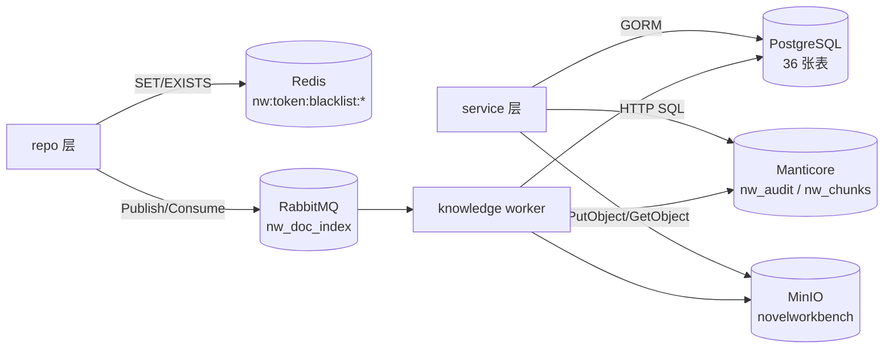
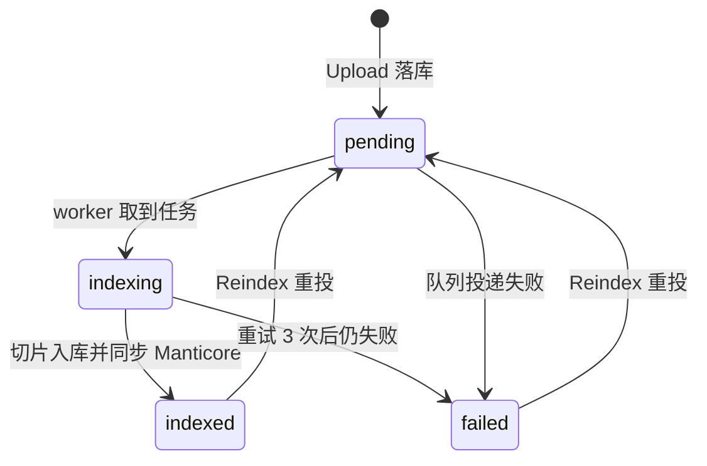
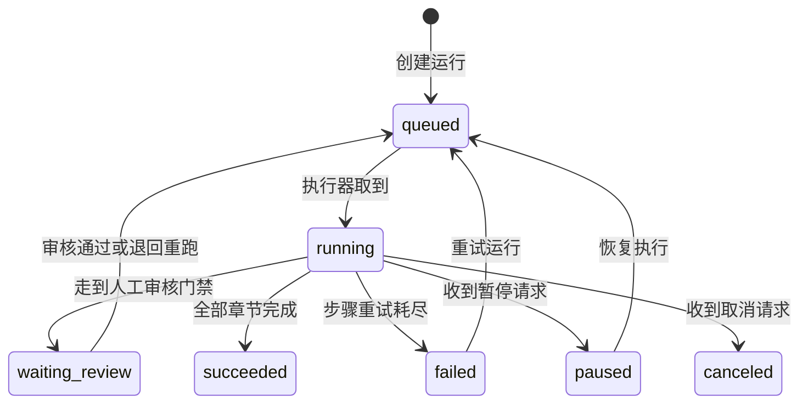

# 数据模型设计

本文描述 NovelWorkbench 的存储分工与降级行为、命名约定、表结构与枚举取值。
存储运行时（非关系存储、启动播种、事务边界、迁移与备份）见 [storage.md](storage.md)。

## 1. 存储分工与降级

| 存储 | 承载内容 | 权威级别 | 缺失或故障时的行为 |
| --- | --- | --- | --- |
| PostgreSQL | 业务主数据、权限、统计、任务留痕 | 权威源 | 启动即退出（`cmd/server/main.go` 中 `infra.NewPostgres` 失败 `os.Exit(1)`） |
| Manticore | 审计全文表 `nw_audit`、知识库切片索引 `nw_chunks` | 可重建投影（非权威） | 审计写入降级为丢弃；知识检索 keyword 模式报错、hybrid 单通道失败降级；服务启动继续 |
| MinIO | 知识库文档原文二进制 | 文件内容权威源 | 上传/读取返回 `ERR_STORAGE`；服务启动继续 |
| Redis | 登出令牌黑名单、写请求幂等记录 | 易失缓存 | 吊销校验视为未吊销，幂等放行；服务启动继续 |
| RabbitMQ | 知识库索引任务投递 | 传输通道（非权威） | 索引任务投递失败，文档置 `failed`；服务启动继续 |

`cmd/server/main.go` 的初始化顺序：配置 → Postgres → `AutoMigrate` → 清理下线表列 → Redis → RabbitMQ → MinIO（含桶检查）→ Manticore → JWT 签名器 → 仓储与服务装配 → 启动播种 → HTTP 监听。

- Postgres 连接或迁移失败：`os.Exit(1)`。
- Redis 配置非法（`NewRedis` 返回 nil 客户端）：`os.Exit(1)`；连接探活失败仅告警。
- RabbitMQ、MinIO、Manticore 连接失败：仅告警，对应能力降级。
- 播种失败（提示词、工具、配置、角色、菜单、引导管理员）：`os.Exit(1)`；默认供应商播种失败仅告警。

运行状态页的依赖探测（`service/system_status_service.go`）把 postgres 标为必需，其余四项为可选：必需依赖失败记 `down`，可选依赖失败记 `degraded`。

## 2. 命名约定

| 对象 | 约定 | 示例 |
| --- | --- | --- |
| 表名 | snake_case 复数，由各 DO 的 `TableName()` 显式指定 | `projects`、`knowledge_chunks`、`lore_settings` |
| 主键 | `<业务>_ulid`，值 = 前缀 + 26 位大写 ULID（`pkg.NewULID`） | `PRJ_01J...`、`CHP_01J...` |
| 引用列 | `_ulid` 结尾 | `project_ulid`、`chapter_ulid` |
| 状态/枚举列 | 多数以 `_code` 结尾；`projects.project_status`、`chapters.chapter_status`、`chapter_snapshots.snapshot_type` 三个列不带该后缀 | `fact_status_code`、`chapter_status` |
| 计数列 | `_count` 结尾 | `word_count`、`chunk_count` |
| 正文/长文本列 | `_text` 结尾且 `type:text` | `content_text`、`chunk_text` |
| 布尔列 | `_flag` 结尾 | `enabled_flag`、`builtin_flag`、`read_flag` |
| 视图对象中的时间戳 | 一律 RFC3339 字符串，由 `pkg.FormatTime` 转换，不落库 | `created_at`、`updated_at` |

GORM 默认把 `XxxULID` 推导为 `xxx_ul_id`。`infra.ULIDNamingStrategy.ColumnName`（`backend/internal/infra/postgres.go`）把以 `_ul_id` 结尾的推导名改写为 `_ulid`；索引名仍保留 GORM 原推导结果（如 `idx_projects_user_ul_id`），列名统一为 `user_ulid`。其余字段（`ToolCodeJSON`、`PayloadJSON`、`AIWordDelta`）用显式 `column:` 标签指定，避免推导名被拆成 `_j_s_o_n`。

### 2.1 ULID 业务前缀

前缀常量定义在 `domain/common.go`、`domain/continuity.go`、`domain/outline.go`、`domain/workflow.go`。
每个前缀对应一类业务实体，日志与接口里看到前缀即可判断实体类型。

| 前缀 | 对应表 / 用途 | 前缀 | 对应表 / 用途 |
| --- | --- | --- | --- |
| `USR_` | `users` | `REQ_` | 请求链路 ID（不落库） |
| `PRJ_` | `projects` | `TRC_` | 工作流运行链路 ID |
| `VOL_` | `volumes` | `PRM_` | `prompts` |
| `CHP_` | `chapters` | `MNU_` | `menus` |
| `SNP_` | `chapter_snapshots` | `ROL_` | `roles` |
| `CHR_` | `characters` | `URO_` | `user_roles` |
| `RLT_` | `character_relations` | `AUD_` | Manticore `nw_audit`（不在 PG） |
| `LOR_` | `lore_settings` | `LGL_` | `login_logs` |
| `OUT_` | `outline_nodes` | `NTF_` | `notifications` |
| `SCN_` | `detailed_scenes` | `MPR_` | `model_providers` |
| `FCT_` | `temporal_facts` | `MDL_` | `model_catalogs` |
| `HOK_` | `foreshadow_hooks` | `MGR_` | `model_role_grants` |
| `CSM_` | `chapter_summaries` | `MUG_` | `model_user_grants` |
| `DOC_` | `knowledge_documents`（同时作为 MinIO 对象键） | `MUS_` | `model_usage_stats` |
| `CHK_` | `knowledge_chunks` | `JOB_` | `jobs` |
| `SES_` | `chat_sessions` | `SET_` | `app_settings` |
| `MSG_` | `chat_messages` | `WCS_` | `word_count_stats` |
| `TOL_` | `tools` | `WFT_` / `WFR_` / `WFS_` | `workflow_templates` / `workflow_runs` / `workflow_steps` |

### 2.2 列类型映射

| Go 类型 / 标签 | PostgreSQL 类型 |
| --- | --- |
| `string` + `size:N` | `varchar(N)` |
| `string` + `type:text` | `text` |
| `int`、`int64` | `bigint` |
| `bool` | `boolean` |
| `float64` | `decimal` |
| `time.Time`（`BaseDO`） | `timestamptz` |

GORM 仅在字段带 `not null` 标签时生成 `NOT NULL`。当前所有 DO 都没有该标签，因此 DDL 中只有主键列隐含非空，其余列均可空；带 `default:` 的列只在建表时写入 `DEFAULT` 值，不改变可空性。非空语义由请求校验与写入路径保证。

## 3. 表结构

`AutoMigrate` 一次性声明 36 张表（`cmd/server/main.go`）。所有表统一含 `created_at timestamptz`（`autoCreateTime`）、`updated_at timestamptz`（`autoUpdateTime`）、`created_by varchar(40)` 与 `updated_by varchar(40)`，来自 `domain.BaseDO`，下表不再重复列出。

`created_by` / `updated_by` 由 GORM 回调自动填充（`pkg.RegisterActorCallbacks`）：`AuthMiddleware` 把当前登录用户 ULID 注入请求 context，回调在 `gorm:create` / `gorm:update` 之前写入对应列。显式赋值优先，不会被覆盖；系统任务（无登录态）留空串。

不使用软删除——业务删除是硬删除，且 `user_name`、`role_code`、`menu_code` 带唯一索引，软删除会让已删行长期占位、无法重建同名资源。

下面按域列出各表的列与关键约束。「PK」为主键，「UQ」为唯一索引，「IDX」为普通索引，未标注者无特殊约束。

### 3.1 用户、权限与审计（6 张 PG + 1 张 Manticore）

**users** — `user_ulid`(PK) · `user_name`(UQ,v64) · `user_email`(UQ,v128) · `password_hash`(v128，bcrypt，`json:"-"` 不出参) · `avatar_url`(v256) · `remark_text`(v256) · `user_status_code`(IDX,v16，缺省 `active`，取值 `active`/`disabled`) · `pwd_epoch`(bigint，缺省 0，改密/重置密码时 +1；令牌内版本落后即失效)

**roles** — `role_ulid`(PK) · `role_code`(UQ,v64) · `role_name`(v64) · `remark_text`(v256) · `perm_codes_json`(text，权限码 JSON 数组，`["*"]` 表示全部) · `builtin_flag`(bool，缺省 false，内置角色不可删除)

**user_roles** — `user_role_ulid`(PK) · `user_ulid`(IDX) · `role_ulid`(IDX)

无唯一约束；写入统一走 `RoleRepo.ReplaceUserRoles`（事务内先删后插），不会产生重复行。

**menus** — `menu_ulid`(PK) · `parent_ulid`(IDX，空为根) · `menu_code`(UQ,v64) · `menu_name`(v64) · `menu_type_code`(v16，`group`/`page`/`action`) · `scope_code`(IDX,v16，`global`/`project`) · `route_path`(v128，项目内以 `:project_ulid` 结尾) · `component_path`(v128) · `icon_code`(v32) · `perm_code`(IDX,v64，空表示登录即可见) · `visible_flag`(bool，缺省 true，是否进导航) · `enabled_flag`(bool，缺省 true) · `sort_order`(bigint) · `remark_text`(v256)

`perm_code` 的全局唯一性由 `MenuService.Save` 调用 `MenuRepo.CountByPermCode` 校验（冲突返回 `ERR_CONFLICT`），数据库不建唯一索引以允许多行空值。

**审计（Manticore `nw_audit`，非 PG 表）** — `audit_ulid`(PK) · `log_level_code`（`info`/`warn`/`error`，由 HTTP 状态推导） · `trace_id`（链路 ID，与响应包络 `trace_id` 同值） · `user_ulid` · `user_name`（登录名快照） · `action_code`（接口路径去 `/api/v1/` 前缀） · `request_path` · `request_method` · `target_type` · `target_ulid` · `resp_code` · `resp_message`(text) · `http_status`(int) · `latency_ms`(int) · `ip_addr` · `user_agent_text`(text) · `request_body`(text，凭据脱敏) · `resp_body`(text，采样上限 32KB) · `search_text`(text，全文检索列，由动作码/操作人/路径/说明/目标/链路拼接) · `created_at_ts`(bigint，毫秒时间戳，用于范围与排序)。建表语句带 `ngram_len=1 ngram_chars=cjk`，中文按字切分；每日 03:00 清理超过留存天数（默认 30，`audit_retention_days` 可调）的记录。PostgreSQL 里的历史 `audit_logs` 表在启动时自动删除。

写入方为 `pkg.AuditMiddleware`：仅记录 `POST` 请求，跳过 `/api/v1/auth/login`、`/api/v1/auth/logout`、`/api/v1/chat/send`。中间件缓冲响应体（上限 32KB）解析包络（业务码与说明）并把响应体一并落库，普通响应不受影响。落库失败只告警，不阻断业务。`AuditRepo` 有 `Create`、`GetByULID`、`ListPage`、`ListByTrace`、`DeleteBefore`（按留存天数清理）；`ListPage` 支持级别 / 链路 ID / 目标类型 / 动作码 / 关键字 / 用户 / 日期区间过滤。

**login_logs** — `login_log_ulid`(PK) · `user_ulid`(IDX，命中用户，失败为空) · `login_account_text`(IDX,v128，登录名或邮箱) · `login_result_code`(IDX,v16，`success`/`failed`/`disabled`) · `fail_reason_text`(v256) · `ip_addr`(v64) · `user_agent_text`(v512)

**notifications** — `notification_ulid`(PK) · `user_ulid`(IDX，接收人) · `notification_type_code`(IDX,v16，`system`/`task`/`account`) · `notification_title_text`(v128) · `notification_body_text`(v512) · `read_flag`(IDX,bool，缺省 false) · `link_url`(v256) · `ref_type_code`(v32) · `ref_ulid`(v40)

所有查询都带 `user_ulid`；用户删除时由 `UserAdminService.Delete` 调用 `NotificationRepo.DeleteByUser` 清理。

### 3.2 创作主数据（7 张）

**projects** — `project_ulid`(PK) · `user_ulid`(IDX，归属用户) · `project_name`(v128) · `genre_code`(v32，无白名单) · `style_text`(v1024，文风提示词) · `synopsis_text`(v4096) · `project_status`(IDX,v16，`draft`/`serial`/`completed`，创建时固定 `draft`) · `total_word_count`(bigint，累计字数，由章节字数差增减)

**volumes** — `volume_ulid`(PK) · `project_ulid`(IDX) · `volume_name`(v128) · `volume_order`(bigint) · `summary_text`(v2048)

**chapters** — `chapter_ulid`(PK) · `project_ulid`(IDX) · `volume_ulid`(IDX) · `chapter_name`(v128) · `chapter_order`(IDX，项目内排序号，创建时取最大值 +1) · `content_text`(text) · `summary_text`(v2048) · `word_count`(bigint，`pkg.CountWords`) · `chapter_status`(v16，`draft`/`revised`/`locked`，创建时固定 `draft`)

**chapter_snapshots** — `snapshot_ulid`(PK) · `chapter_ulid`(IDX) · `content_text`(text) · `snapshot_type`(v16，当前只写 `manual`) · `change_note`(v256)

写入路径只有 `ChapterService.SnapshotCreate` 与 `SnapshotRestore`（回滚前自动留档）。

**characters** — `character_ulid`(PK) · `project_ulid`(IDX) · `character_name`(v64) · `alias_text`(v128) · `role_type_code`(v16，`protagonist`/`antagonist`/`supporting`/`minor`) · `personality_text`(v2048) · `background_text`(v4096) · `appearance_text`(v2048) · `goal_text`(v2048)

**character_relations** — `relation_ulid`(PK) · `project_ulid`(IDX) · `from_character_ulid`(IDX，起点角色) · `to_character_ulid`(IDX，终点角色) · `relation_type_code`(v32，自由文本) · `relation_note`(v256)

**lore_settings** — `lore_ulid`(PK) · `project_ulid`(IDX) · `lore_name`(v128) · `lore_type_code`(IDX,v16，`world`/`rule`/`item`/`place`/`event`/`note`) · `content_text`(text) · `content_mode_code`(v16，缺省 `rich`，`rich`=富文本 HTML / `markdown`) · `sort_order`(bigint)

世界观设定与创作笔记共用一张表，`lore_type_code = 'note'` 表示创作笔记；该类型禁止注入 AI 上下文。

### 3.3 规划与连续性（5 张）

**outline_nodes** — `outline_ulid`(PK) · `project_ulid`(IDX) · `parent_outline_ulid`(IDX，缺省空串) · `node_type_code`(IDX,v32，`volume`/`arc`/`storyBlock`/`chapter`) · `title_text`(v128) · `summary_text`(v4096) · `node_status_code`(IDX,v16，`draft`/`planning`/`ready`/`done`，空值写 `draft`) · `sort_order`(IDX，同级升序)

`OutlineService.SaveNode` 在 `sort_order` 为 0 时取同级最大值 +1；`DeleteNode` 在子节点数 > 0 时返回 `ERR_CONFLICT`，不级联删子节点，也不删挂在其下的场景卡片。

**detailed_scenes** — `scene_ulid`(PK) · `project_ulid`(IDX) · `outline_ulid`(IDX) · `character_ulid_list`(text，出场角色 ULID JSON 数组) · `location_text`(v256) · `conflict_text`(text) · `pace_code`(IDX,v16，`slow`/`medium`/`fast`/`climax`) · `estimated_words`(bigint) · `entry_state_text`(text，入场状态) · `goal_text`(text，角色目标) · `key_choice_text`(text，关键选择) · `outcome_text`(text，场景结果) · `exit_state_text`(text，出场状态) · `sort_order`(IDX)

`SaveScene` 在 `sort_order` 为 0 时取同一大纲节点下最大值 +1；`pace_code` 直接取自请求，无缺省值。

**temporal_facts** — `fact_ulid`(PK) · `project_ulid`(IDX) · `subject_text`(v128，主体) · `predicate_code`(IDX,v64，谓词) · `object_text`(v256，客体) · `fact_status_code`(IDX,v16，`candidate`/`confirmed`/`superseded`/`stale`，空值写 `candidate`) · `valid_from_chapter_ulid`(生效起始章) · `valid_until_chapter_ulid`(生效截止章) · `source_chapter_ulid`(IDX，证据来源章) · `source_quote_text`(text，原文证据) · `note_text`(text)

**foreshadow_hooks** — `hook_ulid`(PK) · `project_ulid`(IDX) · `hook_status_code`(IDX,v16，`planned`/`planted`/`echoed`/`resolved`/`abandoned`) · `description_text`(text，伏笔描述) · `expected_payoff_text`(text，预期回收方式) · `setup_chapter_ulid`(IDX，埋设章) · `payoff_chapter_ulid`(IDX，回收章) · `importance_code`(IDX,v16，`high`/`medium`/`low`，空值写 `medium`) · `note_text`(text)

**chapter_summaries** — `summary_ulid`(PK) · `project_ulid`(IDX) · `chapter_ulid`(IDX) · `summary_text`(text) · `source_hash_text`(v128，生成时的正文指纹) · `summary_status_code`(IDX,v16，`pending`/`verified`/`stale`，空值写 `pending`)

`(project_ulid, chapter_ulid)` 无唯一约束；`ContinuityService.SaveSummary` 先按章节查询，存在则更新、否则插入。

### 3.4 知识库（2 张）

**knowledge_documents** — `doc_ulid`(PK) · `project_ulid`(IDX) · `doc_name`(v128) · `doc_type_code`(v16，`txt`/`md`/`docx`/`pdf`，由扩展名白名单推导) · `object_key`(v256，MinIO 对象键，同 `doc_ulid`) · `doc_status_code`(IDX,v16，`pending`/`indexing`/`indexed`/`failed`) · `chunk_count`(int) · `total_token_count`(bigint) · `error_message`(v512，失败原因)

**knowledge_chunks** — `chunk_ulid`(PK) · `doc_ulid`(IDX) · `project_ulid`(IDX) · `chunk_index`(int，片内序号) · `chunk_text`(text) · `token_count`(int) · `content_hash`(IDX,v64，切片内容指纹，用于增量重建时复用 ULID)

### 3.5 对话与 AI 资产（4 张）

**chat_sessions** — `session_ulid`(PK) · `project_ulid`(IDX) · `user_ulid`(IDX) · `session_name`(v128，缺省取首条消息前 20 字)

**chat_messages** — `message_ulid`(PK) · `session_ulid`(IDX) · `role_code`(v16，`user`/`assistant`/`system`) · `content_text`(text) · `reasoning_text`(text，完整思考过程) · `prompt_code`(v32，命中的指令提示词编码) · `tool_code_json`(text，本轮执行的工具编码 JSON 数组) · `ref_doc_json` / `ref_chapter_json` / `ref_summary_json` / `ref_character_json` / `ref_lore_json` / `ref_session_json`(text，各自的引用 ULID 数组) · `token_used_count`(int)

**prompts** — `prompt_ulid`(PK) · `prompt_code`(IDX,v32，对话中以 `/code` 触发) · `prompt_name`(v64) · `prompt_kind_code`(IDX,v16，`system` 身份 / `command` 指令) · `scope_code`(IDX,v16，`global`/`project`) · `project_ulid`(IDX，全局为空) · `domain_code`(IDX,v32，内置提示词的流程域) · `category_code`(v16，`write`/`revise`/`outline`/`setting`/`review`/`other`) · `description_text`(v256) · `prompt_text`(text，可含 `{{占位符}}`) · `enabled_flag`(bool) · `builtin_flag`(bool，内置不可删) · `asset_hash_text`(v64，出厂指纹) · `customized_flag`(bool，作者是否改过，改过则代码升级不覆盖) · `sort_order`(int)

**tools** — `tool_ulid`(PK) · `tool_code`(UQ,v32，工具编码，模型据此调用) · `tool_name`(v64) · `tool_type_code`(IDX,v16，固定 `builtin`) · `description_text`(v256，模型可见的一句话说明) · `param_schema_json`(text，参数声明 JSON 数组) · `enabled_flag`(bool) · `builtin_flag`(bool) · `asset_hash_text`(v64，出厂指纹) · `customized_flag`(bool) · `sort_order`(int)

工具由模型自行调用，没有「关键词自动触发」列：下发给模型的声明来自 `param_schema_json`，工具是否真的被调用完全由模型决定。

### 3.6 模型生态（5 张）

**model_providers** — `provider_ulid`(PK) · `provider_name`(v64) · `protocol_code`(IDX,v16，`openai`/`anthropic`) · `base_url`(v256) · `api_key_cipher`(text，AES-256-GCM 封存) · `enabled_flag`(bool) · `sort_order`(int) · `remark_text`(v256) · `last_test_status_code`(v16，`untested`/`success`/`failed`) · `last_test_message`(v512，探测结果说明) · `last_test_at`(timestamptz，最近测试时间)

**model_catalogs** — `model_ulid`(PK) · `provider_ulid`(IDX) · `model_name`(v128) · `model_label`(v64) · `temperature`(float64) · `max_tokens`(int) · `context_window_count`(int) · `enabled_flag`(bool) · `default_flag`(IDX,bool，全局唯一默认模型) · `sort_order`(int) · `remark_text`(v256) · `last_test_status_code`(v16) · `last_test_message`(v512) · `last_test_at`(timestamptz)

**model_role_grants** — `grant_ulid`(PK，`MGR_`) · `model_ulid`(IDX) · `role_ulid`(IDX)

**model_user_grants** — `grant_ulid`(PK，`MUG_`) · `model_ulid`(IDX) · `user_ulid`(IDX)

角色授权与用户授权是两条并列的授权路径：`ModelProviderService.ChatSpecOf` 判定时取「用户显式授权 ∪ 用户所属角色授权」，任一命中即放行。用户被删除时 `UserAdminService.Delete` 连带清理其 `model_user_grants` 行；角色授权则由 `ModelProviderRepo.ReplaceGrants` 整体覆盖。

**model_usage_stats** — `usage_stat_ulid`(PK) · `stat_date`(UQ,v10，`YYYY-MM-DD`) · `provider_ulid`(UQ) · `provider_name`(v64，供应商名快照) · `model_name`(UQ,v128) · `call_type_code`(UQ,v16，`chat`) · `call_count`(bigint) · `success_count`(bigint) · `fail_count`(bigint) · `prompt_tokens`(bigint) · `completion_tokens`(bigint) · `total_tokens`(bigint) · `latency_ms_sum`(bigint)

唯一索引 `uk_mus_dim` = `stat_date` + `provider_ulid` + `model_name` + `call_type_code` 四列组合。

### 3.7 运维（3 张）

**jobs** — `job_ulid`(PK) · `job_type_code`(IDX,v32，`doc_index`/`doc_reindex`) · `payload_json`(text，任务载荷 `{"doc_ulid":"DOC_…"}`) · `job_status_code`(IDX,v16，`queued`/`running`/`success`/`failed`) · `retry_count`(int) · `error_message`(v512)

**app_settings** — `setting_ulid`(PK) · `setting_key`(UQ,v64，白名单) · `setting_value`(v512，正整数字符串) · `setting_desc`(v256，启动时与内置说明同步)

**word_count_stats** — `word_stat_ulid`(PK) · `project_ulid`(IDX) · `stat_date`(IDX,v10，`YYYY-MM-DD`) · `word_delta`(bigint，当日人工净增) · `ai_word_delta`(bigint，当日 AI 生成)

`(project_ulid, stat_date)` 无唯一约束；`ProjectRepo.UpsertWordDelta` 与 `ChatRepo.UpsertAIWordDelta` 采用「先查后写」累加，并发下可能插入同日重复行，统计查询以 `SUM` 聚合。

### 3.8 自动化工作流（3 张）

**workflow_templates** — `template_ulid`(PK，`WFT_`) · `template_code`(UQ,v32，模板编码) · `template_name`(v64) · `description_text`(v256，一句话说明) · `step_schema_json`(text，步骤定义 JSON 数组) · `builtin_flag`(bool，内置模板随代码升级同步) · `enabled_flag`(bool) · `sort_order`(int)

**workflow_runs** — `run_ulid`(PK，`WFR_`) · `project_ulid`(IDX) · `user_ulid`(IDX) · `template_code`(IDX,v32) · `template_name`(v64，模板名快照，模板改名不影响历史) · `run_status_code`(IDX,v20，`queued`/`running`/`waiting_review`/`paused`/`succeeded`/`failed`/`cancelled`) · `chapter_ulid_list_json`(text，目标章节 ULID 数组) · `params_json`(text，运行参数 JSON) · `current_index`(int，当前章节下标) · `current_step_index`(int，章节内步骤下标，审核恢复用) · `total_chapter_count`(int) · `finished_chapter_count`(int) · `trace_id`(IDX,v40，链路 ID，串联步骤审计) · `feedback_text`(text，审核退回意见，下一轮起草注入) · `candidate_text`(text，待入库正文，审核通过后写回章节) · `error_message`(v512) · `pause_requested_flag`(bool) · `cancel_requested_flag`(bool) · `started_at`(timestamptz) · `finished_at`(timestamptz)

`current_index` 与 `current_step_index` 组成二维游标：`current_index` 指向第几章，`current_step_index` 指向该章内的第几步。
人工审核通过时两者一起前移，运行因此能从审核点继续而不是从头重跑。

**workflow_steps** — `step_ulid`(PK，`WFS_`) · `run_ulid`(IDX) · `chapter_ulid`(IDX) · `step_index`(int，章节内步骤序号) · `step_type_code`(v20，`draft`/`check`/`revise`/`review`/`human_review`/`summary`/`apply`) · `step_name`(v64) · `step_status_code`(IDX,v16，`running`/`success`/`failed`/`skipped`/`rejected`) · `prompt_code`(v32，该步使用的提示词) · `output_text`(text，步骤产出，截断 20000 字) · `metric_json`(text，度量 JSON，如体检分与问题数) · `attempt_count`(int) · `latency_ms`(bigint) · `started_at`(timestamptz) · `finished_at`(timestamptz)

步骤表是运行的可追溯时间线：每一步的输入引用、产出、状态与耗时都留档，
配合 `workflow_runs.trace_id` 可在审计链路里按一次运行串起全部步骤。

## 4. 枚举与状态码

### 4.1 用户与权限

| 字段 | 取值 |
| --- | --- |
| `users.user_status_code` | `active` / `disabled` |
| `roles.role_code`（内置） | `admin` / `user` |
| `menus.menu_type_code` | `group` / `page` / `action` |
| `menus.scope_code` | `global` / `project` |
| `login_logs.login_result_code` | `success` / `failed` / `disabled` |
| `notifications.notification_type_code` | `system` / `task` / `account` |

权限码常量共 14 个，定义在 `domain/role.go`，以 JSON 数组存于 `roles.perm_codes_json`，并由 `menus.perm_code` 登记到权限目录。

| 权限码 | 常量 | 含义 | 权限码 | 常量 | 含义 |
| --- | --- | --- | --- | --- | --- |
| `*` | `PermAdminAll` | 全部权限 | `system:usage:read` | `PermUsageRead` | 用量分析 |
| `system:user:manage` | `PermUserManage` | 用户管理 | `system:status:read` | `PermSystemRead` | 运行状态 |
| `system:role:manage` | `PermRoleManage` | 角色管理 | `system:setting:manage` | `PermSettingManage` | 运行时配置 |
| `system:menu:manage` | `PermMenuManage` | 菜单与权限登记 | `system:loginlog:read` | `PermLoginLogRead` | 登录日志 |
| `system:perm:read` | `PermPermissionRead` | 权限目录 | `system:job:manage` | `PermJobManage` | 异步任务 |
| `system:audit:read` | `PermAuditRead` | 审计日志 | `prompt:manage` | `PermPromptManage` | 提示词库 |
| `system:model:manage` | `PermModelManage` | 模型供应商 | `tool:manage` | `PermToolManage` | 工具资产 |

### 4.2 创作

| 字段 | 取值 | 缺省 |
| --- | --- | --- |
| `projects.project_status` | 自由文本（前端约定 `draft` / `serial` / `completed`），服务端不做白名单 | 创建时固定 `draft` |
| `chapters.chapter_status` | 自由文本（前端约定 `draft` / `revised` / `locked`），服务端不做白名单 | 创建时固定 `draft` |
| `chapter_snapshots.snapshot_type` | 固定 `manual` | 两条写入路径都写 `manual` |
| `characters.role_type_code` | 自由文本（前端约定 `protagonist` / `antagonist` / `supporting` / `minor`），服务端不做白名单 | 无 |
| `character_relations.relation_type_code` | 自由文本 | 无 |
| `lore_settings.lore_type_code` | 有白名单：`world` / `rule` / `item` / `place` / `event` / `note` | 无 |
| `lore_settings.content_mode_code` | `rich` / `markdown` | 列默认 `rich` |
| `outline_nodes.node_type_code` | 自由文本（前端约定 `volume` / `arc` / `storyBlock` / `chapter`），服务端不做白名单 | 无 |
| `outline_nodes.node_status_code` | 自由文本（前端约定 `draft` / `planning` / `ready` / `done`），服务端不做白名单 | 空值写 `draft` |
| `detailed_scenes.pace_code` | 有白名单：`slow` / `medium` / `fast` / `climax` | 无 |

### 4.3 连续性

| 字段 | 取值 | 缺省 |
| --- | --- | --- |
| `temporal_facts.fact_status_code` | `candidate` / `confirmed` / `superseded` / `stale` | 空值写 `candidate` |
| `foreshadow_hooks.hook_status_code` | `planned` / `planted` / `echoed` / `resolved` / `abandoned` | 由请求决定 |
| `foreshadow_hooks.importance_code` | `high` / `medium` / `low` | 空值写 `medium` |
| `chapter_summaries.summary_status_code` | `pending` / `verified` / `stale` | 空值写 `pending` |

### 4.4 知识库、对话与 AI 资产

| 字段 | 取值 |
| --- | --- |
| `knowledge_documents.doc_type_code` | `txt` / `md` / `docx` / `pdf`（由扩展名白名单推导，其他拒绝上传） |
| `knowledge_documents.doc_status_code` | `pending` / `indexing` / `indexed` / `failed` |
| `chat_messages.role_code` | `user` / `assistant` / `system` |
| `prompts.scope_code` | `global` / `project` |
| `prompts.prompt_kind_code` | `system` / `command` |
| `prompts.category_code` | `write` / `revise` / `outline` / `setting` / `review` / `other` |
| `tools.tool_type_code` | `builtin` |

文档索引状态机（`KnowledgeService` 与 `KnowledgeWorker`）：

### 4.5 模型与运维

| 字段 | 取值 |
| --- | --- |
| `model_providers.protocol_code` | `openai` / `anthropic` |
| `model_providers.last_test_status_code`、`model_catalogs.last_test_status_code` | `untested` / `success` / `failed` |
| `model_usage_stats.call_type_code` | `chat` |
| `jobs.job_type_code` | `doc_index` / `doc_reindex` |
| `jobs.job_status_code` | `queued` / `running` / `success` / `failed` |
| 检索模式（请求参数，非列） | `keyword` / `hybrid`（默认 hybrid） |

### 4.6 自动化工作流

| 字段 | 取值 |
| --- | --- |
| `workflow_templates.template_code`（内置） | `chapter_draft` / `chapter_polish` / `chapter_deai` |
| `workflow_runs.run_status_code` | `queued` / `running` / `waiting_review` / `paused` / `succeeded` / `failed` / `canceled` |
| `workflow_steps.step_type_code` | `draft` / `check` / `revise` / `review` / `human_review` / `summary` / `apply` |
| `workflow_steps.step_status_code` | `queued` / `running` / `success` / `failed` / `skipped` / `rejected` |

运行状态机（`WorkflowService`）：

`waiting_review` 是唯一阻塞态：执行器挂起等人工决定，审核通过后游标前移到下一步骤并把运行置回 `queued` 继续，
审核退回则把意见写进 `feedback_text` 并从本章第一步重跑。

