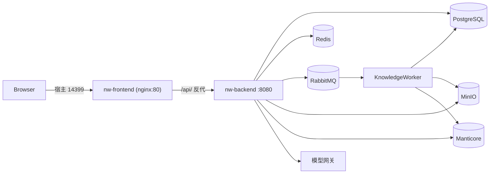
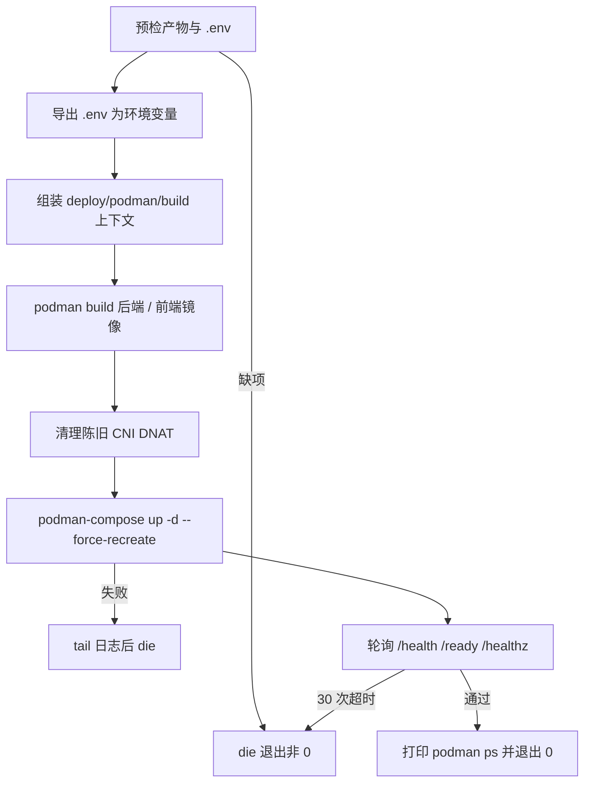

# 部署与运维

本文描述 NovelWorkbench 当前的部署形态：两个应用容器（Go 后端 + nginx 前端）、中间件的两种接入方式、镜像构建、配置模型与环境变量、启动初始化顺序、Podman/Compose 发布流程、CI/CD 与运维操作。

## 1. 部署架构与容器清单

应用只由两个容器组成，中间件不在应用镜像内，部署时二选一：本地用 `infra` profile 拉起，或云主机直连既有实例。



| 容器 | 镜像 | 监听 | 宿主端口 | 职责 |
| --- | --- | --- | --- | --- |
| `nw-backend` | `novel-workbench-backend:latest`（本地构建或 GHCR `backend:<tag>`） | 8080 | 不发布（`expose`） | `/health`、`/ready`、`/api/v1/*`、SSE、索引 worker |
| `nw-frontend` | `novel-workbench-frontend:latest`（本地构建或 GHCR `frontend:<tag>`） | 80 | `${NW_PUBLIC_PORT:-14399}:80` | SPA 静态资源、`/healthz`、`/api/` 反代 |

对外只有 `14399` 一个入口，后端只在容器网络内可达，减少暴露面。

中间件容器（仅根目录 `docker-compose.yml` 的 `infra` profile）：

| 服务 | 镜像 | 宿主端口 | 数据卷 | 作用 |
| --- | --- | --- | --- | --- |
| `nw-postgres` | `pgvector/pgvector:pg16` | 5432 | `nw_pg_data` | 权威数据、权限、任务、审计 |
| `nw-redis` | `redis:8-alpine` | 6379 | 无 | 令牌黑名单 |
| `nw-rabbitmq` | `rabbitmq:4-management` | 5672 / 15672 | 无 | 索引任务队列 |
| `nw-minio` | `minio/minio:latest` | 9000 / 9001 | `nw_minio_data` | 知识库原文 |
| `nw-manticore` | `manticoresearch/manticore:latest` | 9306 / 9308 | `nw_manticore_data` | 全文检索投影（可重建） |

编排差异：

| 项 | 根目录 `docker-compose.yml` | `deploy/podman/docker-compose.yml` |
| --- | --- | --- |
| 服务集合 | backend / frontend + `infra` profile 五个中间件 | 仅 backend / frontend |
| 镜像来源 | `build: ./backend`、`build: ./frontend` | `${NW_BACKEND_IMAGE}` / `${NW_FRONTEND_IMAGE}`，由 `deploy.sh` 构建 |
| 网络 | 编排默认网络 | 外部网络 `NW_INFRA_NETWORK`（默认 `novelworkbench_default`） |
| 重启策略 | `unless-stopped` | `always` |
| 后端资源限制 | 无 | `mem_limit: 384m` |
| gin 模式 | 未注入 `NW_SERVER_MODE`，取 YAML 默认 `debug` | 固定 `release` |

## 2. 镜像构建

| 镜像 | Dockerfile | 构建层 | 运行层 | 要点 |
| --- | --- | --- | --- | --- |
| 后端（Compose / GHCR） | `backend/Dockerfile` | `golang:1.24-alpine` | `alpine:3.20` | `GOTOOLCHAIN=local`、`CGO_ENABLED=0`、`go build -tags "netgo osusergo" -ldflags="-s -w" -o /out/novel-workbench-server ./cmd/server`；运行层装 `ca-certificates`、`tzdata`，非 root 用户 `appuser`(10001) |
| 前端（Compose / GHCR） | `frontend/Dockerfile` | `node:22-slim` | `nginx:1.27-alpine` | `corepack` 启用 pnpm 10 → `pnpm install --frozen-lockfile` → `pnpm build`（`vue-tsc --noEmit && vite build --mode pro`）；`ENV NGINX_RESOLVER=127.0.0.11`、`API_UPSTREAM=http://backend:8080`、`NW_LISTEN_PORT=80`、`NW_CLIENT_MAX_BODY_SIZE=20m` |
| 后端（Podman） | `deploy/podman/Dockerfile.backend` | 无（只用预构建产物） | `${BASE_IMAGE}`，默认 `docker.io/library/alpine:3.20` | 拷入 `ca-certificates.crt`、`nw-server`、`configs/config.yaml`；创建 `appuser`(10001)；`ENTRYPOINT ["/app/nw-server"]` |
| 前端（Podman） | `deploy/podman/Dockerfile.frontend` | 无（只用预构建产物） | `${BASE_IMAGE}`，默认 `docker.io/library/nginx:1.27-alpine` | 拷入 `dist/` 到 `/usr/share/nginx/html`、`nginx.conf.template` 到 `/etc/nginx/templates/default.conf.template` |

两个 `Dockerfile.*` 的基础镜像由 `ARG BASE_IMAGE` 决定，`deploy.sh` 通过 `NW_BASE_IMAGE_PREFIX`（默认 `swr.cn-north-4.myhuaweicloud.com/ddn-k8s/docker.io/library`）拼接后传入，可在受限网络下换源。

静态构建约束：后端全链路 `CGO_ENABLED=0`，产物可直接在 `alpine` 上运行；前端产物是纯静态文件，由 nginx 托管，不引入 Node 运行时。

## 3. nginx 模板与 SSE 配置

`frontend/nginx.conf.template` 由 nginx 官方镜像的 `docker-entrypoint` 用 `envsubst` 渲染为 `/etc/nginx/conf.d/default.conf`。

| 变量 | 作用 | Docker 取值 | Podman 取值 |
| --- | --- | --- | --- |
| `NGINX_RESOLVER` | 上游 DNS 地址 | `127.0.0.11`（内嵌 DNS） | `10.89.0.1`（网络网关，`NW_NGINX_RESOLVER` 可覆盖） |
| `API_UPSTREAM` | 后端上游 | `http://backend:8080` | `http://backend.dns.podman:8080`（`NW_API_UPSTREAM` 可覆盖） |
| `NW_LISTEN_PORT` | 容器内监听端口 | `80` | `80` |
| `NW_CLIENT_MAX_BODY_SIZE` | 反代请求体上限 | `20m`（`frontend/Dockerfile` 的 `ENV`，compose 亦显式传值） | `20m`（`deploy/podman/Dockerfile.frontend` 的 `ENV`，compose 取 `${NW_CLIENT_MAX_BODY_SIZE:-20m}`） |

站点行为：

| 位置 | 配置 | 目的 |
| --- | --- | --- |
| `listen ${NW_LISTEN_PORT}` | 容器内端口可变，宿主端口由 `ports` 决定 | 镜像跨环境复用 |
| `resolver ${NGINX_RESOLVER} valid=10s` | 每 10 秒重新解析 | 容器重建后不残留旧 IP |
| `client_max_body_size ${NW_CLIENT_MAX_BODY_SIZE}` | 紧跟 `resolver` 之后，作用于整个 server | 上传体积上限与后端 `NW_APP_UPLOAD_MAX_MB` 对齐，避免反代先于后端返回 413 |
| `location = /healthz` | `return 200 "ok"`，`access_log off` | 前端存活探针，不依赖后端 |
| `location = /index.html` | `Cache-Control: no-cache, must-revalidate` | 入口必须每次回源校验，见下方发版缓存说明 |
| `location /` | `try_files $uri $uri/ /index.html` + `Cache-Control: no-cache, must-revalidate` | SPA 路由兜底；HTML 不做启发式缓存 |
| `location /assets/` | `expires 30d` + `Cache-Control: public, immutable` | 带 hash 的产物长缓存 |
| `location /api/` | `proxy_pass $api_backend$request_uri` | 变量形式的上游，触发按请求 DNS 解析 |
| `/api/` 头部 | `Host`、`X-Real-IP`、`X-Forwarded-For`、`X-Request-ID` | 链路追踪与客户端 IP 透传 |
| SSE | `proxy_buffering off`、`proxy_read_timeout 3600s` | 流式响应不被缓冲、不被读超时截断 |

**发版缓存**：`index.html` 是唯一不带内容哈希的入口，必须 `no-cache`。若它被浏览器缓存，用户手里的旧 HTML 会去请求
上一版 `assets/Login-xxxx.js`，而新容器里只有新哈希文件，结果是 `ERR_ABORTED` + 整站白屏，且服务端日志全是 200。
`/assets/` 可以放心长缓存：文件名随内容变化，新版本必然是新 URL。

后端侧配合 SSE：`http.Server` 的 `WriteTimeout` 取 `server.write_timeout_sec`，仓库配置为 `0`（不限），`ReadTimeout` 取 `server.read_timeout_sec`（30s）；`service.ChatService` 用 `chatPingInterval = 15s` 的定时器在无输出时调用 `sseChatWriter.Ping` 输出 `: ping` 注释行维持连接，有数据块时重置定时器。

`gzip on`，类型为 `text/plain`、`text/css`、`application/javascript`、`application/json`、`image/svg+xml`。

## 4. 配置模型

### 4.1 加载与覆盖

`infra.LoadConfig`（`backend/internal/infra/config.go`）的执行顺序：

1. `configPath` 为空时取 `configs/config.yaml`（容器工作目录 `/app`，即 `/app/configs/config.yaml`）。
2. `viper.SetConfigFile` + `ReadInConfig` 读取 YAML，失败直接返回错误。
3. `SetEnvPrefix("NW")`、`SetEnvKeyReplacer(strings.NewReplacer(".", "_"))`、`AutomaticEnv()`：键 `postgres.host` 对应 `NW_POSTGRES_HOST`，`app.admin_password` 对应 `NW_APP_ADMIN_PASSWORD`。
4. 遍历 `v.AllKeys()` 逐个 `BindEnv`，使环境变量参与 `Unmarshal`（`AutomaticEnv` 与 `AllSettings` 合并存在盲区）。
5. `Unmarshal` 到 `Config`，随后 `validate()` 做校验与默认值补齐。

结论：环境变量优先于 YAML；YAML 中敏感项一律留空，凭据只经 `NW_*` 注入。

### 4.2 启动期校验（fail fast）

`validate()` 中为空即返回错误、导致进程退出的字段：

| 字段 | 环境变量 | 报错 |
| --- | --- | --- |
| `jwt.secret` | `NW_JWT_SECRET` | `jwt.secret is required` |
| `postgres.host` / `postgres.dbname` | `NW_POSTGRES_HOST` / `NW_POSTGRES_DBNAME` | `postgres.host/dbname is required` |

缺失时补默认值、不报错的字段：

| 字段 | 默认值 | 环境变量 |
| --- | --- | --- |
| `server.port`（为 0 时） | `8080` | `NW_SERVER_PORT` |
| `ai.protocol_code` | `openai` | `NW_AI_PROTOCOL_CODE` |
| `ai.history_count`（≤0 时） | `5` | `NW_AI_HISTORY_COUNT` |
| `app.rag_top_k`（≤0 时） | `6` | `NW_APP_RAG_TOP_K` |
| `app.admin_password` | `Admin@123456`（生产必须覆盖） | `NW_APP_ADMIN_PASSWORD` |
| `app.build_version` | `dev` | `NW_APP_BUILD_VERSION` |

`ai.base_url` 与 `ai.chat_model` 不校验：两者同时非空时才播种默认供应商，留空则由页面维护。

### 4.3 JWT 密钥兼作封存材料

模型供应商的 API Key 以 AES-256-GCM 密文存放在 `model_providers` 表，封存密钥由 `NW_JWT_SECRET` 经 SHA-256 派生（`backend/internal/pkg/secret.go` 的 `SealSecret` / `OpenSecret`，调用点为 `service.NewModelProviderService` 的第四个参数）。

更换 `NW_JWT_SECRET` 后：已签发 JWT 全部失效；数据库中已封存的供应商 API Key 无法解密，必须在「模型供应商」页面重新填写。轮换密钥等同于一次凭据重置。

## 5. 环境变量总表

### 5.1 与 `Config` 字段一一对应

每个 `NW_<大写路径>` 对应 `config.go` 中一个字段，`.` 替换为 `_`。

| 结构体 | 字段 | 环境变量（默认值，说明） |
| --- | --- | --- |
| `ServerConfig` | host, port, mode, read_timeout_sec, write_timeout_sec | `NW_SERVER_HOST`（`0.0.0.0`，监听地址）<br>`NW_SERVER_PORT`（`8080`，监听端口）<br>`NW_SERVER_MODE`（`debug`，gin 模式 `debug`/`release`/`test`）<br>`NW_SERVER_READ_TIMEOUT_SEC`（`30`，读超时（秒））<br>`NW_SERVER_WRITE_TIMEOUT_SEC`（`0`，写超时（秒），0 为不限（SSE）） |
| `JWTConfig` | secret, expire_hours | `NW_JWT_SECRET`（无（必填），签名密钥兼封存材料）<br>`NW_JWT_EXPIRE_HOURS`（`168`，令牌有效期（小时）） |
| `PostgresConfig` | host, port, user, password, dbname, sslmode, max_open_conns, max_idle_conns, conn_max_lifetime_min | `NW_POSTGRES_HOST`（无（必填），数据库主机）<br>`NW_POSTGRES_PORT`（`5432`，端口）<br>`NW_POSTGRES_USER`（`postgres`，账号）<br>`NW_POSTGRES_PASSWORD`（空，口令）<br>`NW_POSTGRES_DBNAME`（`postgres`，库名（必填））<br>`NW_POSTGRES_SSLMODE`（`disable`，SSL 模式）<br>`NW_POSTGRES_MAX_OPEN_CONNS`（`20`，最大打开连接）<br>`NW_POSTGRES_MAX_IDLE_CONNS`（`5`，最大空闲连接）<br>`NW_POSTGRES_CONN_MAX_LIFETIME_MIN`（`30`，连接最长存活（分钟）） |
| `RedisConfig` | addr, password, db | `NW_REDIS_ADDR`（无（为空则退出），`host:port`）<br>`NW_REDIS_PASSWORD`（空，口令）<br>`NW_REDIS_DB`（`0`，库号） |
| `RabbitMQConfig` | url, queue_doc_index | `NW_RABBITMQ_URL`（空，AMQP 连接串）<br>`NW_RABBITMQ_QUEUE_DOC_INDEX`（`nw_doc_index`，索引队列名） |
| `MinIOConfig` | endpoint, access_key, secret_key, bucket, use_ssl | `NW_MINIO_ENDPOINT`（空，`host:port`）<br>`NW_MINIO_ACCESS_KEY`（空，AccessKey）<br>`NW_MINIO_SECRET_KEY`（空，SecretKey）<br>`NW_MINIO_BUCKET`（`novelworkbench`，桶名）<br>`NW_MINIO_USE_SSL`（`false`，是否 SSL） |
| `ManticoreConfig` | base_url, table_chunks | `NW_MANTICORE_BASE_URL`（空，HTTP SQL API 地址）<br>`NW_MANTICORE_TABLE_CHUNKS`（`nw_chunks`，切片全文表名） |
| `AIConfig` | protocol_code, base_url, api_key, chat_model, temperature, max_tokens, timeout_sec, history_count | `NW_AI_PROTOCOL_CODE`（`openai`，`openai` / `anthropic`）<br>`NW_AI_BASE_URL`（空，OpenAI 兼容含 `/v1`；Anthropic 填根地址）<br>`NW_AI_API_KEY`（空，网关密钥）<br>`NW_AI_CHAT_MODEL`（空，对话模型名）<br>`NW_AI_TEMPERATURE`（`0.7`，采样温度）<br>`NW_AI_MAX_TOKENS`（`2048`，单次输出上限）<br>`NW_AI_TIMEOUT_SEC`（`120`，调用超时（秒），≤0 时 `main` 兜底 60）<br>`NW_AI_HISTORY_COUNT`（`5`，历史消息注入条数） |
| `AppConfig` | upload_max_mb, chunk_size, chunk_overlap, rag_top_k, admin_password, build_version | `NW_APP_UPLOAD_MAX_MB`（`20`，上传大小上限（MB））<br>`NW_APP_CHUNK_SIZE`（`800`，切片字符数）<br>`NW_APP_CHUNK_OVERLAP`（`120`，切片重叠字符数）<br>`NW_APP_RAG_TOP_K`（`6`，默认召回条数）<br>`NW_APP_ADMIN_PASSWORD`（`Admin@123456`，引导管理员密码，仅用户表为空时生效）<br>`NW_APP_BUILD_VERSION`（`dev`，运行状态页展示的构建版本） |

`ai.*` 组只在 `model_providers` 表为空时写入一条「默认模型网关」记录（`providerService.SeedDefault`），播种后由页面维护，配置不再参与。

### 5.2 仅部署层消费（不进入 `Config`）

| 变量 | 消费方 | 默认值 | 作用 |
| --- | --- | --- | --- |
| `NW_PUBLIC_PORT` | 两个 compose 文件、`deploy.sh` | `14399` | 前端映射到宿主机的端口 |
| `NW_LISTEN_PORT` | 两个 compose 文件、`nginx.conf.template` | `80` | 容器内 nginx 监听端口 |
| `NW_CLIENT_MAX_BODY_SIZE` | 两个 compose 文件、两个前端 Dockerfile、两份 `.env.example`、`nginx.conf.template` | `20m` | 前端 nginx 反代上传上限 |
| `NW_RABBITMQ_USER` | 根 compose 的 `infra` profile、`deploy/podman/docker-compose.yml` | `admin`（podman） | 拼接 `NW_RABBITMQ_URL` / 初始化中间件 |
| `NW_RABBITMQ_PASSWORD` | 同上 | 无 | 同上 |
| `NW_NGINX_RESOLVER` | `deploy/podman/docker-compose.yml` | `10.89.0.1` | 渲染 nginx `resolver` |
| `NW_API_UPSTREAM` | `deploy/podman/docker-compose.yml` | `http://backend.dns.podman:8080` | 渲染 nginx 上游 |
| `NW_INFRA_NETWORK` | `deploy/podman/docker-compose.yml` | `novelworkbench_default` | 外部中间件网络名 |
| `NW_BASE_IMAGE_PREFIX` | `deploy.sh` | `swr.cn-north-4.myhuaweicloud.com/ddn-k8s/docker.io/library` | 基础镜像仓库前缀 |
| `NW_BACKEND_IMAGE` | `deploy.sh`、podman compose | `localhost/novel-workbench-backend:latest` | 后端运行镜像名 |
| `NW_FRONTEND_IMAGE` | `deploy.sh`、podman compose | `localhost/novel-workbench-frontend:latest` | 前端运行镜像名 |

`deploy.sh` 另识别两个非 `NW_` 变量：`ENV_FILE`（默认 `.env`）、`COMPOSE_LOG`（默认 `/var/log/novelworkbench-compose.log`）。

### 5.3 必填项在编排层的体现

根 `docker-compose.yml` 对 `NW_JWT_SECRET`、`NW_POSTGRES_HOST`、`NW_POSTGRES_PASSWORD`、`NW_REDIS_ADDR`、`NW_REDIS_PASSWORD`、`NW_RABBITMQ_URL`、`NW_MINIO_ENDPOINT`、`NW_MINIO_ACCESS_KEY`、`NW_MINIO_SECRET_KEY`、`NW_MANTICORE_BASE_URL`、`NW_APP_ADMIN_PASSWORD` 使用 `${VAR:?}`，缺值即编排失败，不会启动半配置容器。

`deploy/podman/docker-compose.yml` 中中间件地址是固定服务名（`postgres`、`redis:6379`、`minio:9000`、`http://manticore:9308`），因此只有凭据类变量需要 `${VAR:?}` 校验：`NW_JWT_SECRET`、`NW_POSTGRES_PASSWORD`、`NW_REDIS_PASSWORD`、`NW_RABBITMQ_PASSWORD`、`NW_MINIO_ACCESS_KEY`、`NW_MINIO_SECRET_KEY`、`NW_APP_ADMIN_PASSWORD`；`NW_RABBITMQ_URL` 由 `${NW_RABBITMQ_USER:-admin}` 与口令在此文件内拼装。

## 6. 启动初始化顺序与失败策略

`backend/cmd/server/main.go` 的 `main()`：

| 序号 | 步骤 | 失败策略 |
| --- | --- | --- |
| 1 | `pkg.SetLogger(zap.Must(zap.NewProduction()))` | — |
| 2 | `infra.LoadConfig("")`：读 YAML、应用 `NW_*`、`validate()` | 致命，退出码 1，日志「加载配置失败」 |
| 3 | `signal.NotifyContext(SIGINT, SIGTERM)` | — |
| 4 | `infra.NewPostgres`：DSN 连接 + 连接池 + `Ping` | 致命，退出码 1，日志「Postgres 连接失败」 |
| 5 | `db.AutoMigrate` 建表 33 张（`UserDO`、`ProjectDO`、`VolumeDO`、`ChapterDO`、`ChapterSnapshotDO`、`WordCountStatDO`、`CharacterDO`、`CharacterRelationDO`、`LoreDO`、`KnowledgeDocumentDO`、`OutlineNodeDO`、`DetailedSceneDO`、`TemporalFactDO`、`ForeshadowHookDO`、`ChapterSummaryDO`、`KnowledgeChunkDO`、`SkillDO`、`SkillReferenceDO`、`MenuDO`、`JobDO`、`AppSettingDO`、`ChatSessionDO`、`ChatMessageDO`、`RoleDO`、`UserRoleDO`、`AuditLogDO`、`ModelProviderDO`、`ModelCatalogDO`、`ModelRoleGrantDO`、`ModelUsageStatDO`、`NotificationDO`、`LoginLogDO`、`PromptProfileDO`、`ToolDO`、`ModelUserGrantDO`） | 致命，退出码 1，日志「数据库迁移失败」 |
| 6 | `infra.NewRedis`：构造客户端 + 5s `Ping` | 地址为空返回 `nil` 客户端 → 致命「Redis 配置无效」；Ping 失败 → 告警「令牌吊销降级」并继续 |
| 7 | `infra.NewRabbitMQ` | 告警「异步任务降级」 |
| 8 | `infra.NewMinIO`：构造客户端 + `BucketExists`，桶不存在则 `MakeBucket`；随后 `main` 再校验一次桶是否存在 | 告警「MinIO 初始化失败 / 桶健康检查失败 / 桶不存在，对象存储降级」 |
| 9 | `infra.NewManticore` + `Ping`（`SELECT 1`，HTTP 超时 5s） | 告警「全文检索降级」 |
| 10 | `pkg.NewJWTSigner(cfg.JWT.Secret, cfg.JWTExpireTTL())` | 致命，退出码 1 |
| 11 | 装配 repo / service / `ai.NewClient`，`providerService.SeedDefault` 播种出厂供应商 | 播种失败 → 告警「默认模型供应商播种失败，可在页面手工添加」 |
| 12 | `providerService.MigrateLegacyModels` 补齐模型目录 | 告警，不阻断 |
| 13 | `promptService.SeedDefaults`（24 份内置指令 + 12 份内置身份）、`toolService.SeedDefaults`（6 个内置工具）与 `menuService.SeedDefaults`（含已下线菜单清理） | 致命，退出码 1 |
| 14 | `settingService.SeedDefaults`（默认应用配置） | 致命，退出码 1 |
| 15 | `roleService.SeedDefaults`（内置角色与权限） | 致命，退出码 1 |
| 16 | `menuService.SeedDefaults`（内置菜单与权限登记） | 致命，退出码 1 |
| 17 | `userAdminService.BootstrapAdmin(ctx, "admin", "admin@novelworkbench.local", cfg.App.AdminPassword)`，仅用户表为空时创建 | 致命，退出码 1 |
| 18 | 启动 `service.NewKnowledgeWorker` goroutine 消费索引队列 | 异常退出 → 告警「知识库索引 worker 异常退出」 |
| 19 | 装配 Auth/Audit 中间件与路由，`http.Server{ReadTimeout, WriteTimeout}` 后 `ListenAndServe` | 监听失败 → 进入关闭流程并记错误 |

优雅关闭：收到 SIGTERM/SIGINT 后 `server.Shutdown`（5s 超时）→ 等待 worker 退出（最多 5s）→ 依次关闭 Postgres 连接池、Redis、RabbitMQ。

降级语义：只有 PostgreSQL 与 JWT 是硬依赖；Redis 缺失使令牌吊销失效，RabbitMQ 缺失使索引任务不消费，MinIO 缺失使上传与原文读取失败，Manticore 缺失使检索无结果——服务仍可启动并提供其余功能。

## 7. 本地 Docker Compose

前置条件：Docker + Compose 插件。

```bash
cp .env.example .env            # 填入密钥与地址，.env 不入库
docker compose up -d --build                          # 仅应用容器
docker compose --profile infra up -d --build          # 额外拉起五个中间件
curl http://127.0.0.1:14399/healthz                   # 前端存活
docker compose exec backend wget -qO- http://127.0.0.1:8080/health
docker compose exec backend wget -qO- http://127.0.0.1:8080/ready
docker compose logs -f backend
docker compose down             # 加 -v 会删除 infra 数据卷
```

`infra` profile 的中间件容器与应用容器读同一份 `.env`：

| 中间件 | 初始化变量 | 应用侧变量 |
| --- | --- | --- |
| `nw-postgres` | `NW_POSTGRES_USER` / `NW_POSTGRES_PASSWORD` / `NW_POSTGRES_DBNAME` | 同名三项 |
| `nw-redis` | `NW_REDIS_PASSWORD`（`--requirepass`，另带 `--maxmemory 256mb --maxmemory-policy allkeys-lru`） | `NW_REDIS_ADDR` + `NW_REDIS_PASSWORD` |
| `nw-rabbitmq` | `NW_RABBITMQ_USER` / `NW_RABBITMQ_PASSWORD` | `NW_RABBITMQ_URL` |
| `nw-minio` | `NW_MINIO_ACCESS_KEY` / `NW_MINIO_SECRET_KEY`（映射为 `MINIO_ROOT_USER` / `MINIO_ROOT_PASSWORD`） | 同名两项 |
| `nw-manticore` | 无鉴权 | `NW_MANTICORE_BASE_URL` |

本地全栈时地址必须写服务名：`NW_POSTGRES_HOST=postgres`、`NW_REDIS_ADDR=redis:6379`、`NW_MINIO_ENDPOINT=minio:9000`、`NW_RABBITMQ_URL=amqp://<user>:<pass>@rabbitmq:5672/`、`NW_MANTICORE_BASE_URL=http://manticore:9308`。

容器健康检查：后端 `wget -qO- http://127.0.0.1:8080/health`，前端 `wget -qO- http://127.0.0.1/healthz`，均为 `interval 30s / timeout 5s / retries 3`。

## 8. 云主机 Podman

目标主机运行 Podman + podman-compose，中间件已在宿主机运行并处于同一外部网络，服务别名为 `postgres` / `redis` / `manticore` / `minio` / `rabbitmq`。

### 8.1 文件清单

| 文件 | 作用 |
| --- | --- |
| `deploy/podman/docker-compose.yml` | 仅 backend / frontend；`infra` 网络 `external: true`；后端 `expose: 8080`、`mem_limit: 384m`、`restart: always` |
| `deploy/podman/Dockerfile.backend` | 运行镜像，只打包预构建二进制、配置与 CA bundle |
| `deploy/podman/Dockerfile.frontend` | 运行镜像，只打包 `dist` 与 nginx 模板 |
| `deploy/podman/deploy.sh` | 预检 → 组装上下文 → 构建镜像 → 清理 DNAT → 重建容器 → 健康自检 |
| `deploy/podman/.env.example` | 环境变量模板 |

### 8.2 开发机准备产物

```bash
cd backend
CGO_ENABLED=0 GOOS=linux GOARCH=amd64 go build \
  -tags "netgo osusergo" -ldflags="-s -w" \
  -o build/nw-server-linux-amd64 ./cmd/server

cd ../frontend
corepack enable && pnpm install --frozen-lockfile && pnpm build
```

上传后路径需与脚本期望一致：`backend/build/nw-server-linux-amd64`、`frontend/dist/index.html`、`frontend/nginx.conf.template`、`backend/configs/config.yaml`。

### 8.3 `deploy.sh` 流程

```bash
cd /opt/novelworkbench/deploy/podman
cp .env.example .env     # 填密钥；按 podman network ls 设置 NW_INFRA_NETWORK
bash deploy.sh
```



| 步骤 | 行为 | 失败处理 |
| --- | --- | --- |
| 1 预检 | 校验后端二进制、`frontend/dist/index.html`、`nginx.conf.template`、`backend/configs/config.yaml`、`ENV_FILE`（默认 `.env`） | 任一缺失即 `die` 退出 |
| 2 导出环境 | `set -a; . ./.env; set +a`，`NW_*` 全部进入环境 | — |
| 3 组装上下文 | 清空 `deploy/podman/build/`，拷入 `nw-server`（加可执行位）、`config.yaml`、宿主机 `/etc/ssl/certs/ca-certificates.crt`、`dist/`、`nginx.conf.template` | 缺 CA bundle 即退出 |
| 4 构建镜像 | `podman build -f Dockerfile.backend --build-arg BASE_IMAGE=${BASE_PREFIX}/alpine:3.20`，前端同理用 `nginx:1.27-alpine` | `set -e` 中止 |
| 5 清理 DNAT | `cleanup_port_dnat` 删除指向 `127.0.0.1` 的空规则与该端口名下的 `CNI-DN-*` 跳转链 | 无 `iptables` 命令时跳过 |
| 6 重建容器 | `podman-compose up -d --force-recreate`，输出重定向到 `COMPOSE_LOG` | 打印日志尾部 40 行后 `die` |
| 7 健康自检 | 最多 30 次、间隔 2 秒，检查 `podman exec nw-backend ... /health`、`/ready`、`curl .../healthz` | 超时打印 `podman ps` 与后端日志尾部（过滤 `password` 行）后退出非 0 |

两处设计取舍：输出重定向是因为 `podman-compose` 会把含明文口令的 `podman run` 命令打到 stdout，日志只落服务器本地文件；`--force-recreate` 是因为 `podman-compose` 1.x 不会因镜像 ID 变化自动重建容器。

### 8.4 DNAT 与 rootless Podman

rootless podman 在容器重建后可能残留旧容器的 `CNI-HOSTPORT-DNAT` 规则，导致宿主端口指向已失效的容器 IP。`deploy.sh` 在重建前后各清理一次：`cleanup_port_dnat <port>` 先循环删除指向 `127.0.0.1` 的空跳转（它不按端口划分，任何一次重建都会残留），再按 `--dports` 找出该端口的 `CNI-DN-*` 链并逐条删除 `CNI-HOSTPORT-DNAT` 中的跳转；容器启动时 podman 只为新容器写入唯一规则。

由于后端不映射宿主端口，探活一律用 `podman exec` 进容器访问 `127.0.0.1:8080`，不受 DNAT 影响。

### 8.5 DNS 差异

| 环境 | DNS 行为 | `API_UPSTREAM` |
| --- | --- | --- |
| Docker | 内嵌 DNS `127.0.0.11` 应答裸服务名 | `http://backend:8080` |
| Podman | aardvark/dnsname 只应答 `search` 域 FQDN（`resolv.conf` 中为 `dns.podman`），nginx resolver 不做后缀补全 | `http://backend.dns.podman:8080` |

Podman 下写成裸 `backend` 会导致 nginx 解析失败、`/api/` 返回 502；`NGINX_RESOLVER` 必须是 podman 网络网关地址（默认 `10.89.0.1`）。

## 9. CI/CD

### 9.1 工作流

| 工作流 | 触发 | Job | 内容 |
| --- | --- | --- | --- |
| `ci.yml` | `push` 到 `main`、`pull_request` 目标 `main` | `backend` | `go vet ./...`、`CGO_ENABLED=0 go build -tags "netgo osusergo" ./...`、`CGO_ENABLED=0 go test -short -count=1 -shuffle=on ./...` |
| `ci.yml` | 同上 | `frontend` | `pnpm/action-setup` 安装 pnpm 10、`pnpm install --frozen-lockfile`、`pnpm test`（vitest）、`pnpm build`（`vue-tsc --noEmit && vite build --mode pro`） |
| `ci.yml` | 同上 | `docker`（`needs: [backend, frontend]`） | `docker build -t novel-workbench-backend:ci ./backend`、`docker build -t novel-workbench-frontend:ci ./frontend` |
| `release.yml` | 推送 `v*` tag | `release` | 归一镜像前缀 → 登录 GHCR → 构建并推送 backend / frontend |

CI 关键设置：

| 项 | 值 | 原因 |
| --- | --- | --- |
| `GOTOOLCHAIN` | `local` | 与 `backend/Dockerfile` 一致，禁止构建期拉取其它 Go 版本 |
| `CGO_ENABLED` | `0` | 全流水线静态构建 |
| `go-version` | `1.24` | 与 `go.mod`、镜像构建层一致 |
| `node-version` | `22` | 与 `frontend/Dockerfile` 构建层一致 |
| `cache-dependency-path`（Go） | `backend/go.sum` | job 级 `working-directory: backend` |
| `cache-dependency-path`（Node） | `frontend/pnpm-lock.yaml` | `setup-node` 的 pnpm 缓存路径相对仓库根解析 |

### 9.2 GHCR 小写归一

GHCR 要求镜像仓库名全小写，GitHub 仓库名允许大写。`release.yml` 的 `Normalize image prefix` 步骤：

```bash
echo "prefix=ghcr.io/${GITHUB_REPOSITORY,,}" >> "$GITHUB_OUTPUT"
```

`${GITHUB_REPOSITORY,,}` 为 bash 小写展开，例如 `2132691342/NovelWorkbench` → `ghcr.io/2132691342/novelworkbench`。两个构建步骤共用该输出：

| 镜像 | 标签 |
| --- | --- |
| `<prefix>/backend` | `${{ github.ref_name }}` 与 `latest` |
| `<prefix>/frontend` | `${{ github.ref_name }}` 与 `latest` |

权限为 `contents: read` 与 `packages: write`；登录用 `github.actor` + `secrets.GITHUB_TOKEN`。

### 9.3 Action 版本

| Action | 版本 |
| --- | --- |
| `actions/checkout` | v5 |
| `actions/setup-go` | v6 |
| `actions/setup-node` | v5 |
| `pnpm/action-setup` | v4 |
| `docker/setup-buildx-action` | v4 |
| `docker/login-action` | v4 |
| `docker/build-push-action` | v7 |

### 9.4 发布与回滚

```bash
git tag v1.0.0 && git push origin v1.0.0     # 触发 Release，产出 GHCR 镜像
docker compose pull && docker compose up -d  # 使用 GHCR 镜像的主机滚动更新
```

Podman 主机不拉 GHCR，由 `deploy.sh` 从预构建产物本地构建。回滚方式：切回上一版本镜像 tag 后重建容器（`podman-compose up -d --force-recreate` 或 `docker compose up -d`）；`AutoMigrate` 只做增量建表，回滚旧二进制前需确认新增表不被旧代码依赖。

## 10. 运维

### 10.1 健康检查

| 端点 | 语义 | 实现 | 期望 |
| --- | --- | --- | --- |
| `GET /health` | 进程存活，不查依赖 | `api.healthCheck` | 200，`data` 为 `{"status":"up"}` |
| `GET /ready` | 依赖就绪 | `api.readyCheck`，Ping PostgreSQL（2s 超时） | 200，`data` 为 `{"status":"ready"}`；失败返回 `ERR_STORAGE`（HTTP 503） |
| `GET /healthz`（前端） | nginx 存活 | `return 200 "ok"` | 文本 `ok` |
| `GET /api/v1/system/status` | 逐项探测五个中间件并返回 `NW_APP_BUILD_VERSION` | `service.SystemStatusService` | 需权限码 `system:status:read` |

`/health` 与 `/ready` 挂在根引擎，不在 `/api/v1` 下，nginx 未反代，只能进容器内访问。

### 10.2 日常巡检

| 周期 | 检查项 |
| --- | --- |
| 每日 | `podman ps` / `docker compose ps` 全部 Up（healthy）；`/health`、`/ready` 返回 200；后端日志无连续 `unhandled_error` 与「连接失败」；任务中心无持续增长的 failed；登录日志无异常 IP 批量失败 |
| 每周 | 磁盘占用（PostgreSQL 数据、MinIO、Manticore、容器日志）；模型用量与失败率；通知中心未处理的任务失败；抽查审计日志中的高危操作 |

值班命令（后端不映射宿主端口，探活一律进容器；中间件容器名按实际栈调整——`infra` profile 为 `nw-postgres` / `nw-redis` / `nw-rabbitmq`，云主机既有栈为宿主上的既有名称）：

```bash
podman ps --format '{{.Names}} | {{.Status}} | {{.Ports}}'
curl -fsS http://127.0.0.1:14399/healthz
podman exec nw-backend wget -qO- http://127.0.0.1:8080/health
podman exec nw-backend wget -qO- http://127.0.0.1:8080/ready
podman logs --tail 200 nw-backend
podman exec nw-rabbitmq rabbitmqctl list_queues name messages consumers
podman exec nw-redis redis-cli -a "$NW_REDIS_PASSWORD" ping
podman exec nw-postgres psql -U postgres -c 'select count(*) from users;'
curl -sS 'http://127.0.0.1:9308/sql?mode=raw&query=SHOW+TABLES'
```

### 10.3 常见故障

| 现象 | 排查 | 处理 |
| --- | --- | --- |
| 登录后立刻掉线 | 后端日志 401 峰值；Redis 是否可用；账号是否被禁用 | 恢复 Redis；重新登录（密钥轮换后旧令牌全部失效）；启用账号 |
| 文档长期 `pending` | 任务中心状态；RabbitMQ 队列消费者数；worker 日志 | 恢复 RabbitMQ；任务中心「重试」会把文档重置为 `pending` 并重新投递；`maxIndexRetryCount=3` 后需人工重试 |
| 文档索引 `failed` | 任务的 `error_message` | 常见为文档为空、格式不支持、MinIO 读取失败；修复后重试 |
| 搜索无结果 | 文档状态是否为 `indexed`；`nw_chunks` 表是否存在；日志「Manticore 同步失败」 | 索引可重建；关键词过短或全为停用词也会无召回 |
| AI 调用失败 | 模型供应商页连通性测试；Base URL 协议；密钥是否被轮换 | OpenAI 兼容需含 `/v1`，Anthropic 填根地址；密钥轮换后需在页面重填 |
| 前端 502 / 白屏 | `podman logs nw-frontend` 看上游解析；`API_UPSTREAM` 与 `NGINX_RESOLVER` | Docker 用 `backend:8080`，Podman 用 `backend.dns.podman:8080`；确认 `nw-backend` healthy |
| 静态资源 404 | 镜像内 `dist` 是否完整 | 重新构建前端镜像 |
| 14399 不通 | `podman port nw-frontend` 应为 `0.0.0.0:14399 -> 80/tcp`；云安全组；`iptables -t nat -L CNI-HOSTPORT-DNAT` | 放行安全组；重跑 `deploy.sh` 触发 DNAT 清理 |
| 编排启动即失败 | `NW_*` 必填项是否缺失（`${VAR:?}`） | 补齐 `.env` 后重建 |

### 10.4 备份与恢复

| 数据 | 方式 | 频率 | 说明 |
| --- | --- | --- | --- |
| PostgreSQL | `pg_dump -Fc` | 每日 | 权威数据，必须备份 |
| MinIO | `mc mirror` 到备份桶 | 每日 | 知识库原文 |
| Manticore | 无需备份 | — | 索引可由 PostgreSQL 切片重建（`ensureManticoreSchema` + `rebuildManticoreIndex`） |
| `.env` | 密码管理器 / 加密备份 | 变更时 | 含全部凭据与封存材料来源 |

```bash
podman exec nw-postgres pg_dump -U postgres -Fc postgres > nw-$(date +%F).dump
mc mirror --overwrite local/novelworkbench backup/novelworkbench
```

恢复顺序：停止后端 → `pg_restore` 恢复数据库 → `mc mirror` 恢复桶 → 启动后端（`AutoMigrate` 补齐表结构）→ 任务中心重试失败任务 → 登录验证项目、章节、知识库与通知。

### 10.5 容量与性能

| 资源 | 当前约束 | 扩容方向 |
| --- | --- | --- |
| 后端内存 | podman 编排 `mem_limit: 384m` | 高并发或大文档索引时提升到 768m 以上 |
| PostgreSQL 连接 | `max_open_conns=20`、`max_idle_conns=5`、`conn_max_lifetime_min=30` | 多实例时按实例下调 |
| Redis | `infra` profile 中 `maxmemory 256mb`、`allkeys-lru` | 仅存令牌黑名单，容量需求低 |
| RabbitMQ | 单队列 `nw_doc_index` 持久化 | 索引吞吐不足时增加 worker 实例 |
| Manticore | 单表 `nw_chunks`（CJK ngram） | 按项目分区或分片需改检索层 |
| 上传 | 后端按 `NW_APP_UPLOAD_MAX_MB=20` 校验（`KnowledgeIndexConfig.UploadMaxMB`）；反代上限由 `NW_CLIENT_MAX_BODY_SIZE` 控制，缺省 `20m` | 两者需保持一致；调大时同时改 `NW_CLIENT_MAX_BODY_SIZE` 与 `NW_APP_UPLOAD_MAX_MB`，只改一处会出现反代 413 或后端拒绝 |
| 索引重连 | `consumeReconnectInterval = 5s` | 队列抖动时自动重连 |

### 10.6 日志与排障

| 日志 | 位置 | 用途 |
| --- | --- | --- |
| 后端结构化日志 | `podman logs nw-backend` / `docker compose logs backend` | 请求、错误、降级、worker；zap production JSON 输出到 stdout |
| 前端 nginx | `podman logs nw-frontend` | 上游解析、静态资源、代理错误 |
| 编排日志 | `/var/log/novelworkbench-compose.log`（`COMPOSE_LOG` 可覆盖） | 发布失败现场；含明文口令，禁止外传 |
| 审计日志 | `audit_logs` 表 / 管理页 | 写操作追溯 |
| 登录日志 | `login_logs` 表 / 管理页 | 登录安全 |
| 任务中心 | 管理页 | 索引任务状态与失败原因 |

日志字段：`RequestIDMiddleware` 为每条请求分配 `request_id`（透传 `X-Request-ID`），`LoggerMiddleware` 输出 `http_request` 含 `method`、`path`、`status`、`latency_ms`；响应包络的 `trace_id` 与之一致，报错时提供给用户即可定位。

### 10.7 变更操作

| 操作 | 做法 |
| --- | --- |
| 修改配置 | 改 `.env` 后重建容器（`docker compose up -d` 或 `bash deploy.sh`）；不要回写 `backend/configs/config.yaml` |
| 轮换 `NW_JWT_SECRET` | 所有 JWT 失效 + 供应商 API Key 需在页面重填（见 4.3） |
| 变更中间件口令 | 同步更新 `.env` 中中间件初始化变量与应用连接变量（RabbitMQ 需同时改 `NW_RABBITMQ_USER` / `NW_RABBITMQ_PASSWORD` / `NW_RABBITMQ_URL`） |
| 引导管理员密码 | 仅在用户表为空时生效；已有数据时改配置不会重置密码 |
| 增加索引吞吐 | 新增消费同一队列的 worker 实例（需保证部署形态支持多副本） |
