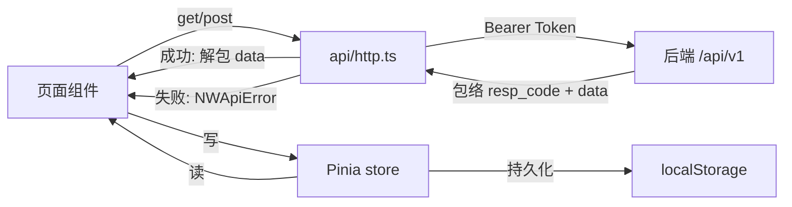
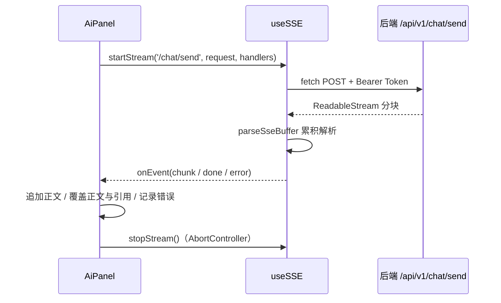
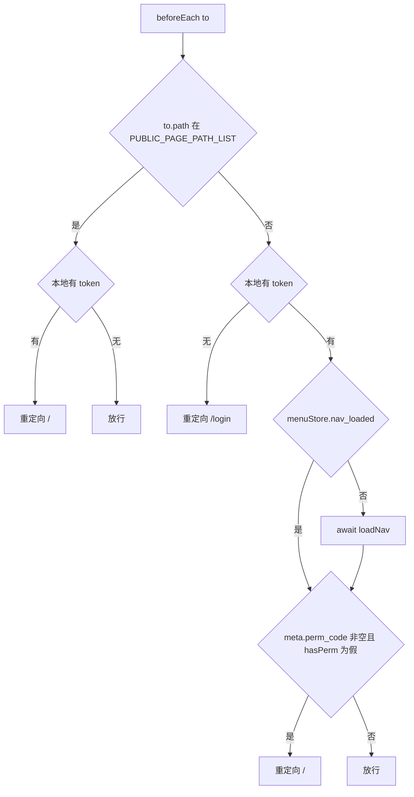

# 前端设计

本文描述 NovelWorkbench 前端（`frontend/`）的工程结构、设计系统、状态与数据流、路由与权限、页面实现、国际化与测试。
事实来源为 `frontend/src/**`、`vite.config.ts`、`vitest.config.ts`、`uno.config.ts`、`package.json`，代码引用格式为 `路径` 的 `符号`。

## 1. 工程结构与构建

### 1.1 目录职责

| 路径 | 职责 |
| --- | --- |
| `src/main.ts` | 应用入口：创建应用，注册 Pinia、Router、i18n、Element Plus，按序引入样式 |
| `src/App.vue` | 根组件：`el-config-provider` 注入 Element Plus 语言包，渲染 `router-view` |
| `src/api/` | `http.ts`（Axios 实例与拦截器）、`contracts.ts`（后端 VO 类型）、14 个业务模块封装 |
| `src/components/` | 8 个无业务组件：`NWButton`、`NWCard`、`NWEmpty`、`NWIcon`、`NWLoading`、`NWPageHeader`、`NWStatTile`、`ProjectPageHeader` |
| `src/composables/` | `useSSE.ts`（SSE 流式请求与解析）与其单测 |
| `src/layout/` | `AdminLayout.vue`（外壳）、`CommandPalette.vue`（Ctrl/Cmd+K）、`NotificationBell.vue`（顶栏铃铛） |
| `src/router/` | `index.ts`（路由表 + 唯一全局守卫） |
| `src/stores/` | 5 个 Pinia store：`app`、`auth`、`menu`、`notification`、`project` |
| `src/styles/` | 5 个全局样式文件，按 `variables` → `element-theme` → `button-states` → `page` → `global` 顺序加载 |
| `src/i18n/` | `index.ts` + `locales/` 下中英各 5 个分片 |
| `src/utils/` | `storage.ts`（localStorage 读写与结构校验） |
| `src/views/` | 15 个页面目录，按业务域拆分 |

`src/views/` 的 15 个目录：`admin`、`character`、`continuity`、`dashboard`、`knowledge`、`login`、`lore`、`models`、`notes`、`notification`、`outline`、`profile`、`settings`、`skills`、`workspace`。
源文件合计 58 个 `.vue`、47 个 `.ts`、29 个 `.css`。

### 1.2 样式加载顺序

`src/main.ts` 的引入顺序决定层叠优先级，后加载者覆盖先加载者：

1. `element-plus/dist/index.css`：组件库基础样式。
2. `virtual:uno.css`：UnoCSS 虚拟产物。
3. `@/styles/variables.css`：品牌五色、语义令牌、Element Plus 变量桥接。
4. `@/styles/element-theme.css`：Element Plus 组件外观收敛（尺寸、圆角、边框、层级）。
5. `@/styles/button-states.css`：按钮五态与 `.nw-button` 外观。
6. `@/styles/page.css`：页面骨架工具类（`nw-page` / `nw-panel` / `nw-stat-grid` / `nw-badge` 等）。
7. `@/styles/global.css`：基础排版、路由过渡、卡片、通知浮层、滚动条、命令面板、减少动效偏好。

### 1.3 构建配置

| 项 | 值 | 来源 |
| --- | --- | --- |
| 别名 | `@` → `./src` | `vite.config.ts` 的 `resolve.alias`；`vitest.config.ts` 复用同一别名 |
| 插件 | `@vitejs/plugin-vue` + `UnoCSS` | `vite.config.ts` 的 `plugins` |
| dev 端口 | `5173` | `vite.config.ts` 的 `server.port` |
| dev 代理 | `/api` → `process.env.NW_DEV_PROXY_TARGET \|\| 'http://127.0.0.1:8080'`，`changeOrigin: true` | `vite.config.ts` 的 `server.proxy` |
| 手动分包 | `element-plus`；`echarts`（含 `zrender`）；`x6`（含 `@antv/*`） | `vite.config.ts` 的 `manualChunks` |
| 构建脚本 | `vue-tsc && vite build` | `package.json` 的 `scripts.build` |
| 测试脚本 | `vitest run` | `package.json` 的 `scripts.test` |
| 测试环境 | `environment: 'node'`、`include: ['src/**/*.test.ts']` | `vitest.config.ts` 的 `test` |
| 类型严格度 | `strict`、`noUnusedLocals`、`noUnusedParameters`、`noFallthroughCasesInSwitch`、`noEmit` | `tsconfig.json` 的 `compilerOptions` |

`uno.config.ts` 启用 `presetUno` 与 `transformerDirectives`（支持 `@apply` / `@variants`）。当前页面样式全部由语义 class 与 CSS 变量构成，未使用原子类，也未出现 `@apply`。

### 1.4 文件组织约定

- 页面样式超过单文件承载量时抽到同目录 `*.css`，模板用 `<style scoped src="./xxx.css">` 引入（如 `views/dashboard/index.vue` → `views/dashboard/dashboard.css`，`views/workspace/index.vue` → `views/workspace/workspace.css`）。
- 复杂页面拆子组件，放同目录由父组件组合：`views/workspace/` 下 `WorkspaceTree.vue`、`ChapterEditor.vue`、`AiPanel.vue`、`ChatComposer.vue`、`ChatMessage.vue`、`SnapshotDialog.vue`；`views/knowledge/` 下 `KnowledgeUploadPanel.vue`、`KnowledgeSearchPanel.vue`、`ChunkListDialog.vue`、`KnowledgePreviewDrawer.vue`。
- 纯逻辑抽成独立 `.ts` 便于直接测试：`views/workspace/wordCount.ts`、`views/workspace/workspaceTreeExport.ts`、`views/workspace/chatTypes.ts`、`views/notes/noteContent.ts`、`views/outline/outlineOptions.ts`、`views/admin/menuIcons.ts`。

## 2. 设计系统

### 2.1 品牌五色

`src/styles/variables.css` 的 `:root` 定义五个品牌色，其余语义令牌全部由它们派生；页面不硬编码替代色值。

| 令牌 | 值 | 用途 |
| --- | --- | --- |
| `--saas_dashboard-color-1` | `#6366f1` | 主色：主按钮、选中态、链接、图表主线 |
| `--saas_dashboard-color-2` | `#818cf8` | 主色提亮：悬停、渐变终点、次系列 |
| `--saas_dashboard-color-3` | `#e0e7ff` | 主色浅底：选中背景、标签底色 |
| `--saas_dashboard-color-4` | `#f8fafc` | 页面底色 |
| `--saas_dashboard-color-5` | `#1e293b` | 主文字 |

### 2.2 语义令牌

| 组 | 令牌 → 值 |
| --- | --- |
| 主色 | `--primary` → color-1；`--primary-hover` → color-2；`--primary-light` → color-3；`--primary-active` → `#4f46e5`；`--primary-soft` → `#eef2ff`；`--primary-disabled` → `#c7d2fe`；`--primary-ring` → `rgba(99, 102, 241, 0.16)` |
| 背景 | `--bg-page` → color-4；`--bg-card` → `#ffffff`；`--bg-hover` → `#f1f5f9`；`--bg-subtle` → `#f8fafc`；`--bg-inverse` → `#0f172a`；`--bg-gradient` → 两段径向渐变（`#eef2ff` / `#f5f3ff`） |
| 文字 | `--text-main` → color-5；`--text-secondary` → `#64748b`；`--text-placeholder` → `#94a3b8`；`--text-inverse` → `#ffffff`；`--text-strong` → `#0f172a` |
| 边框 | `--border` → `#e2e8f0`；`--border-light` → `#eef2f7`；`--border-strong` → `#cbd5e1` |
| 状态基色 | `--success` `#10b981`；`--warning` `#f59e0b`；`--error` `#ef4444`；`--error-hover` `#dc2626`；`--error-active` `#b91c1c`；`--info` `#3b82f6` |
| 图表 | `--chart-series-1` → color-1；`--chart-series-2` → color-2；`--chart-grid` → `#eef2f7` |
| 阴影 | `--shadow-xs`、`--shadow-card`、`--shadow-card-hover`、`--shadow-popover`、`--shadow-button-hover`、`--shadow-button-pressed`、`--shadow-sidebar` |
| 圆角 | `--radius-sm` 6px；`--radius-base` 8px；`--radius-md` 10px；`--radius-lg` 14px；`--radius-xl` 18px；`--radius-pill` 999px |
| 动效 | `--transition-fast` 0.15s ease；`--transition-base` 0.2s ease；`--transition-slow` 0.32s cubic-bezier(0.22, 0.61, 0.36, 1) |
| 布局 | `--layout-sidebar-width` 236px；`--layout-sidebar-collapsed-width` 72px；`--layout-header-height` 60px；`--layout-content-max-width` 1560px |

### 2.3 状态色三元组

状态徽标与提示条统一取「浅底 / 文字 / 边框」三件套，避免页面内硬编码。

| 状态 | 背景 | 文字 | 边框 |
| --- | --- | --- | --- |
| success | `--success-bg` `#ecfdf5` | `--success-text` `#047857` | `--success-border` `#d1fae5` |
| warning | `--warning-bg` `#fffbeb` | `--warning-text` `#b45309` | `--warning-border` `#fef3c7` |
| error | `--error-bg` `#fef2f2` | `--error-text` `#b91c1c` | `--error-border` `#fee2e2` |
| info | `--info-bg` `#eff6ff` | `--info-text` `#1d4ed8` | `--info-border` `#dbeafe` |

### 2.4 Element Plus 变量桥接

`src/styles/variables.css` 末尾把 Element Plus 的 CSS 变量指向本项目令牌，使组件库跟随同一套色板与尺寸：

| Element Plus 变量 | 取值 |
| --- | --- |
| `--el-color-primary` / `-light-3` / `-light-9` / `-dark-2` | `--primary` / `--primary-hover` / `--primary-soft` / `--primary-active` |
| `--el-color-success` / `--el-color-warning` / `--el-color-danger` / `--el-color-error` | `--success` / `--warning` / `--error` / `--error` |
| `--el-color-info` | `--text-secondary` |
| `--el-text-color-primary` / `-regular` / `-placeholder` | `--text-main` / `--text-secondary` / `--text-placeholder` |
| `--el-border-color` / `-light` / `-lighter` | `--border` / `--border-light` / `--border-light` |
| `--el-bg-color` / `--el-bg-color-page` | `--bg-card` / `--bg-page` |
| `--el-border-radius-base` / `-small` | `--radius-md` / `--radius-base` |
| `--el-box-shadow-light` | `--shadow-card` |
| `--el-font-size-base` / `--el-component-size` / `-small` / `-large` | 14px / 36px / 28px / 42px |

`src/styles/element-theme.css` 在此基础上做形态收敛：按钮 `min-height` 36/42/28px 三档、输入聚焦 `box-shadow: 0 0 0 1px var(--primary) inset, 0 0 0 3px var(--primary-ring)`、弹层圆角 `--radius-xl` 与 `--shadow-popover`、表格表头底色 `--bg-subtle` 与斑马纹 `#fbfcff`、分页选中项填充 `--primary`、标签统一 `--radius-pill`、抽屉遮罩 `backdrop-filter: blur(2px)`。

### 2.5 按钮五态

`src/styles/button-states.css` 同时覆盖 Element Plus 的 `.el-button` 与自定义的 `.nw-button`，五态必须齐备。

| 状态 | 触发 | 视觉 | 实现 |
| --- | --- | --- | --- |
| DEFAULT | 静止 | 底色/文字/边框由 `--nw-btn-*` 变量决定；Element Plus 保留自身主题 | `transform: scale(1)`、`transition: all 0.2s ease` |
| HOVER | 悬停 | `scale(1.05)` + `--shadow-button-hover`；`primary` 转 `--primary-hover`；`default` 转底 `--primary-light`、字 `--primary`；`danger` 转 `--error-hover`；`text` 底转 `--primary-light` | `:hover` 排除 `.is-disabled` / `.is-loading` |
| PRESSED | 按下 | `scale(0.95)` + `--shadow-button-pressed`；`primary` 转 `--primary-active`；`danger` 转 `--error-active` | `:active` |
| DISABLED | `disabled` | `opacity: 0.5`、`cursor: not-allowed`、`transform: none`、`box-shadow: none`、`transition: none` | `.is-disabled` / `[disabled]` / `.nw-button--disabled` |
| LOADING | `loading` | `cursor: wait`、`pointer-events: none`、`transform: none`；`::before` 亮带自左向右扫过（`nw-btn-shimmer` 1.2s）；`nw-button` 额外渲染 `.nw-button__spinner`（`nw-btn-spin` 0.8s） | `.is-loading` / `.nw-button--loading` |

`components/NWButton.vue` 的 `type` 取 `primary` / `default` / `text` / `danger` / `danger-text`，`size` 取 `large` / `default` / `small`；`loading` 或 `disabled` 时不派发 `click` 并置 `disabled` 属性。表格行内的次要危险操作使用 `danger-text`（默认弱化为文字色，悬停才显红底）。

### 2.6 布局骨架

```
┌──────────────┬────────────────────────────────────────────┐
│ 品牌标识      │ 折叠  面包屑      搜索 铃铛 语言 头像        │
│ 项目切换器    ├────────────────────────────────────────────┤
│              │                                            │
│ 导航分组      │ 页面内容（nw-page，最大 1560px 居中）        │
│  - 页面       │                                            │
│  - 页面       │                                            │
│ 折叠按钮      │                                            │
└──────────────┴────────────────────────────────────────────┘
```

| 项 | 值 | 来源 |
| --- | --- | --- |
| 外壳 | `display: flex`、`height: 100vh`、`overflow: hidden`，背景 `--bg-page` + `--bg-gradient` | `layout/AdminLayout.css` 的 `.admin-layout` |
| 侧边栏宽 | 236px；`.is-collapsed` 时 72px；`transition: width var(--transition-base)` | `.admin-layout__aside` |
| 顶栏高 | 60px；半透明白底 + `backdrop-filter: blur(10px)` + 下边框 | `.admin-layout__header` |
| 内容区 | `padding: 22px 26px 32px`、`overflow-y: auto`、`scroll-behavior: smooth` | `.admin-layout__content` |
| 工作台路由 | `.is-workspace` 修饰：`padding: 14px 18px 18px`、`overflow: hidden`（三栏各自滚动） | `src/layout/AdminLayout.vue` 按 `route.name === 'WorkspaceView'` 绑定 |
| 页面骨架 | `.nw-page`：纵向 `gap: 16px`、`max-width: var(--layout-content-max-width)`、居中、入场动画 0.28s | `styles/page.css` |
| 统计栅格 | `.nw-stat-grid`：4 列 → 1200px 起 2 列 → 640px 起 1 列 | `styles/page.css` |
| 卡片网格 | `.nw-card-grid`：`repeat(auto-fill, minmax(280px, 1fr))` | `styles/page.css` |
| 窄页面 | 个人中心 `max-width: 920px`、通知中心 `max-width: 980px` | `views/profile/index.vue`、`views/notification/index.vue` |
| 工作台三栏 | 左 272px / 中 `flex: 1` / 右 404px；1360px 起 244/360，1100px 起 220/330 | `views/workspace/workspace.css` |
| 模型页两栏 | `.models-layout` 左侧供应商列表 + 右侧模型表格 | `views/models/index.vue` |

响应式断点集中在 `layout/AdminLayout.responsive.css` 与各页面 CSS：

| 断点 | 行为 |
| --- | --- |
| `≤ 1400px` | 仪表盘项目卡片栅格 3 列 → 2 列 |
| `≤ 1360px` | 工作台左右栏收窄 |
| `≤ 1200px` | 搜索框固定 190px、隐藏顶栏用户邮箱、统计栅格 2 列、仪表盘主栅格单列 |
| `≤ 1100px` | 工作台左右栏继续收窄 |
| `≤ 900px` | 侧边栏强制折叠宽、隐藏品牌文字与 `kbd`、内容区 padding 16px、搜索按钮只留图标、隐藏用户名 |
| `≤ 760px` | 仪表盘项目卡片单列 |
| `≤ 720px` | 个人中心头部纵向排列 |
| `≤ 640px` | 统计栅格单列 |

### 2.7 动效

| 场景 | 动效 | 来源 |
| --- | --- | --- |
| 路由切换 | `fade-slide`：`opacity` + `translateY(±12px)`，0.2s | `styles/global.css` |
| 页面进入 | `nw-page-enter`：`opacity` + `translateY(6px)`，0.28s，结束态 `transform: none` | `styles/page.css` |
| 按钮悬停/按下 | `scale(1.05)` / `scale(0.95)`，0.2s | `styles/button-states.css` |
| 卡片悬停 | `translateY(-4px)` + `--shadow-card-hover` | `styles/global.css` 的 `.nw-card-hover:hover` |
| 统计磁贴悬停 | `translateY(-2px)` + 阴影加深 | `components/NWStatTile.vue` |
| 导航项悬停/按下 | `translateX(1px)` / `scale(0.985)` | `layout/AdminLayout.css` |
| 顶栏图标按钮 | `scale(1.04)` / `scale(0.96)` | `layout/AdminLayout.css` |
| 通知浮层项 | 背景转 `--primary-light` + `translateX(2px)` | `styles/global.css` |
| 加载转圈 | `nw-loading-spin` 0.8s linear 无限 | `styles/global.css` |
| 按钮微光 | `nw-btn-shimmer` 1.2s ease 无限 | `styles/button-states.css` |
| 骨架屏 | `dashboard-skeleton` / `knowledge-search-shimmer` 1.3s 背景位移 | `views/dashboard/dashboard.css`、`views/knowledge/KnowledgeSearchPanel.css` |
| 索引轮询指示 | `knowledge-poll` 1.2s 透明度脉动 | `views/knowledge/knowledge.css` |

页面入场动画一律写 `animation: ... ease`，不写 `both` / `forwards`：填充态残留的 `transform` 会让容器成为 `position: fixed` 子元素的包含块，导致抽屉与弹窗被裁进页面区域。

`styles/global.css` 末尾的 `@media (prefers-reduced-motion: reduce)` 把动画与过渡压缩到 0.01ms 并关闭平滑滚动。

### 2.8 可访问性

| 规则 | 实现 |
| --- | --- |
| 键盘焦点可见 | `.nw-button:focus-visible, .el-button:focus-visible` → `outline: 2px solid var(--primary); outline-offset: 2px` |
| 图标按钮可读 | 顶栏折叠按钮、铃铛、目录树图标按钮带 `:aria-label`；工具栏图标按钮带 `el-tooltip` 或 `title` |
| 装饰元素隐藏 | `NWIcon` 的 `<svg>` 与按钮 spinner 标 `aria-hidden="true"` |
| 加载态语义 | `NWLoading` 根节点 `role="status"` 并输出 `common.loading` 文案 |
| 状态不只靠颜色 | 状态同时给出文字标签（`nw-badge` 文案、`el-tag` 文案） |
| 减少动效 | `prefers-reduced-motion: reduce` 降级 |

## 3. 状态与数据流

### 3.1 五个 Store

| Store | State | Getters | Actions | 持久化 |
| --- | --- | --- | --- | --- |
| `stores/app.ts` 的 `useAppStore` | `locale_code`、`sidebar_collapsed` | — | `toggleSidebar()`、`setSidebarCollapsed(flag)`、`setLocale(localeCode)`（同步 vue-i18n 并落盘） | `nw_locale`、`nw_sidebar_collapsed` |
| `stores/auth.ts` 的 `useAuthStore` | `access_token`、`user_vo`、`perm_code_list` | `is_logged_in`、`hasPerm(permCode)`、`is_admin_user` | `login()`、`fetchProfile()`、`setPermCodes(list)`、`logout()`、`resetSession()` | `nw_access_token`、`nw_user_vo`（JSON，读取时结构校验） |
| `stores/menu.ts` 的 `useMenuStore` | `menu_tree_list`、`perm_code_list`、`nav_loading`、`nav_loaded` | `hasPerm(permCode)` | `loadNav()`（`GET /menu/nav`，并发只发一次）、`resetNav()` | 不持久化，每会话由后端下发 |
| `stores/project.ts` 的 `useProjectStore` | `project_list`、`current_project_ulid`、`list_loading` | `current_project_vo`、`hasProject(projectUlid)` | `loadProjectList()`（`POST /project/list`，page 1 / size 100）、`setCurrentProject(projectUlid)` | `nw_current_project_ulid` |
| `stores/notification.ts` 的 `useNotificationStore` | `unread_count`、`latest_list`、`loading_flag` | — | `refreshUnread()`、`refreshLatest()`、`refreshAll()`、`markRead(ulid)`、`markAllRead()`、`reset()` | 不持久化，每会话从后端拉取 |

权限判定的事实来源是后端 `GET /menu/nav`：`menu.loadNav()` 把 `perm_code_list` 写入自身并调用 `auth.setPermCodes()` 同步，两个 store 的 `hasPerm` 对同一份数据求值，`'*'` 通配全部权限。

### 3.2 数据流



| 数据 | 归属 | 说明 |
| --- | --- | --- |
| 登录态与权限码 | `auth` + `menu` | token 与用户信息落 localStorage；权限码每会话重新拉取 |
| 导航树 | `menu` | 侧边栏、命令面板、面包屑、守卫共读一份 |
| 项目选中态 | `project` | URL 优先级最高，`AdminLayout` 反向回写 store |
| 未读数 | `notification` | 顶栏铃铛与通知中心共读，60 秒轮询 |
| 界面语言与侧栏折叠 | `app` | 直接持久化 |

### 3.3 Axios 层

`src/api/http.ts` 的 `http` 实例规则：

| 规则 | 实现 |
| --- | --- |
| baseURL | `/api/v1` |
| 超时 | `timeout: 30000`；单接口可覆盖（知识库上传 `timeout: 120000`） |
| 鉴权注入 | 请求拦截器读 `readToken()`，非空时写 `config.headers.Authorization = 'Bearer ' + token` |
| 包络结构 | `NWResponseEnvelope`：`{ resp_code, resp_message, trace_id, data }` |
| 包络解包 | 响应拦截器校验 `resp_code === 'SUCCESS'`，成功返回 `envelope.data`；`get<T>` / `post<T>` 直接给调用方 `T` |
| 业务码常量 | `NW_RESP_CODE_SUCCESS`、`NW_RESP_CODE_UNAUTHORIZED`、`NW_RESP_CODE_NOT_FOUND` |
| 错误对象 | `NWApiError` 携带 `resp_code`、`resp_message`、`trace_id`、`http_status`、`notified_flag` |
| 未授权处理 | `ERR_UNAUTHORIZED` → `clearToken()` + `clearUserVo()` → `ElMessage.error` → 动态 `import('@/router')` 后 `push('/login')` |
| 只提示一次 | 统一出口 `rejectWithError` 用 `notified_flag` 去重；`NWRequestConfig.silent_error = true` 时不弹提示 |
| 网络异常 | 无 `error.response` → `resp_code='ERR_INTERNAL'`、`resp_message=t('http.errorNetwork')`、`http_status=0`；有响应但无合法包络 → 用 `axiosError.message` |
| 未就绪判定 | `isApiNotReadyError(error)`：`ERR_NOT_FOUND` 或 `http_status === 404` |

轮询类请求显式传 `silent_error`，避免失败时反复弹提示：`api/knowledge.ts` 的 `getKnowledgeStats`、`listKnowledgeDocuments`、`listKnowledgeChunks`，以及 `stores/notification.ts` 的 `refreshUnread` / `refreshLatest`。

### 3.4 SSE

`POST /chat/send` 走 `src/composables/useSSE.ts`（axios 不支持流式响应）：



| 符号 | 职责 |
| --- | --- |
| `parseSseBuffer(bufferText)` | 纯函数：只消费以 `\n` 结尾的完整行并兼容 `\r`；`data:` 前缀行 `JSON.parse` 成 `NWChatStreamEventVo`，非法 JSON 跳过；末尾半行留在 `restText` 供下段拼接 |
| `streamSsePost(urlPath, body, handlers, signal)` | `fetch('/api/v1' + urlPath)`，带 `Authorization`，`TextDecoder` 流式解码；流结束后补一个换行再解析一次兜住末尾无换行的事件；`AbortError` 视为主动取消静默结束，其余异常走 `handlers.onError` |
| `useSSE()` | 返回 `{ streamingFlag, startStream, stopStream }`；`startStream` 先中止上一条流 |

事件字段由 `api/contracts.ts` 的 `NWChatStreamEventVo` 定义：`seq`、`event_type`、`session_ulid`、`message_ulid`、`content_text`、`reference_list`、`error_message`。`views/workspace/AiPanel.vue` 的 `runStream` 按 `event_type` 分支：`chunk` 追加正文、`done` 覆盖正文并写入引用、`error` 记录错误文案；首个事件带 `session_ulid` 时同步会话列表。

## 4. 路由与权限守卫

### 4.1 路由表

`src/router/index.ts` 共 25 条路由记录：`/login`、根布局 `/`、22 条布局子路由、兜底 `/:pathMatch(.*)*`；其中具名页面路由 23 条（含 `LoginView`）。除 `/login` 外全部挂在 `layout/AdminLayout.vue` 之下，组件均为 `() => import(...)` 懒加载。

| path | name | 组件 | `meta.menu_code` | `meta.perm_code` | 项目内 |
| --- | --- | --- | --- | --- | --- |
| `/login` | `LoginView` | `views/login/index.vue` | — | — | 否 |
| `/`（子路由 `''`） | `DashboardView` | `views/dashboard/index.vue` | `dashboard` | — | 否 |
| `/settings` | `SettingsView` | `views/settings/index.vue` | `settings` | `system:setting:manage` | 否 |
| `/skills` | `SkillAdminView` | `views/skills/index.vue` | `skills` | `skill:manage` | 否 |
| `/models` | `ModelProviderView` | `views/models/index.vue` | `models` | — | 否 |
| `/profile` | `ProfileView` | `views/profile/index.vue` | `profile` | — | 否 |
| `/notifications` | `NotificationCenterView` | `views/notification/index.vue` | `notifications` | — | 否 |
| `/admin/users` | `AdminUsersView` | `views/admin/users.vue` | `admin_users` | `system:user:manage` | 否 |
| `/admin/roles` | `AdminRolesView` | `views/admin/roles.vue` | `admin_roles` | `system:role:manage` | 否 |
| `/admin/menus` | `AdminMenusView` | `views/admin/menus.vue` | `admin_menus` | `system:menu:manage` | 否 |
| `/admin/permissions` | `AdminPermissionsView` | `views/admin/permissions.vue` | `admin_perms` | `system:perm:read` | 否 |
| `/admin/audit` | `AdminAuditView` | `views/admin/audit.vue` | `admin_audit` | `system:audit:read` | 否 |
| `/admin/login-logs` | `AdminLoginLogView` | `views/admin/login-logs.vue` | `admin_login_log` | `system:loginlog:read` | 否 |
| `/admin/jobs` | `AdminJobView` | `views/admin/jobs.vue` | `admin_jobs` | `system:job:manage` | 否 |
| `/admin/usage` | `AdminUsageView` | `views/admin/usage.vue` | `admin_usage` | `system:usage:read` | 否 |
| `/admin/status` | `AdminStatusView` | `views/admin/status.vue` | `admin_status` | `system:status:read` | 否 |
| `/workspace/:project_ulid` | `WorkspaceView` | `views/workspace/index.vue` | `workspace` | — | 是 |
| `/knowledge/:project_ulid` | `KnowledgeView` | `views/knowledge/index.vue` | `knowledge` | — | 是 |
| `/character/:project_ulid` | `CharacterView` | `views/character/index.vue` | `character` | — | 是 |
| `/notes/:project_ulid` | `NotesView` | `views/notes/index.vue` | `notes` | — | 是 |
| `/outline/:project_ulid` | `OutlineView` | `views/outline/index.vue` | `outline` | — | 是 |
| `/continuity/:project_ulid` | `ContinuityView` | `views/continuity/index.vue` | `continuity` | — | 是 |
| `/lore/:project_ulid` | `LoreView` | `views/lore/index.vue` | `lore` | — | 是 |

兜底 `/:pathMatch(.*)*` 重定向到 `/`。`meta` 三个字段的实际用途：`perm_code` 参与守卫判定；`menu_code` 与 `project_scope_flag` 仅为与后端菜单对齐的标注，运行时代码只读取 `meta.perm_code`。

### 4.2 唯一全局守卫



`PUBLIC_PAGE_PATH_LIST = ['/login']`。守卫只做「避免进入必然 403 的页面」，真正的鉴权仍在后端逐接口校验。

### 4.3 项目上下文同步

同步逻辑不在守卫里，而在 `layout/AdminLayout.vue` 的 `watch([routeProjectUlid, () => projectStore.list_loading], ..., { immediate: true })`：

1. 路由带 `project_ulid` 且与 `projectStore.current_project_ulid` 不一致时回写 store（URL 是项目上下文的最高优先级来源），同时写入 `nw_current_project_ulid`；
2. 列表仍在加载时等待；
3. 列表中不存在该项目：列表为空先 `loadProjectList()` 再判定，仍缺失则 `ElMessage.warning(t('layout.projectMissing'))` 并 `router.replace('/')`。

`effectiveProjectUlid = routeProjectUlid || projectStore.current_project_ulid`，两者都空时项目内菜单置灰不可点。各项目页取值方式分两类：`views/outline/index.vue` 与 `views/continuity/index.vue` 为「路由参数优先，缺省回退 store」；`views/workspace/index.vue`、`views/knowledge/index.vue`、`views/character/index.vue`、`views/lore/index.vue`、`views/notes/index.vue` 只取 `route.params.project_ulid`。

## 5. 后端驱动导航

侧边栏完全由 `GET /menu/nav` 返回的 `menu_tree_list` 渲染，前端不维护静态菜单表；无权节点后端根本不下发。

| 行为 | 实现 |
| --- | --- |
| 分组过滤 | `src/layout/AdminLayout.vue` 的 `sidebarMenuList`：分组的 `child_list` 只保留 `menu_type_code === 'page'`，无可见子项的分组整体丢弃 |
| 路径解析 | `resolveMenuPath`：`scope_code === 'project'` 时把 `route_path` 里的 `:project_ulid` 替换为 `effectiveProjectUlid` |
| 可点判定 | `isMenuDisabled`：非 `page` 或无 `route_path` 一律禁用；项目内菜单还要求已选项目 |
| 高亮与标题 | `activeMenuItem`：先按 `route_path` 精确匹配，再取「以 `/` 结尾且为最长前缀」的菜单；`breadcrumbText` 输出「分组名 / 页面名」，无命中时回落 `common.appName` |
| 点击菜单 | `handleMenuClick`：项目内菜单先把当前项目写回 store，再 `router.push` |
| 命令面板 | `layout/CommandPalette.vue` 按 `menu_name` / `menu_code` / `route_path` 过滤，保留分组结构，禁用项不可选 |
| 快捷键 | `src/layout/AdminLayout.vue` 的 `handleGlobalKeydown`：Ctrl/Cmd+K 开命令面板、Ctrl/Cmd+B 折叠侧栏、Esc 关闭面板 |
| 项目切换 | `handleProjectCommand`：切换项目后停留在同类页面（当前命中的项目内菜单 `route_path`），不在项目内页面时进 `/workspace/{ulid}`；`dashboard` 命令回仪表盘 |

后端内置菜单（`backend/internal/service/menu_service.go` 的 `menuSeedList`）提供三个分组与 7 个项目页：`group_project`（写作台 / 创作规划 / 连续性看板 / 角色管理 / 世界观设定 / 知识库 / 素材笔记）、`group_platform`（模型供应商 / 技能管理 / 通知中心）、`group_system`（用户 / 角色 / 菜单 / 权限目录 / 审计 / 登录日志 / 用量分析 / 任务中心 / 运行状态），另有 `dashboard` 与 `settings` 两个顶层页面、一个动作型权限 `action_model_write`。菜单名称直接取后端 `menu_name`，语言包不提供菜单文案。

## 6. 页面实现

| 路由 | 页面文件 | 职责与关键实现 |
| --- | --- | --- |
| `/login` | `views/login/index.vue` | 左侧品牌叙事 + 右侧登录表单，无注册入口。`el-form` 规则：账号必填、密码必填且 ≥6 位；`authStore.login()` 成功后 `menuStore.loadNav()` 再跳 `/`，保证进入业务页前权限就绪 |
| `/` | `views/dashboard/index.vue` + `DashboardTrendCard.vue` + `DashboardProjectCard.vue` + `DashboardProjectDrawer.vue` | 4 张 `NWStatTile`（项目数 / 总字数 / 今日字数 / AI 字数）+ 趋势卡 + 今日目标卡（`el-progress`，目标值读 `daily_word_goal`，缺失回落 2000）+ 快捷入口 + 项目卡片栅格。数据来自 `GET /stats/overview` 与 `listProjects`（page_size 12，支持书名搜索与 `draft/serial/completed` 状态筛选）；封面色按书名散列从 6 组渐变取色，刷新不跳变；新建/编辑共用抽屉，删除走 `ElMessageBox.confirm` |
| `/settings` | `views/settings/index.vue` | 运行时配置按「写作目标 / AI 对话 / 知识库」三组渲染，元信息来自 `settingMetaMap`（`chat_history_count` 0–50、`rag_top_k` 1–20、`daily_word_goal` 100–100000）。逐项保存走 `POST /setting/update`，另有全部保存与重置草稿；脏项按 `setting_key` 高亮 |
| `/skills` | `views/skills/index.vue` + `SkillReferencePanel.vue` | 作用域切换（全局 / 当前项目）+ 分类与关键词筛选 + 表格 + 720px 编辑抽屉。抽屉内维护提示词模板、变量声明与参考资料；表格展示内置 / 覆盖 / 启用标签 |
| `/models` | `views/models/index.vue` + `ModelProviderDrawer.vue` + `ModelCatalogDrawer.vue` + `ModelGrantDialog.vue` | 左供应商列表（模型数、连通状态）+ 右模型表格（默认 / 停用标签、测试连通、设默认、按角色授权）。顶部能力提示条读 `getModelCapability()` 的 `chat_ready` 与默认模型；抽屉 76% 宽，授权对话框按角色全选/清空 |
| `/profile` | `views/profile/index.vue` | 品牌资料卡 + 三页签（基本资料 / 账号安全 / 账号信息）。`fetchProfileDetail`、`updateProfile`、`changePassword`（旧密码 + 二次确认）；保存后 `authStore.fetchProfile()` 刷新顶栏。容器 `max-width: 920px` |
| `/notifications` | `views/notification/index.vue` | 全部 / 未读 / 已读切换 + 类型筛选（`system` / `task` / `account`）+ 关键词搜索 + 单条已读 + 全部已读 + 删除。与顶栏铃铛共用 `useNotificationStore` 的未读数；带 `link_url` 的通知可直接跳转。容器 `max-width: 980px` |
| `/admin/users` | `views/admin/users.vue` + `UserFormDialogs.vue` | 分页表格（账号 / 邮箱 / 状态 / 角色标签 / 创建时间 / 操作）。新建对话框 600px、编辑抽屉 480px、重置密码对话框 440px、删除二次确认；角色选项来自 `listAdminRoles`（page_size 500） |
| `/admin/roles` | `views/admin/roles.vue` | 分页表格 + 600px 保存对话框；权限勾选项唯一来源是 `fetchPermCatalog()`，表格内展示 `perm_name` 而非原始码；内置角色（`builtin_flag`）禁用删除 |
| `/admin/menus` | `views/admin/menus.vue` + `menuIcons.ts` | 菜单树维护（分组 / 页面 / 动作），520px 抽屉编辑编码、类型、作用域、路由、图标、权限码、展示与启用、排序。`menuIcons.ts` 的 `NW_ICON_CODE_LIST` 列出 22 个可登记图标编码，全部包含在 `components/NWIcon.vue` 的 `NW_ICON_PATH_MAP`（71 个编码）中，保证侧边栏渲染不缺图 |
| `/admin/permissions` | `views/admin/permissions.vue` | 只读权限目录：左侧分组、右侧权限表，数据来自 `fetchPermCatalog()` |
| `/admin/audit` | `views/admin/audit.vue` | 按 `action_code` / `user_ulid` 过滤 + 只读分页表 |
| `/admin/login-logs` | `views/admin/login-logs.vue` | 账号 / IP、结果（`success` / `failed` / `disabled`）与日期区间筛选 + 只读分页表 |
| `/admin/jobs` | `views/admin/jobs.vue` | 4 张状态磁贴（排队 / 运行中 / 成功 / 失败）+ 类型、状态、关键词筛选 + 失败重试（二次确认后同时刷新列表与统计） |
| `/admin/usage` | `views/admin/usage.vue` | 区间预设 7 / 14 / 30 天 + 4 项指标（调用量、token 总量、平均延迟、成功率）+ ECharts 双轴按日趋势（柱=调用量、折线=token）+ 按供应商与按模型分布表 |
| `/admin/status` | `views/admin/status.vue` | 进程信息（构建版本 / Go 版本 / 启动时间 / 运行时长）+ 依赖健康表（`dependency_list`）+ AI 能力就绪结论（`chat_ready`）；手动刷新，不自动轮询 |
| `/workspace/:project_ulid` | `views/workspace/index.vue` + `WorkspaceTree.vue` + `ChapterEditor.vue` + `AiPanel.vue` + `ChatComposer.vue` + `ChatMessage.vue` + `SnapshotDialog.vue` | 三栏写作台，左右栏可独立折叠，专注模式一键收起两侧。顶栏显示项目字数 / 当前章字数与图标操作组 |
| `/knowledge/:project_ulid` | `views/knowledge/index.vue` + `KnowledgeUploadPanel.vue` + `KnowledgeSearchPanel.vue` + `ChunkListDialog.vue` + `KnowledgePreviewDrawer.vue` | 文档库 / 检索测试双页签 + 4 张概览磁贴。上传抽屉 500px（扩展名 `txt` / `md` / `pdf` / `docx`，上限 20MB，带进度条）；表格列含状态、切片数、token 数，操作含预览、切片、重索引、删除；存在 `pending` / `indexing` 文档时每 3 秒轮询列表与概览并在顶部提示处理中数量 |
| `/character/:project_ulid` | `views/character/index.vue` + `CharacterEditDrawer.vue` + `CharacterGraphTab.vue` | 角色卡片网格 + 480px 编辑抽屉 + 关系图页签。列表页签支持角色类型与关键词筛选；关系图组件随页签挂载即 `initGraph()` 懒加载 X6，切回该页签时由 `activeTab` 的 watch 触发 `reload()` |
| `/lore/:project_ulid` | `views/lore/index.vue` | 左侧分类（全部 / 世界规则 / 地点 / 物品 / 事件，`NW_LORE_TYPE_LIST = ['world','rule','place','item','event']`）+ 关键词搜索 + 卡片列表 + 520px 抽屉。`lore_type_code = 'note'` 的创作笔记不在本页展示 |
| `/notes/:project_ulid` | `views/notes/index.vue` + `NoteEditor.vue` + `MarkdownNoteEditor.vue` + `noteContent.ts` | 左列表（标题 / 更新时间 / 搜索命中标题或正文纯文本）+ 右编辑器。存储复用 lore（`lore_type_code = 'note'`），标题与正文统一 2 秒防抖自动保存 `POST /lore/save`，切换笔记前 `flushSave`；保存态 `idle` / `saving` / `saved` / `failed`，失败可重试；编辑模式随笔记持久化在 `content_mode_code` |
| `/outline/:project_ulid` | `views/outline/index.vue` + `outlineOptions.ts` | 左大纲节点树 + 右详细场景卡片列表。节点类型 `volume` / `arc` / `storyBlock` / `chapter`，状态 `draft` / `planning` / `ready` / `done`，节奏 `slow` / `medium` / `fast` / `climax`；选项文案统一由 `outlineOptions.ts` 给出 `label_key` 再经 i18n 渲染；含子节点的节点由后端拒绝删除 |
| `/continuity/:project_ulid` | `views/continuity/index.vue` + `ContinuityDialogs.vue` | 三页签（时间事实 / 伏笔钩子 / 章节摘要）+ 4 张统计磁贴。事实 `candidate` / `confirmed` / `superseded` / `stale`（复核走 `reviewFact`）；钩子 `planned` / `planted` / `echoed` / `resolved` / `abandoned`，重要度 `high` / `medium` / `low`；摘要 `pending` / `verified` / `stale`；章节相关筛选与表单统一用章节选择器，560px 对话框 |

项目内 6 个页面（`character`、`continuity`、`knowledge`、`lore`、`notes`、`outline`）复用 `components/ProjectPageHeader.vue`：返回工作台、项目封面首字、名称与状态徽标、字数与章节数、7 个项目内导航页签（`workspace` / `outline` / `continuity` / `character` / `lore` / `knowledge` / `notes`），并支持 `actions` 插槽。`workspace` 使用自己的顶栏，不复用该组件。

`components/NWPageHeader.vue` 提供标题、说明、图标、`eyebrow`、`badge` 插槽与 `actions` 插槽，被 16 个页面使用（仪表盘、设置、技能、6 个项目内页面、7 个管理端页面）；`models`、`profile`、`notification`、`admin/usage`、`admin/status` 与 `workspace` 保留各自的页头结构。21 个页面文件套用 `nw-page` 骨架，登录页为独立全屏布局。

弹层尺寸约定：表单类抽屉 `76%`（模型）或固定宽（技能 720px、菜单与世界观 520px、角色与项目 480px、上传 500px），阅读类抽屉 `72%`（知识库原文预览）；对话框按内容取 440–680px（重置密码 440、权限保存 600、模型授权与连续性表单 560、切片列表 680）。

## 7. 编辑器与可视化分工

| 库 | 版本 | 使用位置与方式 |
| --- | --- | --- |
| `element-plus` | 2.9.0 | 全局 UI 组件（表格、表单、弹窗、抽屉、下拉、分页、消息）；`src/main.ts` 引入基础样式，`src/styles/element-theme.css` 收敛外观 |
| `echarts` | 5.5.0 | `views/dashboard/DashboardTrendCard.vue`（30 天字数柱 + 折线）、`views/admin/usage.vue`（调用量柱 + token 折线双轴）；实例在 `onMounted` 初始化、组件卸载时 `dispose` |
| `@antv/x6` | 2.18.1 | `views/character/CharacterGraphTab.vue` 角色关系图；`await import('@antv/x6')` 懒加载，`disposedFlag` 防重复初始化，卸载 `dispose` |
| `@codemirror/state`、`view`、`commands`、`language`、`lang-markdown` | 6.7.6 / 6.43.15 / 6.11.1 / 6.13.1 / 6.5.2 | `views/workspace/ChapterEditor.vue` 章节正文编辑：行号、活动行高亮、历史、`indentWithTab`、markdown 语法高亮；主题颜色全部取 CSS 变量 |
| `@wangeditor/editor` + `editor-for-vue` | 5.1.23 / 5.1.12 | `views/notes/NoteEditor.vue` 富文本模式；编辑器实例用 `shallowRef` 避免深度代理，卸载时 `destroy` |
| `mavon-editor` | 3.0.2 | `views/notes/MarkdownNoteEditor.vue` Markdown 模式；`subfield=false`、`default-open='edit'`、`html=false`，与富文本共享字符串值契约 |
| `turndown` + `turndown-plugin-gfm` + `marked` | ^7.2.5 / ^1.0.2 / ^12.0.2 | `views/notes/noteContent.ts` 的 `convertNoteContent`：HTML→Markdown 走 turndown（含 GFM），Markdown→HTML 走 marked，已是目标格式时原样返回；`looksLikeHtml` 判定正文格式 |
| `docx-preview` | 0.3.4 | `views/knowledge/KnowledgePreviewDrawer.vue` 的 `renderAsync` 渲染 docx |
| `vue-pdf-embed` | 2.1.7 | 同一抽屉渲染 pdf；blob URL 在清理阶段 `URL.revokeObjectURL` |
| `xlsx` | 0.18.5 | `views/workspace/workspaceTreeExport.ts` 的 `exportProjectOutline`，`await import('xlsx')` 懒加载后 `writeFile` 导出卷章大纲 |
| `axios` | 1.6.8 | `api/http.ts` |
| `pinia` | 2.1.7 | 5 个 store |
| `vue` / `vue-router` / `vue-i18n` | 3.4.34 / 4.3.2 / 9.10.2 | 框架、路由、国际化 |

分工原则：

| 场景 | 选型 | 理由 |
| --- | --- | --- |
| 章节正文（长篇、纯文本 + Markdown 语法） | CodeMirror 6 | 行号、历史、Tab 缩进与轻量 DOM，长文输入不卡顿 |
| 创作笔记富文本 | WangEditor | 所见即所得，运营向排版操作直接可见 |
| 创作笔记 Markdown | MavonEditor | 分栏源码/预览，与富文本共用字符串契约，切换靠 `noteContent.ts` 转换 |
| 统计趋势 | ECharts | 双轴、柱线混排、渐变填充开箱可用 |
| 角色关系图 | AntV X6 | 节点/边模型与拖拽布局比 SVG 手写更省事；懒加载避免首屏体积 |

`views/knowledge/KnowledgePreviewDrawer.vue` 的原文取用 `GET /knowledge/content/{docUlid}`，走 `fetch` 拿 `Blob` 而非 Axios（二进制流不走包络解包），按扩展名分派到 `marked`（md）、等宽 `<pre>`（txt）、`docx-preview`（docx）、`vue-pdf-embed`（pdf）；字号缩放档位 `NW_FONT_SCALE_LIST = [0.85, 1, 1.15, 1.3]`，支持下载原文与失败重试。

`views/workspace/wordCount.ts` 的 `countWords` 与后端 `pkg.CountWords` 同口径：汉字逐字计数、连续非空白字符算一个词，保证前端实时字数与落库字数一致。

## 8. 国际化

### 8.1 分片与装配

`src/i18n/index.ts` 用 `createI18n({ legacy: false, locale: readLocale(), fallbackLocale: 'zh-CN' })` 创建实例；`locales/{lang}.ts` 只做聚合展开，实际文案在 5 个分片里。

| 分片 | 命名空间 | 内容 |
| --- | --- | --- |
| `{lang}-common.ts` | `common`、`http`、`login`、`layout`、`profile`、`notifications`、`dashboard`、`settings`、`skills`（9） | 外壳、登录、仪表盘、设置、技能与通用文案 |
| `{lang}-workspace.ts` | `workspace`、`projectPage`、`character`、`knowledge`、`notes`、`lore`（6） | 写作台与项目内页面 |
| `{lang}-admin.ts` | `models`、`usage`、`status`、`admin`（4，`admin` 下含 `search` / `reset` / `users` / `roles` / `menus` / `perms` / `loginLogs` / `jobs` / `audit`） | 模型、用量、状态、系统管理 |
| `{lang}-assets.ts` | `continuity`、`outline`（2） | 连续性看板与创作规划 |
| `{lang}-extensions.ts` | `markdownNote`（1） | Markdown 笔记编辑器文案 |

共 22 个顶层命名空间，中英各 5 个分片。语言选项由 `NW_LOCALE_OPTIONS` 给出：`zh-CN`（简体中文）、`en-US`（English）。

### 8.2 键名与同步

| 规则 | 实现 |
| --- | --- |
| 键名风格 | camelCase，例：`layout.quickJumpPlaceholder`、`skills.promptTemplate`、`admin.menus.routePathHint`、`projectPage.backToWorkspace`、`markdownNote.modeRich` |
| 切换语言 | `useAppStore.setLocale()` → `i18n/index.ts` 的 `applyLocale()`：写 `i18n.global.locale.value` 并落盘 `nw_locale` |
| Element Plus 语言 | `App.vue` 用 `el-config-provider` 包裹根节点，`:locale` 由 `appStore.locale_code` 计算：`en-US` 用 `element-plus/es/locale/lang/en`，否则用 `element-plus/es/locale/lang/zh-cn` |
| 键集同步 | 中英两份分片键集一一对应；仅 `admin.roles` 下有 4 个只存在于英文侧的键（`permAll`、`permUserManage`、`permRoleManage`、`permAuditRead`），页面不引用 |
| 不进语言包的文案 | 菜单名称、权限名称、技能名称、通知正文、项目名称等后端数据一律直接渲染 |

## 9. 前端测试

`vitest.config.ts` 只跑 `src/**/*.test.ts`，`environment: 'node'`，不引入 jsdom，不做组件渲染或快照断言。

| 测试文件 | 被测符号 | 覆盖点 |
| --- | --- | --- |
| `src/composables/useSSE.test.ts` | `parseSseBuffer` | 单条用例串联断言：跨 chunk 断行（完整事件解析 + 半行留存）、半行补全与多事件粘包、CRLF 换行兼容、非法 JSON 行跳过且不中断后续解析、非 `data:` 前缀行（心跳注释）不产生事件、末尾半行必须留存 |
| `src/views/notes/noteContent.test.ts` | `convertNoteContent`、`looksLikeHtml` | 单条用例串联断言：WangEditor 空笔记 `<p><br></p>` 转 Markdown 得到空串、空正文与空白正文不产生内容、HTML→Markdown 标题/段落/列表且不残留标签、Markdown→HTML 生成 `<h2>` 且 `looksLikeHtml` 为真、已是目标格式时原样返回 |

选择纯函数而非组件测试的理由：SSE 解析与正文格式转换的偏差会直接造成事件丢失或格式串味，二者都是无副作用的纯逻辑，一条用例即可覆盖全部边界；组件渲染与样式由类型检查与人工走查保证。

类型正确性由 `npm run build`（`vue-tsc && vite build`）保证，`tsconfig.json` 开启 `strict`、`noUnusedLocals`、`noUnusedParameters`、`noFallthroughCasesInSwitch`。

### 9.1 类型声明补充

| 文件 | 作用 |
| --- | --- |
| `env.d.ts` | `vite/client` 引用、`virtual:uno.css` 模块声明、`turndown-plugin-gfm` 的最小类型声明 |
| `src/views/notes/wangeditor-for-vue.d.ts` | `@wangeditor/editor-for-vue` 缺少 `types` 导出条件时的最小模块声明，导出 `Editor` 与 `Toolbar` 组件类型 |
