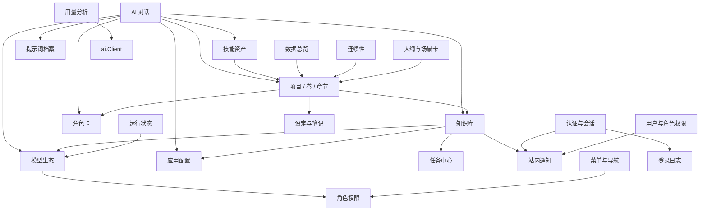

# 模块设计与实现

本文逐个说明 NovelWorkbench 业务模块的职责、数据结构、实现路径、边界与设计权衡。
每个模块固定四段：**职责与数据**（做什么、落在哪些表/对象上）、**实现路径**（文件与符号、关键规则）、**边界**（不做什么、失败如何处理）、**权衡**（为什么这样设计、代价是什么）；接口字段见 `doc/api.md`，表结构见 `doc/database.md`，AI 细节见 `doc/ai.md`。

## 0. 模块总览

| # | 模块 | 主要表 | 主要入口 |
| --- | --- | --- | --- |
| 1 | 认证与会话 | `users` | `api/auth_api.go`、`service/auth_service.go` |
| 2 | 用户与角色权限 | `users`、`roles`、`user_roles` | `service/user_admin_service.go`、`service/role_service.go` |
| 3 | 菜单与导航 | `menus` | `service/menu_service.go` |
| 4 | 审计与登录日志 | `audit_logs`、`login_logs` | `pkg/access_middleware.go`、`service/audit_service.go`、`service/login_log_service.go` |
| 5 | 应用配置 | `app_settings` | `service/setting_service.go` |
| 6 | 站内通知 | `notifications` | `service/notification_service.go` |
| 7 | 任务中心 | `jobs` | `service/job_service.go`、`service/knowledge_worker.go` |
| 8 | 项目 / 卷 / 章节 | `projects`、`volumes`、`chapters`、`chapter_snapshots`、`word_count_stats` | `service/project_service.go`、`service/volume_service.go`、`service/chapter_service.go` |
| 8.1 | AI 开书 | 同模块 8（+ `outline_nodes`） | `service/bootstrap_service.go`、`api/bootstrap_api.go`、`ai/bootstrap.go` |
| 9 | 角色卡与关系图 | `characters`、`character_relations` | `service/character_service.go` |
| 10 | 世界观设定与创作笔记 | `lore_settings` | `service/lore_service.go` |
| 11 | 大纲树与场景卡 | `outline_nodes`、`detailed_scenes` | `service/outline_service.go` |
| 12 | 连续性 | `temporal_facts`、`foreshadow_hooks`、`chapter_summaries` | `service/continuity_service.go` |
| 13 | 知识库 | `knowledge_documents`、`knowledge_chunks` + MinIO + Manticore | `service/knowledge_service.go`、`service/knowledge_worker.go`、`service/knowledge_search_service.go` |
| 14 | AI 对话 | `chat_sessions`、`chat_messages` | `service/chat_service.go`（会话与落库）、`service/chat_context.go`（上下文装配）、`service/chat_stream.go`（流式转发与看门狗） |
| 15 | 技能资产 | `skills`、`skill_references` | `service/skill_service.go`、`service/skill_reference_service.go` |
| 16 | 提示词档案 | `prompt_profiles` | `service/prompt_profile_service.go`、`api/prompt_profile_api.go` |
| 17 | 模型生态 | `model_providers`、`model_catalogs`、`model_role_grants` | `service/model_provider_service.go`、`service/model_catalog_service.go`、`service/model_access_service.go` |
| 18 | 数据总览 | `word_count_stats`、`projects` | `service/stats_service.go` |
| 19 | 用量分析 | `model_usage_stats` | `service/model_usage_service.go` |
| 20 | 运行状态 | 无（实时探测） | `service/system_status_service.go` |
| 21 | 前端工作台装配 | 无（消费上述接口） | `frontend/src/layout`、`frontend/src/store`、`frontend/src/views/Workspace` |

后端在 `backend/internal/api/router.go` 内注册 113 条 GET/POST 路由（含 `/health`、`/ready` 两个探针）、33 张 AutoMigrate 表（`backend/cmd/server/main.go`）、18 个内置技能（`backend/internal/ai/domain_<域>.go`，每域两个）与 9 份内置提示词档案（`BuiltinPromptProfiles`）。所有业务接口挂在 `api → service → repo → domain` 单向依赖上，`ai`/`infra`/`pkg` 为叶子层，不反向依赖 service。

## 1. 认证与会话

### 1.1 职责与数据

登录、查询当前用户、个人资料维护、修改密码、登出吊销。写入 `users`（`password_hash` 为 bcrypt，`json:"-"` 永不输出）与 `login_logs`；会话状态不落库，靠 JWT + Redis 黑名单维持。

| 数据 | 位置 | 说明 |
| --- | --- | --- |
| 令牌 | 客户端 `Authorization: Bearer` | HS256，声明含 `user_ulid`、`exp`、`iat`、`iss=NovelWorkbench` |
| 吊销标记 | Redis `nw:token:blacklist:<sha256(token)>` | 值 `"1"`，TTL 取 `expires_at - issued_at`（签发时长，非登出时刻的剩余有效期） |
| 登录结果 | `login_logs` | `success` / `failed` / `disabled`，含 IP 与 UA |

### 1.2 实现路径

- `service/auth_service.go` 的 `AuthService.Login`：`userRepo.GetByAccount` 同时匹配 `user_name` 与 `user_email`；账号不存在、密码错误均返回 `ERR_UNAUTHORIZED`「账号或密码错误」，`disabled` 返回 `ERR_FORBIDDEN`；成功后 `JWTSigner.SignToken` 签发并把 `role_codes` 一并返回（`withRoleCodes`）。
- `service/auth_service.go` 的 `AuthService.Logout`：`jwt.Parser` 非验签解析出 `exp`/`iat`，取两者差值作为 TTL 调 `tokenStore.Revoke`。
- `service/auth_service.go` 的 `AuthService.ChangePassword`：先 `bcrypt.CompareHashAndPassword` 校验旧密码，再写新哈希，最后经 `notify` 发一条 `account` 类型站内通知。
- `pkg/middleware.go` 的 `AuthMiddleware`：剥 `Bearer` 前缀 → `ParseToken` → `tokenStore.IsRevoked` → `userStateChecker` 查库确认账号仍存在且未禁用，全部通过后把 `user_ulid` 写入 Gin 上下文。
- `pkg/jwt.go` 的 `NewJWTSigner` 在密钥为空时直接返回错误，由 `cmd/server/main.go` 在启动期 fail fast。
- 免鉴权白名单只有 `/api/v1/auth/login`（`main.go` 构造 `AuthMiddleware` 时传入）。

### 1.3 边界

- 不提供注册接口，账号只能由管理员创建（见第 2 节「用户与角色权限」）；不存在 `/auth/register` 路由。
- 密码错误与账号不存在返回同一文案与同一业务码，不泄露账号是否存在。
- 登录日志写入失败只打警告，不阻断登录；通知写入失败同样只告警。
- 令牌吊销依赖 Redis：`TokenRepo.IsRevoked` 在 Redis 异常时返回 `false`（视为未吊销），由后续用户状态校验兜底。
- 修改密码不吊销已签发的旧令牌，也不强制重新登录，只发通知；禁用账号与删除用户则由 `AuthMiddleware` 的用户状态检查即时生效。

### 1.4 权衡

无状态 JWT 让横向扩容与 SSE 长连接不需要会话粘滞，代价是「主动失效」只能靠外部黑名单：黑名单键取令牌哈希，TTL 取签发时长，因此条目最多存活一个令牌周期、不会无限堆积，但一次登出多一跳 Redis 写。每请求回查用户状态多一次主库读，换来「禁用立即生效」，对当前低并发管理型系统是划算的；如果将来 QPS 上升，这一跳是第一个该加短 TTL 缓存的地方。

## 2. 用户与角色权限

### 2.1 职责与数据

账号生命周期（创建、编辑、禁用、重置密码、删除）与角色权限模型（角色 CRUD、权限码勾选、权限判定）。

| 表 | 关键列 | 说明 |
| --- | --- | --- |
| `users` | `user_name`（唯一）、`user_email`（唯一）、`user_status_code` | 状态 `active` / `disabled` |
| `roles` | `role_code`（唯一）、`perm_codes_json`、`builtin_flag` | 权限码以 JSON 数组存在角色行上 |
| `user_roles` | `user_ulid`、`role_ulid` | 多对多，无独立权限表 |

内置角色两条：`admin`（`perm_codes_json = ["*"]`）与 `user`（空权限集），由 `service/role_service.go` 的 `roleDefaultList` 与 `SeedDefaults` 播种。

### 2.2 实现路径

- `service/user_admin_service.go` 的 `UserAdminService.Create`：登录名与邮箱分别查重 → bcrypt 哈希 → 建用户 → `roleRepo.ReplaceUserRoles` 挂角色（缺省 `user`）→ 发「账号已开通」通知。
- `service/user_admin_service.go` 的 `Update`：只覆盖传入的非空字段；`roleCodes != nil` 时整体替换角色挂载；`operatorULID` 用于拒绝「禁用自己」。
- `service/user_admin_service.go` 的 `Delete`：拒绝删除自己 → 清角色挂载 → 清本人通知 → 删用户行。
- `service/user_admin_service.go` 的 `BootstrapAdmin`：仅当 `users` 表为空时按配置创建 `admin` 账号并挂 `admin` 角色，是系统唯一的「自动建号」路径。
- `service/role_service.go` 的 `Save`：`role_ulid` 为空则创建（编码重复返回 `ERR_CONFLICT`）；更新时内置角色不允许改编码。
- `service/role_service.go` 的 `HasPerm`：遍历用户全部角色，命中 `*` 或目标权限码即通过；`PermCodesOfUser` 对多角色权限码取并集去重保序。
- 路由侧由 `pkg/access_middleware.go` 的 `RequirePermMiddleware` 收口：`/admin/user/*` 要 `system:user:manage`，`/admin/role/*` 要 `system:role:manage`（`api/router.go` 的 `registerAdminRoutes`）。

### 2.3 边界

- 内置角色不可删除、不可改编码；角色下仍有用户时删除被拒（`ERR_CONFLICT`）。
- 管理员不能禁用或删除自己；邮箱与登录名唯一性由数据库唯一索引与服务层双重保证。
- 角色保存不校验权限码是否存在于权限目录，前端选项来自权限目录接口。
- 删除项目只校验项目归属，不额外要求权限码；技能使用对所有登录用户开放，只有维护动作收口到 `skill:manage`。
- 权限判定逐请求查库，不做缓存，因此角色权限修改在下一次请求即生效。

### 2.4 权衡

权限码存在角色行的 JSON 列里，而不是「角色-权限」关联表：读路径只有一次 `roles` 查询加内存遍历，写入是整行覆盖，模型极简。代价是无法按权限码反查角色、也无法在数据库层做外键约束，权限码拼写错误只能靠人工发现。逐请求查库省掉了缓存失效问题，换来的是管理接口每次多一跳主库——对「写操作少、管理端并发低」的定位可以接受。

## 3. 菜单与导航

### 3.1 职责与数据

`menus` 表同时承担两件事：前端导航树的唯一数据源，以及权限码的登记处（菜单即权限单一事实源）。表内 26 条内置菜单由 `service/menu_service.go` 的 `menuSeedList` 播种：3 个分组（`group_project` 创作 / `group_platform` 平台 / `group_system` 系统）、22 个页面节点（其中 `dashboard` 与 `settings` 为根级）、1 条动作节点 `action_model_write`。

| 列 | 取值 | 作用 |
| --- | --- | --- |
| `menu_type_code` | `group` / `page` / `action` | `group` 仅组织下级、`action` 不进导航只登记权限码 |
| `scope_code` | `global` / `project` | 项目内菜单路由以 `:project_ulid` 结尾 |
| `perm_code` | 权限码，空表示登录即可见 | 导航过滤与权限目录的唯一来源 |
| `visible_flag` / `enabled_flag` / `sort_order` | 布尔 / 整型 | 显隐、启停、同级排序 |

### 3.2 实现路径

- `MenuService.SeedDefaults`：按 `menu_code` 查缺补插，父级编码先于子级解析，缺父直接报错；已存在的行由 `syncSeed` 校正名称、类型、作用域、路由、图标、权限码与排序，保证升级后导航与权限不漂移（展示开关与备注保留作者改动）。
- `MenuService.Nav`：`roleSvc.PermCodesOfUser` 取权限并集 → `menuRepo.ListEnabled` → `filterVisibleMenus`（剔除动作节点、隐藏节点、未命中权限码的节点，`*` 全放行）→ `buildMenuTree` 按 `parent_ulid` 递归装配，返回 `menu_tree_list` 与 `perm_code_list`。
- `MenuService.Save`：分组不能配路由；`validateParent` 阻止指向自己或自己的下级（成环检测，深度上限 32）；`menu_code` 由 `GetByCode` 判重，`perm_code` 由 `CountByPermCode` 判重（排除自身）。
- `MenuService.Delete`：存在下级时返回 `ERR_CONFLICT`，不做级联。
- `MenuService.PermissionCatalog` / `buildPermCatalog`：把菜单行上的非空 `perm_code` 按首段分组（`permGroupCode` / `permGroupLabel`），`*` 单独登记为「全部权限」，同一权限码重复登记只展示一次。
- 前端 `frontend/src/store/modules/menu.ts` 的 `loadNav` 拉取 `GET /menu/nav`，把树与权限码同时写入 menu store 与 user store；`frontend/src/layout/components/NavMenu.vue` 按 `menu_tree_list` 渲染侧边栏，项目内菜单在未选项目时置灰。

### 3.3 边界

- 动作节点永不进入导航树，只在权限目录与角色勾选里出现。
- 菜单删除不做级联：有下级先删下级，避免悬空 `parent_ulid`。
- `Nav` 只返回启用菜单；禁用某个菜单后用户刷新导航即消失，不需要重新登录。
- 导航只决定「看得见什么」，接口鉴权仍由 `RequirePermMiddleware` 独立判定：改菜单可见性不会放宽接口权限。

### 3.4 权衡

把权限码登记在菜单表上，省掉了「权限表 + 角色-菜单关联表」两层结构：权限目录、角色勾选、导航过滤共用同一份数据，新增一个受控页面只需加一条菜单行。代价是权限码与「页面」概念绑死，纯动作权限必须伪造成 `action` 节点（如 `action_model_write`），菜单管理页因此混着导航配置与权限登记两件事；同时删除菜单会连带删除该权限码的登记，管理员需要知道这层耦合。

## 4. 审计与登录日志

### 4.1 职责与数据

| 表 | 记录内容 | 触发者 |
| --- | --- | --- |
| `audit_logs` | 操作者、动作码（去掉 `/api/v1/` 的路径）、目标类型与 ULID、`status=<HTTP 码>`、IP | `pkg.AuditMiddleware` |
| `login_logs` | 账号、命中用户、结果码、失败原因、IP、UA | `AuthService.recordLogin` → `LoginLogService.Record` |

### 4.2 实现路径

- `pkg/access_middleware.go` 的 `AuditMiddleware`：仅对 `POST` 且不在跳过名单内的请求生效，先 `c.Next()` 执行业务，再按最终状态码落库；`extractAuditTarget` 只在 `/api/v1/admin/` 路径下、且 body ≤ 64KB（`auditBodyLimitBytes`）时按 `auditTargetKeys` 白名单提取 `user_ulid` / `role_ulid` / `project_ulid` / `chapter_ulid` / `doc_ulid`。
- 跳过名单在 `cmd/server/main.go` 装配：`/api/v1/auth/login`、`/api/v1/auth/logout`、`/api/v1/chat/send`（SSE 流不适合等待后置写入）。
- `service/audit_service.go` 的 `Record`：补 `audit_ulid`，`user_name` 为空时回查用户登录名；`ListPage` 分页返回。
- `service/login_log_service.go` 的 `Record`：账号 128、失败原因 256、IP 64、UA 512 字符截断后落库，写失败只 `Warnw`。
- `service/auth_service.go` 的 `Login` 在三条失败分支（账号不存在 / 已禁用 / 密码错误）与成功分支各调用一次 `recordLogin`，因此成功与失败都有痕迹。

### 4.3 边界

- 审计只覆盖 `POST`：GET 查询不记录，避免读接口把表打成热点。
- 业务失败也记录（`status=4xx/5xx`），因为写入发生在 `c.Next()` 之后；审计写失败不阻断业务，只记 `audit_record_failed` 警告。
- 只有 `/admin/` 路径读 body 提取目标，其余路径的 `target_type` / `target_ulid` 为空，避免对创作接口做大 body 拷贝。
- 登录日志失败不阻断登录链路；日志里的失败原因比接口响应更具体（如「密码错误」「账号已被禁用」），只对管理员可见。

### 4.4 权衡

同步落库保证「业务提交即有审计」的顺序一致性，代价是每个 POST 多一次写；当前管理端写操作稀疏，表不会成为瓶颈。body 采样限制在 admin 路径 + 64KB，是对「审计价值 / 拷贝成本」的折中：创作接口的正文可能有几十 KB，逐条拷贝会显著放大内存与磁盘。登录日志与审计日志分表，是因为查询维度与保留策略不同（前者按账号与结果过滤，后者按动作码与操作者过滤）。

## 5. 应用配置

### 5.1 职责与数据

`app_settings` 只有三行，由 `service/setting_service.go` 的 `settingDefaultList` 定义，键、默认值、说明、合法区间同源：

| 键 | 默认值 | 区间 | 消费方 |
| --- | --- | --- | --- |
| `chat_history_count` | 5 | 0–50 | `ChatService.resolveHistoryLimit` |
| `rag_top_k` | 6 | 1–20 | `KnowledgeService.resolveRAGTopK` |
| `daily_word_goal` | 2000 | 100–100000 | 仪表盘每日目标展示 |

### 5.2 实现路径

- `SettingService.SeedDefaults`：按 `setting_key` 查缺补插；已存在但说明文案变化时只更新 `setting_desc`，不覆盖用户改过的值。
- `SettingService.Update`：`settingKeyAllowed` 做白名单校验 → `strconv.Atoi` 要求整数 → `settingRangeMap` 校验区间 → 更新值。
- 消费侧一律「应用配置 > 全局配置」两级回退：`resolveHistoryLimit` 先看请求参数，再看 `chat_history_count`，最后落到 `ChatConfig.HistoryCount`；`resolveRAGTopK` 同理回退到 `KnowledgeIndexConfig.RAGTopK`。
- 路由：`GET /setting/list` 对所有登录用户开放（前端要读每日目标），`POST /setting/update` 需要 `system:setting:manage`（`api/router.go` 的 `registerSettingRoutes`）。

### 5.3 边界

- 只支持整数配置：`Update` 拒绝非整数与越界值，返回 `ERR_INVALID_PARAM`；不支持的键同样拒绝。
- 没有新增键的接口：新增配置必须改 `settingDefaultList` 与 `settingRangeMap` 并重启播种。
- 不缓存，每次请求读表；读取失败时调用方回退到配置文件值并打警告，不会让对话或检索失败。

### 5.4 权衡

「配置即表 + 每次读」让保存后立即生效，不需要重启或广播失效，也不需要配置中心。代价是热路径（每次对话、每次检索）多一次小表查询，并且配置项必须编译期登记——这是一次有意的收紧：运行时只能改值，不能改结构，避免出现无人认识的配置键。前端 `views/Settings/index.vue` 里另有一份展示元数据（分组、单位、区间），与后端区间重复，改动时需要两边同步。

## 6. 站内通知

### 6.1 职责与数据

`notifications` 表按用户隔离，读后保留。类型三值：`system`（公告）、`task`（异步任务结果）、`account`（账号事件）。

| 生产者 | 事件 | 类型 |
| --- | --- | --- |
| `AuthService.ChangePassword` | 登录密码已修改 | `account` |
| `UserAdminService.Create` | 账号已开通 | `account` |
| `UserAdminService.ResetPassword` | 密码被管理员重置 | `account` |
| `KnowledgeWorker.notifyOwner` | 知识库索引完成 / 失败 | `task` |

### 6.2 实现路径

- `NotificationService.Notify`：`user_ulid` 为空直接返回（如项目已删除导致接收人缺失）；标题 128、正文 512、链接 256 字符截断（`pkg.TruncateText`）；类型缺省 `system`。
- `ListPage` / `UnreadCount` / `MarkRead` / `MarkAllRead` / `Delete` 全部以 `user_ulid` 作为查询条件，不接受跨用户 ID。
- `DeleteByUser` 在账号删除时清理该用户全部通知。
- 前端 `frontend/src/store/modules/notification.ts` 维护未读数；`layout/components/NotificationBell.vue` 挂载时刷新并每 60 秒轮询一次；`views/Notifications/index.vue` 提供状态筛选与单条、批量已读。

### 6.3 边界

- 无实时推送：延迟上限等于轮询间隔（60 秒），不支持 WebSocket/SSE 通知。
- 通知只是提示，不承载业务状态：点开链接跳转由前端路由完成，后端不校验目标资源是否仍存在。
- 所有写入失败只告警，绝不影响主链路（改密、建号、索引结果都不因通知失败而回滚）。

### 6.4 权衡

用「落库 + 轮询」而不是消息推送，省掉长连接与网关改造成本，也天然支持离线用户与历史回看；代价是未读数有最多 60 秒延迟，且每次轮询要跑一次 `count` 查询。通知内容在写入时截断并做快照（标题/正文直接存文本，不存模板 ID），因此历史通知不会随后续文案调整而变化。

## 7. 任务中心

### 7.1 职责与数据

`jobs` 表是异步任务的留痕与运维入口，当前唯一任务族是知识库索引：`doc_index`（首次）与 `doc_reindex`（重建）。`payload_json` 存 `{"doc_ulid": "DOC_..."}`。状态取值 `queued` / `running` / `success` / `failed`，但 worker 只写 `queued`（投递时）、`success`、`failed` 三态：`running` 仅用于 `Stats` 计数与 `GetPendingByDoc` 的待办查询，当前没有代码把它写入任务行。

### 7.2 实现路径

- `service/knowledge_service.go` 的 `enqueueIndexJob`：先建 `queued` 任务行，再 `mqRepo.PublishIndexJob`；投递失败把任务置 `failed` 并返回 `ERR_STORAGE`。
- `service/knowledge_worker.go` 的 `Run`：启动时 `ensureManticoreSchema`，结构升级返回 `true` 时 `rebuildManticoreIndex` 从 PostgreSQL 回灌；随后阻塞消费，消费中断按 `consumeReconnectInterval`（5 秒）重连，`ctx` 取消时优雅退出。
- `handleIndexJob`：`GetPendingByDoc` 找回任务行 → 文档置 `indexing` → 内部重试至多 `maxIndexRetryCount`（3）次，退避为 1s/2s/3s → 成功置 `success` 并发通知，全部失败置 `failed` 并回写 `error_message`，随后 `ack`（毒消息不重投）。
- `service/job_service.go` 的 `ListPage`：解析载荷批量取文档名（`GetDocumentsByULIDs`），避免 N+1；`Stats` 按状态计数；`Retry` 只接受 `failed`，把任务重置为 `queued`、文档重置为 `pending` 后重新投递。
- 前端 `views/Admin/Jobs.vue` 展示四张状态卡 + 筛选表 + 失败重试（二次确认）。

### 7.3 边界

- 只有 `failed` 任务可重试，其余状态返回 `ERR_BIZ_FAILED`；载荷缺 `doc_ulid` 或文档已删除时拒绝。
- 文档已删除的滞留消息直接 `ack` 并置任务 `failed`，避免无意义重投。
- 文档状态与任务状态是两套：`knowledge_documents.doc_status_code` 面向用户（`pending/indexing/indexed/failed`），`jobs.job_status_code` 面向运维，由 worker 同步维护。
- 没有超时回收器：worker 在索引中途崩溃会留下 `queued` 任务与 `indexing` 文档；`/knowledge/reindex` 只接受 `indexed`/`failed`，任务重试只接受 `failed`，因此这两种中间态都没有自助恢复入口，需要人工改状态或重新上传文档。

### 7.4 权衡

任务行在投递前创建，保证「消息丢了也能看到一条 queued/failed」，比纯 MQ 语义更可运维。重试放在 worker 内部（进程内退避）而不是让 MQ 重投，避免毒消息在队列里打转；代价是重试次数只体现在 `retry_count`，队列层面看不到投递次数。把 Manticore 索引当作可重建副本来处理（失败只降级关键词通道，不阻断文档 `indexed`），是这条链路最重要的取舍：权威数据永远在 PostgreSQL 与 MinIO。

## 8. 项目 / 卷 / 章节

### 8.1 职责与数据

创作主线三级结构：`projects`（书名、题材、文风、简介、状态、累计字数）→ `volumes`（卷名、排序、概要）→ `chapters`（正文、梗概、字数、状态）。`chapter_snapshots` 存人工留档，`word_count_stats` 存按日字数增量（`word_delta` / `ai_word_delta`）。

| 表 | 关键列 | 约束 |
| --- | --- | --- |
| `projects` | `user_ulid`、`total_word_count` | 项目即权限边界 |
| `volumes` | `project_ulid`、`volume_order` | 缺省取 `max+1` |
| `chapters` | `project_ulid`、`volume_ulid`、`chapter_order`、`word_count` | 冗余 `project_ulid`，鉴权免 join |
| `chapter_snapshots` | `chapter_ulid`、`content_text`、`snapshot_type`、`change_note` | 当前只有 `manual` |

### 8.2 实现路径

- `service/project_service.go` 的 `Create` / `Update` / `List` / `Detail` / `Tree`；`Tree` 返回卷列表与每卷章节（升序），是写作台一次加载的数据源。
- `mustOwnProject`（`service/project_service.go`）是所有创作模块共用的归属校验：项目不存在 `ERR_NOT_FOUND`，非本人 `ERR_FORBIDDEN`。
- `ProjectService.Delete`：单个 `repo.WithTx` 事务内依次删快照、章节、卷、角色、关系、设定、大纲节点与场景卡、时间事实与伏笔与摘要、会话消息、知识切片与文档、字数统计，最后删项目；事务提交后 `cleanupKnowledgeExternal` 清 MinIO 原文与 Manticore 行，失败仅告警。
- `service/volume_service.go` 的 `Create` 缺省排序取 `MaxOrder+1`；`Delete` 先 `SumWordCountByVolume` 汇总字数，删快照与章节后按总量负向回补项目字数。
- `service/chapter_service.go` 的 `Create` 校验卷属于该项目，`chapter_order` 取 `MaxOrder+1`，初始状态 `draft`。
- `ChapterService.Update`：单事务内按非空字段更新；正文变化时用 `pkg.CountWords` 重算，差值经 `applyWordDelta` 同时调整 `projects.total_word_count`（`AdjustTotalWordCount` 用 SQL 表达式增减）与当日 `word_count_stats.word_delta`。
- `SnapshotRestore`：回滚前先把当前正文写成一条 `manual` 快照（`change_note` 为「restore 自动留档」），再覆盖正文并重算字数差。
- 字数口径在 `pkg/text.go` 的 `CountWords`：汉字逐字计数，连续拉丁字符算一个词，前端 `views/Workspace/wordCount.ts` 与后端同口径。

### 8.3 边界

- 卷必须属于目标项目，章节创建时卷不匹配返回 `ERR_INVALID_PARAM`；章节只能通过所属项目间接鉴权。
- 删除项目只校验项目归属，不额外要求权限码。
- 字数账目只在四条路径维护：章节更新、章节删除、快照回滚、卷删除；直接改库或绕过服务层不会自动修正。
- 外部存储清理（MinIO / Manticore）在事务外，失败不回滚，可能留下孤儿对象；文档行已删，孤儿对象不再被引用。
- 级联范围覆盖快照、章节、卷、角色与关系、设定、大纲节点、场景卡、时间事实、伏笔钩子、章节摘要、会话与消息、知识切片与文档、字数统计；`ProjectCascadeDeps` 持有 `OutlineRepo` 与 `ContinuityRepo`，删除项目后不会残留按 `project_ulid` 孤立的数据行。

### 8.4 权衡

章节表冗余 `project_ulid`，让「按项目取章节」「按项目鉴权」都不需要 join 卷表，代价是插入时必须保证两列一致（服务层强制）。累计字数用「增量表达式 + 每日增量表」而不是每次聚合全表：读路径 O(1)，写路径只加一个常量；代价是账目正确性依赖所有写入口都调用 `applyWordDelta`，一旦有遗漏就只能靠重算修复。快照采用「整章全文副本」而不是 diff，存储放大但回滚是纯覆盖，没有补丁冲突。

### 8.5 AI 开书（8.1）

一句创意直接长出可写的项目骨架，解决「新建项目后面对空白卷章不知道从哪下手」的冷启动问题。

**实现路径**

- `ai/bootstrap.go`：`bootstrapSystemPrompt` 固定输出严格 JSON（书名 / 卖点 / 简介 / 文风 / 卷章 / 角色 / 设定）；`ParseBootstrapPlan` 容忍代码围栏与前后缀文字，缺 JSON、缺书名或缺卷章一律报错，不产出半成品。
- `service/bootstrap_service.go` 的 `GeneratePlan`：经 `ModelProviderService.ChatSpecOf` 取当前账号有权限的模型（未指定则默认模型），流式累积全文后一次解析（非流式会撞网关首包超时）；首包超时与输出上限单独放宽到 300s / 8000 token。失败且章节数 >3 时缩半规模重试一次，避免模型输出上限截断导致整份方案作废。`normalizeBootstrapPlan` 再收敛模型输出——卷 ≤3、角色 ≤8、设定 ≤10、章节数按请求截断、`role_type_code` / `lore_type_code` 校正到枚举、名称按列宽截断、空名称补默认值。
- `ApplyPlan`：单个 `repo.WithTx` 事务内创建项目 → 卷 → 章节 → 角色 → 设定 → 两级大纲节点（卷节点下挂章节点），任一失败整体回滚；成功后回读项目行组装 `ProjectVO` 返回。
- 前端 `views/Dashboard/components/BootstrapDialog.vue`：两步向导，第一步写创意与章节规模，第二步逐字段可改（书名、卖点、简介、文风、卷章、角色、设定）后确认开书，成功后直接进入新项目的写作台。

**边界**

- 方案只生成不落库，落库必须显式二次提交，避免模型幻觉直接写进作品数据。
- 不生成正文：章节只有名称与「发生什么 / 章末停在哪」的梗概，正文由作者在写作台起草。
- 大纲只建卷 → 章两级，不建幕与故事块；场景卡不自动生成。
- 生成失败返回 `ERR_AI_PROVIDER`（含模型未配置/未授权的情况），不静默降级为手工模板。

**权衡**

选择「两段式（plan → apply）」而不是一次调用直接建库：多一次前端往返，换来作者能在落库前改掉不合适的书名与章节，且服务端只需校验结构、不承担"猜用户意图"的责任。用非流式而非 SSE：开书是一次性结构化产物，逐字流没有意义，前端用加载态表达等待更简单。枚举收敛放在服务层而非提示词里：模型对枚举值的遵从率不可控，落库前必须有一次确定性校正。

## 9. 角色卡与关系图

### 9.1 职责与数据

`characters` 存角色卡（姓名、别名、类型 `protagonist/antagonist/supporting/minor`、性格、背景、外貌、目标动机），`character_relations` 存有向关系边（起点、终点、类型、说明）。两者都以 `project_ulid` 归属。

### 9.2 实现路径

- `service/character_service.go` 的 `Save`：`character_ulid` 为空即新建，否则先校验存在且同项目，再整字段覆盖更新。
- `Delete`：单事务内先 `DeleteRelationsByCharacter` 再删角色，避免悬挂边。
- `Graph`：一次取全项目角色与全项目关系，装配 `CharacterGraphVO{NodeList, EdgeList}`，节点只带 `character_ulid` / `character_name` / `role_type_code`。
- `RelationSave`：拒绝自环（两端相同 ULID）；两端角色必须存在且都属本项目；`RelationDelete` 按关系行反查项目做归属校验。
- 前端 `views/Character/index.vue` 为卡片网格 + 编辑抽屉；`views/Character/components` 下的关系图页签 用 `await import('@antv/x6')` 懒加载渲染关系图，卸载时 `dispose`。
- 角色卡同时是 AI 上下文素材：`service/chat_context.go` 的 `formatCharacterBlock` 把每个角色的性格截断 120 字、背景截断 200 字后注入（优先级 `ai.PriorityCharacter`）。

### 9.3 边界

- 关系图按需计算，不落图数据库，也不做布局持久化：每次打开重新取数、重新布局。
- 角色卡没有版本历史；删除角色会连带删除其全部关系边，不可撤销。
- 注入 AI 的角色信息是截断摘要，不是全文；角色数量多时靠上下文预算裁剪整块丢弃，而不是逐条挑拣。

### 9.4 权衡

用「两张普通表 + 内存构图」替代图数据库：规模是一本书的几十个角色、几百条边，全量加载在毫秒级，省掉一套中间件与同步逻辑。代价是无法做图算法查询（最短路径、社区发现），关系类型也只是自由字符串，没有约束枚举。角色卡选择「全量注入 + 单项截断」而不是按相关性检索，是因为作者期望 AI 认识全部主要角色；预算不足时整块丢弃虽然粗暴，但行为可预测。

## 10. 世界观设定与创作笔记

### 10.1 职责与数据

`lore_settings` 一张表承载两个产品：世界观设定（`lore_type_code` = `world` / `rule` / `item` / `place` / `event`）与创作笔记（`lore_type_code = note`）。`content_mode_code` 决定正文用哪种编辑器与存储格式：`rich`（HTML）或 `markdown`（原文）。

### 10.2 实现路径

- `service/lore_service.go` 的 `Save`：新建时 `content_mode_code` 缺省 `rich`；更新时只覆盖非空字段，`content_mode_code` 传空表示保持原值。
- `Delete` / `List` 均先经 `mustOwnProject`；列表支持按 `lore_type_code` 与关键词过滤，按 `sort_order` 升序。
- 笔记隔离有两道闸：`repo/chat_repo.go` 的 `ListLoreBriefsByProject` 在 SQL 层 `WHERE lore_type_code != 'note'`；`service/chat_context.go` 的 `formatLoreBlock` 再跳过一次 `note`。
- 前端 `views/Lore/index.vue` 按分类展示设定卡片；`views/Notes/index.vue` 只查 `NW_LORE_TYPE_NOTE`，标题与正文 2 秒防抖自动保存（`POST /lore/save`），切换笔记前 `flushSave`，保存状态分 `idle/saving/saved/failed`。
- 笔记双模式由 `views/Notes/components/NoteEditor.vue` 实现：`markdown` 模式用 `marked` 渲染预览，`rich` 模式直接按 HTML 渲染原文；两种模式共用同一个 textarea 与自动保存通道，模式随 `content_mode_code` 持久化。

### 10.3 边界

- `note` 永不进入 AI 上下文：即使作者手动在对话里 `@` 引用，引用入口只覆盖知识库文档与章节，不包含设定表。
- 正文上限 20000 字符（`LoreREQ` 的 `binding`）；类型白名单 `world rule item place event note`，非法值被参数校验拒绝。
- 设定没有版本历史，删除即物理删除；富文本以 HTML 原样存储，不做服务端清洗（信任单作者场景）。
- 同一张表意味着「设定」与「笔记」共享所有权、排序与搜索语义，但没有独立的字段（笔记没有额外元数据）。

### 10.4 权衡

复用设定表承载笔记，省掉一张表、一套 CRUD 与一套前端状态；代价是「排除笔记」这条业务规则必须同时存在于 SQL 与格式化函数两处（当前刻意冗余，任一处失效仍有兜底），且笔记的富文本/双模式逻辑在设定页并不需要。私人笔记的隔离选择「SQL 层排除」而不是「提示词层过滤」，是因为前者能保证即使上下文装配被改写也不会泄漏。

## 11. 大纲树与场景卡

### 11.1 职责与数据

`outline_nodes` 是邻接表树（`parent_outline_ulid` + `sort_order`），节点类型 `volume` / `arc` / `storyBlock` / `chapter`，状态 `draft` / `planning` / `ready` / `done`。`detailed_scenes` 挂在节点下，记录出场角色 ULID 列表、地点、核心冲突、节奏 `slow/medium/fast/climax`、预计字数、入场状态、目标、关键选择、结果、出场状态。

### 11.2 实现路径

- `service/outline_service.go` 的 `SaveNode`：新建时 `sort_order` 为 0 则取 `MaxNodeOrder+1`，状态缺省 `draft`，并 `validateParent` 校验父节点属本项目且不成环；更新时先 `loadOwnedNode` 确认节点属本项目。
- `validateParent`：父节点为空直接放行；父节点等于自身拒绝；随后从父节点沿 `parent_outline_ulid` 上溯（每层都 `loadOwnedNode` 校验属本项目），一旦发现某层的父节点是自己即判成环。
- `DeleteNode`：先 `CountNodesByParent`，有子节点返回 `ERR_CONFLICT`，不做级联删除。
- `ListTree`：一次取全项目节点，按 `parent_outline_ulid` 分桶后由 `attachOutlineChildren` 递归拼装，根节点为 `parent_outline_ulid = ''`。
- `SaveScene`：先 `loadOwnedNode` 校验节点，`encodeCharacterULIDs` 把角色列表序列化为 JSON；新建时排序取 `MaxSceneOrder+1`；更新时 `loadOwnedScene` 确认场景属本项目。
- 前端 `views/Outline/index.vue` 左树右场景卡；节点类型/状态/节奏选项集中在 `views/Outline/components` 下的选项常量。

### 11.3 边界

- 大纲节点与真实章节是两套数据：大纲 `chapter` 类型节点不会自动创建 `chapters` 行，反之亦然，作者需要分别维护。
- 删除节点必须自底向上，没有「连同子树一起删」的接口。
- 场景卡的出场角色只存 ULID 列表，不校验角色是否仍存在；角色被删后列表里会留下失效引用。
- 没有拖拽重排接口：调整顺序靠保存新的 `sort_order`。

### 11.4 权衡

邻接表 + 内存建树，写入是单行更新，读取是一次全项目查询，对一本书的规模（几十到几百节点）足够；代价是深度查询（祖先链、子树统计）要在应用层循环，且没有数据库级的外键或环约束——成环检测是服务层职责。大纲与章节分离，是因为规划阶段的结构（幕、故事块）与写作阶段的卷章并不一一对应；代价是两套结构的同步只能靠作者。

## 12. 连续性

### 12.1 职责与数据

三本手工账，全部以 `project_ulid` 归属：

| 表 | 状态码 | 关键字段 |
| --- | --- | --- |
| `temporal_facts` | `candidate` / `confirmed` / `superseded` / `stale` | 主语、谓语、宾语、生效章节区间、来源章节与原文引用、备注 |
| `foreshadow_hooks` | `planned` / `planted` / `echoed` / `resolved` / `abandoned` | 描述、预期回收、埋设/回收章节、重要度 `high/medium/low` |
| `chapter_summaries` | `pending` / `verified` / `stale` | 摘要正文、`source_hash_text`（生成时正文指纹） |

### 12.2 实现路径

- `service/continuity_service.go` 的四个校验函数 `isValidFactStatusCode` / `isValidHookStatusCode` / `isValidImportanceCode` / `isValidSummaryStatusCode` 是状态白名单的唯一实现，允许空值由调用方补默认（事实 `candidate`、重要度 `medium`、摘要 `pending`）。
- `SaveFact`：新建或更新；更新时状态为空则沿用原值，不允许把状态写成非法码。
- `ReviewFact`：只接受 `confirmed` / `superseded` / `stale` 三种目标状态，明确不允许退回 `candidate`；`note_text` 非空时覆盖备注。
- `SaveHook`：状态随显式保存推进，不做自动流转；重要度缺省 `medium`。
- `SaveSummary`：无 `summary_ulid` 时先按 `(project_ulid, chapter_ulid)` 查既有记录，存在则更新，保证「一章一条摘要」；`source_hash_text` 只是原样存储。
- 前端 `views/Continuity/index.vue` 三个页签各自筛选与加载；事实行提供「确认 / 取代 / 标记过期」下拉，摘要状态在 `views/Continuity/components` 下的弹窗组件 里选择。

### 12.3 边界

- 全部由作者手工维护：AI 对话链路不写这三张表，也不读取它们（章节梗概走 `chapters.summary_text`，见第 14 节「AI 对话」）。
- `source_hash_text` 不参与自动比对：正文变化后系统不会自动把摘要置 `stale`，需要作者手动改状态。
- 状态流转没有强制的前置约束（例如 `echoed` 之前是否必须 `planted`），只有取值白名单。
- 章节 ULID 字段（`setup_chapter_ulid`、`valid_from_chapter_ulid` 等）不做存在性校验。

### 12.4 权衡

把连续性做成「可人工复核的账本」而不是「AI 自动抽取的知识图谱」：结论可解释、可回溯到章节引用，且不会因为模型幻觉污染权威数据；代价是全部维护成本落在作者身上，规模大了容易漏记。事实复核不允许退回 `candidate`，是因为「候选」代表未经人判断的原始记录，一旦人工定性就不该伪装成未处理——需要推翻时用 `superseded` 并新建一条。摘要指纹只存不算，是为将来自动失效留的字段，当前不承担逻辑。

## 13. 知识库

### 13.1 职责与数据

原文进 MinIO（对象键即 `doc_ulid`），元数据与切片进 PostgreSQL（`knowledge_documents` / `knowledge_chunks`），全文检索副本进 Manticore。文档状态 `pending → indexing → indexed | failed`，类型白名单 `txt/md/docx/pdf`，单文件上限取 `KnowledgeIndexConfig.UploadMaxMB`（配置项 `app.upload_max_mb`，默认 20MB）。

### 13.2 实现路径

- 上传：`service/knowledge_service.go` 的 `Upload` 校验归属与扩展名 → `objectRepo.PutObject` 写原文 → 建 `pending` 文档行（失败则回滚对象）→ `enqueueIndexJob` 投递任务（失败则文档置 `failed`）。
- 索引：`service/knowledge_worker.go` 的 `indexDocument` 读原文 → `extractDocumentText`（`extractDocxText` / `extractPDFText`）→ `chunkText` 按 `ChunkSize` 切分、`ChunkOverlap` 重叠、`lastBoundary` 在句末/换行处回退断点 → `contentHashOf`（SHA-256）与既有切片比对复用 ULID → 单事务删旧切片写新切片 → `syncManticoreChunks` 先删后插 → 文档置 `indexed` 并回写 `chunk_count` / `total_token_count`。
- 表结构：`knowledge_manticore.go` 的 `ensureManticoreSchema` 建 `charset_table='non_cjk,0..9,A..Z->a..z,a..z'`、`ngram_len='1'`、`ngram_chars='cjk'` 的全文表；`SHOW CREATE TABLE` 结果里缺少 `ngram_len` 说明表不是当前结构，此时 drop 重建并返回 `true`，由 `rebuildManticoreIndex` 从 PostgreSQL 全量回灌。
- 检索：`service/knowledge_search_service.go` 的 `SearchWithTrace`：`normalizeSearchMode`（只有 `hybrid` 走双通道，其余按 `keyword`）→ `extractQueryTerms`（CJK 2-gram + 拉丁词）→ `searchKeywordChannel` 分别以 `term`（`"a" | "b"`）与 `phrase`（整串短语）查 Manticore → `fuseSearchResults` 用 RRF（`score = Σ 1/(60+rank)`，常数 `rrfRankConstant = 60`）融合 → `maybeRerank` 用系统默认对话模型重排（8 秒超时，失败 fail-open 保留原序）→ `trimHits` 截断。返回 `KnowledgeSearchDTO` 同时带 `Trace`（检索词、MATCH 表达式、候选数、是否重排、入选 ID）。
- 切片回表：`searchKeywordChannel` 拿到 `chunk_ulid` 后 `GetChunksByULIDs` 回 PostgreSQL 取正文与文档名，Manticore 只当索引不存权威文本。
- 默认召回条数：`resolveRAGTopK` 优先 `rag_top_k` 配置，回退 `KnowledgeIndexConfig.RAGTopK`。
- 其它入口：`ChunkList`（切片分页）、`GetContent`（按 `Content-Type` 直接输出原文二进制，读取上限 `contentMaxBytes` = 25MB，不走 JSON 包络）、`Stats`（按状态计数与切片总数）、`Reindex`（仅 `indexed`/`failed` 可重投）、`Delete`（先删对象与 Manticore 行，再事务删切片与文档）。

### 13.3 边界

- 不支持向量检索，也不生成 embedding；`hybrid` 指「词条 + 短语两条词法通道」，不是语义通道。
- 检索限定单项目：`KnowledgeSearchREQ.ProjectULID` 必填且经 `mustOwnProject` 校验，Manticore 查询也带 `project_ulid` 过滤；`mustOwnDoc` 对 `project_ulid` 为空或 `"0"` 的全局库文档放行，对话 `@` 引用时同样接受这类文档。
- Manticore 是可选依赖但检索强依赖它：建表/同步失败只在启动与索引阶段降级（打警告，文档仍可置 `indexed`）；查询阶段单个通道失败会降级到另一通道，两个通道都失败则 `/knowledge/search` 返回 `ERR_STORAGE`，只有对话链路里的 RAG 召回会吞掉该错误降级为空上下文。
- 切片入库在事务内，Manticore 同步在事务外：同步失败时 PostgreSQL 与索引短暂不一致，靠 `Reindex` 或重启时的结构检查修复。
- 删除文档先删外部对象：MinIO 删除失败直接返回 `ERR_STORAGE` 并中止，Manticore 删除失败只告警。

### 13.4 权衡

不引入向量模型是这套设计的根假设：部署不需要额外模型与向量库，检索结果完全可解释（能给出 MATCH 表达式与每个通道的名次），索引可从 PostgreSQL 整体重建。代价是同义改写、跨语言查询召回明显弱于语义检索，只能靠 CJK 2-gram 切词、双通道 RRF 与对话模型重排补偿。用 Manticore 而不是 PostgreSQL 全文索引，是为了 CJK ngram 分词与 BM25 打分开箱可用；代价是多一个必须同步的存储，以及「索引可重建」带来的运维复杂度（worker、队列、任务状态机）。

## 14. AI 对话

### 14.1 职责与数据

`chat_sessions`（项目 + 用户 + 会话名）与 `chat_messages`（角色 `user/assistant/system`、正文、命中技能码、三类引用 ULID 的 JSON、估算 token）。会话名缺省时用首条消息前 20 字回填。

### 14.2 实现路径

`ChatService.Send`（`service/chat_service.go`）是唯一生成入口，顺序固定：

1. `mustOwnProject` → `resolveSkill`（`SkillService.Resolve` + `SkillTemplate`，项目技能覆盖同编码全局技能）。
2. `resolveSession`：`session_ulid` 为空自动建会话，否则 `mustOwnSession` 校验归属并要求项目一致。
3. `validateRefMessages` 校验显式引用的历史消息都属于本会话（去重保序）；`selectHistoryMessages` 取最近 `n` 条为骨干，引用消息必注入。
4. `loadContextInput`（`service/chat_context.go`）：引用章节（首项标记为当前章）、引用文档全文（分页拼切片）、引用章节摘要（按 `summary_ulid` 校验归属项目）、引用提示词档案（`mustReadableProfile`，项目档案校验创建者）、RAG 召回（`KnowledgeService.Search`，失败降级为空）、项目角色、设定（排除 `note`）、当前章前后章 `summary_text`。
5. `buildContextBlocks` 组装块并给优先级：技能 100、当前章 90、技能参考资料 85、显式引用 80（`ref_chapter` / `ref_doc` / `ref_summary` / `ref_prompt`）、RAG 70、章节梗概 60、角色与设定 50、历史 40；技能命中时用 `ai.RenderPrompt` 渲染 `{{user_input}}` / `{{chapter_content}}` / `{{context}}`。
6. `ai.AssembleContext`（`ai/prompt.go`）按优先级装入、超 `ai.ContextBudgetChars`（12000 字符）的块整块丢弃并返回 `dropped_keys` 记日志。
7. 先落用户消息（含引用与 token 估算），会话名为空则回填；`providerSvc.ChatSpecOf` 取模型规格（失败时流尚未开始，按 JSON 包络返回）。
8. `streamChat`（`service/chat_stream.go`）消费模型流：`thinking`/`chunk` 事件逐段下发，`chatPingInterval`（15 秒）无输出发 `: ping` 心跳，连续 `chatStreamIdleTimeout`（6 分钟）无分片判网关已断并发 `error` 事件，`ctx.Done()` 或写失败即中止。
9. 生成完成后单事务写入 assistant 消息与当日 `ai_word_delta`（`UpsertAIWordDelta`），再发 `done` 事件并携带 RAG 依据。

SSE 协议由 `api/chat_api.go` 的 `sseChatWriter` 实现：`data: {json}` 单行事件，`begin()` 首次输出时提交 `text/event-stream`、`no-cache`、`X-Accel-Buffering: no`；事件 `seq` 由 `chatEventWriter.emit` 单调递增。

### 14.3 边界

- 单链路：没有「一键生成摘要/续写」的独立接口，所有生成都走 `/chat/send` + 技能码；前端插入章节是本地动作（`ChapterEditor.insertTextAtCursor` 后走 2 秒防抖保存）。
- 流开始前的失败（项目、技能、会话）返回 JSON 包络且不写任何消息；但 `ChatSpecOf` 在用户消息落库之后才执行，供应商不可用时同样返回 JSON 包络，此时用户消息已留在会话里、assistant 消息缺失。
- 流开始后的失败只能经 `error` 事件下发，接口本身已提交 200 与 `text/event-stream` 响应头。
- 客户端断开或生成失败时不写 assistant 消息，但已落库的用户消息保留（作为对话痕迹）。
- 引用文档必须是本项目或全局库（`project_ulid = "0"`），跨项目引用返回 `ERR_FORBIDDEN`。
- 历史条数优先级：请求参数 > `chat_history_count` > `ChatConfig.HistoryCount`（默认 5）；上下文超预算时丢弃是静默的（仅服务端日志）。
- `chat/send` 在审计跳过名单内，因此不产生 `audit_logs` 行；用量统计仍由 `ai.Client` 上报。

### 14.4 权衡

单链路把所有生成收口到一处，上下文装配、容错、流式协议、落库与统计只有一份实现，排错路径唯一；代价是交互上多一步「生成 → 手动插入」，且无法为某类生成定制不同的流式行为。上下文用「优先级 + 整块丢弃」而不是「逐块摘要压缩」：行为确定、不会二次调用模型，但预算不足时可能丢掉整块角色信息，作者无从感知。RAG 失败降级为空上下文而不是报错，是保证「对话永远可用」的取舍，代价是回答质量静默下降。

## 15. 技能资产

### 15.1 职责与数据

`skills` 是可编辑的提示词资产：编码（对话中以 `/code` 触发）、名称、作用域 `global`/`project`、分类 `write/revise/outline/setting/review/other`、模板 `prompt_template`、变量声明 `variable_spec_json`、启停与内置标记。`skill_references` 存参考资料（名称、正文、逗号分隔关键词、排序），在技能命中时按关键词挑选注入。

内置技能 18 个，按 9 个流程域组织（每域一份档案 + 两个技能）：起草 `continue`/`conflict`、架构 `outline`/`worldrule`、打磨 `polish`/`dialogue`、去 AI 味 `deai`/`humanness`、质检 `review`/`hitscan`、连续性 `foreshadow`/`ledger`、定稿 `summary`/`finalcheck`、运营 `golden3`/`platform`、立项 `pitch`/`deconstruct`。由 `ai.BuiltinSkills()` 从 `domain_<域>.go` 汇总、`SkillService.SeedDefaults` 播种为全局作用域 `builtin_flag=true`，并按内容指纹做版本升级；完整矩阵见 [skills.md](skills.md)。

### 15.2 实现路径

- `SkillService.List`：`project_ulid` 非空时合并「项目技能 + 全局技能」，并用 `isOverriddenGlobalSkill` 给被覆盖的全局技能打标记。
- `SkillService.Save`：作用域缺省 `global`；项目技能必须带项目并经 `mustProjectAccess` 校验项目存在（不校验创建者）；`validateSkillTemplate` 要求模板占位符都在变量声明里；同一作用域下 `skill_code` 唯一；内置技能不允许改编码与作用域。
- `resolveByCode` / `pickSkillByScope`：启用中的项目技能优先，其次启用中的全局技能，都不命中则报「技能不存在或已停用」。
- `resolveSkillCode` / `parseSlashToken`：显式 `skill_code` 优先，否则只解析正文**首个 token** 的 `/code`，命中才剥离命令，未命中正文原样返回。
- `resolveSkillVariables`：按变量声明取请求值，缺省值兜底，必填缺失进 `missing_list`，由 `Resolve` 原样返回给前端提示补全；对话链路只取 `SkillTemplate` 的模板文本，变量渲染发生在 `buildContextBlocks`。
- 参考资料：`skill_reference_service.go` 的 `matchReferences` → `selectSkillReferences`：关键词为空总是命中，否则任一关键词出现在正文中即命中；按排序累计字符，超过 `skillReferenceBudgetChars`（4000）即停止（后续资料一律不取）。
- 前端 `views/Skills/index.vue` 支持作用域切换（全局 / 当前项目）+ 分类关键词筛选 + 编辑抽屉；`views/Skills/components` 下的参考资料面板 管理参考资料。

### 15.3 边界

- 内置技能不可删除（`ERR_BIZ_FAILED`，可停用），删除自定义技能时级联清理其参考资料。
- 只识别正文首个 token 的斜杠命令；正文中间出现的 `/xxx` 不会触发技能。
- 参考资料按字符预算硬截断，不做摘要或二次筛选；预算之外的资料连尝试机会都没有。
- 项目技能的作用域校验只看「项目存在」，不看归属：同一项目的协作者都能维护项目技能，这是刻意的团队协作放宽。
- 变量只支持字符串；模板占位符未声明的会被 `validateSkillTemplate` 拒绝保存。

### 15.4 权衡

把提示词做成数据而不是代码，让作者不改代码、不发版就能调技能；代价是模板与变量的一致性必须在保存期校验，运行期还要处理变量缺失与参考资料预算。作用域覆盖规则（项目覆盖全局）让「全局默认 + 项目特化」成为可能，代价是列表页必须显式标注「被覆盖」，否则作者会困惑于改了全局为什么没生效。参考资料用关键词命中而不是向量相似度，与第 14 节的检索取舍一致：可解释、零额外依赖，但同义表达命中率有限。

## 16. 提示词档案

### 16.1 职责与数据

`prompt_profiles` 存「AI 是谁」：编码、名称、作用域 `global`/`project`、系统提示词正文、启停与内置标记。与技能的分工是：**档案定身份与底线，技能定本次动作**。同一次对话两者同时下发，档案不会被技能覆盖。

内置 9 份，与技能一一配对：`novelist`（长篇连载作者，默认）、`architect`（故事架构师）、`stylist`（文字打磨师）、`deai`（去 AI 味修订）、`editor`（连载责任编辑）、`continuity`（设定守门人）、`final_editor`（定稿编辑）、`serial_editor`（连载平台主编）、`pitch_analyst`（选题策划）。由 `ai.BuiltinPromptProfiles()` 提供、`PromptProfileService.SeedDefaults` 播种并按指纹升级，见 [skills.md](skills.md)。

### 16.2 实现路径

- `SystemPromptOf(projectULID, promptProfileULID)`：显式档案（须启用且为全局或属于当前项目）→ 启用的全局默认档案（排序号最小）→ `ai.SystemPrompt("")` 内置兜底。解析失败不报错，直接降级，保证链路永远有身份约束。
- `ai.ComposeSystemPrompt(profileText, styleText)`：档案正文 + 「本项目文风约束」段落。有档案时不再拼内置人设，避免两套身份打架。
- `Save`：作用域缺省 `global`；项目档案必须带项目并经 `mustOwnProject` 校验归属；`CountByCode` 保证作用域内编码唯一；内置档案可改正文与名称，但编码与作用域不可变。
- `Delete`：内置档案拒绝删除（可停用），停用后使用它的对话自动回退到默认档案。
- 前端 `views/Prompts/index.vue` 管理档案，`views/Workspace/ChatComposer.vue` 提供对话期档案选择（清空即用默认）。

### 16.3 边界

- 档案不参与上下文预算裁剪：它走 `system` 角色，不受 `ContextBudgetChars` 约束，因此正文上限设为 8000 字符。
- 项目档案的归属校验与技能不同：档案用 `mustOwnProject`（校验创建者），技能用 `mustProjectAccess`（只校验项目存在）。档案会直接影响模型行为，收得更紧。
- 档案只在对话链路生效，知识库重排等内部调用仍走固定提示词。

### 16.4 权衡

把系统提示词做成可编辑资产，让「换一种 AI 身份」不需要改代码；代价是多一层解析与一次数据库读取（每次发送一次 `GetByULID` 或 `GetDefaultGlobal`，单行主键查询，可忽略）。不做缓存是刻意的：档案改完要立刻生效，缓存失效逻辑比查询本身更贵。

## 17. 模型生态

### 17.1 职责与数据

三层结构：供应商（`model_providers`：名称、协议、BaseURL、加密 API Key、启停、测试状态）→ 模型目录（`model_catalogs`：模型名、标签、温度、max tokens、上下文窗口、默认标记、测试状态）→ 角色授权（`model_role_grants`：模型 × 角色）。

| 规则 | 实现 |
| --- | --- |
| 协议 | `openai`（`/v1/chat/completions` 兼容）与 `anthropic`（`/v1/messages`），Anthropic 的 BaseURL 会自动剥掉尾部 `/v1` |
| 密钥 | `pkg.SealSecret` / `OpenSecret` 用 JWT 密钥做 AES-GCM 封存，读取只回掩码（首 4 + `***` + 末 3） |
| 默认模型 | 全局唯一，设置前先 `ClearDefaultModel`；默认模型不可删除 |
| 授权 | `ReplaceGrants` 整体覆盖，管理员（`*`）无需授权即可见全部启用模型 |

### 17.2 实现路径

- `service/model_provider_service.go` 的 `SeedDefault`：供应商表为空且配置了网关时按配置文件播种「出厂默认」，并 `grantToBuiltinRoles` 授权给全部内置角色；`MigrateLegacyModels` 在模型目录为空时把仅带 `chat_model_name` 的供应商行补成目录行（幂等），保证开箱有可用模型。
- `SaveProvider`：首次创建必须填 Key；更新时 Key 传空表示保持不变；协议与 BaseURL 规范化后落库。
- `TestProvider` / `TestModel` → `probe`：构造 `ProviderSpec` 后调 `gateway.Probe` 跑一次极小对话，结果（状态、消息、延迟、回复）回写 `last_test_*` 字段。
- `DeleteProvider`：其下仍有模型时拒绝，避免误删模型与授权。
- `service/model_catalog_service.go` 的 `SaveModel` / `DeleteModel` / `SetDefaultModel` / `TestModel` / `GrantModel`：`temperatureOf` 缺省 0.7；`toModelVO` 把供应商快照（名称、协议、BaseURL、启停）与角色授权（ULID + 名称）一起返回。
- `service/model_access_service.go` 的 `usableModelList`：管理员看全部「模型启用且供应商启用」的模型，其他用户取角色授权并集再过滤；`pickModel` 依次尝试指定 ULID、`default_flag`、第一个可用。
- `ChatSpecOf` / `DefaultChatSpec` / `Capability`：前者给对话链路（含授权与停用校验），中者给检索重排等后台链路（只看系统默认模型），后者给前端模型下拉（可用列表 + 默认模型 + 提示文案）。

### 17.3 边界

- 不支持向量模型与 embedding 协议，只有对话协议。
- 没有可用模型时 `ChatSpecOf` 返回 `ERR_AI_PROVIDER`（提示去分配），指定了未授权模型返回 `ERR_FORBIDDEN`。
- 授权粒度是角色，不是用户；单用户特例只能通过新建角色实现。
- 密钥解密失败时 `specOf` 返回 `ERR_BIZ_FAILED` 并提示重新填写；掩码在解密失败时显示「无法解密，请重新填写」。
- 供应商/模型的测试结果只是快照，不影响是否可用；真正可用性判断看 `enabled_flag` 与授权。

### 17.4 权衡

「供应商承载凭据与网关、模型是最小使用与授权单位」，让一个 Key 下挂多个模型成为常态，也让按角色分配变成一张小表；代价是管理端要维护三张表与两个抽屉，配置路径变长。授权每次对话实时计算（模型目录、供应商、用户角色与授权表各查一次），换来「改授权立即生效、无需重新登录」；管理端流量低，这个成本可以接受。密钥用 JWT 密钥做对称封存，避免额外密钥管理服务，代价是轮换 JWT 密钥会导致已存密钥无法解密，需要重新填写。

## 18. 数据总览

### 18.1 职责与数据

只读聚合：项目数、累计字数、今日净增字数、AI 累计字数、近 30 天趋势。数据来自 `projects.total_word_count` 与 `word_count_stats`（按项目按日的 `word_delta` / `ai_word_delta`），趋势天数常量 `trendDayCount = 30`。

### 18.2 实现路径

- `service/stats_service.go` 的 `Overview`：`project_ulid` 非空时先 `mustOwnProject`；随后 `CountProjects`、`SumTotalWordCount`、`SumWordDeltaByDate`（今日）、`SumAIWordTotal`、`trendList` 五次查询。
- `trendList`：`SumDailyBetween` 取区间内有数据的日期，再按天循环补零，保证 30 个点连续。
- `repo/stats_repo.go` 的所有查询都 `JOIN projects` 并按 `user_ulid` 过滤，`project_ulid` 作为可选收窄条件。
- 前端 `views/Dashboard/index.vue` 用 ECharts 画柱（`word_delta`）+ 折线（`ai_word_delta`）双系列；每日目标读 `daily_word_goal` 配置。

### 18.3 边界

- 不做实时重算：数值完全信任 `projects.total_word_count` 与 `word_count_stats`，账目错了总览就错。
- 没有缓存与预聚合表：每次打开仪表盘都跑聚合查询。
- `ai_word_delta` 只统计对话生成的字数，不含「插入章节」后的正文（插入走章节更新，计入 `word_delta`）。

### 18.4 权衡

用「写入时记账 + 读取时求和」替代「读取时扫章节表」：趋势查询只碰一张窄表，30 天数据量恒定；代价是写入路径必须维护两处账（项目累计 + 当日增量），任何绕过服务层的写入都会让统计漂移。补零放在服务层而不是 SQL，是为了让「没有数据的那天」也能返回完整序列，前端不需要处理空洞。

## 19. 用量分析

### 19.1 职责与数据

`model_usage_stats` 按「日期 × 供应商 × 模型 × 调用类型」唯一聚合调用次数、成功/失败数、输入/输出/总 token、耗时总和。当前调用类型只有 `chat`。

### 19.2 实现路径

- `service/model_usage_service.go` 的 `NewModelUsageService` 启动 `flushLoop`；`RecordUsage` 在内存 map 中按 `日期|供应商|模型|类型` 累加，`sync.Mutex` 保护。
- `flushLoop` 每 `usageFlushInterval`（5 秒）`Flush` 一次，`ctx` 取消时做最后一次落库；`Flush` 先整体换出新 map 再逐条 `UpsertIncrement`，单条失败只告警并丢弃该批。
- `Overview`：查询前先 `Flush`，避免刚发生的调用看不到；`resolveUsageRange` 缺省近 14 天、非法日期回退默认、起止倒置自动交换；`fillUsageDaily` 补零；`weightedAvgLatency` 用每日调用数加权求平均延迟（整数运算）；成功率 = `(总调用 - 失败) / 总调用`。
- 上报方：`ai/client.go` 的 `record` 与 `RecordStreamUsage` 通过 `ai.UsageRecorder` 接口调用 `ModelUsageService.RecordUsage`，`cmd/server/main.go` 用 `aiClient.SetUsageRecorder(usageService)` 注入，避免 `ai` 依赖存储层。
- 前端 `views/Admin/Usage.vue` 提供 7/14/30 天预设、四项指标、双轴趋势图与两张分布表。

### 19.3 边界

- 调用类型只有 `chat` 一种：连通性探测（`Probe`）与检索重排（`Rerank`）内部都走 `Client.Generate`，因此同样以 `chat` 计入，无法从统计里区分「用户对话」与「系统自用」。
- 进程崩溃会丢失未 flush 的缓冲（最多 5 秒窗口）；`Flush` 失败也直接丢弃该批，不做重试队列。
- 不做用户维度统计：维度是供应商 × 模型，无法按账号拆分消耗。
- 需要 `system:usage:read` 权限才能访问。

### 19.4 权衡

内存缓冲 + 批量 upsert 把高频小请求的写放大压到 5 秒一次，代价是弱持久性（崩溃丢几秒数据）与内存态（多实例部署时各实例各自缓冲、无法合并同维度累加）。查询前强制 flush 是补上「刚调用完看不到」的体验缺口，代价是每次查询多一次同步写。按天聚合而不是存原始调用日志，让表体量恒定、查询便宜，但丧失了事后按任意维度重算的能力。

## 20. 运行状态

### 20.1 职责与数据

实时探测五个外部依赖 + 一个模型能力结论，附带进程信息（启动时刻、运行时长、Go 版本、构建版本）。不落库。

| 依赖 | 必需 | 探针实现 |
| --- | --- | --- |
| PostgreSQL | 是 | `sqlDB.PingContext` |
| Redis | 否 | `rdb.Ping`（未配置时报错） |
| RabbitMQ | 否 | 连接状态 + `DeclareQueue` |
| MinIO | 否 | `BucketExists` |
| Manticore | 否 | `manticoreClient.Ping` |
| 模型供应商 | 否 | 复用 `ModelProviderService.Capability` |

### 20.2 实现路径

- `service/system_status_service.go` 的 `Status`：固定五项探针放进 `sync.WaitGroup` 并发执行，结果按下标写回保证顺序；随后追加一条 `model` 健康项，状态取 `Capability.ChatReady`。
- `probeDependency`：探针为 `nil` 记 `degraded`「未配置」；执行成功记 `up` 并记录耗时；失败时必需依赖记 `down`、其余记 `degraded`，消息截断 200 字符。
- `NewSystemStatusService` 在 `BuildVersion` 为空时补 `dev`，并用构造时刻作为启动时刻。
- 探针由 `cmd/server/main.go` 以闭包形式注入（`SystemProbeDeps`），service 不直接持有各中间件客户端。
- 前端 `views/Admin/Status.vue` 手动刷新，不做自动轮询。

### 20.3 边界

- 探测失败不影响接口本身：`Status` 永远返回 200 与一份完整清单，`Capability` 出错只告警并留空结论。
- 没有历史与告警：只反映调用瞬间的状态，不记录趋势、不推送通知。
- 依赖注入是「缺失即降级」：未配置 Redis 时该项显示「未配置」，不会让整个页面失败。
- 与 `/health`、`/ready` 分工不同：前者只回存活，后者只 Ping PostgreSQL，本模块是给人看的面板。

### 20.4 权衡

并发探测把总延迟压到最慢一项，代价是每次刷新同时打六个外部依赖——因此前端坚持手动刷新，不做轮询。探针以闭包注入而非让 service 依赖 infra 客户端，保持了分层单向，代价是 `main.go` 里装配代码较长。只给「up/down/degraded」三态而不做更细的错误分类，是让运维一眼看出「能不能用」，具体错误消息放在 `message_text` 里。

## 21. 前端工作台装配

### 21.1 职责与数据

前端不重复实现业务规则，只做三件事：装配后端下发的结构（导航、权限码、可用模型）、维护跨页上下文（当前项目、未读数）、承载交互（编辑器、流式渲染、抽屉表单）。设计系统、路由表、i18n 与测试见 `doc/frontend.md`，本节只说明与后端模块的装配关系。

### 21.2 实现路径

| 装配点 | 数据来源 | 消费位置 |
| --- | --- | --- |
| 侧边栏导航 | `GET /menu/nav` 的 `menu_tree_list` / `perm_code_list` | `store/modules/menu.ts` 的 `loadNav` → `layout/components/NavMenu.vue` |
| 项目上下文 | 路由参数 `:project_ulid` 优先，其次 `store/modules/project.ts` 的选中态 | `layout/Layout.vue` 的 `syncFromRoute`、`layout/useNavMenu.ts` |
| 可用模型 | `GET /model/capability` | `views/Workspace/AiPanel.vue` 的 `modelOptions` |
| 会话与消息 | `POST /chat/session/list`、`POST /chat/history` | `views/Workspace/AiPanel.vue` |
| 流式生成 | `POST /chat/send`（fetch + `ReadableStream`） | `composables/useSSE.ts` 的 `streamSsePost` / `parseSseBuffer` |
| 章节正文 | `GET /chapter/detail/{ChapterULID}`、`POST /chapter/update` | `views/Workspace/ChapterEditor.vue`（CodeMirror 6，2 秒防抖保存） |
| 目录树 | `GET /project/tree/{ProjectULID}` | `views/Workspace/WorkspaceTree.vue` |
| 未读通知 | `GET /notification/unread_count`、`POST /notification/list` | `store/modules/notification.ts` → `layout/components/NotificationBell.vue` |

- 写作台三栏：`views/Workspace/index.vue` 组合 `WorkspaceTree` / `ChapterEditor` / `AiPanel`，左右栏可独立折叠。
- AI 回复落正文是纯前端动作：`AiPanel` 发 `insert-to-chapter` 事件 → `index.vue` 的 `handleInsertToChapter` → `ChapterEditor.insertTextAtCursor`，随后走编辑器同一自动保存通道；「替换整章」多一次 `ElMessageBox.confirm`。
- 权限判断只读 `perm_code_list`（含 `*`）：路由守卫调 `store/modules/user.ts` 的 `hasPerm`，菜单可见性由后端导航树预先过滤，前端不做角色推断。

### 21.3 边界

- 前端不拼装 AI 上下文：`@` 引用只传 ULID 列表（`ref_doc_ulid_list` / `ref_chapter_ulid_list` / `ref_summary_ulid_list` / `ref_prompt_ulid_list` / `ref_message_ulid_list`），素材加载、截断、预算裁剪全在后端。
- 前端不计算字数权威值：编辑器用 `wordCount.ts` 做即时反馈，落库字数以服务端 `pkg.CountWords` 为准。
- 前端不缓存业务列表：切页即重新请求，只有导航树、权限码、当前项目与未读数跨页保留。
- 后端字段变更会直接影响页面：`api/contracts.ts` 是契约的镜像，没有生成器，字段改名需要手工同步。

### 21.4 权衡

导航完全由后端下发，改菜单即改侧边栏，代价是登录后多一次 `nav` 请求、角色变更后必须重新拉取。SSE 用原生 `fetch` 而不是 Axios（Axios 不支持流式响应体），代价是要自己实现按行解析与半行缓冲（`parseSseBuffer` 已覆盖跨 chunk 断行与粘包）。编辑器自动保存 2 秒防抖而不是逐键保存，减少写请求并避免字数账目抖动，代价是极端情况下（关页面前未 flush）可能丢最后两秒输入，因此切换章节前显式调用 `flushSave`。

## 22. 模块间依赖

调用方向严格单向，箭头表示「调用/依赖」，不表示数据流向：

| 依赖 | 说明 |
| --- | --- |
| 对话 → 技能 / 知识库 / 模型 | `ChatService` 持有 `SkillService`、`KnowledgeService`、`ModelProviderService`：先解析技能，再召回切片，最后取 `ChatSpecOf` 下发模型规格 |
| 对话 → 提示词档案 | `ChatService` 调 `PromptProfileService.SystemPromptOf` 解析对话系统提示词，显式档案优先、默认档案兜底，与技能模板共同组成最终下发指令 |
| 知识库 → 模型 | 重排走 `DefaultChatSpec`（系统默认模型），与用户授权无关；无模型时 fail-open 保留检索顺序 |
| 知识库 → 任务中心 | `enqueueIndexJob` 写 `jobs` 行后投递队列，worker 回写任务与文档状态 |
| 菜单 → 角色 | `MenuService.Nav` 调 `RoleService.PermCodesOfUser` 取权限并集；`RequirePermMiddleware` 调 `RoleService.HasPerm` |
| 模型 → 角色 | 授权表按角色 ULID 关联；`isAdminUser` 用 `*` 权限码判定管理员 |
| 认证 / 用户管理 → 通知 | 改密、建号、重置密码各发一条 `account` 通知，失败只告警 |
| 项目 → 知识库 / 角色 / 设定 / 大纲 / 连续性 | `ProjectService.Delete` 在事务内级联删这些表，提交后清 MinIO 与 Manticore |
| 数据总览 → 项目 | 所有统计查询 `JOIN projects` 按 `user_ulid` 过滤，不直接信任前端传入的归属 |
| 用量分析 ← ai.Client | `ai` 只依赖 `ai.UsageRecorder` 接口，由 `main.go` 注入 `ModelUsageService`，避免叶子层反向依赖 service |
| 运行状态 → 模型 | 复用 `Capability` 得出「AI 是否就绪」，不自建模型探测逻辑 |

三条贯穿全局的约定：

1. **归属校验统一走 `mustOwnProject`**：项目、卷、章节、角色卡、设定、大纲、连续性、知识库、对话、提示词档案全部经此函数；技能例外地只校验项目存在（`mustProjectAccess`），方便协作。
2. **事务边界在 service**：跨表写入用 `repo.WithTx`（章节更新、项目级联删除、切片重建、助手消息 + AI 字数），事务外只做可重建或可降级的外部清理。
3. **外部依赖失败按「能力边界」处理，而非一律中断**：站内通知、审计日志、登录日志、用量缓冲、Manticore 同步、令牌黑名单查询失败只降级并告警，主链路继续；而 MinIO 写入/读取、队列投递、检索双通道全失败属于该能力本身不可用，直接返回 `ERR_STORAGE`。
