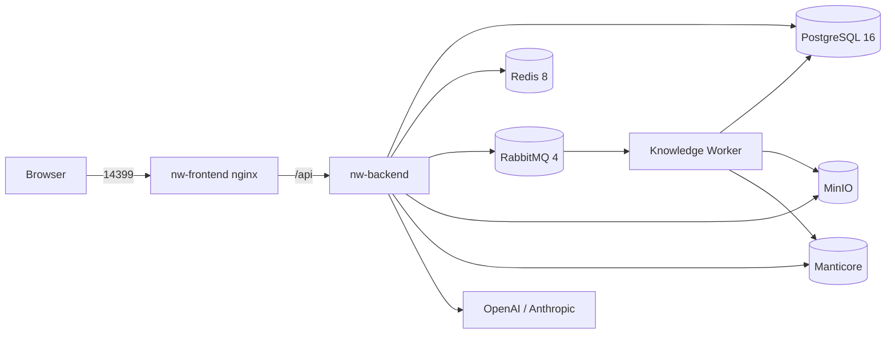

# 运维手册

本文面向部署与值班：服务拓扑、健康检查、常见故障、备份恢复、容量与发布流程。
部署细节见 `deploy.md`，安全边界见 `security.md`。

## 1. 服务拓扑



| 组件 | 容器 | 端口 | 作用 |
| --- | --- | --- | --- |
| 前端 | `nw-frontend` | 宿主 14399 → 容器 80 | SPA、`/api` 反代、`/healthz` |
| 后端 | `nw-backend` | 容器 8080 | HTTP API、SSE、索引 worker |
| PostgreSQL | `pgvector` | 5432 | 主数据、权限、任务、通知、日志 |
| Redis | `redis` | 6379 | 令牌黑名单 |
| RabbitMQ | `rabbitmq` | 5672 / 15672 | 知识库索引队列 |
| MinIO | `minio` | 9000 / 9001 | 知识库原文 |
| Manticore | `manticore` | 9308 / 9306 | 全文检索投影 |

## 2. 健康检查

| 端点 | 语义 | 期望 |
| --- | --- | --- |
| `GET /health` | 进程存活 | `200` + `{"status":"up"}` |
| `GET /ready` | 依赖就绪 | `200`；PG Ping 失败返回 503 |
| `GET /healthz`（前端） | nginx 存活 | 文本 `ok` |
| `GET /api/v1/system/status` | 依赖健康详情 | 需 `system:status:read` |

启动期行为：

- PG 连接失败直接退出；AutoMigrate 失败退出。
- Redis / RabbitMQ / MinIO / Manticore 失败只告警，服务降级启动。
- 索引 worker 消费中断每 5 秒重连。
- 用户表为空时创建引导管理员；菜单、角色、技能、配置幂等播种。

## 3. 日常巡检

每日：

- [ ] `podman ps` 确认 7 个容器 Up / healthy。
- [ ] `/health`、`/ready` 返回 200。
- [ ] 后端日志无连续 `unhandled_error`、`连接失败`。
- [ ] 任务中心无持续增长的 failed。
- [ ] 登录日志无异常 IP 批量失败。

每周：

- [ ] 检查磁盘：PG 数据、MinIO、Manticore、容器日志。
- [ ] 检查模型用量与失败率。
- [ ] 检查通知中心是否有未处理的任务失败。
- [ ] 抽查审计日志中的高危操作。

## 4. 常见故障

### 4.1 登录后立刻掉线

| 可能原因 | 排查 | 处理 |
| --- | --- | --- |
| JWT Secret 变更 | 后端日志 401 峰值 | 重新登录；如需固定密钥，恢复原值 |
| Redis 不可用 | `/ready`、后端日志 | 启动 Redis；令牌黑名单降级 |
| 账号被禁用 | 用户管理状态、登录日志 | 启用账号或重新分配 |

### 4.2 知识库文档一直 pending

1. 看任务中心：任务是否 queued / running / failed。
2. queued 不动：RabbitMQ 连接或 worker 未启动。
3. failed：看 `error_message`，常见为文档为空、格式不支持、MinIO 读取失败。
4. 修复后在任务中心点「重试」；重试会重置文档为 pending 并重新投递。
5. 仍失败：检查 Manticore 是否可用；索引失败不影响 PG 原文。

### 4.3 搜索无结果

1. 确认文档状态为 indexed。
2. 检查 Manticore `nw_chunks` 表是否存在。
3. 后端日志看 `Manticore 同步失败`；索引可重建。
4. 关键词过短或停用词可能导致无召回，换更具体词。

### 4.4 AI 调用失败

1. 模型供应商页测试连通性。
2. 检查 Base URL 是否符合协议：OpenAI 兼容需含 `/v1`；Anthropic 填根地址。
3. 检查密钥是否被轮换；密钥轮换会导致解密失败，需要重填。
4. 看用量分析失败数与延迟。
5. 失败不落助手消息；前端可重试。

### 4.5 前端 502 / 白屏

1. `podman logs nw-frontend` 看 nginx 上游解析。
2. Docker 使用 `backend:8080`；Podman 使用 `backend.dns.podman:8080`。
3. `NGINX_RESOLVER` 与 podman 网络网关一致（默认 10.89.0.1）。
4. 确认 `nw-backend` healthy。
5. 静态资源 404 时检查 dist 是否打进镜像。

### 4.6 端口 14399 不通

1. 容器端口映射：`podman port nw-frontend` 应为 `0.0.0.0:14399 -> 80/tcp`。
2. 云安全组放行 14399。
3. rootless podman 重建容器后陈旧 DNAT：`deploy.sh` 已清理；手工检查 `iptables -t nat -L CNI-HOSTPORT-DNAT`。
4. 本机 `curl http://127.0.0.1:14399/healthz`。

## 5. 备份与恢复

### 5.1 备份

| 数据 | 方式 | 频率 |
| --- | --- | --- |
| PostgreSQL | `pg_dump -Fc` | 每日 |
| MinIO | `mc mirror` 到备份桶 / 对象存储 | 每日 |
| Manticore | 只需备份配置；索引可从 PG 重建 | 变更时 |
| `.env` | 密码管理器 / 加密备份 | 变更时 |

```bash
# PostgreSQL
podman exec pgvector pg_dump -U postgres -Fc postgres > nw-$(date +%F).dump

# MinIO
mc mirror --overwrite local/novelworkbench backup/novelworkbench
```

### 5.2 恢复

1. 停止后端，避免写入。
2. `pg_restore` 恢复数据库。
3. `mc mirror` 恢复 MinIO 桶。
4. 启动后端；AutoMigrate 补齐新表。
5. 任务中心检查失败任务并按需重试。
6. 登录验证项目、章节、知识库与通知。

## 6. 容量与性能

| 资源 | 当前约束 | 扩容建议 |
| --- | --- | --- |
| 后端内存 | 编排 `mem_limit: 384m` | 500+ 并发或大文档索引时升到 768m |
| PG 连接 | `max_open_conns=20` | 多实例时降低单实例连接数 |
| Redis | `maxmemory 256mb`，`allkeys-lru` | 仅令牌黑名单，容量足够 |
| RabbitMQ | 单队列持久化 | 索引量大时增加 worker 实例 |
| Manticore | 单表 `nw_chunks` | 分片或按项目分区需改检索层 |
| 上传 | 默认 20MB | 按需调整 `NW_APP_UPLOAD_MAX_MB` |

性能要点：

- 列表接口全部分页，默认 20，上限 100。
- 用户角色批量查询防 N+1；任务中心批量回填文档名。
- 用量统计内存缓冲 5 秒批量落库。
- SSE 写超时为 0，心跳 15 秒；nginx 关闭缓冲。
- 权限逐请求查库，管理流量低可接受。

## 7. 发布流程

```bash
# 开发机
cd backend && CGO_ENABLED=0 GOOS=linux GOARCH=amd64 go build -o build/nw-server-linux-amd64 ./cmd/server
cd frontend && npm ci && npm run build

# 上传产物到云主机 /opt/novelworkbench
# 云主机
cd /opt/novelworkbench/deploy/podman
bash deploy.sh
```

发布检查：

- `deploy.sh` 健康检查使用 `NW_PUBLIC_PORT`（默认 14399）。
- 失败时看 `/var/log/novelworkbench-compose.log`，脚本会过滤含 password 的行。
- 回滚：切换镜像 tag 后 `podman-compose up -d --force-recreate`。
- 数据库迁移向前兼容；回滚旧二进制前确认新表不影响旧代码。

## 8. 日志与排障

| 日志 | 位置 | 用途 |
| --- | --- | --- |
| 后端结构化日志 | `podman logs nw-backend` | 请求、错误、降级、worker |
| 前端 nginx | `podman logs nw-frontend` | 上游解析、静态资源、代理错误 |
| 编排日志 | `/var/log/novelworkbench-compose.log` | 发布失败现场 |
| 审计日志 | 数据库 / 管理页 | 写操作追溯 |
| 登录日志 | 数据库 / 管理页 | 登录安全 |
| 任务中心 | 管理页 | 索引任务状态与失败原因 |

日志字段：`request_id` / `trace_id` 贯穿前后端；响应包络包含 `trace_id`，报错时提供给用户便于定位。

## 9. 值班速查

```bash
# 容器状态
podman ps --format '{{.Names}} | {{.Status}} | {{.Ports}}'

# 健康（后端不映射宿主端口，进容器探活）
curl -fsS http://127.0.0.1:14399/healthz
podman exec nw-backend wget -qO- http://127.0.0.1:8080/health
podman exec nw-backend wget -qO- http://127.0.0.1:8080/ready

# 后端最近日志
podman logs --tail 200 nw-backend

# 队列
podman exec rabbitmq rabbitmqctl list_queues name messages consumers

# Redis
podman exec redis redis-cli -a "$NW_REDIS_PASSWORD" ping

# PostgreSQL
podman exec pgvector psql -U postgres -c 'select count(*) from users;'

# Manticore
curl -sS 'http://127.0.0.1:9308/sql?mode=raw&query=SHOW+TABLES'
```
