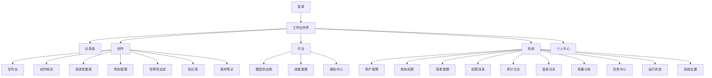

# 产品设计与功能地图

本文从产品视角说明 NovelWorkbench 服务谁、解决什么问题、信息如何组织、每个模块的边界与验收口径。
实现细节见 `features.md`，接口见 `api.md`，数据结构见 `database.md`。

## 1. 产品定位

NovelWorkbench 是面向长篇网文作者与创作团队的 **AI 小说工作台**：

- **写长篇，不是写短文**：以「项目 → 卷 → 章节」组织百万字级内容，目录、字数、快照、连续性都可追踪。
- **作者握笔，AI 起草**：模型只负责生成建议，任何 AI 产出都需要作者显式插入、修订与定稿。
- **事实可查，依据可解释**：人物、设定、时间线、伏笔与知识库构成权威事实层；AI 召回必须展示依据。
- **团队可管，数据自持**：账号由管理员分配，权限、菜单、审计、登录日志、用量与任务都可运营。

一句话：**给长篇小说的一张书桌，而不是一个聊天框。**

## 2. 目标用户

| 角色 | 核心诉求 | 系统对应能力 |
| --- | --- | --- |
| 长篇作者 | 目录清晰、正文不丢、AI 续写可控 | 写作台、章节快照、AI 对话、@引用、技能 |
| 设定党 / 世界观作者 | 人物关系、设定、时间线不打架 | 角色卡与关系图、世界观设定、连续性看板、章节摘要 |
| 资料型作者 | 旧稿、设定集、参考文档能参与创作 | 知识库上传与索引、关键词检索、可解释召回 |
| 创作团队负责人 | 账号分配、权限隔离、成本可见 | 用户 / 角色 / 菜单 / 权限、用量分析、审计与登录日志 |
| 平台管理员 | 服务稳定、任务可观测、故障可定位 | 运行状态、任务中心、应用配置、通知中心 |

## 3. 设计原则

1. **权威数据与 AI 建议分离**：AI 结果默认是候选，不自动写入项目事实。
2. **单一事实源**：权限码来自菜单表；项目归属来自 `project_ulid`；检索原文在 PG/MinIO，Manticore 只是可重建投影。
3. **可解释优先于黑盒**：不接向量模型，用关键词、结构化事实与 chat 重排，返回召回依据与检索追踪。
4. **显式操作**：保存、插入、回滚、删除、重试都由用户触发；后台任务只推进状态，不替用户改正文。
5. **稳定 > 体验 > 性能**：中间件降级不阻断写作；索引失败可重试；SSE 断连不落半成品。
6. **高内聚低耦合**：一个业务域一组 `domain/repo/service/api` 文件，AI 与基础设施是叶子能力层。

## 4. 信息架构

- 侧边栏由后端 `GET /menu/nav` 下发，分组、页面、图标、排序都可在「菜单管理」在线调整。
- 项目内页面在未选择项目时置灰；顶栏项目切换器保持当前功能页面。
- 个人中心与通知中心从顶栏头像 / 铃铛进入，不占用主导航层级。

## 5. 核心用户旅程

### 5.1 从零开始写一本书

1. 管理员创建账号并分配角色；用户首次登录看到欢迎通知。
2. 仪表盘新建项目，填写书名、题材、文风与简介。
3. 写作台新建卷与章节，CodeMirror 编辑正文，实时字数写入项目累计。
4. 在创作规划拆卷 / 幕 / 故事块 / 章节，写场景卡任务单。
5. 在角色、设定、知识库补齐事实；上传资料后异步建立索引。
6. 在工作台选中技能（如 `/continue`）发送写作指令，AI 流式返回。
7. 作者把满意的段落插入正文；不满意可停止生成，不污染历史。
8. 重要节点创建章节快照，后续可回滚。
9. 每天在仪表盘查看字数趋势与 AI 生成占比。

### 5.2 长篇一致性维护

1. 连续看板录入时序事实，逐条确认 / 取代 / 过期。
2. 伏笔钩子记录埋设章节与计划回收章节，状态从 open 到 resolved。
3. 章节摘要带内容哈希；正文变化后摘要标记 stale，避免过期证据进入 AI。
4. 角色关系图检查人物网络；世界观设定按分类与关键词检索。

### 5.3 资料检索与 AI 召回

1. 上传 txt / md / docx / pdf，选择项目并命名。
2. 原文写 MinIO，文档行 pending，任务中心出现 queued 任务。
3. RabbitMQ worker 提取文本、切片、写 PG 与 Manticore，任务变 success。
4. 通知中心收到「索引完成」；失败则收到失败原因并可到任务中心重试。
5. 知识库页搜索关键词，查看 RRF 融合、重排与检索追踪。
6. AI 对话中 @ 文档，回复末尾展示召回切片与来源。

### 5.4 平台运营

1. 管理员在用户管理创建账号、分配角色、重置密码。
2. 在角色权限按权限目录勾选；菜单表是权限唯一登记处。
3. 审计日志看写操作，登录日志看成功 / 失败 / 禁用尝试。
4. 用量分析看调用量、token、延迟与成功率。
5. 运行状态看 PG / Redis / RabbitMQ / MinIO / Manticore 与模型健康。
6. 任务中心处理失败索引；通知中心承载账号与任务事件。

## 6. 模块清单与验收口径

| 模块 | 用户可见能力 | 关键验收 |
| --- | --- | --- |
| 认证 | 登录、登出、当前用户 | 无注册入口；禁用账号旧令牌立即失效 |
| 个人中心 | 改邮箱 / 头像 / 备注、改密码 | 旧密码错误拒绝；改密后收到安全通知 |
| 通知中心 | 未读徽标、分类筛选、已读、删除 | 未读数与铃铛一致；只操作本人通知 |
| 用户管理 | 分页、创建、编辑、禁用、重置密码、删除 | 不能禁用 / 删除自己；邮箱登录名唯一 |
| 角色权限 | 角色 CRUD、权限勾选 | 内置角色不可删；权限改动下次请求生效 |
| 菜单管理 | 树形查看、增删改、排序、显隐 | 有下级不可删；权限码唯一；不成环 |
| 权限目录 | 按分组浏览权限码 | 与菜单表非空 perm_code 一一对应 |
| 审计日志 | 写操作分页检索 | POST 记录操作者、动作、目标、IP |
| 登录日志 | 成功 / 失败 / 禁用记录 | 失败不泄露账号是否存在；记录 IP/UA |
| 任务中心 | 状态统计、筛选、失败重试 | 只有 failed 可重试；重试重新入队 |
| 模型供应商 | 多供应商、双协议、加密密钥、连通测试 | 密钥只回显掩码；默认供应商唯一 |
| 技能管理 | 全局 / 项目技能、变量、参考资料 | 同编码项目技能覆盖全局；内置不可删 |
| 知识库 | 上传、索引、搜索、切片、预览 | 删除文档清理原文、切片与索引 |
| 写作台 | 目录树、正文编辑、快照、导出 | 字数增减与项目累计一致 |
| 创作规划 | 大纲树、场景卡 | 环检测；有子节点不可删 |
| 连续性 | 事实复核、伏笔状态、章节摘要 | AI 只产生候选；摘要可标 stale |
| 设定生态 | 角色卡、关系图、世界观、笔记 | 私人笔记不注入 AI 上下文 |
| 仪表盘 | 统计卡、趋势图、项目管理 | 趋势 30 天补零；项目分页 |
| 用量分析 | 调用量、token、延迟、成功率 | 区间非法自动纠正；缺日补零 |
| 运行状态 | 依赖健康、进程信息 | 依赖失败显示降级而非白屏 |

## 7. 非目标

- 不做公开注册、社交、评论、付费订阅。
- 不接入向量模型，不维护伪造向量；检索走关键词 + 结构化事实 + chat 重排。
- 不做多人实时协同编辑；当前以单作者项目隔离为主。
- 不做移动端原生 App；Web 响应式优先。

## 8. 迭代路线

| 阶段 | 目标 | 状态 |
| --- | --- | --- |
| P0 | 认证、项目 / 卷 / 章、AI 对话、知识库、模型供应商 | 已完成 |
| P1 | 菜单权限、技能资产、审计、用量、运行状态 | 已完成 |
| P2 | 个人中心、通知中心、登录日志、任务中心 | 已完成（本轮） |
| P3 | 项目模板、全局搜索、导出 docx / txt、写作目标 | 规划中 |
| P4 | 团队空间、审批流、BPMN 可视化编排 | 规划中 |

## 9. 体验标准

- 所有异步动作有 loading / 成功 / 失败反馈，禁止静默失败。
- 所有按钮具备默认、悬停、按下、禁用、加载五态。
- 列表具备加载态、空态、错误重试入口。
- 危险操作二次确认；不可逆删除在文案中说明影响范围。
- 页面切换有过渡，卡片有悬停微抬，通知有未读徽标。
- 中英双语键名同步；新增文案必须同时补齐两个语言包。
