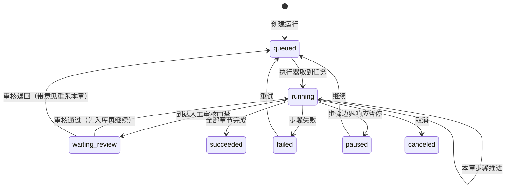

# 自动化工作流

本文说明工作流这一核心能力：它解决什么问题、有哪些模板与步骤类型、一次运行怎么推进、审核门禁如何工作，以及失败与恢复。

工作流是产品的**主路径**：作者准备素材与要求，选模板、填几个参数，AI 按步骤跑完，人只在审核点做「通过 / 退回」。目标是让不熟悉提示词工程的用户也能稳定产出可发布章节。

## 1. 为什么需要工作流

单轮对话解决的是「这一段怎么写」，工作流解决的是「这一批章节怎么稳定产出」。差别在三点：

| 维度 | 单轮对话 | 工作流 |
| --- | --- | --- |
| 执行者 | 人反复提问、复制、粘贴 | AI 连续执行，人只看结果 |
| 质量约束 | 靠作者在提示词里临时写 | 字数、体检分、复审结论作为硬门禁 |
| 可追溯 | 会话历史 | 每章每步一条记录（耗时、输出、指标） |
| 失败处理 | 人重说一遍 | 步骤失败可重试，整轮可从中断处继续 |

因此工作流**不是**把提示词堆得更长，而是把「提示词 + 上下文 + 确定性校验 + 人工审核」编排成一条有状态的任务。

## 2. 模板

模板决定「一次任务跑哪些步骤」。内置三条，覆盖最常见的重复劳动：

| 模板编码 | 名称 | 适用场景 | 步骤 |
| --- | --- | --- | --- |
| `chapter_draft` | 逐章成稿 | 空白章节从零写起 | 写正文 → 体检 → 按问题修订 → AI 复审 → 人工审核 → 定稿入库 → 生成摘要 |
| `chapter_polish` | 存量打磨 | 已有草稿润色提升 | 润色改写 → 体检 → 按问题修订 → 人工审核 → 定稿入库 |
| `chapter_deai` | 批量去 AI 味 | 入库前批量清洗 | 去 AI 味改写 → 体检 → 人工抽检 → 定稿入库 |

模板落库在 `workflow_templates`，`step_schema_json` 存步骤数组。启动时按 `template_code` 同步：编码不存在则插入，存在则用代码里的定义覆盖名称、说明与步骤——**模板结构由代码定义**，避免数据库里的历史模板与执行引擎不匹配。

## 3. 步骤类型

| 编码 | 名称 | 执行者 | 作用 | 是否消耗模型 |
| --- | --- | --- | --- | --- |
| `draft` | 出稿 | AI | 取提示词 + 上下文，生成正文写入候选正文 | ✅ |
| `check` | 体检 | 服务端 | 对候选正文跑确定性门禁（`ai/check.Analyze`） | — |
| `revise` | 修订 | AI | 体检不达标时按问题重写；达标则跳过 | ✅ |
| `review` | 复审 | AI | 输出严格 JSON 结论（pass / revise / block + 分级问题） | ✅ |
| `human_review` | 人工审核 | 人 | 阻塞运行，等待作者通过或退回 | — |
| `apply` | 入库 | 服务端 | 候选正文写回章节（覆盖前自动留快照） | — |
| `summary` | 摘要 | AI | 生成章节摘要写入连续性账本 | ✅ |

关键设计：

- **候选正文与章节正文分离**。AI 产出先落在运行的 `candidate_text`，只有 `apply` 步骤或人工审核通过才写回章节。这样「AI 写坏了」不会污染作品数据。
- **体检是确定性的**。同一段正文永远得到同一个分数，作者可以自己验证门禁是否合理，不必相信模型的主观判断。
- **修订按需触发**。`skip_when_pass=true` 的修订步骤在体检达标时记为「跳过」，不浪费模型调用。
- **起草类步骤只收正文**。出稿与修订步骤用专门的系统提示词（`workflowBodyOnlySystemPrompt`）要求「只输出可直接入库的正文，不要分析、清单、改动说明」，因为这段输出会被原样写进章节。提示词资产本身也受一条回归测试约束（`TestWorkflowBodyOnlyPromptChain`）：会被写入正文的提示词不得要求先列清单。

## 4. 一次运行的推进

推进细节：

1. **创建**：`POST /workflow/run/create` 按模板用途解析目标章节（见下），收敛参数，落库运行与章节列表，`auto_start_flag=true` 时立即调度。

   | 模板 | 未显式指定章节时取哪些章 | 都没有时 |
   | --- | --- | --- |
   | `chapter_draft` | 项目内空白章 | 按 `new_chapter_count` 新建（0 则报错说明） |
   | `chapter_polish` / `chapter_deai` | 项目内已有正文的章节 | 报错说明「本模板处理已有正文」 |

   这条区分不能省：让去 AI 味默认指向空白章会空跑一遍，让逐章成稿默认指向已有正文会覆盖作者写好的内容。
2. **逐章执行**：`runChapter` 从 `current_step_index` 开始跑本章剩余步骤，每完成一步更新 `current_step_index`，全部步骤完成后 `current_index + 1`。
3. **审核门禁**：到达 `human_review` 步骤时，记录一条「等待审核」步骤并把运行置为 `waiting_review`，执行器退出（不占用 goroutine）。
4. **审核通过**：`POST /workflow/run/approve` 先把候选正文写回章节（含快照与字数账目），记录审核步骤，然后从门禁的下一步继续。
5. **审核退回**：`POST /workflow/run/reject` 记录退回步骤，清空候选正文与步骤下标，把退回意见写进 `feedback_text`，下一轮起草会把意见注入提示词。
6. **完成**：所有章节跑完后置 `succeeded`，发出站内通知。

## 5. 参数

| 参数 | 默认 | 范围 | 作用 |
| --- | --- | --- | --- |
| `target_word_count` | 2500 | 300-20000 | 每章目标字数，写进起草提示词的 `{{user_input}}` |
| `gate_score` | 80 | 60-100 | 体检通过分；低于此分的章节会触发修订步骤 |
| `review_gate_flag` | true | — | 是否保留人工审核门禁；关闭后 AI 直通入库 |
| `new_chapter_count` | 0 | 0-50 | 无可用章节时新建几章（挂到最后一卷） |
| `chapter_ulid_list` | 空 | — | 显式指定目标章节，优先于空白章探测 |
| `extra_requirement_text` | 空 | ≤1000 字 | 作者补充要求，拼进起草提示词 |
| `model_ulid` | 空 | — | 指定模型；空则用发起人的默认模型 |
| `draft_prompt_code` / `revise_prompt_code` / `review_prompt_code` | 模板默认 | — | 覆盖步骤使用的提示词 |

参数在创建时收敛并固化到 `params_json`，执行期只读——运行中途改参数会让已完成章节与后续章节标准不一致。

## 6. 上下文装配

每一步 AI 调用都自带上下文，作者不需要手工 @ 引用：

| 来源 | 内容 | 上限 |
| --- | --- | --- |
| 项目简介与文风 | `projects.synopsis_text` / `style_text` | 全量 |
| 本章信息 | 章节序号、章节名、章节梗概 | 全量 |
| 前情摘要 | 其他章节的 `chapter_summaries`（最多 5 条） | 每条 300 字 |
| 待回收伏笔 | 未回收的 `foreshadow_hooks`（最多 5 条） | 每条 120 字 |
| 当前正文 | 候选正文，无候选时用库内正文 | 6000 字（保留首尾） |

正文收敛刻意宽松：宁可上下文长，也不把成段素材压成摘要句。超出 6000 字时保留首 60% 与尾 40%，中间标注省略字数。

## 7. 失败与恢复

| 场景 | 行为 |
| --- | --- |
| 模型调用失败 | 步骤记 `failed`，运行记 `failed`，错误写入 `error_message`，发出站内通知；`POST /workflow/run/retry` 从本章第一步重跑 |
| 章节被删除 | 运行失败并说明「目标章节不存在」 |
| 提示词被停用 | 该步失败并提示编码，作者到提示词库启用后重试 |
| 服务重启 | 启动时把 `running` 退回 `queued` 并重新调度（`RecoverInterrupted`），任务不会永远卡在 running |
| 用户取消 | 步骤边界检查 `cancel_requested_flag`，置 `canceled`；已入库章节保留 |
| 用户暂停 | 步骤边界检查 `pause_requested_flag`，置 `paused`；`resume` 从当前步骤继续 |
| 单步超时 | 单个 AI 步骤 10 分钟；运行总时长 = 60 分钟 + 每章 20 分钟（推理模型单章可能跑十几分钟） |
| 审核后卡住 | 审核通过会把步骤下标前移并置回 `queued`，否则恢复执行会重新卡在同一个门禁上 |

同一运行不会并发执行：执行器用进程内 `activeSet` 去重，重复的 `start` 调用直接忽略。

## 8. 可观测性

每次运行有一条 `trace_id`（复用创建请求的链路 ID），每个步骤落一行 `workflow_steps`，**同时写一条审计**（`action_code=workflow/step/<类型>`，链路 ID 与运行一致）——步骤是后台链路，不经过 HTTP 中间件，必须显式留痕，否则审计时间线里只有一次创建请求。

- 步骤类型、名称、状态、使用的提示词编码
- 输出文本（体检清单、复审结论、摘要正文）
- 量化指标（`metric_json`：分数、结论、字数）
- 耗时与失败原因

前端「运行详情」抽屉把这些渲染成时间线：当前章的步骤按顺序排列，每步显示状态标签、耗时与输出摘要；待审核时上方直接展示候选正文与通过 / 退回按钮。

## 9. 与提示词、工具的关系

- **提示词**只负责「这一单活怎么干」。内置只剩 3 个域 7 条任务（写正文 2 条、修问题 2 条、做规划 3 条），作者能一眼看懂每个 `/命令` 干什么。复杂的多步编排交给工作流。
- **工具**（章节体检、去 AI 味扫描等）仍是对话期由模型自行调用的确定性能力；工作流里的体检步骤直接调用同一个 `ai/check` 包，不经过模型，因此两边判定永远一致。
- 工作流不引入 MCP、不引入外部编排引擎：步骤定义是代码里的数组，执行器是一个 goroutine，状态在 PostgreSQL 三张表里。

## 10. 接口一览

| 方法 | 路径 | 说明 |
| --- | --- | --- |
| GET | `/workflow/template/list` | 可用模板（含步骤定义） |
| POST | `/workflow/run/create` | 创建运行（可立即执行） |
| POST | `/workflow/run/list` | 运行分页列表 |
| GET | `/workflow/run/detail/{RunULID}` | 运行详情（步骤时间线 + 当前章正文） |
| GET | `/workflow/run/stats` | 状态概览 |
| POST | `/workflow/run/approve` | 审核通过并入库 |
| POST | `/workflow/run/reject` | 审核退回（带意见重跑） |
| POST | `/workflow/run/pause` | 暂停 |
| POST | `/workflow/run/resume` | 继续 |
| POST | `/workflow/run/cancel` | 取消 |
| POST | `/workflow/run/retry` | 重试失败运行 |

所有运行类接口都校验 `run.user_ulid` 归属；创建运行校验项目归属。模板列表对登录用户开放，不额外要求管理权限。
